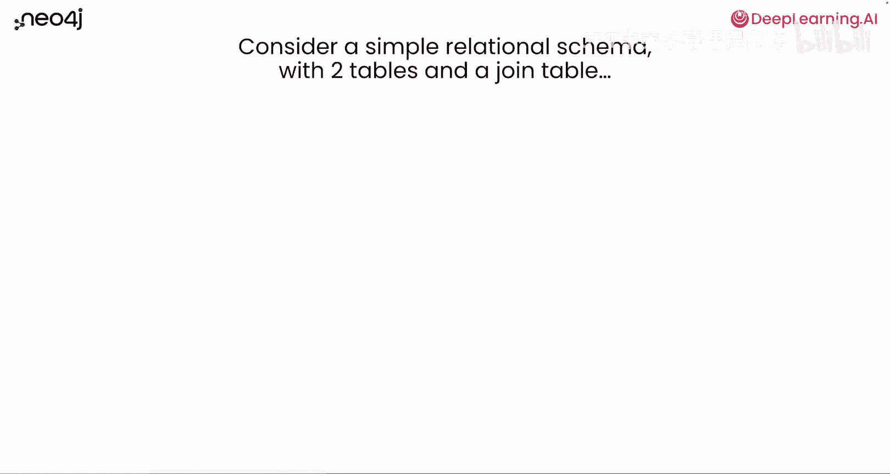
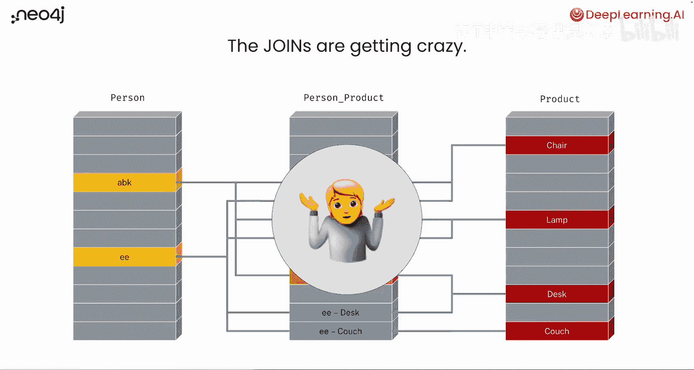
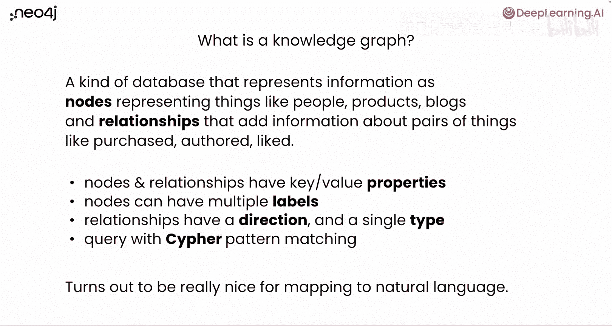
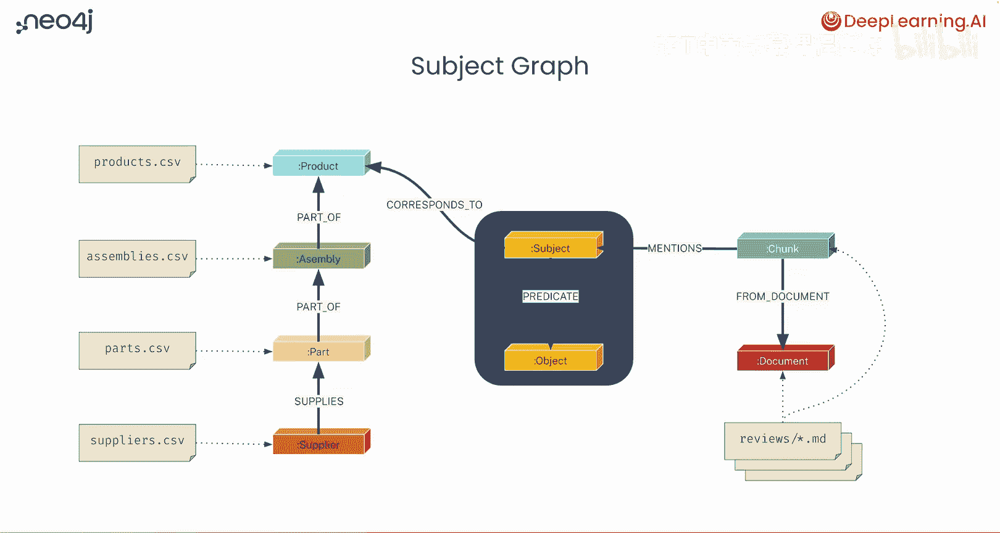
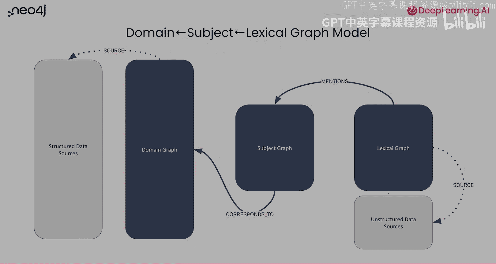

# 吴恩达《智能体驱动的知识图谱构建｜Agentic Knowledge Graph Construction》Claude-4-s翻译 - P2：2.what-is-a-knowledge-graph.zh_en - GPT中英字幕课程资源 - BV1AShCzoENH

In this lesson， we'll go through what a knowledge graph means and how they help represent and retrieve relationships from your data。

 You'll then explore the data set you'll work on to build a knowledge graph。 Let's dive in。

So what is a knowledge graph？We're going to take a step back for a moment。

And reflect on relational databases and what relational schema looks like。

 We all probably are familiar with some scenario like this。

 where there will be some table on the left and some table on the right。 in this table in the middle。

 that is the join table that allows for multiple connections between the persons and the products in this particular example。

So let's think about these two tables with the join table。If you ask a question like。

 what products has this person purchased？Youd first start with the person table and select this person here it's identified by A B K。

And of course， you do a join over to the person product table。

 and you'd see that the person product table has a join between the A B K and some chair， A B。

 a lamp， A B K and a desk。 Fantastic。 One word join across from the person to the person product to the product table。

 now you've got a complete answer where from A B K。

 you can see that heres the products that A B K is purchased。 This chair lamp in a desk。

 and you can get the details about those purchases。😊，What if you extended that question。

 And you asked who else bought products that A B K bought。Well。

 you start with the same joins going from A B K to the products。

 and then you would join back to the person product table。 and from there back to the person table。

 And now you would get this person E E， who has bought some products that A B K also bought。

 But notice that E E has also bought one extra product。 That's interesting。

So we could probably extend this one more step and ask， well。

 what product should we recommend that A B K buy next， Now。

 this is kind of the basics of doing a recommendation query。

If you've got some purchase pattern from ABK， that matches a purchase pattern from some other person or other group of people。

The thing you want to recommend to A B K is what that other group of people bought that A B K has not。

 So the same joins apply from A B K through to the products back to the other people that have bought those products。

 There's too many joins。 It's getting a little confusing。

Theres actually a nicer way to actually think about this and to query this。

 Let's turn this into a graph。

The first step is to just drop all the records that don't matter。

 all those gray records that weren't part of the original query。

 let's put those aside for the moment and focus on the records that we know about that are part of the data set so far that matters for this query about recommending something to ABK。

Get rid of all the joint table records in the middle。 Turn those into arrows， connecting A B。

 K directly over to the products that he's purchased and the same thing for E E over to the products that they have purchased。

 And now I'll just rearrange the records a little bit。 So you've got A B K on one side。

 E E on the other side。And now it looks much nicer， it's much easier to understand what's going on。

 both ABK and EE are connected to these products in the middle。

 but then also this person E E is connected to another product that has no connection to ABK。

You can start to turn this into a query by rephrasing it as a pattern match starting with ABK on the left side。

 you can describe a query in a query language called cipher， where it looks a little bit like SQL。

 If SQL has pattern matching abilities。 So here we're going to describe a pattern that describes the data records that you want to find we're going to match from the data record that we're going to call ABK that has a label of person and that has a property with the name key where the value of it is ABK。

 So that's in round parentheses， we know that that's a node in graph terms。

And then we kind of have this right facing arrow with colon purchased in there。

 That's a relationship type that is the purchased。 So match a pattern where A B K purchased over to some other parentheses。

 We're going to call A B K products。 That's going be a pattern match from A B K to the products that A B K matched。

 We' can return those directly。 and that's going to be the products in the middle there。

We can extend that pattern to include the other people who bought those products。

 Since we went from A B K to the products that A B K purchased。

 we can also have relationships going in to those products and say， okay。

 there are some other people who bought those products。

 This pattern will find all the products that people have in common with A B K。

 we can extend it a little bit more to ask that recommendation question problem。

 where instead of saying we just want to find these other products。

 the other products have a unique property where there are actually something that A B K does not have。

 So we have the same pattern match from A B K to some products to some other people and then extend that to other products and now we include a predicate saying we actually want a negative pattern to be true that A B K has not purchased those other products。

 So where not A B K purchased those other products。

 So down there on the bottom that dotted line from A B K to the couch。 We want that to not exist。

 Now， we're describing a pattern that both has records that should exist。

Something that should not exist， the other products now will be reduced to only products that ABK is not purchased。

 that's what we're going to use as a recommendation that he buy。So what really is a knowledge graph？

It's a kind of database that represents information as nodes， representing things like people。

 products， blogs， whatever you might want to have is records in a database。

 But then also relationships that aren't simply convention of using a join table。

 but that our first class citizen， they're actually data records inside of the database that have a semantic meaning。

 they actually represent how two nodes you're connected。

 and they add information about those two nodes。 So both the nodes and relationshipss have key value properties。

 They have multiple labels on nodes。 Reships always have a direction and they have a single type。

 and the query language that you use who we doing pattern matching is called cipher。

 And it turns out that this is super nice for mapping to natural language and really convenient for working with Geni and Lms because Lms are really good at natural language。

If we go back for a moment here。

And just look at that query at the top。 You can read that out loud and make sense of it。 Mat A B K。

 who is a person whose name is A B K， that bought some products that some other people have bought。

 They' have bought some other products where A B K has not purchased those other products。

The other thing that's interesting about knowledge graphs is that they're really convened for combining unstructured data along with that structured data。

 whether that was some products that we have or people， whatever it might be in structured data。

 you can then add any kind of chunked text do a vector representation of that store that in the database as well and combine both vector similarity search and pattern matching together for all kinds of powerful access patterns。

So for example， if you want to do root cause analysis。

And you imagine that you're a furniture manufacturer looking to understand customer complaints about your products。

 So you turn to your team of experts， know， data engineering， data analysis team and say， hey。

 could you do some root cause analysis who I've heard a lot of complaints out on the Internet。

 about our products， Let's try to figure out what's going on。

So the root cause analysis would include questions like which products have the most issues。

 And then based on those products， well， what part of the product is the actual problem and then you might want to ask a question like is there a problem with the part itself。

 perhaps there are other things that are going on， people just don't like the product。

 But if you can take corrective measures it would be because there's something either in the manufacturing process。

 What you're looking for here is for a corrective measures that you can take do root cause analysis for something you can improve So if it's a design problem you could turn that over to the design team。

 they could take a look at what people's complaints are about。

 But if it's a manufacturing problem or a problem with a part somewhere。

 you can do some analysis on that， find the part problem and either swap out the part for a new one or figure out how to improve the process itself。

So as a data engineer， if you were handed this task， you would start with the usual thing。

 ask some clarifying questions。Why are we really doing this。

 You want to be able to understand that there's possible manufacturing problems in the supply chain。

 Cool， Okay， second question is， if that's what we want to find out what data is available that we can do this analysis with。

So it turns out in this scenario， we've got to build materials。

 some CSP files that connect the product all the way to the suppliers from those products。

 Maybe it came from some spreadsheets， maybe it came from some relational database that isn't really suited for doing analysis that's okay too。

 and you also have some data from user reviews that you scraped from some websites on the Internet。

 You want to be able to combine those into one data set that you can then do some analysis on。

 So to do that analysis， you're going to build a knowledge graph that connects all the data。

So here's what the target data model is going to look like on the left in the sort of beige boxes over there。

 you see the C files that are available。 each one of those is going to turn into nodes in the graph or relationships in the graph。

That's going to be the kind of what we're going to call the domain graph on the right end side on the bottom there。

 youll also see some beige boxes that represents markeddown files。

 Those markeddown files are going to be chunked up。

 They're going to create some documents inside of the graph as well。

 And then all of this is going to get connected。 We'll look at some of the details as we actually go through doing the agent descriptions themselves。

 But what I want to call out here for you right now。 is that these are really very connected。

 but also very distinct parts of the graph。 We've got the data sources。

 The structured data on the one side there。 that's going to turn into what we call the domain graph。

 So that's the structured data that we know that we can query with pattern matching。

On the other side， the unstructured data sources are not going to be queed in the same way。

 and they're not going to be imported in the same way either。

 So they're going to turn into what we call the lexical graph。

 which represents the original textual data， plus also the structure around that textual data to connect those two pieces。

 the unstructured data and the structured data。 We've got this part in the middle that we're going to call the subject graph。

 The subject graph is going to be subjects or entities that we pull out of the chunks。

 So the chunks will have some text。 that will be talking about products。

 maybe they'll be user names and things。 all of those things might be entities。

 We're going to find those call those things subjects。

 and those subjects are going to be connected to objects。 So the subjects talk about something。

 So some user， let's say that it's me user A B K loves this table。

 And so therell be a subject predicate object in the subject graph that talks about A B K loving some table。

 That also， because A B K loves the table。 The table can correspond with the product that we have in the structured data。

If ABK mentioned is a table， and the table is a product that exists in the structured data。

 we can then connect the entities that we've extracted from the text all the way over to the structured data that we've got in from the CSV files。

Don't worry， we can do this step by step on a high level， This is what you're going to end up with。

 a graph with subgraphs within it， a domain graph， a subject graph， and le lexical graph。

