# 吴恩达《智能体驱动的知识图谱构建｜Agentic Knowledge Graph Construction》Claude-4-s翻译 - P3：3.architecture-of-the-multi-agent-system.zh_en - GPT中英字幕课程资源 - BV1AShCzoENH

Now that you have an idea about the goal of the knowledge graph you'll build。

 let's go through the details of the multi agent system you'll design to first find the graph model and then construct the graph。

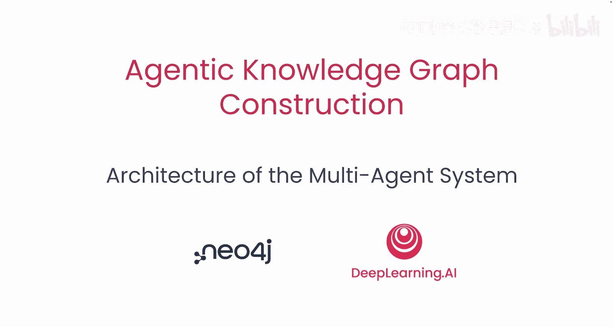

For lots of definitions for an agent。 Here's my definition。

 I like to think about agents from an engineering perspective。 And for me。

 it's a fancy new kind of control flow operator。 Basically， you have a loop。 And inside of the loop。

 there's a call to an LM that then figures out what it wants to do。

 And then based on what it wants to do， passes that back over to the computer side to the client side。

 and really runs into a switch statement that performs potential actions。 So in this loop。

 this is really a intelligent behavior that's happening because of the LM call。

 But the execution of that intelligent behavior is still happening through code。

What's great about this architecture， of course， is that agents are really powerful because you've got an LM there to do some reasoning and call out to tools that can do anything you can do with code。

 and it's adaptive because the LM is given memory， so it can learn what's happened either through the conversation or to things that you've saved into memory that are important for it to decide future outcomes。

 And it's pretty easy to get started because you're really just doing natural language descriptions through the prompts about what the agent should do。

 But all this power and ease comes with some downsides。

 It can be slow working with an agent because the calls out to a remote LM is a bit expensive and slow。

 It's also nondeterministic。 Well， because L M is are nondeterministic。 And， you know。

 token cost over time can really add up quite a lot。

 So if you're running an agent over time in production for thousands and thousands of calls。

 The token cost gets really expensive really quickly。😊。

But one of the advantages of moving to a multi agent system is that you can actually prove some of the downsides here。

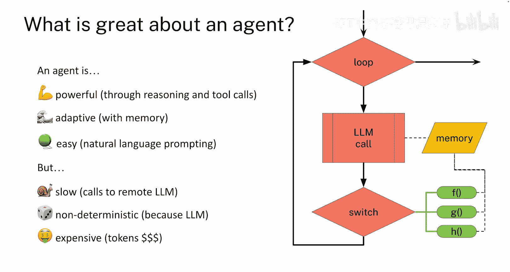

So what is exactly a multiag system， It is， of course。

 just a system where you have multiple agents working collaboratively on a single goal。

 the agents typically are arrangement it to a kind of a hierarchy where you have a top level agent that manages the overall flown and then as many sub level agents as you'd like to that have either different phases of the work or very specific tasks that they're performing。

The agents interact in a couple different ways。 There is a main conversational thread that's basically happening with the user where the user might have some message that they kick off the work with。

 Then each of the agents can decide， is this work that I can do or something that somebody else should do。

 So can of delegate this to a different agent。 So you can see in this illustration here that the root agent is able to delegate to either agent A or agent B。

Internally， agent A and agent B can do some work using the tools that they've been given。

 One of the tools in agent B is unique。 This P agent here。

 This P function is actually going to be an agent itself， but being called as if it were a tool。

 So there's two ways for tools interact。 Either agents delegating to each other or an agent that's behtting as a tool being called by another agent。

 And along the way， you've got specific checkpoints with a user that are possible whenever you have any of these transitions。

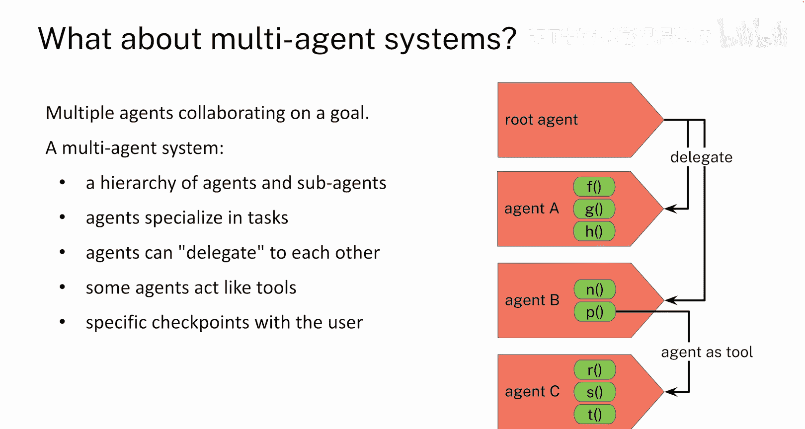

So what is the multi agent system that you'll build？You'll build parts of a knowledge graph agent。

 focusing on the subagent that perform knowledge graph construction。

You'll learn the basics of building an agent using Google's A K。

 You'll learn what memory is and how to use it for recording critical information。

 You'll define some tools。 And， of course， all of this will converge from open ended conversation to executable code。

 This beautiful diagram are all the agents and the flow of agents and their interactions。

 Let's walk through this a little bit at a time。😊。

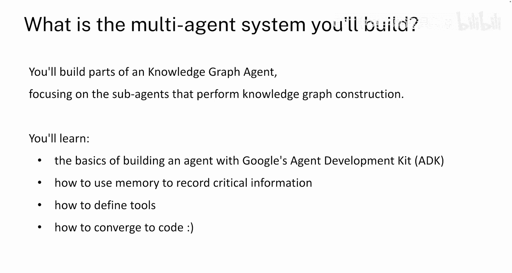

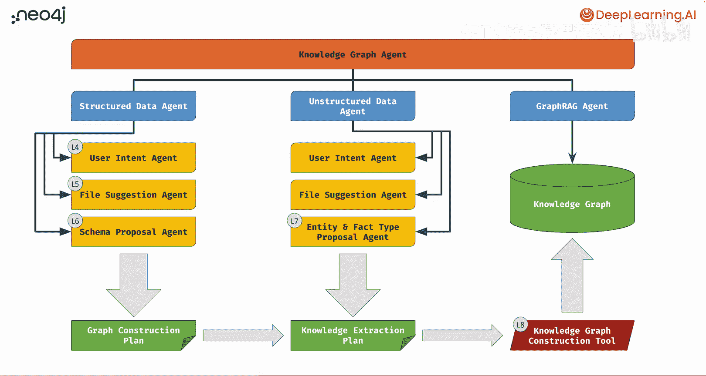

At the top level， this is the agent that manages the overall introduction of the user to what's possible。

 what the agent's responsibility is and helping the user understand what's the workflow that's possible here from the knowledge graph construction all the way to doing graph retrieval。

 So this is really a conversational agent that itself is not going to do any work。

 But it's going to guide the user through the different phases of work that are going to occur。

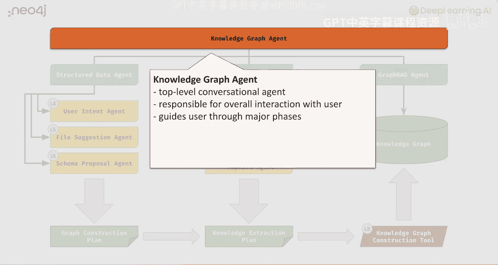

It's this next level of agents down that are really going to manage the individual workflows。

 And there are three major workflows。 If really on the left， we've got two workflows。

 the structured data agent and the unstructured data agent。

 These are responsible for taking the user through the idea of like what they might want to do all the way to constructing a graph。

 And then if those have done their job， This third agent。

 the graph rag agent on the right side is responsible for helping the user actually answer questions using that graph。

 But the structured data agent and the unstructured data agent are workflow agent。

 They perform their work by interacting with the user and helping them go through the steps of what needs to happen from the idea of what they want to do all the way to describing the graph。

 and they do that by delegating to subagent that specialize in each phase of the workflow。

 You'll see some replication here that both the structured unstructured data have some agents that are in common。

 and I'll touch on those as we get into the one level down。

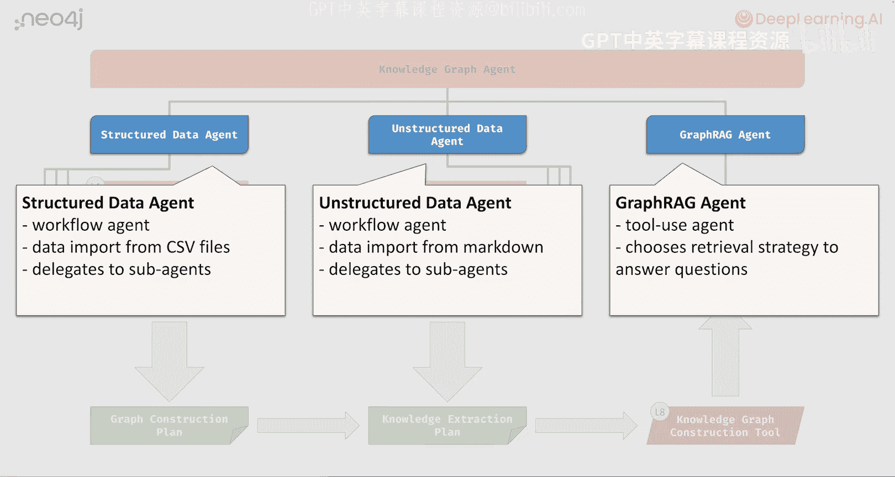

Okay so here's the subagians that are actually doing the workflow for structured data。

 let's walk through these one at a time and also what's important to note here is the output of actually these Asians doing their work If you think about yourself as being a data engineer that's been given the task of actually performing this work each of these agentss are kind of what you would do yourself you're engaging in the work。

This first one， the user intent agent， is what you would do when you've been asked to do some task for data analysis and whoever asked that you respond to with some questions。

 Hey， could you clarify what you want me to do。Give me， what are the goals you're after。

 what kind of analysis do you want me to perform。 And it's really important to nail that down upfront。

 This is the kind of the requirements or the direction overall of what the job is。

 So this user intent agent， even though it's collaborative and kind of conversational。

 The output of this is really important。 We're capturing what is the user goal and what are they trying to get out of this work。

 based on that user goal then this next agent down the file suggestion agent。

 It's going to take into account what has been established to the user intent agent as the direction and the goal of what the work is。

 And then it's going to look at the data files that are available and try to find from those data files。

 which ones are useful for actually achieving that goal。

 there might be more files that are available， there might be even multiple data sources that are available。

 Here we're simplifying it down to as making suggestions for files that are available on disk。

 The output of that ends up being a list of suggested files that have been approved by the user。

 And then that gets input into the next agent， which is the schema proposal agent。

Schema proposal agent is actually a pair of agents formed in a critic pattern where one of the agents is responsible for making a proposal about what the schema could look like。

 And the next one is going to be a critic saying， well。

 maybe that's not quite so right to think about changing in this way or that way。

 We'll look at the details in the later lesson。 But the idea here is that this pairing of agents internally will loop through what's possible。

 selfcriize itself and the outcome of that should be a good graph schema that uses the files that were approved from the previous agent and also in compliance with user goals that were set by the first agent。

 producing a graph schema that can answer questions that are useful for the user。

 So the output of all of that we're calling a graph construction plan。 It's not a graph itself。

 but the description about how to construct that graph。 The second work， though， in the middle。

 The first two parts of that work， though， or the exact same as the structured data work， though。

 here in the middle。 we're dealing with unstructured data but it still begins with understanding what is the user intent for in bringing in the unstructured data。

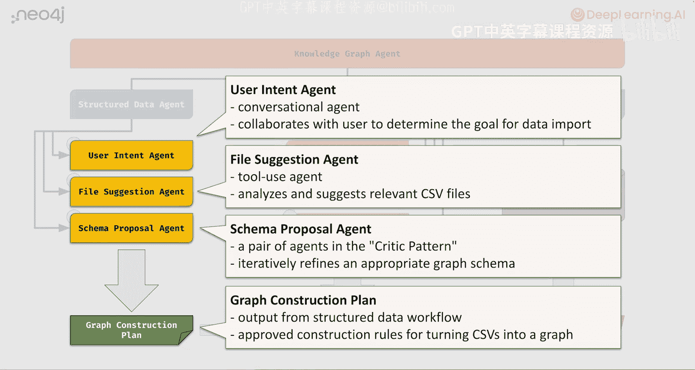

Here that's some markdown files。 And then okay， if you understand why the user wants to bring in some markdown files。

 you can identify which files are relevant。 again， the file suggestion agent would do that。

 similar behavior to the structured data But this third step is different And the third step rather than designing a schema based on some Cv files All you have is text And from the text。

 how do you create a graph。 Well， the approach here is that we're gonna to have two specialized agents that look through the text and identify what are called entities So people。

 places and things that occur within the text。 And also for those entities that identifies what facts are describing those entities within the text。

 So let's say that it was I was in the text and I had some reviews of local coffee shops it might reveal that ABk really loves to soar a coffee from fills。

 because who doesn't So those are facts that could be extracted from the text。

 the goal of this agent is actually to find out what kinds of facts can be。

Extracted and not do the extraction， but simply describe what's possible and so that we're going to be calling a knowledge extraction plan。

 the knowledge extraction plan paired with the graph construction plan from the structured data together give all the rules that we need using the graph construction plan and the graph extraction plan。

 this red box down in the corner then is just a single tool that is multiple tools internally that actually can take those plans and do the extraction itself and do the construction itselfll loop over all the construction rules to create a domain graph。

 loop over all the markdown files， chunk them up， do the vector embedding of those and then also extract entities and the facts and then connect those to the structured data。

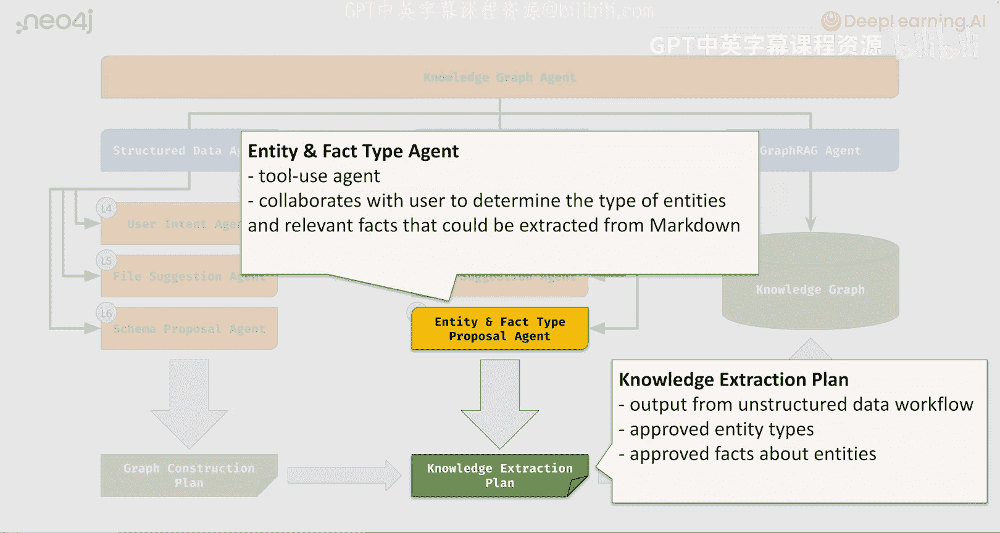

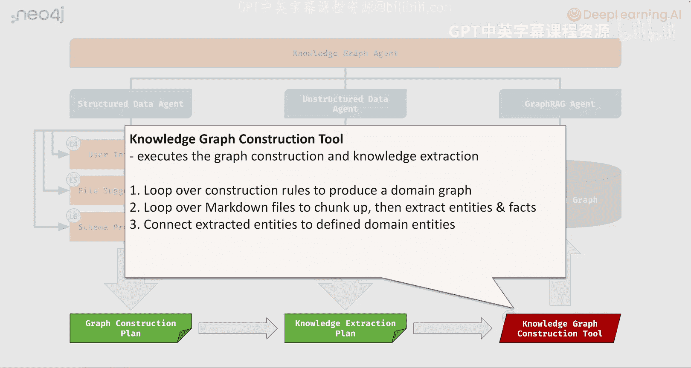

In lessons 4 through 8， you'll go through the entire workflow for structured data from user intent。

 file suggestions to the schema proposal。 Then we'll skip over to the unstructured data。

 just the entity， in fact， typed proposal。 and then finally。

 we'll look at the particular tool in lesson 8 that does the graph construction itself does all the hard work that the previous agents really did the reasoning about what the work should be。

In the next lesson， we'll actually get into doing some coding， building your first agent。

 We're going to be using Google's ADK。 If you're already familiar with Google ADK。

 you could skip over that lesson and move on to actually building the multiageent system。

 but I think it's a really good overview and also it helps you understand how I think about it and how I've implemented it in this particular multiagent system。

 So it's nice to walk through。 I'll see you there。😊。

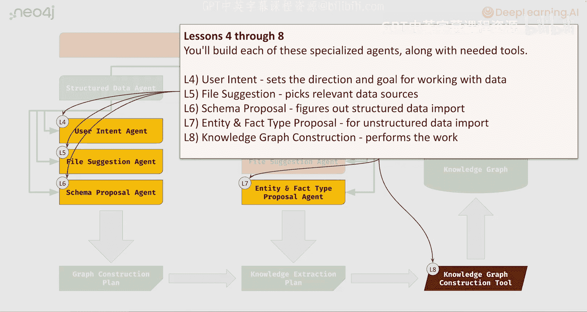