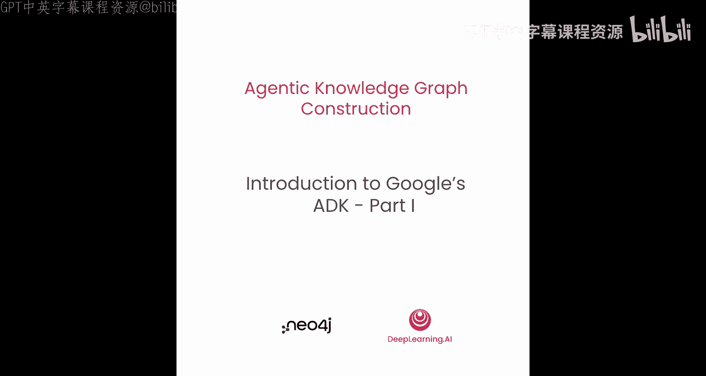
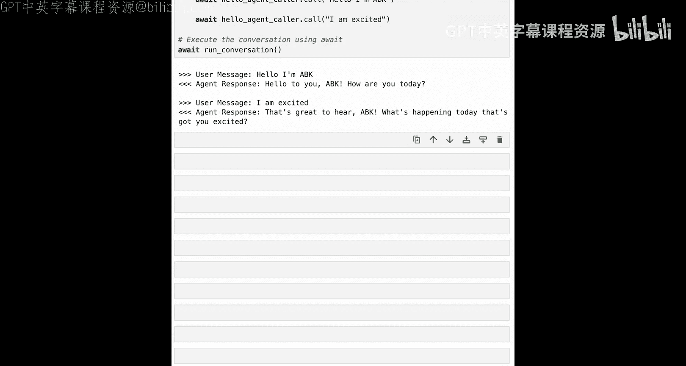

# 吴恩达《智能体驱动的知识图谱构建｜Agentic Knowledge Graph Construction》Claude-4-s翻译 - P4：4.introduction-to-googles-adk---part-i.zh_en - GPT中英字幕课程资源 - BV1AShCzoENH

To build the multi agent system， you'll use Google's AD K or agent development kit。

 which is a framework for developing agents。 In this lesson。

 you'll learn how to create and run one agent， as well as a team of agents。 All right， let's go。

In this lesson， you'll familiarize yourself with Google's agent development kit。

 and you'll use that for building agents throughout this multi agent system。 In this lesson。

 you'll learn how to create and run an agent using A K and the imports that we're doing here。

 Of course， the standard O S。 and then a bunch of stuff from Google80 K itself。

 We're going to import this agent， which is going to be the key thing for actually describing what an agent is for interacting with an LL M。

 we're going to be using the light LL M libraries。 We' going to import that here。

 And this is a little raper for letting Google 80 K talk to open AI。

And then we're also going to need some memory for the agent， for the memory。

 we're going to using the memory session service。 And then finally。

 the agent also needs a way to run。 So we're going to import a runner。

 We also have some typing stuff here that's not really so important for how all this works。

 Let's go ahead and make sure that all that imports Gpe。 all the libraries are imported。

 So the next part。 then， just to start defining the models that we're going to use。

We're going to be using open AI for this course so let's go ahead and import we'll define what the the model is going to be itself is Open AI is G 40。

 again， we're going to be using light LLM for actually reaching out to the open AI API。

And we're just going to go ahead and try a sample execution of completing a chat with that。

 So if you look at the chat here， you'll notice that we're just setting up a message that we're going to send to open AI and we're going to ask it the question。

Are you ready。So if that all work successfully， we'll get a good message from Open AI letting us know that this works。

Looking at the model of response， there's a lot of information here。

 but the key part is that the response includes a message from Open AI saying yes， I'm ready。

 How can I assist you today。 Open AI is all set to go。 We're also using Ne4j today。

 So we're going to import a helper library that combines Ne4j with Google AK in a nice way。

And that library is something we can take a look at to see the details of what's going on。

 The import that we're going to use is just from Ne4j4 ADK， importm the G D B library。

 Let's take a look at those details。Okay now we're inside of Ne4j for ADK and you can see it starts off pretty simply。

 we import some stuff from the operating system。 we， of course load up the environment。

 and then from Ne4j the Python package， we load up the graph database and you also get over result class definition。

 Now a bunch of these functions that are here are just really nice for just wrapping up how to interact with Ne4j and presenting the results from Ne4j in a way that Google ADK likes to see things。

 One of the key things is that results should come back either as a dictionary with a status that is a success or a status that is an error These two helper functions help do that。

 you can call tool success or tool error along with some extra arguments and actually get a nicely formatted result from any kind of call to that we then go ahead and also integrate helper library results that are handled by Google ADK need to be easily persisted So this function call here to Python basically goes through all the different kinds of results you can get back from Ne4j and make them easily serializable and a nice format for Google。

AKYou can look at the details if you want to see what's going on here。The key part， of course。

 is this function that takes the new4j result。 Pi Pass in and as just a result。

 basically calls that two Python package， packages all that up into a result that is easily used by Google8K Each of those helper functions is then also used by this upper level class called Ne4j48K。

 and this is really a wrapper that combines a Ne4j driver initializes the environment variables used there。

 allows access to the driver and then has a special function here for sending queries and itll send any kind of query you'd by2。

 but then uses those helper functions for actually read formatting those results into a nice Google 8k result。

 At the end then because we're just going to have one driver and one connection that we're using。

 we're going to have a single tin of this class that we're used。

 This is the graph Db that we're going to actually exposes a variable and use that through of the notebooks。

Okay， we took a look at Ne4j for 80K。 Let's continue with the notebook。

 So now we've got everything set up， and we can start to define an agent itself。 Okay。

 with our Ne4j wrappper ready， let's go ahead and give it a try。

 You can just send in kind of Ne4j query that you'd like to as long as it's valid cipher。

 Here the cipher that we're sending is a very simple cipher statement that doesn't do any work other than directly return of results。

 Here， the result is a string。 Ne4j is ready。 Pass that back alias as a message variable。

 So if we run this and then print the result。😊，You'll see that it's been packaged up into this nice little dictionary with its status success and then the query result containing an array of all the rows returned from the database。

Great， with Open AI Ready and E for J Ready， we can start to define our tools themselves and the agent eventually。

Tool definition is an important part in actually defining an agent without tools。

 an agent can do a lot of thinking， maybe have some chats。

 but can't really do any interactions with the environment with the world around it。

So we're going to find a very simple tool just to kind of illustrate what kind of things an agent can do。

 Hello world is the classic of course， so we're going to develop the hellello world version of for an agent's tool and we're going to call it say hello。

So tools can be simply defined as functions here the function is just say hello。

 it takes a single argument， person name as a string， and it returns a dictionary。

 of course that dictionary is the Google AK dictionary that likes to see all results in。

And it also has a couple important parts here。 There's a doc string that's here。

 which is always nice when you're writing code。 It's also especially critical when you're developing tools for Google8 K。

 This doc string is what lets Google8 K understand what actually this tool does。

 This gets passed along to the L M。 when the L M is told， here's all the tools that are available。

 And also here's what those tools are described as doing。

 So this a couple important parts that we should go through here。 You describe what the tool does。

 here， it just formats a welcome message to a named person， of course， past in this person name。

 You describe the arguments that are being passed in， and also the result。

 The result here is consistent through all of the tools because the result is a dictionary that Google8 K likes to see But you can add a little extra detail if you want to hear。

 for instance， if you know the kinds of errors that might come back。

 you could explain that here as well。 Inside the function is incredibly simple。

 All we're doing is using Ne4j again， to actually do a hello world。

 We're going to call out to the Ne4j， sending a query where。😊。

We're still going to return a hello to you。 But then we're also going to concatenate that with this person name。

 which is passed in as an argument to the function。

 that's going to get passed in as a query parameter to this query。

 When you see that dollar sign in an ne4j cipher statement。 that means here's a query parameter。

 So here in this array in this dictionary that's being passed in。

 you'll see the person name is being passed in as person name。

 that'll get substituted in as this variable here， not as a template substitution。

 but as the value gets passed in。 And then this whole query will get executed。

 So let's define that function。 And of course， because this function is just a normal function。

 we can try to write it。 so we can print saying hello to A B K。 and expect to see a very nice。😊。

Google A K formatted result that was successful where the query result that was sent off to Ne for J has the reply。

 hello to you A B K。 doing that concatenation。 fantasticastic。 Now。

 just a side note here about query parameters， Part of why we're doing that。

 This is good discipline for any kind of query language that are using most query languages have the ability to have query parameters。

 And one of the reasons you do that is to avoid injection attacks。 right。

 So that people can't pass in values that look like sQL statements or cipher statements or any other query language statement as a value and have that concatenated into a string。

 that can cause all kinds of mayhem。 So instead， you pass in a query parameter。 And here。

 for instance， if I pass in the name and say actually， the names can be， hey。

 return some string here， This could be some malicious code instead get that gets passed in as the person's name。

 If you just concatenated that as a string， all kinds of bad things can happen。 Instead。

 because it's a query parameter that still just behaves as a variable， it gets passed in。

 it gets concatenated as a string with the other string。😊。

And the result is simply hello to the somewhat friendly and malious injection attack， and of course。

 it's been avoided now。We have a basic tool available。

 Now we can define an agent that's going to use that tool。 Now。

 there are a couple of components of defining an agent。 It's common across all frameworks。

 They'll do some variations of the same idea。 Let's take a look at what's happening inside of Googleglay decay to define an agent。

Now if you recall earlier， we had imported this agent class from Google AK。

 so we're going to make an instance of that class and it takes a bunch of parameters。

 So the first thing that's important is that every agent is given a name De。

 we're going to call it hello agent underscore V1。 This is in case you have multiple versions of the agent that you want to have at the same time or if you want to actually have different versioned instructions as well having an idea of what the version of this agent is is very helpful for debugging later on。

You also pass in the model that you want to use or if you recall we had defined LLM before as being a call through Light LLM out to open AI。

 so we're going to use that here。And these next two are pretty critical for how the Google AK actually orchestrates and executes agents。

The first part is this description of the agent。 This is a little bit like the doctoring of the tool what describes what does this agent do。

 This lets Google AK and also the other agents understand what is the purpose of this agent and is there occasions when I should call this agent rather than doing something myself what's called agent delegation。

So that's for other agents to know what to do with the agent here。 then for the agent itself。

 you provides some instruction and the instruction is basically the same kind of thing you would have done with when you're doing prompt engineering and you're defining the system prompt for the LOM。

 This is the same kind of thing that you would do there。 This is a hello world agent。 So it is。

 of course， very helpful， it's a helpful assistant that's going to chat with the user and it really only has one tool that it wants to use So you describe that tool here so that the agent understands not just from the tool definition but also from your instructions that you're giving it。

 how to think about that tool and when to use that tool。

 So here if the user provides their name you know use the say hello tool。

To give them a custom grieving。And then the final part of course is we have to make those tools available the tools get passed in as an array of just the function names themselves So we're gonna to pass in say hello and then the agent then has access to that tool it knows what to do with that tool because we give it instructions and other agents if there are other agents know what this agents's role is now that we have an agent and the agent has the tool and it has instructions about how to use that tool Now we need to run the agent This is the final part in creating a very basic agent system。

 an agent has to have an execution environment So if you look at this diagram here you'll see that inner box here This is the execution environment that happens there's a runner class actually manages all the event loops basically for calling out to the LOM passing results from the LLM to a particular agents and coordinating all the agents themselves and how they execute each of those runners also has access to various services whether that is in-memory services for like doing actual memory memory could be in memorymory or it could be you could use a day。

And for J for memory as well， so that gets you access to storage。

 then there's the execution logic that inside of the execution loop。

 here are the steps of for actually running things and coding the agent。

 whether agents were running in parallel or in sequence or in a loop。

 this altogether actually is the execution environment for the agent。Okay。

 we're going to do this by hand first and then show how we can wrap this up to a little convenience method when you're doing your own development with Google A K。

 Google AK has really great tooling for just defining an agent and then using the tooling for actually just running that agent and providing it the full execution environment that it needs。

 We're going to be doing that by hand inside of the notebook。

 So let's do that one step at a time and then wrap it up into a little helper。😊。

So there are a couple things you're going to need to actually set up the execution environment。

 Every runtime actually runs within a session。 you could， of course。

 have multiple sessions that are running in some production environment here。

 we're gonna to have a single session we're going to go ahead and to set up the inmemory service。

 which provides context and state for the agent as it's running we're going to create the session service based on that memory and also for the particular agent that we're writing and also assuming that we have a user。

 we're going to assume that we have a single user， a single application that we're running and a single session All that is going to be used here in the create session to actually create a single executable state to actually be run and then the runner is going to run that state given the agent that it has So here the runner combines the agent that we want to run our hello world agent The app name is going to be the same as we passed into the session here and also that the session service is going to be the session within which this agent runs。

 again， in a production environment there might be multiple sessions。

 there might be multiple applications that are using this。

AtThat's why these are all different arguments drawn run。Okay。

 now there's a lot to walk through just to actually do the running of the agent as well。

 So let's go through this step by step and take our time。

 We know that we just have this runner available that we just defined。

 and we're going to do just a single loop through with a single user message and allow the runner to execute the agent reacting to that message from the user。

So we're going to define find a user message and I'm simply going to say hello， I may be okay。

 And we'll go ahead and print that message out in a friendly way so we ourselves can see as this is running what's going on。

 That message that is just a string has to get packed up into a data structure that Google Ad the runtime environment expects。

 Usually this is handled behind the scenes for you。 of course， but we're going to do this by hand。

 So we're going create this content class here。 and the role of the content that we're creating is from the user。

 This is a user message。 content can have multiple parts。

 So we're going to create an array of parts where one of the parts is has some text where the text is a user message。

 This is all bundled up to do more complex things here。

 we're just trying to run a single message from a single user。

 but this gives you lots of flexibility when you have lots of extra things is going on。

 and this is basically creating a content event but then has to get processed by the agent runtime system。

 Also， we're going go ahead and set up。😊，A response from the agent system in case it doesn't do anything。

 So after you pass in a message， we're going to actually go through running that message and letting the agent get a chance to respond。

 But it's possible that the agent doesn't respond。 There's this notion of having a final response。

 which is a flag that an agent can set in different ways to actually indicate， okay。

 I'm done thinking about this or I'm done processing this So you can go on， go back to the user。

In case the agent does nothing， a final response may not get set。

 so we preset it here with a default value to let us know that nothing has happened。

We're going run through without any verus output right now。

 And you can see in a second what the ver output might look like。 This is the event loop itself。Well。

 one step I should say of the event loop， you know。

 if for this one message where given that user message。

 we're going to asynchcray use the runner and call out to the LLM using the message that was passed in。

 the agent that was defined to use that model and all the instructions that we had given it。

 So the first thing that you'll notice is that when we call this async。

 we also pass in all the same information we had for creating the session。

 This is because you can run things。 Again， there could be multiple sessions going on。

 So you have multiple event loops running around。 and asynchronously， you pass in。

 here's the context that I'm currently operating in。

 It's for this user and this session and here's the content that's getting passed in。

 go ahead and execute this once with the LLM do some work on this。

This is inside of a for loop because this is an agent system。

 so once the agent is given this message， it might do a bunch of things before actually having that final response。

So the event loop here pulls out events from the asynchronous running of the agent。

 Every event is some update from the agent itself as the events come in。

 if the verboos motors turned on will' print out here's an event that happened。

 here's who created that event。The initial event， of course。

 should be that the user message was passed in， so we should see the event author was the users themselves and they will see the content of the event as well。

 You can take a look at what's happening here in the debug statement。 Lots of things get printed out。

 which are helpful to understand what's going on。 And then this is the key concept for keeping the event loop running for as long as you'd like it to run Hopefully the agent will run only as much as it needs to。

But as each event comes in， there's a flag that says， okay。

 this is the final event I'm done processing this。 The agent has done processing。 If it has set this。

 then you know that， okay， the processing is over。 you can take a look at the content。

 decide what the final response might be here we're taking a look at the content if they have some multiple parts。

 So if it's a nonzero array of text that to come back。

 We're going to take the first message back from the parts zero here。 grab the text from that。

 And here we're making some assumptions that the text response in the first part is actually the right one。

 turn that into the final response text。 Ally， the agent could have decided this is my final response。

 And by the way， I don't have actually of response。

 When I've asked the runtime system to do is actually to escalate Now here escalation ends up meaning the agent is running knows that it's a subag and it can't handle or it can't do any more work with what's currently available。

 So it's basically saying， hey， escalate this to somebody else。

 either my parent or to some other agent that might be。Appropate in that case。

 the final response text that we're going to set is based on that。

 we're going to say that the agent has decided to escalate the current handling of the message and that we don't have any specific message or there is an error message if there is one there and return that as the final message。

All that is to continue to have run through one round through the event loop。

 instigated by a single user message， and then at the end。

 we'll go ahead and print out the final agent' response。 That's kind of a lot to go through。

 but keep that in your heads a little bit as you're going through all the notebooks internally。

 This is really what's happening to actually make all the machinery've run。For all that work。

 there we go。 Simple chat。 Hello， I'm A B。 K。 Hello to you， A B。 K。Of course。

 because we're going to be doing a lot of calling to Asian manually。

 we're going to set up a helper class to actually let us do that a little bit more easily。

And I'm going to call that helper class Asian collar。

 this Asian collar basically wraps up those functions that we went through each one at a time here。

And also the event loop itself。Into one class and if you look through the details。

It is doing all the things that we'd seen above， it's saving the single user ID。

 the single session ID， the current agent that we're going to be running and also the runner that's been set up。

 it has access to getting the session that it uses internally for actually managing stuff and this call function here is what actually instgates one round trip through the event loop based on a user message so does just what we saw above。

 takes the user message， packages it up so that it's available as content to be processed by the agent and then it runs through the event loop。

Same kind of debug options available as well。And this is really a stylistic choice。

 I'm not a native Python developer。 And so this is the way I like to do things。

 I prefer having factory methods for things that are a little bit complex to construct。

 So rather than having a complex constructor inside of that class。

 I created a separate class that actually does the construction。And this here， this utility function。

 make agent call is well create an instance of the agent call， you will be passing into it。

 all the necessary information that it has， what's the agent that you want to be running。

 and also what is the initial state of that agent， where the state is the agent's internal memory。

All of this should look just like what we had run through before。

 but now packaged up into here's the different elements。

 the major components that should be combined into the agent collar what is the current app。

 the user， the session  ID D， create a session service for both memory and also for managing the session itself and finally also create a runner。

 then having construct all of those things， pass those into the agent call which wraps those all up into an execution loop。

Okay， now that we have some utility functions for running an agent。

 we can run a conversation with the say hello agent that we said that we created earlier。

So to create a new agent call for our hello agent， we're going to actually crawl out to the helper function to make Age color passing in the Ho agent itself。

 and we'll just call that the hello agent collar。Then to run a conversation。

 we're going to have any synchronous function that has multiple user messages that we're going to pass in to the Asian call using the call method。

 First， I'll say， hello， Im A B K， and then I'll say I am excited。

 We'll go ahead and run that conversation and see what that looks like。😊，Awesome。

 we have created a friendly chat agent。Good work。So now that you've gotten this far。

 you know the basics about using Google ADK， how to create an agent。

 how to give that agent tools that it can use， and also how to create an execution environment for that agent finally with all that in hand。

 you can script interactions with the agent here in the notebook passing in user messages that let you then test out how the agent is going to work So this fantastic agent caller class we created and then this construction method。

 the factory method called make agent caller， we're going be using that through all the other notebooks to make it easy for once we defined an agent。

 we're going easily create a runtime and environment using that function。

 So you'll get a lot of use to put that。

