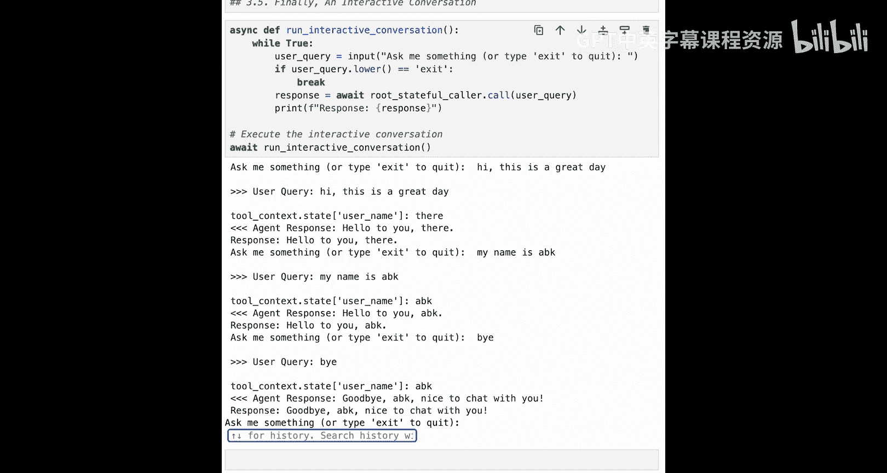
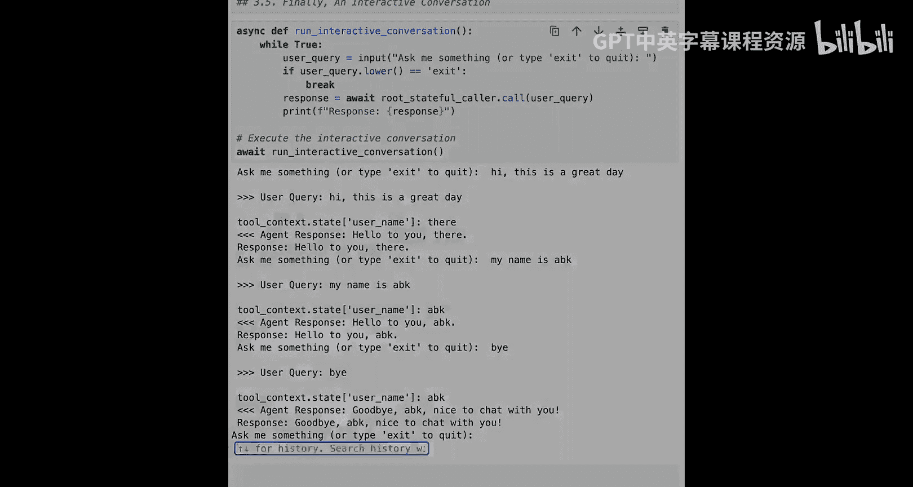

# 吴恩达《智能体驱动的知识图谱构建｜Agentic Knowledge Graph Construction》Claude-4-s翻译 - P5：5.introduction-to-googles-adk-–-part-ii.zh_en - GPT中英字幕课程资源 - BV1AShCzoENH

In the previous lesson， you learned how to create an agent using Google ADK。

 and now we're going to create multiple agents， a team of agents working together。

 We're going to have a root agent and then two subag。

 We'll build on what we did previously where we had to say hello agent。

'll introduce a new agent that can say goodbye。 and then we'll have another agent that puts them together into one multi agent system。

As usual， we'll go ahead and start with importing the libraries that we need。And then， of course。

 we'll go ahead and set up the LLM that we're going to use。 Again， this is open AI。

 We'll define the LLM， and we'll also go ahead and do a quick sanity check by passing out a message to make sure that it's ready。

Always fun to see what open AI might say on any given day。 Usually with friendly messages。

 it's pretty good about saying friendly things back。😊，Next， you can set the agent call。

We're going to use the same class that we defined before in lesson3， part1。

 rather than defining all that again， we're just going to import the tool that we need。

If you remember from part1， we had this helper function make Age Col that's going to create the agent colorer class with all that it needs to run。

Okay， with everything ready， you can now begin to create the multi agent system。

 you're going to create multiple specialized agents， each designed for a specific capability。

You'll create one agent in charge of handling greetings， that's to say hello agent we had before。

 the new agent is going to take charge of saying goodbye。To combine those。

 you're going to have what's called a root agent and you'll hear terms like orchestrator or coordinator。

 top level agent， it all really means having an agent that's going to wrap up to other agents and then manage their execution。

That root agent is going to receive the initial user request。

 the hello or whatever the user decides to say， and then decide how to process that either itself or by what's called delegating。

 handing off to one of the subag。 So the root agent。

 this top level orchestrator is going to be delegating both hello and goodbye。 hopefully。

 to the subag that specialize in those tasks。 Okay， let's start to assemble our multi agent system。

 Again， we're going have the say hello agent that we had before。

 we're going to add a say goodbye agent and then we'll combine them together。First。

 we'll define the tools for our subagents。The first tool is the same。

 say hello tool that we had from the previous lesson， this is the hellello world function。

 takes in a person's name and creates a hellello world message as a response。To that。

 we're going to include a say goodbye function。 Now。

 this tool is going to be even simpler than to say hello because it doesn't accept any arguments whatsoever。

 It has a constant reply。 goodbyee from the cipher， no matter what you want to do。

 this is what you're going to get as of response。 saying goodbye to the user。

With those two tools defined， we can now define some agents that will use those tools。

 Now we're going to have a special agent for greeting and a special agent for farewell。

 but you'll see it's pretty straightforward。Now as we're defining these subagents。

 I really want to emphasize the best practices here and how important it is to have really good descriptions of each of these agents and also instructions that you're handing to them。

 You're going to spend most of your time once you've set up any kind of multi-agian system。

 Most of your time is going to be spent and actually optimizing these instructions This is back to classic prompt engineering and also this description to repeat what I had said in the previous lesson。

 the description is what allows other agents to know what does this agent do and when should I use this agent that's called delegation and the instructions are for the agent itself to understand what is its purpose。

 what is it trying to do and what tools does it have available and when to use them。

So this is our greeting subagent， it's the say hello agent that has access to only the say hello tool。

And then we'll add our farewell agent。The farewell agent is pretty straightforward。

 It's similar to the hello agent。You can look through the description here of what the instructions are。

 and these instructions are actually useful to take a closer look at。😊，It seems obvious。 okay。

 your job as the farewell agent is to respond whenever user says goodbye in some kind of way。 Well。

 people say goodbye in lots of different ways。 So this is a very small example of how to do some few shot learning within the agent instructions。

 So here we have in parentheses， some examples are like when the user users words like bye， goodbye。

 thanks bye or see you。 those are all ways of saying goodbye。

Now most LLMs don't need this extra bit of examples。

 but this is a good practice to have overall is to think how can I help the LLM understand what this agent's purpose is and actually when to execute and what to do in its role and of course we're going to hand it the say goodbye tool that we defined earlier。

Great， you know， I have two subag ready to go and now we need to combine them。

 we're going to do that by defining the root agent。

 which is going to understand both of these subagents and when to delegate a task to them。

 It's similar to doing tool calling， but the agent knows that it's talking to another agent so the entire conversational history gets passed along and actually control of the conversation gets passed along to the subagent。

 So it's a little bit different than tool call but the same idea is current workflow is going to go from the agent who is in charge here。

 the root agent to one of the subagent。So this is similar to tool calling but let's take a careful look at how agent delegation works here。

 we know that the agents themselves have described what their role is， like they say hello。

 agent versus to say goodbye agent both have some understanding about what it is arere supposed to do and their descriptions described to other agents what it is their job is。

We're going to double down on that in the instructions that we give to the root agent。

The root agent be told your job is to coordinate a team of subagents。

So you can see that in the instructions here and that its primary goal is to be friendly。😊。

In order to be friendly， it has actually two specialized sub agents。

 So you would describe what the are so that the agent understands when it actually should use the subag。

 This is like describing when you should use particular tools。

The greeting agent should be used for handling simple greetings like hell low or high。 And。

 of course， the farewell agent should be used for saying good， whether that's by。

See you or anything else and we're explicit here about saying when those messages are received from the user。

 go ahead and delegate to the sub agent to actually respond to the user rather than responding directly as the coordinator。

So if this works well the coordinator shouldn't do anything other than answer general questions and when you say hello or goodbye。

 it should delegate to the subags for actually executing a response or generating a response to the user。

This top level coordinator doesn't have any tools to use whatsoever it can only chat or delegate to the subags。

 we're also going to hand it the list of subag here in the subags key so that subags are the greeting Subag and the farewell subagent。

Now that we have a team of agents all put together into a multi agent system。

 let's go ahead and interact with it。This is similar to what we did in part1 of lesson 3。

 where we had an asynchronous function that managed a conversation。 So here。

 the conversation is going to be just what we did before。 Hello， I A B K。 and then later。

 rather than saying I'm excited。 this transcript is going to say thanks by。

 This is going to be the second user message。😊，We've also added this true here。

 so if you look at the call to this agent caller， the second argument that's passed in is whether or not to be verbose in responses we're going to turn on verbosity here so you can see all of what's going on beyond the scenes so you can understand both the user message going in。

 see the delegation， see the tool calls and also see the responses it's a lot to walk through but it's worth walking through at least once to get familiar with what you can see when you're debugging an agent interaction。

All right， this starts off innocently enough， we get the user's message， hello A may be K。

And you can see that the initial event comes from the friendly agent team。

 so this is the top level a coordinator， so the team coordinator that's going to call the subagent。

 and you can see the first action that it takes is that it wants to transfer to agent so transfer or delegating to a subag and it's going to transfer to the greeting subag。

 so that's perfect in response to hello I may be Ka。

 the top level a coordinator realized I've got an agent who's really good at saying hello。

 let me transfer control over to that agent。So the transfer of response doesn't have any value whatsoever it's just a nun。

 but we should see next is that the greeting sub agentient takes control。

 so here's another event but now from the greeting sub agentient and it's going to look at the transcript and see the user's message and realize that okay it's now my job to actually do something about this and the greeting Sub agentient is going to respond by making a tool call。

You can see this function call here and the name of the function that it wants to call called say hello。

 and it's going to pass in some arguments where the one argument that's passing in is the person name is ABK。

So the agent has realized that from the statement here， of course。

 hello MABK is able to extract that ABK must be the person's name。

 and it's going to make a function call to the tool passing in that name。

And then you can receive the response， here's the function response。

 and the response is hello to you ABK， perfect。Now the greeting sleation is done。

 it goes ahead and you can see that the final message is true。

 so that's the flag that says I'm done processing this message。

 we can go ahead and terminate this particular event loop。

And the final agent response ends up being the response that came back from the tool， hello to you。

 ABK。We send in the second query then or message from the user， and the user says thanks bye。

And again， the top level agent is going to go ahead。 Oh actually， no。

 it's still in the control of the greeting subag。 So the greeting sub agent itself is going to realize。

 okay， this is not something I should use。 Please transfer this to the farewell sub agent。

 So it's aware of the other agents that are available。 transfers to the farewell sub agent。

And that is the end of that function response。Here you can see then a message from the farewell subagent itself。

 It， again， is going to look at the transcript now that it's been given control of the current conversation。

 The first thing it's going to do is realize， okay， the user said good by。

 Let me go ahead and call the say goodbye tool to figure out how to respond to them。

 And so here's the function call to say good by。 And， of course， it takes no arguments。As expected。

But the response to it is the content that we saw earlier in the tool definition。

 it's going to get a farewell that is goodbye from cipher。And that again。

 is the final response for this event loop。And so that is going to be the final agent response。

 Goodbye from Cypher。 Okay， that was a lot to walk through。

 It's worth taking the time to do that for anything else we do in these notebooks。

 You can really see all of the interactions about tool calls。

 Age delegation and also the responses in the changes in state overall。 So really useful to do。

 we're not going to do that for every notebook。 But if you'd like to on your own time。

 please do take the time to really understand what's happening behind the scenes。

 because what's happening behind the scenes was going to effect， of course。

 how you do the overall agent definitions and also the agent orchestration。

You're going to take one more step in this multiag system。

 We have an execution environment for agents。 we've got a team of multiple agents that can work together。

 they can delegate tasks to each other and then each of those agents also has tools that they can use。

The last important component for all the agent systems is having memory memory is just internal state happening for a particular session across any agents that are involved in that session。

 and of course the user themselves。Would is session state really a session state in Google AK by default is really just a dictionary that's available that you can update keys within that dictionary。

 And when you update values of those keys， Google AK tracks those changes。

 It tracks deltas to the state basically and updates the overall session state to keep it consistent across all Asians。

 whether they're running in parallel or running sequentially because it's an asynchronous system at its heart。

 it manages all this state updates。Agents have a few different ways of interacting with state。

 One way the way that I prefer in the primary method for interacting with state is through the tool context。

 So whenever a tool is called， theres an extra parameter that's available。

 That is the context within which that tool has been called。 Given that tool context。

 the tool itself then has access to the current state or the current memory of the agent。

 and it can use that memory for actually making either different decisions。

 creating different output， whatever is appropriate for the memory。

 The other way that agents can interact with state， is by using an output key。

So rather than using a tool call for updating some memory or for accessing memory。

 you can take the actual output from an agent that final response。

 rather than just turning that back as the response from the agent。

 you can save that into state by defining an output key。 So when you see this final true。

The message related to the final true here to be the text Good bye from Cypher could get used for updating state itself。

 That's very convenient sometimes， and we'll do a little bit of that later on in some of these notebook。

Okay in this next step we're going to set up some memory。

 we always have the inmemory session that we're using right now。

 so the memory is saved just within RA that's not being persisted to a database。

 Of course that's the best thing to do for a production system but for convenience having inmemory state is perfectly fine。

 we're going to update both of our tools to actually take advantage of using that inmemory state So both for it say hello and say goodbye we're going to update those tools to take advantage of the tool context to update session state or memory。

You should do this one at a time and take a careful look at the differences here。

You'll notice that we're importing tool context from Google ADK tool context is the class that takes care of keeping track of the session state in addition to other things that is useful for tools to have access to。

So we're going to update the sayhio function to be say hello stateful。

It still accepts an argument for the user's name， but it now has this extra argument called tool context。

 It's the tool context that's going to let us get access to the tool context passed in for the session by the execution environment。

So in the tool context， there is this state dictionary。

And B is going to update the username key and the name that was passed into the function we're going to use for updating the session memory or the session state for the username key。

 so this is pretty straightforward username username now we have a dictionary that is shared across all agents and across all tools that will have that value that is passed into this function。

This is a way of sort of keeping track of things by natural use of functions and also then preserving them for later use。

For debugging purposes， when this tool is called， we'll go ahead and print out the update to the session state。

 particularly to the username key。And then of course。

 we'll do what we had done in the previous say hello。

 we'll send a query off to Ne4j using a query parameter that is the username。

So it's go ahead and define that。Now that you've defined that。

 you can define the same thing for they say goodbye。And again， as you're defining this。

 this is just an update to the say goodbye that we had before。 Now。

 the difference is that this say goodbye， even though it doesn't take an argument for anything related to the person that has no custom arguments here。

 it does get this tool context passed in。 And I should mention that this is something that Google AK does automatically when it sees a tool when the last argument to the tool is tool context。

 It automatically injects that to the tool call。So when say goodbye， stateful is called here。

 it's going to get tool context， but nothing else。 But because say hello。

 stateful has set this state。The user name into the state。Say goodbye。

 can actually access the username so now we have remembered what the user's name is。

 we can access the state for the state key username and then have a default value in case the user didn't identify themselves。

 but we can get from the dictionary， the username or default。

 assign that to the username and use that for actually generating a goodbye statement。

You can then define a new stateful agent for farewell。

 and again that's going to be the same as we had as the previous farewell agent。

 but now it's going to be call the say goodbye stateful tool。As before。

 you can combine those into a multi agent system by having a root level agent to a coordinator agent that's going to use both of those as sub agents。

And this is exactly the same as the other root agent that we had。

 but now it's just using all the subagents that have ultimately down a third core。

 these tools that are stateful based。You now have a multi agent system that takes advantage of memory。

You can give it a try。You will use our friend the make agent collar passing in that new root agent stateful that is the top of a coordinator。

 create a collar for that。 and to see the change in the session。

 we'll go ahead and get the session directly from the collar。

 Remember there is a utility function for getting that if you look back at the agent collar class。

We'll go ahead and get the session and then based on that session。

 we'll print out the initial state when this is created。

 and we should see that there's nothing in the current state。As expected， the initial state is empty。

You can now define a conversation， it's the same conversation that we've been having， say hello。

 say goodbye， and let's see what happens。Actually， I'm going to take out these verbo statements right now and you can decide to keep those in or add them if you'd like。

 run it either way， but just to keep the output to a minimum。

 we'll go ahead and run this without the debugging statements。

And what's really important here is that we saw that the initial state was empty。

And we expect that once these calls are done， the initial state turn into a final state。

 here we're going to get it again， that the final state should actually have the user's name as defined by the call to say hello。

Awesome， so our utility functions printed out。😊，This update to the user name here。

 and we also see when we get the session and then get the state from that session that the final state includes the username ABK。

 fantastic， Everything's working as expected。Now， if you'd like to。

 you can actually run this in an interactive environment， even within this notebook。

 you can set up a small helper function that's going to have a loop for getting messages from the user and just calling our caller。

 passing in that message。 This will run as long as the user doesn't pass in a message that says exit。

When you set that up and then run it， you'll see a little box appear so when you run the interactive session。

 you can type in a message and just see what happens。And I'll start by not revealing my name。

 see what happens。Okay， that's kind of funny。So the LLM decided that my name is there based on this message。

 that's not really great。Let's correct it， let's say。

And you can see just by passing in my name is A B。 K that the tool context actually updated with A B K。

 So there is a tool call still to say hello to A B K。 And because of that。

 the L O M correctly identified my name is A B K。 Sa that into memory。 This is fantastic。

 If I say goodbye bye again。😊，We should now get a nice message by A B K as before。 Give this a try。

 interactact with it and see which you can come up with。 And， of course， if you'd like to。

 change the any of the code and see what the impact is of that。Okay。

 you've gotten all the way to the end of lesson three。

 you've created a basic agent that is a single agent that says hello。

 and then you created a multiagent system with two subag specialized in saying hello or saying goodbye and then a root agent that coordinates their interactions with the user。

With this in hand， you're ready to continue into actually doing agent knowledge graph construction。

