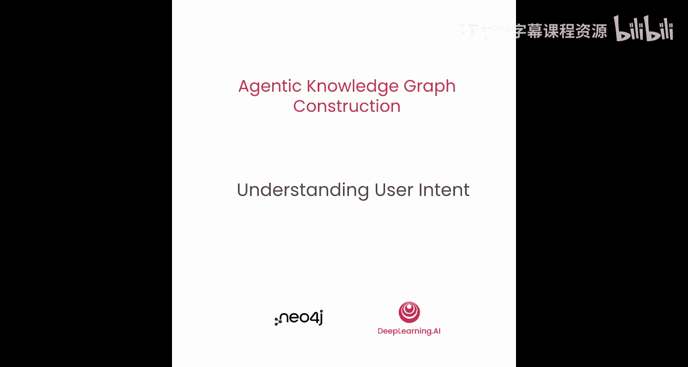
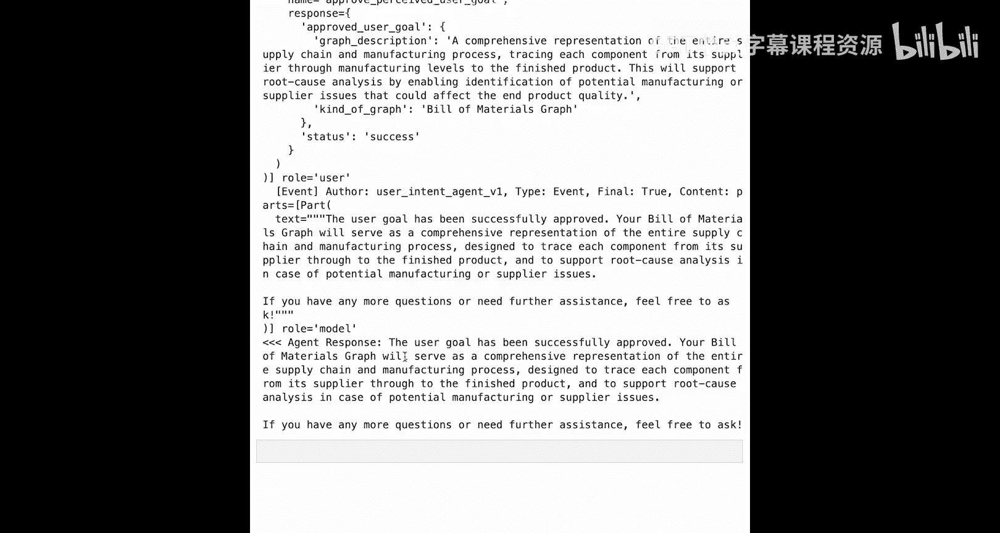

# 吴恩达《智能体驱动的知识图谱构建｜Agentic Knowledge Graph Construction》Claude-4-s翻译 - P6：6.understanding-user-intent.zh_en - GPT中英字幕课程资源 - BV1AShCzoENH

You're now ready to define the first agent in your system。 The user intent agent。

 Its main goal is to help you brainstorm ideas for the type of knowledge graph you can construct and what questions you'd like to answer from the graph。

 Let's get coding。

If you think back to the diagram that we'd seen in lesson two that had the overall Know graph agent architecture。

 we're going to be working through the structured data agent。

 which is the subagent here that takes care of taking information from CV files。

 taking that data and transforming that into a graph ultimately。

Now we're going to do that progressively， we're going to do that in this collaborativeative way and the first step is to actually understanding what is the user intent What happens here in this first phase when we're establishing what is the user's goal and a description of what they're trying to achieve will influence everything else that the agents do this sets the direction overall for what we're trying to achieve and all the agents will respond to that appropriately。

So this particular agent has got one main job。 The output of it is saving to the memory what is the approved user goal。

 And to do that， it's got two tools to work with。 has one tool where it first perceives what is the user's goal based on some interaction during the conversation it's having with the user。

And then based on what it understands the user wants， it's only able to say。

 okay here's what I perceive that you want。 And so it's going to call a tool for actually capturing that。

 And then it'll tell the user here's what I think you want。

 And the user has the option of saying yes， that's right or no that's not quite right。 try again。

 If you want to try again， then the agent is going have to continue to use this set perceived user goal until the user thinks actually that's the correct thing。

 I approve that。 And only when the user is approved。

 the agent should then call this approved perceived user goal。

 and we'll see how these tools work kind of in collaboration to update the memory and actually capture this approved user goal。

 So notice I think critically set perceived user goal cannot actually itself set the approved user goal。

 It's only by calling this tool here。 This tool ends up being a guard ensuring that we have a checkpoint with the user that the user is actually themselves explicitly said。

 yes， this is good。 let's go with it。😊，Okay， with the agent details in mind。

 we'll go ahead and do the usual setup and import libraries that we need。

And we'll set up the LOM and a quick sanity check。Let's see， how did it respond this time？

Kind of consistently。 Yes， I'm ready。 How can I assist you today。

So we can start to define the user intent agent itself。

And we're going to start by actually piece by piece describing what is the prompt we actually want to give。

 what are the instructions for this agent？The first part of the prompt that you would want to define is what is this agent's role and also what is its goal。

 So here we're going to say this agent is an expert at knowledge graph use cases。

Your primary goal is to help the user come up with a knowledge graph use case This is basically saying your job dear agent is to help the user ideate on some ideas。

 what is it trying to accomplish， what is the user trying to accomplish？

The agent's goal is to help the user figure out what their goal is。

The next part of the prompt we're going to add is what I'm calling conversational hints。

 This is helping the agent understand within the context of the role that it has。

 the goal that it is trying to achieve。 How should it go about its business。So here。

 because we're in the context of figuring out what the user's intent is。

 trying to work with the user on ideation， we have some basic ideas about， well。

 if the user isn't sure what to do， you can make some suggestions。

 particularly around classic use cases for knowledge graphs。

 because of course this agent is an expert at knowledgeGraph use cases。Now。

 perhaps LOMs already know a lot about knowledge graph use cases。

 but if you're doing this for your own internal production system and some enterprise。

 LOMs may not know anything about your business， so this is a great opportunity for you to explain to the agent what it is that goes on in your business and what matters to you and what doesn't。

 So here I explain a couple different use cases for knowledge graphs。

You can use them for social networks， logistics， recommendation systems， fraud detection。

 or of course， things like pop culture if you want to keep track of movies， books or music。

Because it's so important for setting the overall direction of the multi Asianian system。

I doubled down on like， what is it that a user goal actually is composed of。

 And here I describe within the prompt that a user goal has two components。 One is the kind of graph。

 So are you creating a social graph or creating a logistics graph， What could it be。

So the kind of graph is here described to the agent as being at most three words that describe what is the graph that we're creating。

 and in addition to the kind of graph you' are creating。

 there's also the component of describe that graph。

 so provide a few sentences about the intention for that graph。So for example。

 if we had said USA freight logistics， the description could be a dynamic routing and delivery system。

For cargo。This is by way of doing kind of some few shot learning。

 really emphasizing to the agent and through the agent to an LLM what it is you're trying to achieve because this is so important it's worth repeating both here in the prompt itself and then later in the tool descriptions that are actually use the user goal。

 both in just what it is and also then approving what has been understood。

The last part of the prompt that we're going to put together is the chain of thought directions。 Now。

 chain of thought can be as simple as， hey， think carefully， think step by step。

 But here we're going to be a bit more particular。 We have some steps that we want the L M to go through。

 So we're going to say very specifically。 Here's what I want you to do one step at a time。

 and the agent might do variations of this。 But by being very specific here when we know what we'd like the agent to do。

 it very much helps focus the agent's attention and figure out how it should proceed given a user's initial interactions。

So most importantly， it needs to understand the user's goal， again。

 we're going to reiterate that's the kind of graph along with the description。

And if it's not sure that the agent should ask clarifying questions as needed。

 and then only when the agent thinks it understands the user's goal should call the set perceived user goal tool。

 That's what's actually going to record into memory the user goal as understood with the two components of kind of graph along with the description。

Finally， present that perceived user goal through the user asking them for confirmation here's what I think you just said。

 am I right， if the user agrees only then can the agent call the approved perceivedive user Go tool here we give lots of extra instructions about calling this tool so that the agent really understands what this tool is doing。

That upon calling this tool。That the current perceived goal be saved inter state under the approved user goal key。

Okay， all of these parts together will form the prompt that we're going to give to the agent。

To combine those together， we'll use some Python string templates。

 and we'll just go ahead and actually insert the variables that we defined earlier。

 the agent roll in goal， the conversational hint， the output definition。

 and then also the chain of thought directions。We'll go ahead and print that to the screen so you can see what the total thing looks like。

You can now go ahead and find those tools。The first tool is to set the perceived user goal and you can see in comments here。

 This is to encourage collaboration with user by setting this up inside of a tool and by having only through that tool。

 saving the values that it perceives into memory， we really help the agent focus on like what does it mean to understand the user's goal because it has to call this tool。

 it knows that it has these two components。 we've said that in the prompt and then here in the tool definition itself。

 it can see that theres a two arguments， it has to passs in the kind of graph and also a graph description。

 And also you'll notice we have the tool context passed in as the last parameter。

 If you remember from the previous lesson， when the last argument is a tool context。

 AK will automatically inject that when this tool is being called in the tool description。

We reiterate what this is doing that it's saving the perceived user's goal。

 including the kind of a graph along with a description of it。

 and we also describe what the arguments are， these should be exactly the same as what we said to the agent inside of the instructions earlier that will be part of the prompt but now the tool definition itself is going to say it again。

 the more times you can say it， theyre less likely that the LOM is going to do the wrong thing when calling the tool。

And inside of the tool， it's pretty simple。 All it's going to do is assemble a small dictionary that is the usable data that is composed of those two components。

 the kind of graph along with the graph description， just as passed into the tool。

 So this is really just a very simple way of actually capsulating how to access memory。

 but also focusing the access to memory。 So the context state is updated with that dictionary。

 because this has been an update。 the ADK will see that there's been a change to state。

 itll propagate that delta to anybody else who needs to perceive it inside of the runtime environment。

You can then define the next tool， which is used to approve that perceived user goal。 Now。

 this should only get triggered after the perceived user goal has been set。

 and then the user has also said yes， I approve that if both of those things are true。

 this tool should be called。Now， when you can， whenever it's possible and sensible， inside of a tool。

 it's worth trusting but verifying that the LLM is doing the right thing。In this tool。

 this should only be called upon approval from the user。

 So we're going to iterate again with the L M。 Hey， only call this after the user has approved。

 And then if the user has approved by calling this。

 the tool will record the perceived user goal as the approved user goal。 And again。

 we're going to say to the agent only call this tool if the user has explicitly approved the perceived user goal inside of the tool。

To check a little bit， because we require the perceived user goal has already been set。

 we can go ahead and check that that has been set before we do anything else。 Now。

 how we handle this setting is really important because the call to the tool can result either successfully or in an error。

 So here we have a very specific error that we might turn back if the perceived user goal isn't in the current context if it's not in the tool context state so the agent's memory if the perceived user goal is not there we're going to go ahead and return an error from this tool。

And the error message that we're going to supply is meant to actually help the LOM understand。

 here's what went wrong， here's what you should do to actually fix the problem。

 so we're telling the LLM that the perceived user goal has not been set and that it should set the perceived user goal first or ask clarifying questions if it's unsure what the user's intentions are。

So this is really reiterating to the agent in all these different places from the prompt to the definition of the tools。

 to also the error messages that come back from the tools。

 encouraging the LLM to do the right thing based on what's happening。If it was successful。

 all we do then is copy the state from the perceived user goal into the approved user goal。

 so notice the only way for this to happen since we are not passing an argument into the approved perceived user goal。

The approved user goal only gets set if there is a perceived user goal， it gets copied in。

 and then both the perceived and approved user goals should be available inside of the state。

For convenience， we'll add both of those to a list because we know we're going to pass in a list when we create the actual agent itself。

So we've got our two tools， setting perceived user goal and approving the perceived user goal。

So you can define the user intent agent， you're going to give it a name with a version that's going to be unique version name。

 and we're just going to use the LLM that we defined earlier。

 This will be the same LLM through all the notebooks so we can just skip right over this in the future。

 and the description is really important。The intent of this user intent agent is to help the user ideate on knowledge graphra use cases。

 this is helping the overall multiagent system know when to use this agent itself。

 you recall from the diagram earlier， this is part of a workflow by having this description match the role this agent plays within that workflow。

 that helps the coordinator that's going to be actually managing the workflow。

 know when to delegate to this agent。Inside of the agent then we have the complete agent instructions that we assembledd earlier。

 we're going to pass that in， and of course we'll also pass in the tools that are available。

You now have a complete user agent ready to go。Let's interact with it。

You can import your friend the make agent collar and go ahead and create a collar for the user intent agent that we'll call the user intent collar。

And you can pay attention to this note here， of course， if we're going to run this a couple of times。

 it's worth coming back here to reinitialize the state if things have gotten kind of off the rails。

So let's set up a conversation to interact with the user intent agent。

We'll get the session before we actually start interacting so we can see the current state of the session this should be empty initially as usual。

And then we're going to go ahead and create a scripted conversation that really just has two calls here。

 the first call。It's going to be the user declaring that the user wants to have a bill of materials graph or a BOM graph。

And that it should include all levels of the bill of materials from suppliers to a finished product。

And the user also specifying that they want this bill of materials graph that can support root cause analysis。

I'm going to go ahead and get rid of the verbo output right here。

 but you can leave that in if you'd like to。 Now， this is an important part of the conversation。

 Sometimes when an agent actually receives that initial message from the user， it might decide， well。

 I do need to ask a clarifying question。And so in case it has。

 then the perceived user goal will not be set， the agent probably has responded by saying， hey。

 tell me some more about what you're trying to do， so we're going to make an assumption here if the perceived user goal has not been set in the session state。

 let's assume that the LLN is asked for a clarifying question。

 let's provide it with a clarifying answer， and say that as the user。

 I'm concerned about possible manufacturing or supplier issues。

 hopefully that's enough detail to satisfy the agent and encourage it to actually call the perceived user goal tool。

Then optimistically， if we've gotten here， then the perceived user goal has been set。

 and we're going to go ahead and say， well， that sounds great。 I approved that goal。

You might run this multiple times in case that the agent actually doesn't set the perceived user goal。

 it might decide on any given day that it wants to have a more conversation with the user before deciding that it knows what really the user goal is。

Okay， I'll lift debugging on for that final call to approving the user goal。

 but you can see as we went through the session here。

 the session started with nothing in session states so memory was empty。

The user sent their initial message and the agent responded actually asking for clarifying questions。

 so it said，  hey， are you trying to trace the components of a product from suppliers through various stages of manufacturing on and on this is quite a long response from the agent that's fine。

And because we had that check in place， we go ahead and decide， okay。

 we realized that the perceived user goal was not set。

 we send this extra message if the I'mconcerned about possible manufacturing or supply issues。

With that。Looks like the agent then responds by deciding that， O。

 that's enough information for it to continue and then has no understanding of what our goal is。

 And it tells us， O， here's the kind of graph I think you're trying to build。

 And here's what I think the description of what you want out of that graph。Finally， it then says。

 correctly， hey， does that capture your intent， which is exactly what we wanted to do。

 We wanted to say。 Here's what I think you're asking for。 Is that correct， And then as the user。

 we're going to go ahead and assume to approve that goal。

 That was part of the transcript that we decided earlier。

And you can see in improving that goal that the user intent agent goes ahead and makes the set perceived user goal call。

 so actually didn't yet set the perceived user goal。Where it's calling it again。

 it looks like actually to me。And then。As the next part of that， having set the perceived user goal。

 because the user has approved， it's calling the approved perceived user goal。Okay。

 you can see the final response here at the bottom。

 then the user goal has been successfully approved and everything is all good。

The workflow now knows the overall direction of what the user is trying to achieve in building a knowledge graph in this multi agent system。

