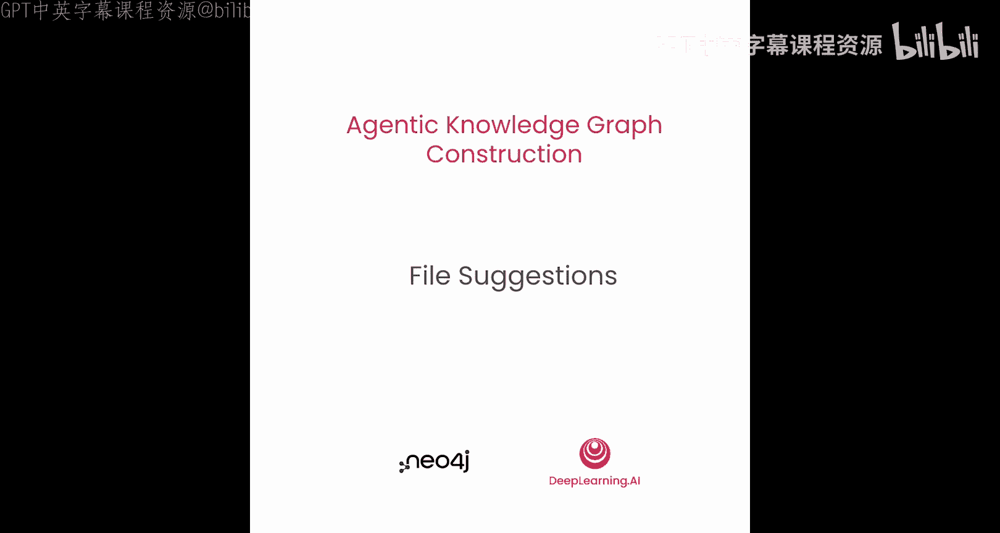
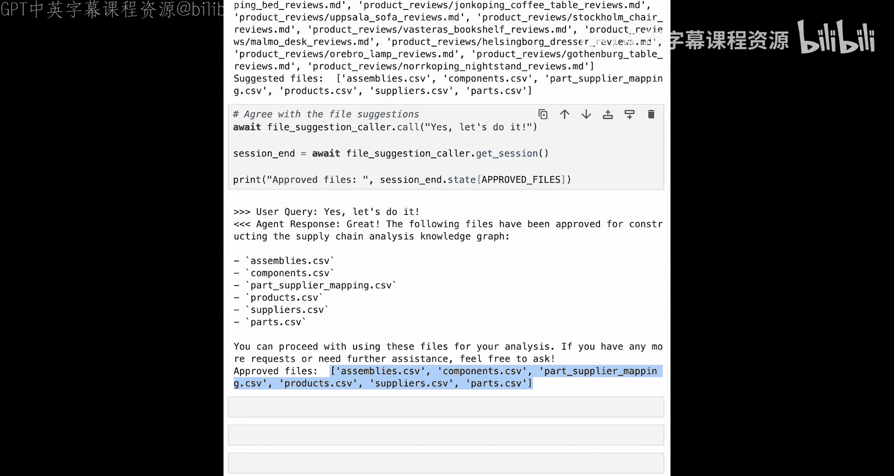

# 吴恩达《智能体驱动的知识图谱构建｜Agentic Knowledge Graph Construction》Claude-4-s翻译 - P7：7.file-suggestions.zh_en - GPT中英字幕课程资源 - BV1AShCzoENH

You'll now set up the second agent for your system， the file Su agent。

This agent will help you choose the relevant files from your structure data to build the domain graph。

Let's go in the workflow that you're working through。

You're building the structured data agent workflow in lesson 4。

 you created the user intent agent here in lesson 5， you will create the file suggestion agent。

 It will have a similar pattern to what we did with the user intent agent in lesson 4。

 the agent itself has one primary goal creating this approved files list this will be the list of files that the agent itself is looked at decided these look relevant for the users trying to do and then ask the user hey。

 do you approve these。 And if so， the output will be the approved files to do that。

 the file suggestion agent has a bunch of tools to actually take a look at the files that are available So that's the list import files for any of those files。

 it can sample the file that's like doing a little bit of a read from the file。

 it can only read about 10 lines and then based on that it can make a recommendation based using this tool called the set suggested files tool。

 And then if the user approves it will call the approved suggested files tool and that will update the memory so that we have the approved files。

In context， rather than just the suggested files， all of this， of course。

 informed by the work of the previous agent， all this is based on the overall direction of what the user is trying to accomplish。

 This agent gets that from memory rather than from conversational history。

 So rather than relying on the transcript of what has happened before this tool was called or before this agent was called。

 This agent is going to use the get approved user goal tool to find out what it is that the user is trying to accomplish。

 Then with that， take a look at the files， Figure out which ones relevant and make a suggestions of the user。

 Let's take a look at the code。😊，You'll start with the usual setup importing the libraries that we need and any helper functions that we defined previously。

With the libraries already， we'll go ahead and create a connection to Open AI and make sure that it's working。

It's very consistent today， yes， I'm ready， how can I assist you？

You'll start by constructing the instructions for the agent itself。

Now we're going to do this a little bit at a time。 First。

 you want to define the agent's role and also its goal。

 So for this agent that is in charge of making suggestions for files that are relevant。

 we're going to say that it's a constructive critic reviewing a list of files。

And its goal is to suggest relevant files that can be used for constructing a knowledge graph。

You can then give it some hints about how to go about achieving that task。 The particular task。

 of course， is to review the list of files and see within those files。

 which ones are relevant for the kind of graph into the description that is based on the approved user goal。

For each of those files， there is a tool available called sample file that will let the agent actually see the content of that file to confirm whether the file contains information that is useful for achieving the goal。

 and we're giving it also the hint that it should only take a look at structured data files like CSsphere or JON。

You can close that out with the chain of thought directions and here the chain of thought really has two pieces there' is going to be a preparation part of it。

 which is go ahead and call the get approved user goal to get what the user goal is from session memory。

 we're going to call a tool for that rather than passing that in directly to the prompt。

 so encourage the agent to use the tool。And then with that in hand。

 we're going to give it the chain of thought， as always， think carefully。

 repeating these steps until you are finished。 And here are the steps we want the agent to follow。

 Get a list of all the files that are available。 Then for that list of files。

 evaluate evaluate each one of them for their relevance。

And then use the set suggested files tool to record the suggested files into memory。

 This step here is step 3， encouraging the8 and2， use the get suggested file tool to get the list of suggested files is really quite important。

It's possible for the agent to realize within its own reasoning and within conversational history。

 what the list of files might be and what it thinks the suggested files are。

 but rather than relying on that， we really want to encourage it to only use the files that are been saved to the suggested files memory here the Get suggested files tool is what accesses that memory completing that loop actually encourages the LLM to really focus on what is in memory。

 not what it remembers from conversational history。With that。

 then the result that you got back from the tool call is what's can be presented to the user for approval。

 if the user approves， then go ahead and say that's great， usually prove suggested files。

 but if the user has feedback， go back to step one and repeat the process with the feedback in mind。

You can now define the tools that are used by the agent。The first tool is get approved user goal。

This function is defined in the tools module that is provided to you。

 It just returns the approved user goal that has been stored in the state。

 We're also going to import a little helper function here that these tools that we're about to define will use。

 Each of these tools interact with the file system。 But it's not the entire file system。

 They' are constrained to just looking at the files that are available for import that Ne4j itself can access。

 So Ne4j has the notion of an import directory。 So this helper is going to let us know where is that import directory。

 All the tools then can use that import directory for deciding what files are available and of those files。

 which ones to use。You can then define the tool to list the import files。

 and it's going to be saved to this key all available files。

 the tool call needs the tool context because there are some helper utilities we're going to use for actually getting the directory on disk where these files are stored and so that the files that are listed are only relative paths rather than absolute paths。

So you can see down here in the implementation we're going to get this helper function get Nefrj importer that's the import directory that Ne4j itself has access to Nefrjta does not have access to the full disk space so we can't use absolute files it has to be relative to this import directory so we get that here and then we list all of the files This is just some string using that import directory We then go ahead and do a glob listing of all the files recursively down from that directory and do a bit of list comprehension here to turn that into a relative list of files。

We save that to current state as all available files and then return that as the result of this tool call。

You can then define the sample file tool call。Now the sample file tool is again going to use the tool context。

 and it's also going to use a file path。 this is going to be a relative path to the file that the LOM has decided it wants to take a look at。

This tool could be instead a call out to the operating system to actually use CA or something here we're going to do this all in Python。

 The result of calling this tool is going to be just up to 100 lines of text we're going to assume it's a text file。

Get 100 lines of text return That is the value of this tool call。

Now we have a couple of guards in place here because the LLM can invent paths it can invent lots of different things when it calls this。

 we're going to do some sanity checking on the file path that was passed in。

We're going to make sure that it's not absolute that if it is absolute。

 we're going to return an error because it must be only relative files。

 and we expect them to be relative to the import directory。And the last part here。

 we also encourage the agent to remember that the file path being passed in here should appear in the list of available files。

 So it's not sure it should actually check that and based on the import directory。

 we go ahead and get the full path to that file， we make sure that the file exists again。

 return a helpful error message if it doesn't exist so that the agent can take corrective measures。

Then if it is existing， then we go ahead and read 1 hundred0 lines and save that into the content。

 passing that back as a successful tool call。 If any errors occur here。

 we've got to pass that error back as a response to the EM as well。

 and the agent can decide whether or not it's capable of doing anything or just needs to complain to the user that something is just wrong。

You've given the agent the ability to list all the files， take a look at those files。

 so now it's able to actually make a suggestion based on those files and the file content about what it thinks are relevant files for what user is trying to get done。

Here we've got a pair of tools that actually does that。

 the first is to set the list of suggested files， it takes a list of strings that should be file paths。

And you could add some extra checking in here if you wanted to to make sure that the list passed in here are all actually existing files here we're actually going to be a bit trustful。

 a bit of Yolo in this tool here， of course， for improvement。

 you can add that check and then the flip side of course。

 we're going to have a guest suggested files that just looks into memory for that list to files that have been suggested。

Once the agent has successfully figured out what files they thinks are relevant for the user's goal and made that suggestion to the user。

 if the user has approved， of course， it will call the approved suggested files tool to make that transfer from the state of suggested files into approved files。

 as in the previous lesson， we're going to double check that before this call is made that the suggested files actually exist in state and if not suggest to the agent that it needs to go and figure that out before it calls this tool if it has been set。

 they will go ahead and make a copy of the suggested files into the approved files and return that as the success from this tool call。

You can then go ahead and take all of those tool definitions， put those into our list。

 and save that it as the file suggestion agent tools We use that for the agent definition in just a moment。

 You can now define your agent。The agent and definition is pretty straightforward。

 we did all the hard work in setting up the tools and defining the prompt earlier。

 we' just can pass those in here and create the agent。With the agent in hand。

 you can now go ahead and interact with the agent。Import the make agent Col helper that we defined earlier and then create a color using that。

All right， just really just one thing that's a little bit different here。Previously。

 when we use the make Age collar， we would just call it directly with the agent we want to execute。

 Notice here that we're initializing the state with the approved user goal。Now。

 as we had said at the beginning of the workflow， the approved user goals。

 it's the overall direction for all the different agents and what they're trying to accomplish。

 so it's important to set that here。In the final production system， in the multi agent system。

 By the time we get to this part of the workflow， the state will already have the user goal because we'd gone through the previous part of the workflow here。

 we haven't gone through that part of the workflow。

 So we simulated it by setting the initial state as if we had gone through and approved a user goal that wants to do a supply chain analysis with a description about doing a multilevel bill of materials for manufactured products。

You can then go ahead and run a very short conversation where the user asks what files can we use for import。

 and then the file suggestion agent will go ahead and do all its processing to find out which files are available and which ones are relevant。

 We should see in the end that the available files list contains all files in the directory and the suggested files are a subset of that。

 Hopefully just the CSV files。Now， this may take a few moments to work because the LM is， of course。

 looking through all the files that it finds， trying to understand whether or not those are relevant。

 We can see this response that it's done a pretty good job。

 It's figured out these CV files for the assemblies， some components。

 a mapping from parts to suppliers。Some products themselves， the suppliers themselves。

 and also the parts， that's perfect。If you look at the available files， it's got a lot of extra ones。

 particularly all these markdown files， it has ignored those and correctly just suggested these assembly files。

 the component files， all the CSV files， awesome。Since the agent has made those excellent suggestions。

You can go ahead and send another message to the agent just saying yes， let's do it。

 you can rephrase this， perhaps depending on how the agent responds that may not be a good way for approving。

 let's try this out。The agent was very happy about that。

And should have made a tool call so that the approved files here。

 we can see from the session state that the approved files matched what we had earlier as the suggested files。

 success。You've now built two agents within the workflow for constructing a knowledge graph out of structured data。

 the first that would establish the user's intent， the next one building on the user's intent and looking for data files that are available that support that user's intent。

 in the next lesson you will take the next step which is， given the user's intent。

 the files that are available， what could a graph actually look like。

