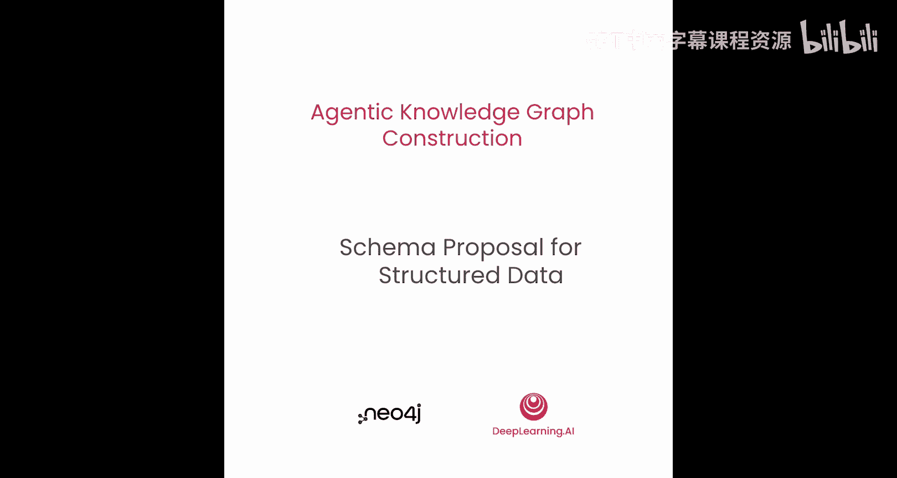
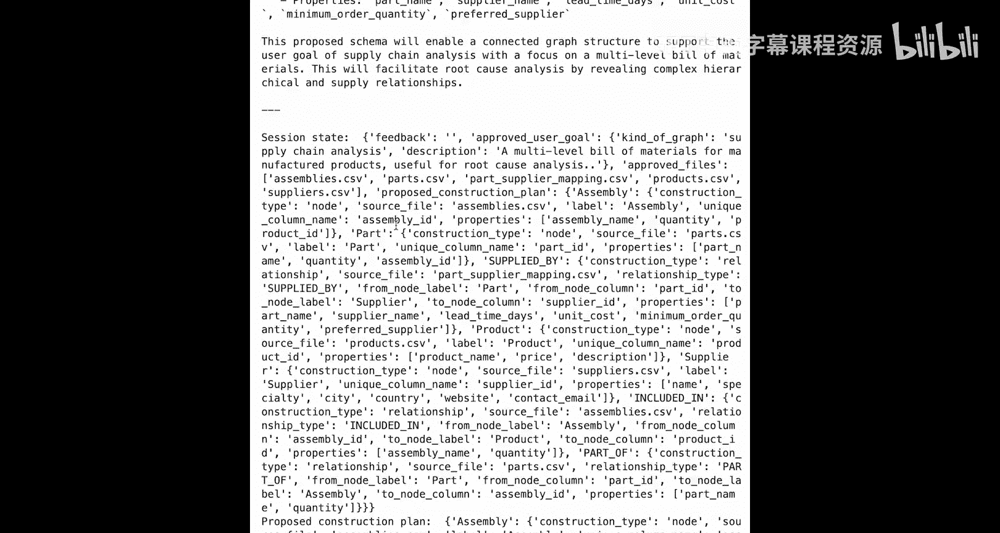
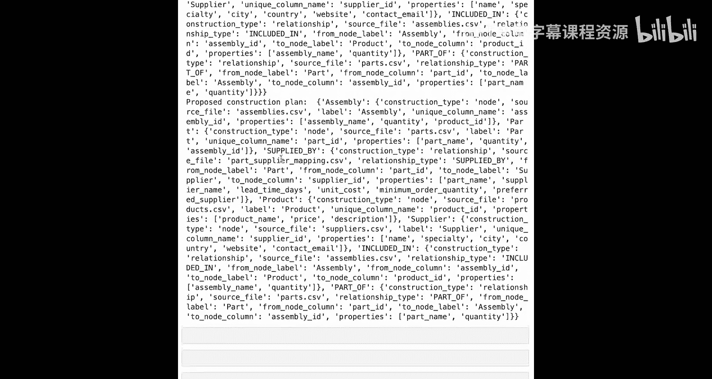
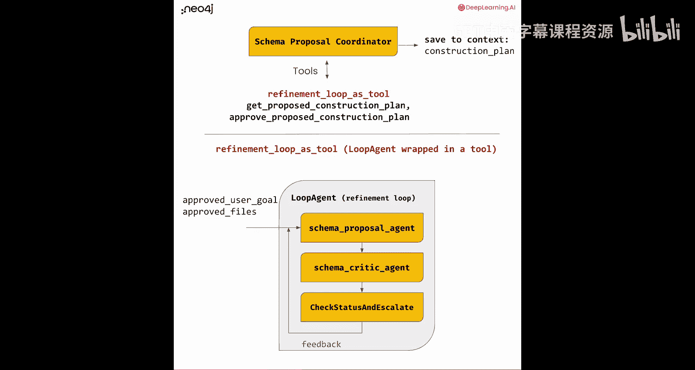

# 吴恩达《智能体驱动的知识图谱构建｜Agentic Knowledge Graph Construction》Claude-4-s翻译 - P8：8.schema-proposal-for-structured-data.zh_en - GPT中英字幕课程资源 - BV1AShCzoENH

You now have the goal defined and the file specified。

 The next step is to decide on the graph model for your structured data。

 meaning what types of nodes and edges will constitute the domain graph。

 You'll set up a loop of subagents that will refine the model。 Let's dive in。

You're working through the structured data agent， through the workflow that started with user intent。

 and then file suggestions， and finally we were ready to make a proposal for what the graph schema might look like。

That's the job of this agent。 Now， this agent also introduces some new ideas in terms of how you compose an agent。

 This agent actually has multiple agents inside of it。

 where particularly there is one agent that makes a proposal。 So says。

 here's what I think we can make for a graph。 And then another agent takes a look at that and criticizes it。

 So this is a critic pattern。 very common through many multiagent systems。

So in the top level coordinator， it has only a couple of tools that it's working with here。

 It has one tool that we're calling the refinement loop as a tool， and then two kind of normal tools。

 the get proposed construction plan， and also approve the proposed construction plan。

 Those are similar to the file suggestion and file approval tools we saw before。

 But this refinement loop as tools interesting。 That actually is an agent itself。

 where actually a couple of agents working together。 Let's look inside of that。

 So the refinement loop is actually an agent that helps coordinate subagent。

 The loop agent here has three subagent。 A schema proposal agent， a schema critictic agent。

 And then something that we're calling the check status and escalate agent。

These were together looping over and over time until they get to a final result。

 The schema proposal agent makes the proposal。 The schema critic criticizes it。

 and then the check status and escalate agent is responsible for looking at the output from the critic in deciding。

 is the critic satisfied or do we have to try again。 And if the critic is satisfied。

 it's this agent that actually makes the escalation happen so that this loop agent terminates。

Now this could go on forever so that when you call the loop agent。

 we can also set a limit to how many iterations through the loop will try if we fail to get to some kind of consensus。

 then we're going to kick back to the user saying， hey， we're not sure what to do here。

 the top level coordinator will then be responsible for actually getting some more input from the user。

You'll start with the usual imports。When those are ready。

 you can define the LLM that we're going to use。And check it out。Great， with all that ready。

 we can go ahead and our tool definitions。You can start with the agent instructions。

Now the agents we're going to be looking at more closely here or the schema proposalal Age and then the critic。

So let's take a look at the instructions we're going to give to those。So for the proposal agent。

 for its role in its goal， we're going to tell it that it's an expert at graph data modeling with property graphs。

you can look at the detail here about where we're describing to it， but the novel part here。

 really in this part of the prompt is that we're going to be injecting here some feedback。 Now。

 the feedback initially will be empty。 and so we're telling the agent that。

Consider the feedback only if it is available， but because it can be empty。

 we don't want to be confused about the rest of the prompt being part of the feedback。

So we canclo it in some Xml here， So pseudoxml saying here's the feedback and then here's the closing feedback because most LLms understand that pretty well this is a delimiter。

 So we have a delimiter here and then this curly braces feedback ends up being a template variable that gets injected by Google8K。

 Google8K， when it's assembling the prompt will look for these kinds of parts of the text and replace this with context a context variable。

 So if in the tool context state， if the state has a feedback variable that's defined in the dictionary。

 the value of that will get injected here。 So if there's feedback in the context that'll get passed into this part of the prompt。

Okay， you've given the agent a goal and also a role。

 and now we're going to give it some hints about how to go about its job。

 Now the hints here are lengthier than anything you've done so far。

 The reason for that is that most LOMs and opening eyes included are pretty good at doing graph data modeling but they're not exceptional at it and so we're going to give it some extra guidance here about thinking how to work with the data files that are available and what those data files might look like as a graph you can look through all the guidance here and notice that we've got best practices for knowledge graph construction really encoded inside of this prompt。

 So overall， every file in the approved file list should somehow become part of the graph。

 and within those files， these are CSsv files often you'll see unique identifiers we tell it to take a look for those unique identifiers try to identify what those identifiers are and use those for actually understanding the role of that particular file and constructing the graph。

Then we give it some guidance， basically some design rules for how to think about whether a particular file might represent a node or might represent a relationship and you can look through the particulars。

 but there's like often some semantic hints in the naming of the file itself the number of identifiers that appear whether those identifiers are actually unique to the file or that they're unique to some other file。

 all these kinds of things or what you or I might do when we're just performing as data engineers and we've been handed a bunch of data files。

 we basically do this with Gr with CA maybe we've throw it into an editor and take a look at the files This is the same kind of thing we would do now actually articulated here inside of the prompt so helping the agent figure out how to go about doing the same kind of data modeling that we already know。

So breaking it down whether it is this node or a relationship， particular design rules for nodes。

 nodes often have a single identifier， not multiple identifiers。

 but if the file does have multiple identifiers， the extra identifiers might be reference relationships so this is what happens when in a relational database you might have four key relationships in a graph those will turn into relationships。

That if relationships themselves， there's two ways that they really show up。

 there's either what we're calling here a full relationship and a reference relationship。

And then we break that down even further。 we describe to the LLM。

 what do we mean by a full relationship and what would it mean by a reference relationship？

There's two components here we're describing how to identify what they are。

 but then also having identified them， how to turn those into a graph。Finally。

 after we've given it all kinds of design guidance。

 we recommend that the resulting schema should be a properly connected graph。

 This is important because it's so obviously entirely possible that you can import all kinds of data and not have it be connected。

 It's not really much of a graph， It's not very useful at that point。

 So it should be totally connected。 If there are any isolated components。

 That's probably a problem in something that should be considered。

You can then give the agent some chain of thought directions。

 This is also a bit more elaborate labinth than we've done before。

You can look to this one step at a time。 You start with actually getting the agent to prepare for the task ahead。

 We know that this task is based on what the established user goal is， the list of approved files。

 And also whether or not there's an approved construction plan or a current construction plan。

 So even proposing it， this might not be the first time that this agent has actually proposed a construction plan。

 And so if one already exists， it's possible for it to actually get that current construction plan。

 and to decide whether it needs to make any changes to it。

The actual chain of thought then is as usual， encouraging it to think carefully。

 perform step by step using tools that are available to fort any actions。

It has to go through each approved file， considering whether it is a node or a relationship。

 this is echoing our design guidance from earlier。And then every time it finds an identifier or it thinks that it's found an identifier。

 it should verify that it has found a unique identifier by using a tool called the search file tool。

 This is basically a python based version of Gp， where the things it has found an identifier。

 it can try to verify that that thing is actually unique by looking for whether there are multiple occurrences of it in the same file。

We then encourage it to actually take into account the guidance that we gave it earlier for deciding whether that is in fact。

 a node or a relationship and for a node file， it has a special tool for proposing how to take that node file and perform what we're calling here a construction。

 So there's a special tool where it can record for a given file the construction of how to take that file and turn it into a node within the graph。

Similarly， if it thinks it's found of relationship。

 there is another tool that I can call called the proposed relationship construction tool that it can be used for proposing of relationship construction。

Using those two tools， it'll go through every file and whether it's a node or a relationship。

 It will call one of those tools to create a construction rule for turning that file into part of the graph。

 And if needed， it can also remove any construction rules。Once it's done。

 it'll use the Get proposed construction plan tool to present the final plan to the user。

This gett proposed construction plan tool will have the full list of all the individual construction rules in one set。

You can then combine all this together to the final instructions we're going to give to the agent。

You can now move on to tool definitions。There are many common tools that we have defined in previous notebooks。

 so we'll just go ahead and import those like the Get approvedrov user goal， get approved files。

 and also the sample file the utility。The agent's instruction also talked about a search file tool that search file tool is basically a repP like function that can read a file。

 look through a couple of the lines of the file and look for patterns。

's then a very sophisticated query the way GP is， but it's enough to allow the LLM to actually look for things that might occur。

 for instance like for unique identifiers， It could pass that in as a constant here。

 and then look through the file to see if that content occurs。

 The result of this tool will actually be the number of lines and also which lines have that content。

The next tool you will define is the proposed node construction。

Now this proposes how to take a source data file so we're passing in improved file， the file path。

And then based on that file path， we want to be able to create a node inside of the graph。

So we describe what the node should look like。You describe what the node looks like with a few different things。

 One is what is the label that we should apply to that node。

 labels generally apply to nodes in ways that describe whether it's a person， a place or a thing。

 that describes the kind of thing that the node represents。In addition to that。

 we identify what the unique column name is so that on the import CSV file。

 one of the column should be a unique column if we identified that， that'll get passed in here。

And then finally， you may not accept all of the columns as being valid for actually constructing the node。

So the proposed properties actually describes from the CSV file。

 which are the columns that we actually going to import and create as properties on the node。

If you look at the actual implementation of this function， it's pretty straightforward。

 it does some sanity checking as usual。 If we made it through that sanity check。

 we then go ahead and describe the construction rule or construct。

 the construction rule based on the import arguments。

 This is really just like a factory function for describing a data object。

 So the data object here will be a construction rule where the type of construction is a node。

 It's being derived from a source file that is been passed in。 It's being given a label。

 It has a unique column name and also a set of properties。

 with that all created we then add that to the list of construction rules that exist。And to be clear。

 we've just before grabbed the current construction plan from the memory， and if it doesn't exist。

 this will just be an empty dictionary。But if it does exist。

 when we add it here we're going to add it using the label because all the labels should be unique。

 using the label as a key， we're going to go ahead and add that construction rule so that the overall construction plan will be a set of unique keys where each of those keys will be a rule that is either a node or relationship construction with the needed information。

You can define a similar tool for creating relationship construction rules。Now。

 if you take a look at the arguments being passed in here。

 they are unique to relationships similar to a node。

 it starts with a file name that is where the relationship is going to be pulled from relationships instead of having labels they have types。

 it's going to pass in a proposed relationship type and because relationships connect to other nodes。

 you want to know what is the label of the node that this relationship is going to be from and what is it connecting to So you get a label for the from node and a label for the two node。

And then for the from node and the two node， you also want to know what's unique about that。

 So in the CSV file that is being used to create the construction。For the relationship。

 there should be a column that identifies for the from node。 What is the unique identifier for that。

 So the from node column， there is also a two node column that should have the unique identifiers for the nodes that the relationship is connecting to With all of that information。

 you can then construct a relationship。As with the node implementation。

 if both the from and the two nodes exist， then we can go ahead and create the construction rule itself and this construction rule again be a dictionary。

The type of the dictionary will be that it's a relationship。

 so this is a relationship construction rule， it has a source file， relationship type， a from node。

 a two node， and then a set of properties that might be applied to the relationship itself。

 All that also gets added to the relationship construction plan based on the relationship type。

 like the node labels， we expect the relationship types to be unique as we're doing this data import。

Because this agent will be acting inside of a refinement loop。

 it might be necessary for actually to remove a construction rule that it had done previously。

 So we're going to provide it a tool to do that both for the node construction and also for relationship construction。

 This is the node version of it。You can define a similar tool for removing relationship constructions as well。

 This will be based on the relationship type， instead of the node label。

The result of the agent interacting with those tools for proposing construction rules and then removing those construction rules is a complete construction plan for taking some source data files of Cv files and creating a knowledge graph So if you let the L M know。

 what is the overall plan that it actually built。 We have a tool for that as well。

 This get proposed construction plan tool。 We'll get the current construction plan from the state。

 here it's going to go ahead and use the same key that's been used for constructing the plan before。

 And it has a default value of empty in case nothing has been done yet。

 the current construction plan might be there is no plan。

As you have done before with the user intent and then the file suggestions for the schema proposal。

 you also have a tool that specifically takes the proposed or suggested schema based on the construction plan and then approves that。

You can then add all those tools to a list and this is the list you'll use when defining the agent tax provided with all the tools it's going to use you can see the tool collection here is growing over time as we go through the workflow because it's a combination of getting what we've agreed upon previously in previous phases of a workflow with what the current agent is meant to do for the current stage of the workflow here its intention of course。

 is to create a graph schema。You're now ready to define the agent itself that's going to do this chchema proposal。

You're going to add a new utility function here that we're going to use when we create the agent。

 this utility function just logs that the agent is being called and it'll print to the screen that this agent based on the agent name。

 here's what we is currently going to be handling the current conversation You'll see where we add this when we create the agent in just a moment。

You can now define the schema proposal agent， if you just say agent here。

 that is an agent for an LLM agent that means a reason agent that can make some decisions based on some tools that it has available。

Now， just as before， we're going to give it a name， give it a description。

 we're going to pass in the instructions。But what's unique about this particular call is that before the agent is actually called。

 there's a callback before it's called。 And we want the call back to be actually out to this log agent function that we just defined。

 That's going to be what let's us see when this agent is actually being invoked。One more step。

 You need to go ahead and create the execution environment using our good friend。

 the make Age collar。And as we have in the previous parts of the workflow。

 we want to set up the initial state of this agent as if the previous parts of the workflow had already happened。

 so we need to get the approved user goal， we need the approved files and because this agent is going to happen within a feedback loop。

 we're going to initialize the feedback also as being blank this will let this agent run without having any kind of issues。

You can now call this agent prompting it with a user message， asking。

 how can these files be imported to construct a knowledge graph。

 We're going to take a look at the session when it's done and print out the session state。

We expect to see a proposed construction plan。And here it's given us the final result。

 You can see again， we've got this event where the final is true。

And let's take a look at what it's decided。It wants to create some nodes for the assembly based on the assemblys CSV。

 apart nodes for the parts， product for the product， supplier for the suppliers。

 pretty straightforward， it's done a really good job with that。

Now it gets very creative with relationships， let's see what it's decided there。

It thinks that from the assembly CSV has from an assembly to a product。

 it can say that the assembly is included in some product。

 So it's going to create some relationships from assemblysemblies two products。

 and it's going to call those relationships included in。

 and the properties are going to be the assembly name and also the quantity The products that we're working with here are furniture。

 It could be like table legs， I guess that that could be an assembly and there could be four of them so that it has a quantity that looks good。

It made a similar decision for the parts that the part Cs V seems to refer to the assemblies so that the part is a part of some assembly。

 Again， it includes the part name and the quantity that looks good。

And it's also figured out how to do the mapping to suppliers。Now notice in these relationships。

 these are actually two different kinds of relationships here。

 these first two are source files that fundamentally define nodes。

 but because those nodes have four key relationships。

 it's realized that thanks to our brilliant prompting and then it's decide okay great I'm going to define some construction rules for creating relationships from those this one supplied by is a little bit different because this part supplier mapping Csv is just a mapping from parts to the suppliers。

This is like having a join table in a relational database where the part table and the supplier table and this part supplier is the join table between them here that turns into a relationship rather than a join table。

 this is perfect。It also gives us some explanation of all that， and it feels very happy with itself。

 so this is good。

The session state is pretty thick， you can take a look through it if you'd like to to see all the details。

 but it was expressed pretty well in this markdown output from the agent itself。

Okay， one agent and down that proposes the schema。Now we're going to turn to the critic。

 which is going to be the second part of the refinement loop。

 The schema critic is similar to the proposal agent inasmuch as it is an expert in knowledge graph modeling。

 but its job is not to create the model but to criticize the model that was created。

So the critic has a special role in goal。It's， of course， going to be a critic。

 We're going to say that its rule is that it's also an expert at knowledgeledgraph modeling with property graphs。

 just like the proposal agent was。But instead of proposing its job is to criticize what was proposed。

 So here if that's the goal that it's got， go ahead and criticize the proposed schema。

 Ma sure that it's relevant to the user's goal and the available files。

You'll give this agent also some hints about how to go about its job。

 when it's being critical about the proposed schema， what are the things that it should look at。

This is really an extension of like how to do knowledge graph modeling in a good way。

 But now with the particular angle of like， if you're going to criticize somebody else's model。

 what would you say about it， what are the things you would look for。

 So are the unique identifier is actually the unique。

 you've got a search tool that can be used to actually check that that's true。

 could any of the nodes that have been defined， actually be relationships instead。

 Do check that that's true。 And if this is a connected graph。

 you should be able to manually trace from the source data all the way to the constructed graph to make sure that all the source Csv files were created in the graph and that the graph itself is fully connected。

 Then there are some other hints here， of course， about whether there is hierarchical container relationships And if there is any relationships that are redundant。

 Often the scheme of proposal might be a bit too enthusiastic and create more relationships that are necessary or that are logically required for actually achieving the result。

 So check that as well。😊，The next part of the prompt is the chain of thought directions。 As before。

 we're going to explain to the critic how to prepare for the task that has got。

 what are the tools that it uses to actually get ready for doing its job。

 And then how should it go about doing the job， As always。

 it should think carefully and it should use tools to perform actions。

 The first thing it should do is take a look at each construction rule。

 Both the node construction rules and the relationship construction rules。

 It should then use its tools to validate that the construction rules are relevant and correct。

 And then if that's all passes and all looks good， You can respond with a single word。😊，Valid。

 if the schema has any problems， respond with a retry and provide some feedback。

 And the feedback here is asked as a concise bullet list。

 So if the critic has any concerns about whats been proposed。

 we should see this nice bullet list explaining what changes should be made。

 That feedback will eventually be put into the loop and passed back to the proposal agent to change what it done and try to take into account any of the feedback。

You can then go ahead and combine all those prompt parts into a single prompt that'll be the critic agent instruction that we'll use for defining the agent in just a moment。

Now the schema critictic also needs tools， but there aren't any tools that are novel to the schema critictic。

 it can use the same tools that the proposal agent used。

 and we're just going to include them here into a list， it's getting the approved user goal。

 the approved files， and then the utility tools like sampling the file or search and the files。

You've got all the components necessary for the critic agent so you can go ahead and create the agent。

 it's going to be an LLM agent， its name is going to be the schema critictic agent V1。

And heres one thing that's novel about this agent that we haven't seen before。

 unlike other agents that simply do their work and then use tools for， having some output。

 this agent is simply going to respond with some text and that text is going to be captured into state using this output key。

So the output key here we're calling it feedback means that when this agent is done when the final message from this agent has been received。

 that final message will be stored into state using the key feedback so that state dictionary that we've got。

 will have this value generated by the critic， because that's there， later on。

 if you loop back to the proposalr。 the proposal will be able to get that information back from the state。

You've defined the two critical components the two critical subag within this refinement loop。

 now we have to define the refinement loop itself。And just before we do that。

 there's going to be one more agent that's going to be a custom agent that we define。

 If we go back to the architectural diagram， we've got the proposal agent， the critic agent。

 And now we're going to add this check status and escalate agent。

This agent has one job and its job is to decide whether or not the loop is done。

Let's take a look at how this works。So this is a base class called base agent that we're going extend。

 And we're just going to call it the check status and escalate class。

 This is going to be a custom agent where the custom run function here。

 This run function will get invoked， itll get the current context in which it was being invoked。

 and we're not going to take too much concern about that。

 except for looking at the current session state。 So from that context。

 we're going to look for the current session， look at the state and we're going to get the feedback。

 if there is any feedback。 And if not， we're going assume that the feedback is valid。

 So if there is no feedback from the critic agent。 We're going assume that it's valid。

 or if the agent has said that it's valid， the result of this will be that the feedback is valid。

 And so this should stop flag will be set based on whether or not the feedback has the content valid。

 It's a very simple check， we can be more sophisticated about this。 but this works。

 know just fine for most of the agents。 If this is all true。

 we're going to yield a new event authored by， of course。

 this special agent that we've constructed here。 and it's going to take a very specific action。

 we're going。An action to this event called escalate and the value of escalate is going to be based on should stop。

 so it should stop will be true if the current feedback is valid or empty， if it's not empty。

 then escalate will be false， which means we'll still emit this event。

 but the escalation won't happen because we've said escalate equals false。

 that's enough to either break out of the loop or continue the loop。

You can finally create the loop agent。 The loop agent is a special workflow agent that takes a list of subagent here。

 the proposal agent， the critic agent and that custom check status and escalate agent。

 and puts them inside of a loop。 all this that does is no reasoning whatsoever。

 All it does is coordinate the execution of these other agents and you can see there's one interesting thing here it has a new parameter called max iterations and we're setting that to two。

 which means the loop will happen at most twice So either we have gotten to a consensus and the critic has agreed that a proposal is good or if not will still exit this loop we're not going to continue forever and when this is done。

 the result will either be that we have a confirmed schema or if not that perhaps you need some more input from the user about how to actually approach the schema。

So you can go ahead and create that agent too。You can finally create an execution environment for this agent and then call it。

 passing it the user message， how can these files be imported now， as before。

 when we create this execution environment， we're going to initialize the state with some feedback that is blank。

 the user goal and the approved files。The agent there we're going to be running here though is the schemeche of refinement loop into the refinement loop collar we'll pass in the user message。

 or wait for it to finish， get the session state and take a look at it。

So you can see that this takes a little while because we're actually going to be both iterating on the loop at most twice。

 but also in order to do this evaluation， there's two agents that are going to be taking a look at the files。

 the first one， of course， the proposal agent is going to be looking at each of these files and deciding how to create a knowledge graph out of that。

But then the critic is basically going to look at the same set of files and decide whether or not the proposal is valid or not。

 So you can see we started with the refinement loop。 went on proposal agent V1。

 then the critic finally got started。Back to the proposal agent。Back to the critic agent， again。

Oh the critic is still not satisfied here the final response was that the critic says， nope。

 you've got to retry。 It's unhappy with something about what the proposal is。

 It thinks there's some overlap in relationships， the data maybe is not complete。

 I won' rethrow all the feedback here， but this feedback is exactly what should be passed back to the proposal agent to actually improve its results。

So in this invocation， even though we went through two iterations through the refinement loop。

 the critic has not been satisfied。 this is when in the overall architecture。

 this loop would have terminated。 and actually the overall control flow it have been passed back to the schema proposal coordinator。

 Now， this is the agent that actually involves a human。

 So this is where the coordinator could say to the human。 Hey， not sure about what schema to produce。

 Here's what I've got。 What do you think we should do next。

 shall we keep trying or do you have some suggestions。 without the human in the loop here。

 you could try to run this again， you could go into the notebook。

 We set these cells and tried to run this again。 you could try to refine the message that's passed in here。

 the kinds of things you would do if you're directly interacting with this。

 There will be an optional version of this where you will actually go ahead and incorporate this top level coordinator。

 you'll be able to interact with and actually see how either through a single refinement or multiple refinements or some suggestions from you。

 you can get to a sche of proposal that the critic likes that you like。

And there you can move forward with to actually construct the knowledge graph。

