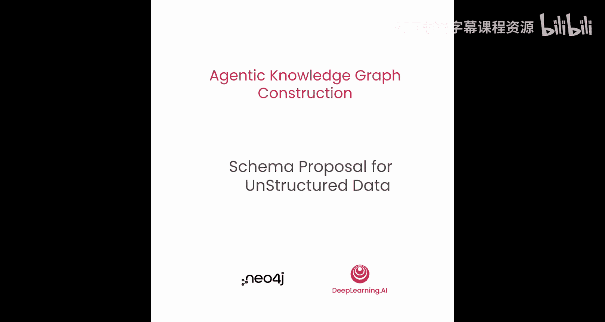
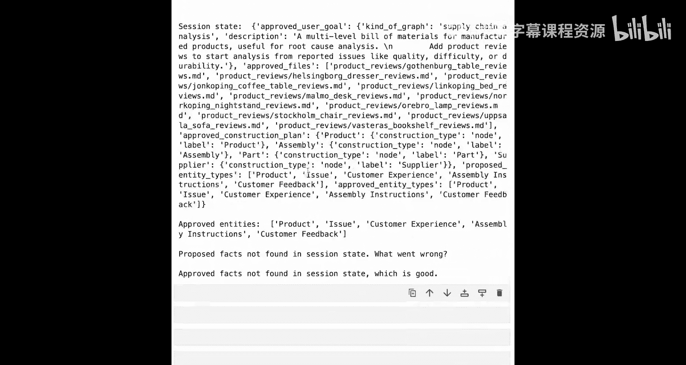
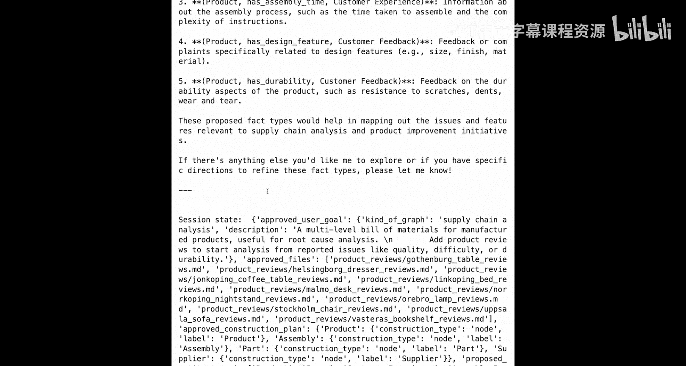
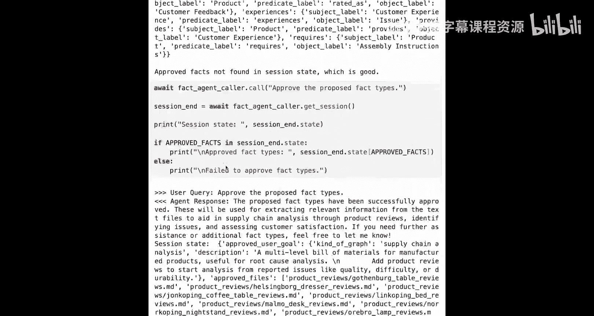
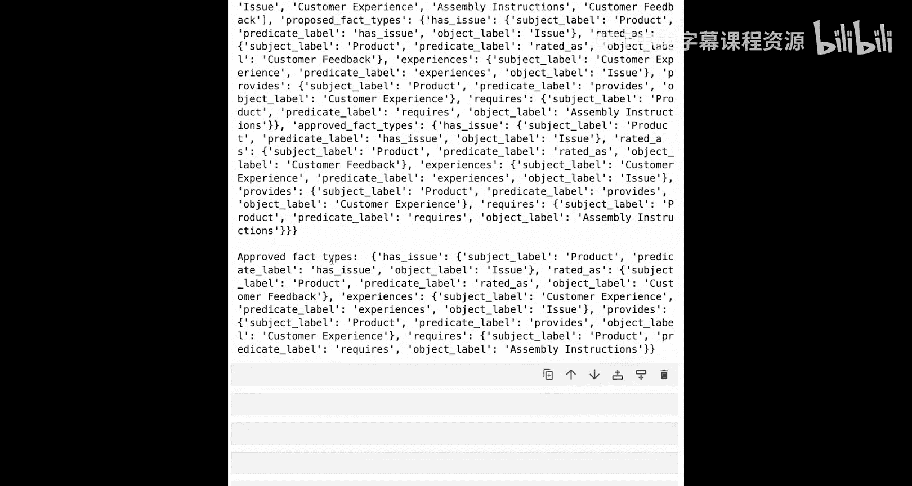

# 吴恩达《智能体驱动的知识图谱构建｜Agentic Knowledge Graph Construction》Claude-4-s翻译 - P9：9.schema-proposal-for-unstructured-data.zh_en - GPT中英字幕课程资源 - BV1AShCzoENH

With now focus on unstructured data， you'll design two specialist agents to decide on the graph model that can be extracted from markdown files。

 Let's get to it。

You have built a complete workflow for defining a construction plan that can build a knowledge graph from CV files。

 Now， you can move on to the unstructured data workflow。 This starts in a similar way。

 with user intent and file suggestion agent， But now for markdown files。

 Those agents are needed for the complete solution but will simulate their output in this lesson。

 Instead， you will focus on the new concept。 The entity and fact type proposal agent。

 The entity and fact type proposal agent is itself composed of two dedicated subag。

 the named entity recognition or any E R schema agent and the fact type extraction agent。

 Notice that the output of these agents is a plan for how to perform knowledge extraction。

 not to do the extraction itself。 The N R schema agent will read the markdown files looking for it named entities。

 These are people， places or things that are prominent in the text In our example， you'd expect。

Things related to furniture and reviews。 The fact type extraction agent is a second pass over the text that looks for the kind of statements that appear about those things。

 So， for example， some furniture has issues。 Together。

 those agents will come up with a plan for extracting information that supports the approved user goal。

To begin， of course， we're going to have to go through some setup and import the usual libraries。

And then it will get open A eyes set up and check that it's working perfectly。That looks good。

 And we'll also check that Neuverj is available。 It's ready to， good。Now。

 the first agent that you're going to define is a named entity recognition agent。

 Nad entity recognition is a very common natural language processing operation that you can find in many different frameworks。

 It turns out， of course， that Lms are very good with language。

 So they're very good with this task as well。 Now， named entity recognition， as it says。

 is the idea of like having entities that are recognized and giving them names， really。

 that's what's kind of happening。 And entity can be anything from a person a place for a thing。

 And here we're going to ask the LM to look for things that are relevant to the user's goal that it can find within the text that's available。

 You'll start by defining the instructions for the agent。 And as before。

 we're going to break this up into a couple different parts that will then compose together。 First。

 to find what the agent's role and goal are。 Here， you're going to describe the agent as being a top tier algorithm designed for doing natural language processing。

 really。 And its goal is to find named entities within the text。

 but it's not actually going to extract those entities。

 The goal here is for it to identify what kinds of entities are available。

You can then give some more hints to the agent to let it know exactly what we're looking for here。

 And again， we're going to describe what an entity is。

 And then also we're going to break it down to two different categories of entities。

 We're going to describe what we're calling here wellknown entities。

 And these are well known because they exist in the structured data that we've already described in the previous lesson。

 So if that structured data。 if some of those entities defined there occur in the text。

 we want those parts of the text also be extracted。 In addition to that。

 we have what we're calling discovered entities。 And these are entities that may not exist in the graph data that we've described。

 but they might be appropriate to the user's goal。 And if they appear consistently。

 then maybe there's something useful。We then give some more details about。

 you know what the design rules are for identifying what a well known entity is and also what a discovered entity is。

 and as before， usually give a couple of examples to help the agent really understand what the purpose is。

The final part of the instructions that you want to put together are the chain of thought directions。

 and here we're going to describe exactly how to prepare for doing the task at hand。

 which is identifying these entities。 So here's the tools that it needs to use to actually find out what is expected of it。

 Give it the full context。 And then here is the proposed series of steps that it should go through。

 It knows some files that are available It has a sampling file tool。

 So go ahead and use that to take a look at some of the files and see what it can discover and consider both the well-known entities and then also discovering new ones that are frequently mentioned。

 And then through that， put together an entire list of entities that it thinks are appropriate and then use the proposed entities tool to find that list。

 And as before will turn back to the user to say， hey， does that look correct。

 And then there will be a separate tool that is called for actually making the approval here it's called the approved proposed entities tool。

You can then compose all those together into a single string。

 and this will become our agent instructions for the named entity recognition agent。

With the instructions defined， you can then provide the definitions of the tools themselves。

 And these are going to be pretty straightforward。 that not a lot of cleverness happening here。

 The tools we're going to define follow the same pattern that we've had in previous lessons。

 We're going to ask the agent to first propose some things and then have some other tools that will take those proposals and turn them into approved versions of those。

 So here， the things we're proposing are a list of entities that are first proposed and then approved。

 And then you can also， of course， get those either proposals or the approvals。

The next tool you need is a little bit different。 It's going to be another getter tool。

 So this is going to be getting the well known types from the schema that was proposed in the previous lesson from the structured data。

 So the well known types tool will end up being the labels are defined for nodes in the previous proposed schema here they're going to be used as the labels。

 we're going to pull them out of the construction plan and then just return that as a list。

You'll go ahead and import the predefined tools that we have defined in previous lessons and then also the additional ones here。

 as before you can combine them into a single list and that's what well use as part of the agent definition。

Now， to get an idea of what the agent is working with， you can use that sample file function。

 just go ahead and call it directly on one of the available files and take a look at the content。

So looking at this markdown file， you can see that this is a bunch of reviews and markdown format。

 It's got the headings。 It's got some values that are embedded here， like ratings。

 You can see there's username， locations。 And， of course， the text of the review itself。 So there's。

Only a handful of reviews in the hero， but it's enough to kind of demonstrate how this all works。

Okay， you've got your instructions defined， you've got your tools defined。

 Now we can construct the agent itself。Now， to run this agent because it's part of a longer workflow。

 it has some assumptions about what's really been accumulated in state。

 So we've got to create an initial state to try this agent doubt。

 and the initial state requires a couple of things。 It needs to have the approved user goal。

 the approved files here you can see the markdown files it's going to take a look at。

 and then also the construction plan。 and it's the construction plan that's used for those well known entity types。

Notice we're leaving out the relationship construction just because we don't need that in this step。

 so this is just kind of simulating what you would need。

Now you're ready to go ahead and run the agent。 We're going to use that make agent call from the helper module。

 and we're going send in a simple request here。 We're going to just basically tell it， you know。

 hey agent can you do your job add some product reviews to the knowledge graph to take product complaints back through the manufacturing process。

 If you run any kind of trouble here。 Of course， you can run the alternative version of this。

 which is a very short sentence， but it has the debug comma true here。

 that'll show you all the output Once the agent is done kind of getting an idea of what it wants to propose。

 and it makes a proposal We'll take a look at the session state to make sure that it actually has made a proposal and hopefully it should not have automatically approved。

 It should be waiting for us to say， yeah， that looks good。

So this will take a couple of minutes to run because the agent is going to go off。

 take a look at a couple of these different files and try to come up with what it thinks is the best set of labels to use for the entities。

 Okay， pretty good job。 It's identified that there's products here。

 There's issues that are reported complaints about customerary experience。

Assembling instructions and maybe some customer feedback， maybe a bit of redundancy。

 But this looks good enough to me。And this is also important， not only did it have a good response。

 but it also updated the session state， the memory correctly。 So we've got proposed entities。

 but we do not yet have approval。So I've got a good result here。 If you have not。

 feel free to run that cell again and see if you get a better set of rose den。 Again。

 this is all set up， assuming that we're going to be in an interactive environment。 But if it works。

 you can go ahead and。Send a new message to the same agent saying， I approve those proposed entities。

 Whence this is done， we should find that it is actually couldt transfer the proposed entities into approved entities。

 and we should see that in the session state。Perfect， there we go。 The approved entities。

 matching what they had proposed before。You can then move on to the second agent。

And this is going to be our fact type extraction subagent。

And as the name implies of course and similar to what the previous agent did。

 we're going to be looking for the types of things that can be extracted。

 We're not going to do the extraction itself。So you can start with the instructions because that's the most important part of both of these agents。

And for this agent， the role and goal， again， we're going to say that this agent is the top tier algorithm。

 Its going to be doing some text analysis。 But here the goal is a little bit different。

 It's going to be looking for the type of facts that could be extracted。

 Don't actually extract those facts。 Just find what types of facts are possible。

To help the agent down to understand what we're really talking about here。

 we're going to provide some hints。 And the important part here that we're going to say。

 and it's similar to what we had in the previous instructions for the previous agent。

 do not propose specific individual facts， but instead proposed the general type of fact that it would be relevant for the user's goal。

 And giving examples is always a great idea。 here， my examples is。

 do not propose that A B K likes coffee， but the general type of fact that you know。

 person likes beverage。So these form very simple sentences and we call these sentences triplets。

 and they of the form subject predicate object， and you can notice that here weve put it in parentheses。

 this is a classic thing to do。 we'll see if the agent actually picks up on that format and provides that back to us in the response。

We give it some additional design rules for how to think about this and what to look for。

 and then also how to use the tools。A little bit different than the previous agent。

 The previous agent had an entire list of proposed entity types here for each individual fact。

 we're going to just add that as an individual fact one at a time。

 rather than here's a collection facts that we're going to propose。 Subtle difference there。

 The importance really ends up being like both how the agent behaves and also what the cost of tokens really ends up being。

 the more ran trips you have， it's going to be a bit more expensive to do。

 But if it's going to have better results， then maybe that's a good trade off。And finally。

 you can go ahead and add the chain of thought directions。 as before。

 we're going to follow the same pattern that we always do for these directions。

 Here's how you prepare for the task。 and the here's are suggested step by step approach for how to actually execute on this task。

 Use the tools in this way， sample some of the files。

 look for subjects and objects that are related to the text。

 and then add proposed facts about those subjects and objects。

 So what you end up with here should be a couple of small sentences， three word sentences。

You can then compose that altogether in a single string。

And where ratess move on to the tool definitions。Now。

 I'm going to spend a little bit more time looking at the tool definitions for the fact type extraction agent。

And that's because it does a little bit of sanity checking along the way。

 And that's part of the intention of actually separating these out into different agents。

 In the previous agent， the named entity recognition agent。

 we give it some guidance about how to look for entities。

 but we didn't really constrained too much about what it found here we're going to be very particular that the facts that it's actually going to propose must match up with existing entity types that were defined by the prior agent。

 splitting it up in this way gives us a little bit better guarantee that we're going to have facts that actually don't line up with entity types that we want。

So when you look at the definition of ad proposed fact here。

 we're getting what we're even saying by argument name is an existing approved subject label proposed predicate label and then an approved object label。

 So that again， is the sort of the triple。And these triples， though。

 both the subject and the object should already exist from the previous agent。

 So we're going to put in a little of guardveils around that。 We're going to check。

 here's the approved entities。 We're going to get that from state and make sure that both the approved subject and the approved object label that are passed in as arguments are in that list。

 And if not， we're going to go ahead and eject an error from this tool call and tell it that label doesn't exist。

 you know that it should try again。 Part of the reason why we're doing things one piece at a time here so that we can one piece at a time actually make a little bit of a corrections to the agent's behavior。

 If that all looks fine， then we kind of rearrange this and should just a triple saveve that into the current predicate list and create a fact list out of that。

The other two functions here are just following the usual pattern。

 getting that list of proposed facts and then approving the proposed facts into the approved list of facts。

You can go ahead and put that list of tools all together， ready to use by the fact agent。

 and now we can go ahead and construct it。Constructing the agent。

 since we've done all the hard work already defining things is pretty straightforward。

 and now you can go ahead and run it。Now， the initial state for this agent is the same as the initial state for the previous agent。

 so we're going to take advantage of that and just go ahead and make a copy of the end state of the previous agent for this agent in the full multi agent system。

 these would just be run in sequence and you know they would have the shared state in that way。

But so you can run them by themselves。 We're going to go ahead and make a copy and then go ahead and make a caller for the agent。

 And the message we're going to use for actually kicking things off is asking it to go ahead and make some proposals。

 There's a lot of output here。 So I'm actually going to switch over to doing it this way without the comm true at the end that will just let the agent do its work without seeing all of the output。

 If you run't to a problem。 use this one with the comm true at the end instead。

Once the agent is done with all of its fact proposals。

 we're going to go ahead and take a look at the session state。

 We're going to assume that it has made a proposal and then complain if it hasn't。 And also。

 we're going to assume that it has not approved to that proposal。 Hopefully that works out。Okay。

 let's take a look at the proposals that it's made here。

 It's proposed facts like that a product has an issue and that a product has received some customer feedback。

 product has an assembly time。 That's an interesting one。A lot of different ones here。

 This looks like a pretty good list。And let's check the session state。

 So something did go wrong here。 It actually sent us back this proposal。

 but it didn't save it to the session state。 Now， why is that？

 Let's see if it has any complaints that it says。

So that's unfortunate。 Sos to decided to actually make this proposal into just plain text。

 but it hasn't followed through with actually making the tool call that we thought that it would。

 So I' move your ahead and run this again。 And， of course， in the full agent system。

If it gets to the point where it makes this kind of proposal。 and at the end。

 we realize that there are no proposed facts， we would go ahead and automatically just retry。

 So this rerun should work pretty cleanly because it's going to re initialize the state and then go through the exact same steps。

Okay， so we've got what looked like pretty much the same fact types as before。

 It aligns with the user goals。 Ask us if we want to proceed。 And let's see if it is actually。

 it has correctly proposed those facts， but it's awaiting the approval。 Okay， great job。

 agent get an a plus this time。So again， if this isn't work out for you。

 you can just try to run it again， depending on the temperament of open AI on any given day。

 itll work first time or second time。 It's usually not three times as required。

 I'm going to godon to send another message approving the proposal。

 and that should just cop it over to the approved fact types。

Looking at the session state， we see the approved fact types at the end。 That's perfect。

 This has been a pretty good run。

