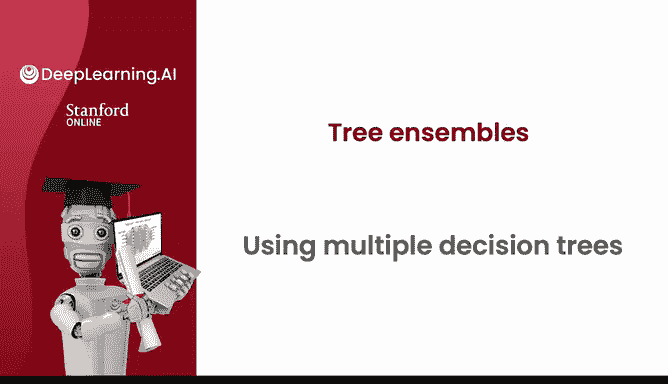
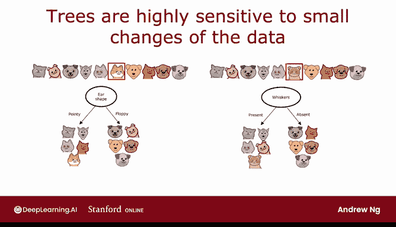
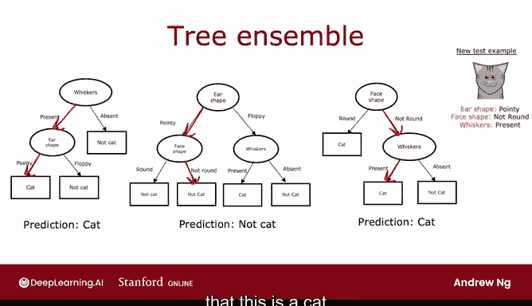

# 吴恩达《机器学习》｜machine-learning（中英字幕-deepseek翻译） - P100：58_04_01_使用多个决策树.zh_en - GPT中英字幕课程资源 - BV1MN4y1S7DE

One of the weaknesses of using a single decision tree is that that decision tree can be highly sensitive to small changes in the data and one solution to make the algorithm less sensitive or more robust is to build not one decision tree but to build a lot of decision trees and we call that a tree ensemble let's take a look with the example that we've been using the best feature the split on at the root note turned out to be the ear shape resulting in these two subsets of the data and then building further subies on these two subsets of the data。

But it turns out that if you were to take just one of the 10 examples and change it to a different cat so that instead of having pointy years round face whiskers apin。

 this new cat has floppy years round face whiskers present。

With just changing a single training example， the highest information gain feature to split on becomes the whiskers feature instead of the ear shape feature。

As a result of that， the subsets of data you get in the left and right subties become totally different。

 and as you continue to run the decision tree learning algorithm recursively。

 you build out totally different subies on the left and right。

 So the fact that changing just one training example causes the algorithm to come up with a different split at the root and therefore a totally different tree。

That makes this algorithm just not that robust。That's why when you're using decision trees。

 you often get a much better result that is you get more accurate predictions if you train not just a single decision tree。

 but a whole bunch of different decision trees。

And this is what we call a tree ensemble， which just means a collection of mouse po trees。

We'll see in the next few videos how to construct this ensemble of trees。

But if you had this ensemble of three trees， each one of these is maybe a plausible way to classify cat versus not cat。

If you had a new test example that you wanted to classify。

 then what you would do is run all three of these trees on your new example and get them to vote on what is the final prediction。

So this test example has  pointy years a not round face shape and whiskers are present。

 and so the first tree would carry out inferences like this and predict that it is a cat。

The second inference would。Follow this path through the tree and therefore predict that is not a cat。

And the third tree would follow this path and therefore predict that it is a cat。

These three trees have made different predictions and so what we'll do is actually get them to vote and the majority vote of the predictions among these three trees is cat so the final prediction of this ensemble of trees is that this is a cat。

 which happens to be the correct prediction。

So the reason we use an ensemble of trees is by having lots of decision trees and having them vote。

 it makes your overall algorithm less sensitive to what any single tree may be doing because it gets only one votes out of three or one votes out of many men in different votes and it makes your overall algorithm more robust。

But how do you come up with all of these different plausible but maybe slightly different decision trees in order to get them to vote in the next video we'll talk about a technique from statistics called sampling W replacement and this will turn out to be a key technique that will use in the video after that in order to build this ensemble of trees so let's go on to the next video to talk about sampling W replacement。

