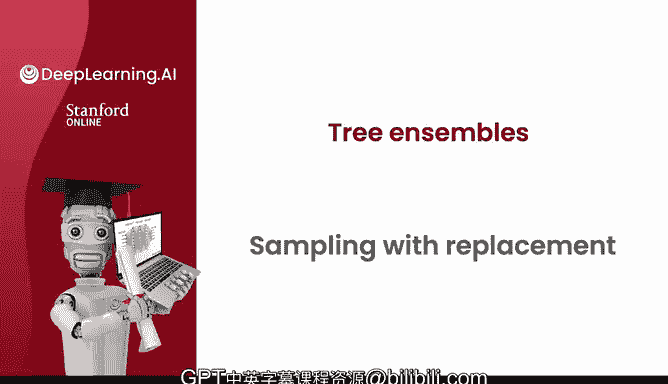
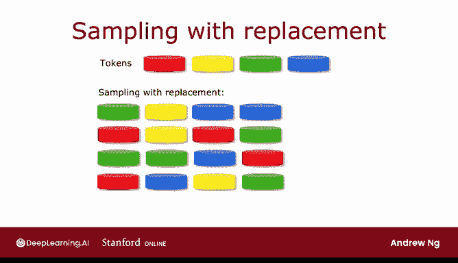

# 吴恩达《机器学习》｜machine-learning（中英字幕-deepseek翻译） - P101：59_04_02_有放回抽样.zh_en - GPT中英字幕课程资源 - BV1MN4y1S7DE

In order to build a tree ensemble， we're going to need a technique called sampling with replacement。

 let's take a look at what that means。

In order to illustrate how sampling with replacement works。

 I'm going to show you a demonstration of sampling with replacements using four tokens that are colored red。

 yellow， green， and blue。So I actually have here with me four tokens of colors， red， yellow， green。

 and blue， and I'm going to demonstrate what something with replacement using them looked like。

Here is a black velvet bag empty， and I'm going to take this example of four tokens and drop them in。

And I'm going to sample four times with replacement I this bag and what that means I'm going to shake it out。

😊，And can't see what I'm picking， pick up one token turns out to be green and the term with replacement means that before I take out the next token。

 I'm going to take this and put it back in and shake it out again。And then take out another one。

 yellow， replace it， that's the work replacement part， and then go again blue。Replace it again。

And then pick on one more which is blue again， so that sequence of tokens I got was green， yellow。

 blue blue notice that I got blue toys and didn't get red even a single time If you were to repeat this something with replacement procedure multiple times if you were to do the game。

 you might get red， yellow， red， green or green， green， blue red。Or you might also get red， blue。

 yellow， green。Notice that the width replacement part of this is critical because if I were not replacing a token every time my sample。

 then if I were to pull all four tokens from my bag of four。

 I will always just get the same four tokens that's why。

Replacing a token after I pull it out each time is important to make sure I don't just get the same four tokens every single time The way that something with replacement applies to building an ensemble of trees is as follows we are going to construct multiple random training sets that are all slightly different from our original training set in particular we're going to take our 10 examples of cats and dogs and we're going to put the 10 training examples in a theoretical bag。

Please don't actually put a real cat or dog in a bag that sounds inhue that you can take a training example and put it in a theoretical bag if you want and using this theoretical bag we're going to create a new random training set of 10 examples of the exact same size as the original data set and the way we'll do so is we'll reach in and pick up one random training example and let's say we get this training example then we put it back into the bag and then again。

Randomly pick up one training example and see you get that and you pick a game and again and again。

And notice now this fifth training example is identical to the second one that we had out there but that's fine and you keep going and keep going and we get another repeat example and so on and so forth until eventually you end up with 10 training examples some of which are repeats and you notice also that this training set does not contain all 10 of the original training examples。

 but that's okay that is part of the sampling with replacement procedure The process of sampling with replacement lets you construct a new training set that's a little bit similar to but also pretty different from your original training set。

 It turns out that this will be the key building block for building an ensemble of trees let's take a look in the next video and how you could do that。

