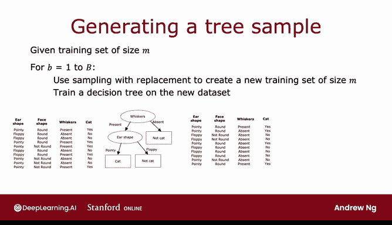
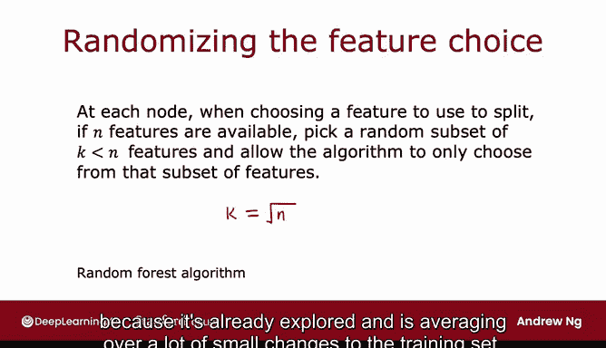

# 吴恩达《机器学习》｜machine-learning（中英字幕-deepseek翻译） - P102：60_04_03_随机森林算法.zh_en - GPT中英字幕课程资源 - BV1MN4y1S7DE

Now that we have a way to use sampling with replacement to create new training sets that are a bit similar to。

 but also quite different from the original training set。

 we're ready to build our first tree ensemble algorithm in particular in this video we'll talk about the random forest algorithm which is one powerful tree ensemble algorithm that works much better than using a single decision tree here's how we can generate an ensemble of trees If you are given a training set of size M then for B equals1 to capital B so we do this capital B times。

You can use something with replacement to create a new training set of size M。

 so if you had 10 training examples， you will put the10 training examples in that virtual bag and sample a replacement 10 times to generate a new training set with also 10 examples。

And then you would train a decision tree on this dataset。

So here's the dataset sets I've generated using sampling with replacement。

 if you look carefully you may notice that some of the training examples are repeated and that's okay and if you train the decision tree algorithm on this data。

 you end up with this decision tree。And having done this once。

 we would then go and repeat this the second time， use something with replacement to generate another training set of M or 10 training examples。

 This again looks a bit like the original training set but it's also a little bit different You then train the decision tree on this new data set and you end up with a somewhat different decision tree and so on and you may do this a total of capital B times。

Typical choice of capital B， the number of such trees you build might be around 100。

 people recommend any value from say 64 to 128。And having built an ensemble of， say。

100 different trees， you would then， when you are trying to make a prediction。

 get these trees that all vote on the correct final prediction。

 It turns out that setting capital B to be larger。Never hurts performance。

 but beyond a certain points you end up with diminishing returns and it doesn't actually get that much better when B is much larger than say 10 or so。

 and that's why I never used say a thousand trees that just slows down the computation significantly without meaningful increasing the performance of the overall algorithm。

Just to give dispolar A a name。This specific instantiation of tree ensemble is sometimes also called a bagged decision tree。

 And that refers to putting your tree examples in that virtual bag。 And that's why also we use the。

Let us lowercase be an uppercase be here because that stands for a bag。

 There's one modification to this algorithm that will actually make it work even much better。

 and that changes this algorithm， the bag decision tree into the random forest algorithm。

 The key idea is that even with this sampling with replacement procedure Sometimes you end up with always using the same split at the root node and very simple split near the root node that didn't happen in this particular example where a small change the training set resulted in a different split at the root node。

 but for other training sets is not uncommon common that for many or even all capital B training sets。

 you end up with the same choice of feature at the root node and at a few of the nodes near the root node。

 So there's one modification to the algorithm to further try to randomize the feature choice at each node that can cause the center of trees you learn。

To become more different from each other。 So that when you vote them。

 you end up with an even more accurate prediction。 The way this is typically done is。At every node。

When choosing a feature to use the slit， if n features are available。 So in our example。

 we had three features available。Rather than picking from all n features。

 we would instead pick a random subset of K less than n features。

And allow the algorithm to choose only from that subset of k features so in other words you would pick k features as the allow features and then out of those k features choose the one with the highest information gain as the choicer feature to use the split when n is large。

 say n is dozens or tens or even hundreds a typical choice for the value of K would be to choose it to be square root of n。

In our example we have only three features and this technique tends to be used more for larger problems with a larger number of features and would just further change the algorithm you end up with the random forest algorithm which will work typically much better and becomes much more robust than just a single decision tree one way to think about why this is more robust than a single decision tree is the sampling with replacement procedure。

Causes the algorithm to explore a lot of small changes to the data already and is training different decision trees and is averaging over all of those changes to the data that is something where replacement procedure causes。

 and so this means that any little change further to the training set makes it less likely to have a huge impact on the overall output of the overall random forest algorithm because it's already explored and is averaging over a lot of small changes to the training set。

Before wrapping out this video， there's just one more thought I want to share with you。

 which is where does a machine learning engineer go camping？In a random forest。Allright。

 go and tell that joke to your friends， I hope you enjoy it。

 the randomand forest is an effectivearrow and I hope you better use it in your work。😊。

Beyond the random forest， it turns out there's one other algorithm that works even better which is a boosted decision tree in the next video let's talk about a boosted decision tree algorithm called XG boost。

