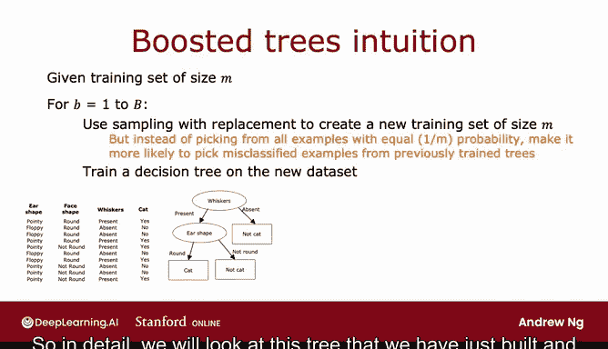
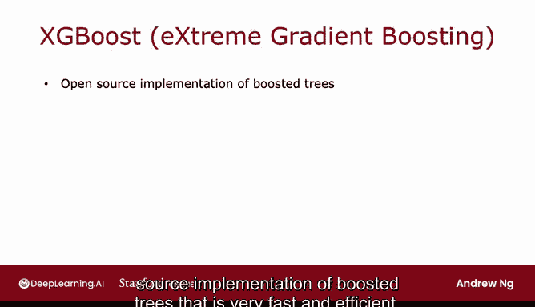
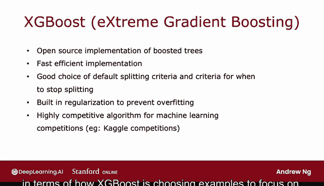
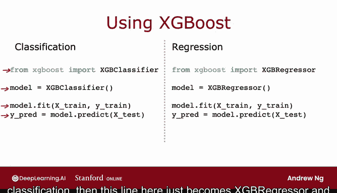

# 吴恩达《机器学习》｜machine-learning（中英字幕-deepseek翻译） - P103：61_04_04_XGBoost.zh_en - GPT中英字幕课程资源 - BV1MN4y1S7DE

Over the years， machine learning researchers have come up with a lot of different ways to build decision trees and decision tree ensembles today。

 by far the most commonly used way or implementation of decision tree ensembles or decision trees is an algorithm called XG boost It runs quickly the open source implementations that easily used has also been used very successfully to win many machine learning competitions as well as in many commercial applications Let's take a look at how XG boost works There's a modification to the bag decision tree algorithm that we saw in the Mars video that can make it work much better。

 Here again is the algorithm that we had written down previously。

Given the training set of sizeM， you repeat capital B times use sampling or replacement to create a new training set of sizeM and then train the designry on the new data set。

 and so the first time through this loop， we may create a training set like that and train the disry like that。

 but here's where we're going to change the algorithm， which is every time through this loop。

 other than the first time there is a second time third time and so on。When sampling。

 instead of picking from all M examples with equal probability with one over imp probability。

 let's make it more likely that we' pick misclassified examples that the previously trade trees do poorly on in training and education。

 there's an idea called deliberate practice。 For example。

 if you're learning to play the piano and you're trying to master piece in a piano rather than practicing the entire say fivemin piece over and over。

 which is quite time consuming if you instead play the piece and then focus your attention on just the parts of the piece that you aren't yet playing that well in practice those smaller parts over and over。

 then that turns out to be a more efficient way for you to learn to play the piano well。

And so this idea of boosting is similar。 We're going to look at the decision trees we've trained so far and look at what we're still not yet doing well on and then when building the next decision tree。

 we're going to focus more attention on the examples that we're not yet doing well so rather than looking at all the training examples we focus more attention on the subset of examples is not yet doing well on and get the new decision tree。

 the next decision tree we built the ensemble to try to do well on them and this is the idea behind boosting and it turns out to help the learning algorithm learn to do better more quickly So in detail we would look at this tree that we have just built and go back to the original training set notice that this is the original training sets。

 not one generated through something replacement and we'll go through all 10 examples and look at what this learned decision tree predicts on all 10 examples So this foremost column。

predictions and I put a check mark across next to each example。

 depending on whether the tree's classification was correct or incorrect。

So what we'll do in the second time through this loop is。

We will sort of use sampling with replacement to generate another training set of 10 examples。

 but every time we pick an example from these 10 we'll give a higher chance of picking from one of these three examples that we're still misclassifying and so this focuses the second decision treess attention via process like deliberate practice on the examples that the algorithm is still not yet doing that well on。

And the boosting procedure will do this for a total of capital B times， where on each iteration。

 you will look at what the ensemble of trees。For trees one。

2 up through being minus1 are not yet doing that well on and when you're building tree number B。

 you will then have a higher probability of picking examples that the ensemble of the previously though trees is still not yet doing well on the mathematical details of exactly how much to increase the probability of picking this versus that example are quite complex。

 but you don't have to worry about them in order to use Ruid tree implementations。

And of different ways of implementing Boing， the most widely used one today is XGbooze。

 which stands for extreme gradient boosting， which is an open source implementation of boosted trees that is very fast and efficient XGbooze also has a good choice of the default footing criteria and criteria for when to stop splitlitting and one of the innovations in XGboos is that it also has built in regularization to prevent overfitting。

 and in machine learning competitions such as there a widely used competition site called kgle。

 XGbooze is often a highly competitive algorithm。 In fact。

 XGbooze and deep learning algorithms seem to be the two types of algorithms that in a lot of these competitions Oh in one technical note rather than doing something with replacement。

 XGbooze actually assigns different ways to different training examples so it doesn't actually need to generate a lot of randomly chosen。

And this makes it even a little bit more efficient than using a sampling with replacement procedure。

 but the intuition that you saw on the previous slide is still correct in terms of how XG Booze is choosing examples to focus on。

The details of XGBs are quite complex to implement。

Which is why many practitioners will use the open source libraries that implement。Exji bo。

This is all you need to do in order to use XGboos。 You would import the XGBo library as follows。

And initialize a model as an XG Bot classifier。For the model。

 and then finally this allows you to make predictions using this Bed decisionion trees algorithm。

I hope that you find this however useful for many applications that you may build in the future。

 or alternatively， if you want to use XGboos for regression rather than for classification。

 then this line here just becomes XGB regressor and theres the code works similarly so that's it for the XG boosto algorithm we have just one last video for this week and for this course where we'll wrap up and also talk about when should you use a decision tree versus maybe use the neural network let's go on to the last and final video of this week。

