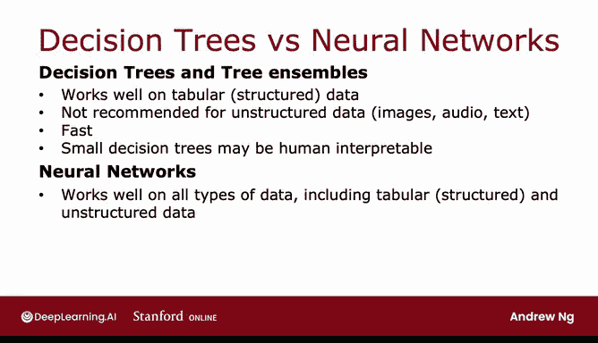

# 吴恩达《机器学习》｜machine-learning（中英字幕-deepseek翻译） - P104：62_04_05_何时使用决策树.zh_en - GPT中英字幕课程资源 - BV1MN4y1S7DE

Both decision trees， including tree ensembles as well as neural networks are very powerful。

 very effective learning algorithms When should you pick one or the other let's look at some of the pros and cons of each。

Decision trees and tree ensembles will often work well on tabular data， also called structured data。

And what that means is if your dataset set looks like a giant spreadsheet。

 then decision trees would be worth considering So， for example。

 in the housing price prediction application， we had a data set with features corresponding to the size of thehus。

 the number of bedrooms and number of floors and the age of the home and that type of data stored in the spreadsheet with either categorical or continuous value features and both for classification or for regression tile which trying to predict discrete category or predict the number。

All of these problems are ones that decision trees can do well on。In contrast。

 I would not recommend using decision trees and tree ensembles on unstructured data。

 and that's data such as images， video or du text that you're less likely to store in a spreadsheet format Ne networks。

 as we'll see in a second， will tend to work better for unstructured data tasks。

One huge advantage of decision trees and tree ensembles is that they can be very fast to train。

You might remember this diagram from the previous week in which we talked about the iterative loop of machine learning development if your model takes many hours to train then that limits how quickly you can go through this loop and improve the performance of your algorithm。

 but because decision trees， including tree ensembles tend to be pretty fast a train that allows you to go through this loop more quickly and maybe more efficiently improve the performance of your learning algorithm。

Finally， small decision trees may be human interpretable if you are training just a single decision tree and if that decision tree has only。

 say a few dozen those， you may be able to print out the decision tree to understand exactly how it's making decisions。

I think that the interpretability of decision trees is sometimes a bit overstated because when you build an ensemble of 100 trees and if each of those trees has hundreds of nodes。

 then looking at that ensemble to figure out what it's doing does become difficult and may need some separate visualization techniques。

 but if you have a small decision tree， you can actually look at it and see， oh。

 is classifying whether something is a cat by looking at certain features in certain ways。

If you've decided to use a decision tree or tree ensemble。

I would probably use XGbooze for most of the applications I would work on one slight downside of a tree ensemble is that it is a bit more expensive than a single decision tree。

 and so if you had a very， very constrained computational budget。

 you might use a single decision tree， but other than that setting I would almost always use a tree ensemble and use XGbooze in particular。

How about neural networks In contrast to decision trees and tree ensembles。

 it works well on all types of data， including tableular or structured data as well as unstructured data。

 as well as mixed data that includes both structured and unstructured components。

Whereas on tableular structured data， neural networks and decision trees are often both competitive on unstructured data such as images。

 video， audio and text， and neural network will really be the preferred algorithm and not the decision tree or tree ensemble。

On the downside， though， neural networks may be slower than a decision tree。

A large neural network can just take a long time to train。

Other benefits of neural networks includes that it works with transfer learning。

 and this is really important because for many applications where you have only a small data。

 being able to use transfer learning and carry out pre-training on a much larger data that is critical to getting competitive performance。

Finally， if you're building a system of multiple machine learning models working together。

 it might be easier to string together and train multiple neural networks than multiple decision trees。

The reasons for this are quite technical and you don't need to worry about it for the purpose of this course。

 but it relates to that even when you string together multiple neural networks。

 you can train them all together using gradient in descent。

 whereas for decision trees you can only train one decision tree at a time。So that's it。

 you've reached the end of the videos for this course on advanced learning algorithms。

 thank you for sticking me all this way and congratulations on getting to the end of the videos on advanced learning algorithms。

 you've now learned how to build and use both neural networks and decision trees and also heard about a variety of tips。

 practical advice on how to get these algorithms to work well for you。😊。

But even with all that you've seen on supervised learning。

 that's just part of what learning algorithms can do supervised learnings need label datasets with the labels Y on your training set there's another set of very powerful algorithms called unsupervised learning algorithms where you don't even need labels why for the algorithm to figure out very interesting patterns and to do things with the data that you have so I look forward to seeing you also in the third and final course of the specialization which would be on unsupervised learning。

Now， before you finish out this course I hope you also enjoy practicing the ideas of decision trees in their practice quizzes and in their practice labs。

 I'd like to wish you the best of luck in their practice labs or for those of you that may be Star Wars fans。

 let me say may the forest be with you。