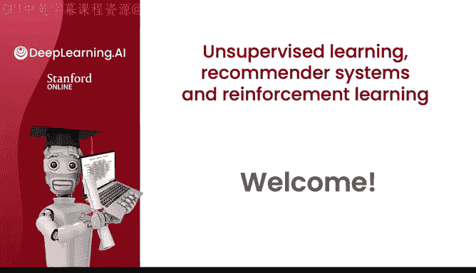
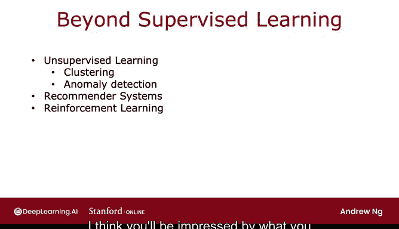

# 吴恩达《机器学习》｜machine-learning（中英字幕-deepseek翻译） - P106：01_01_01_欢迎.zh_en - GPT中英字幕课程资源 - BV1MN4y1S7DE

Welcome to this third and final course of this specialization on unsupervised learning。

 recommended systems and reinforcement learning。

Whereas in the first two courses we spent a lot of time on supervised learning in this third and final course we'll talk about a new set of techniques that goes beyond supervised learning and will give you an extra set of powerful tools that I hope you enjoy adding to your toolet and by the time you finish this course and finish the specialization I think you'll be well on your way to be an expert in machine learning let's take a look。

This week will start with unsupervised learning and in particular you learn about clustering algorithms。

 which is a way of grouping data into clusters as well as anomaly detection。

 both these are techniques used by many companies today in important commercial applications。

And by the end of this week， you know how these algorithms work and be able to get into work with yourself as well。

In the second week， you will learn about recommend systems when you go to a online shopping website or a video streaming website。

 how does it recommend products or movies to you？Recommened systemss is one of the most commercially important machine learning technologies is moving many billions of dollars worth of value or products or other things around is one of the technologies that receive surprisingly little attention from academia despite how important it is。

 but in the second week I hope you learn。How these systems work and be able to implement one for yourself。

And if you are curious about how online ad systems work。

 the description of recommended systems will also give you a sense for how those large online ad tech companies decide what ads to show you。

In the third and final week of this course。You learn about reinforcement learning。

 you may have read in the news about reinforcement learning being great at playing a variety of video games。

 even outperforming humans， I've also used reinforcement learning many times myself to control a variety of different robots。

Even though reinforcement learning is a new and emerging technology， that is。

 the number of commercial applications of reinforcement learning is not nearly as large as the other techniques covered in this week or in the previous two courses of the specialization is a technology that is exciting and is opening up the new frontier to what you can get learning algorithm to do。

And so in the final week， you implement reinforcement learning yourself and use it to land a simulated moonlander。

And when you see that working for yourself with your own code later in this course。

 I think you'd be impressed by what you can get reinforcement learning to do。

So I'm really excited to be here with you to talk about unsupervised learning。

 recommended systems and reinforcement learning。So let's go on to the next video where you learn about an important unsupervised learning algorithm called a clustering algorithm。

