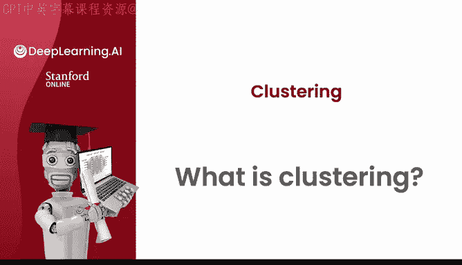
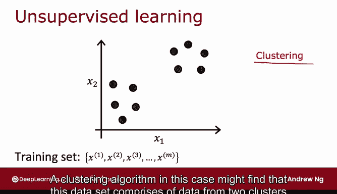
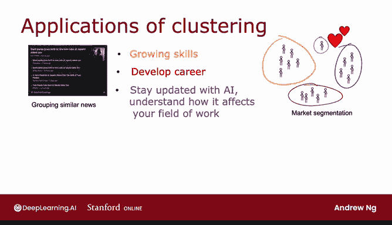

# 吴恩达《机器学习》｜machine-learning（中英字幕-deepseek翻译） - P107：02_01_01_什么是聚类.zh_en - GPT中英字幕课程资源 - BV1MN4y1S7DE

What is clustering a clustering algorithm looks at a number of data points and automatically finds data points that are related or similar to each other let's take a look at what that means let me contrast clustering which is an unsupervised learning algorithm with what you had previously seen with supervised learning for binary classification。

Given the data sets like this， we features X1。And x2。With supervised learning。

 we had a training set with both the input features X as well the labels Y。

And we could plot a data set like this and fit， say a logistic regression algorithm or a neural network to learn a decision boundary like that。

And in supervised learning， the dataset included both the input X， as well as the target outputs Y。

In contrast in unsupervised learning you're given a dataset like this with just X。

 but not the labels or the target labels y， and that's why when I plot the data it looks like this with just dots rather than two classes denoted by the x's and the Os because we don't have target labels y we're not able to tell the algorithm。

 what is the quote right answer y that we want it to predict instead we're going to ask the algorithm to find something interesting about the data that is to find some interesting structure about this data。

 but the first unsupervised learning algorithm that you learn about is called a clustering algorithm which looks for one particular type of structure in the data。

Namely， it'll look at the data like this and try to see if it can be grouped into clusters。

 meaning groups of points that that's similar to each other。

So a clustering algorithm in this case might find that this data set comprises of data from two clusters shall here。

 here are some applications of clustering。

In the first week of the first course， you heard me talk about grouping similar news articles together。

Like the story about pandas or Marcus segmentation where at deep learningning。AI。

 we discovered that there are many learners that come here because you may want to grow your skills or develop your careers or stay updated with AI and understand how it affects your view the work。

 and we want to help everyone with any of these goals to learn about machine learning or if you don't fall into one of these cluster that's totally fine to and I hope deep learning。

 AI and stand an online materials will be useful to you as well clustering has also been used to analyze DNA data where you would look at the genetic expression data from different individuals and try to group them into people that exhibit similar traits。

I find astronomy and space and space exploration fascinating。

 and so one application that I thought was very exciting was astronomers using clustering for astronomical data analysis to group bodies in space together for their own analysis of what's going on in space。

And so one of the applications I found fascinating was astronomers using clustering to group bodies together to figure out which ones form one galaxy or which one form coherent structures in space。

So clustering today is used for all of these applications and many， many more。😊，In the next video。

 let's take a look at the most commonly used clustering algorithm called the Can means algorithm and let's take a look at how it works。

