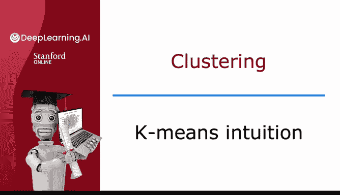
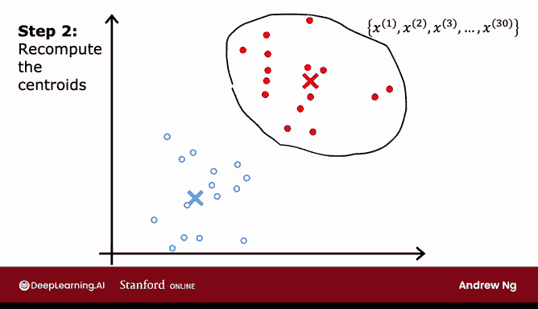

# 吴恩达《机器学习》｜machine-learning（中英字幕-deepseek翻译） - P108：03_01_02_K均值算法直观理解.zh_en - GPT中英字幕课程资源 - BV1MN4y1S7DE

Let's take a look at what the K means clustering algorithm does let me start with an example here I've plotted a data set with 30 unlabeled training examples。

 so there are 30 points。And what we like to do is run Heians on this dataset。

The first thing the Le Caian algorithm does is it will take a random guess at where might be the centers of the two clusters that you might ask it to find In this example I'm going to ask it to try to find two clusters later in this week we'll talk about how you might decide how many clusters to find。

 but the very first step is it will randomly pick two points which I've shown here as a red cross and a blue cross at where might be。

The centers of two different clusters these is just a random initial guess and they're not particularly good guesses but iss a start One thing I hope you take away from this video is that K means will repeatedly do two different things the first is assign points to cluster centroids and the second is move cluster centroids let's take a look at what this means。

The first of the two steps is it will go through each of these points and look at whether it is closer to the red cross or to the blue。

Cross。The very first thing that Ca means does is it will take a random guess at where are the centers of the cluster？

And the centers of the cluster are called cluster centroids。

After it's made an initial guess at where are the cluster cents。

 it will go through all of these examples， x1 through x30 by 30 data points。And for each of them。

 it will check if it is closer to the red clustercentroid shown by the red Cross。

 or if it iss closer to the blue clusterentroid shown by the blue Cross。

 and it will assign each of these points to whichever of the clustercentroids it is closer to。

I'm going to illustrate that by painting each of these examples， each of these little round dots。

 either red or blue， depending on whether that example is closer to the red or to the blue cluster Android。

So this point up here is closer to the red centroid， which is why I's painted red。

 whereas this point down there is closer to the blue cluster centroid。

 which is why I've now painted in blue。So that was the first of the two things that Caians does over and over。

 which is assign points to clusterandroids and all that means is it will associate。

Wwhichch I'm illustrating here with the color， every points with one of the cluster Androids。

 the second of the two steps that Kas does is theyll look at all of the red points。

And take an average of them。And it will move the red Cross to whatever is the average location of the red dots。

 which turns out to be here， and so the red cross that is the red cross the central will move here。

And then we do the same thing for all the blue dots。

 look at all the blue dots and take an average of them and move the blue cross over there。

 so you now have a new location for the blue close to sroid as well。In the next video。

 we'll look at the mathematical formulas for how to do both of these steps。

But now that you have these new and hopefully slightly improved guesses for the locations of the。

Two cluster centroids we'll look through all of the 30 training examples again and check for every one of them。

 whether it's closer to the red or the blue cluster centroid for the new locations and then we will associate them which I indicate by the color gain every point to the closer cluster centroid and if you do that you see that the field points change color。

So for example， this point was colored red because it was closer to the red clustercentroid previously。

 but if we now look again this now actually closer to the blue clustercentroid because the blue and red clustercentroids have moved。

So if we go through and associate each point with the closer closest Android， you end up with this。

And then we just repeat the second part of key music game， which is look at all of the。

Readed dots and compute to average。And also look at all of the blue dots and compute the average location of all of the blue dots。

 and it turns out that you end up moving the red cross over there and the blue cross over here and we repeat。

 let's look at all of the points again and we color them either red or blue depending on which cluster centralroid it is closer to so you end up with this。

And then again， look at all the red dots and take their average location and look at all the blue dots and take their average location and move the clusters to the new locations。

And it turns out that if you were to keep on repeating these two steps。

 that is look at each point and assign it to the nearest clusterandroid and then also move each clusterentroid to the mean of all the points with the same color if you keep on doing those two steps you find that there are no more changes to the colors of the points or to the locations of the clusterandroids and so this means that at this point。

 the K means clustering algorithm has converged because applying those two steps over and over results in no further changes to either the assignment of points to the centroids or to the location of the clusterentroids in this example it looks like K means has done a pretty good job it has found that these points up here correspond to one cluster and these points down here correspond to a second cluster。

So now you've seen an illustration of how K means works the two key steps are assign every point to a clustercentroid depending on what clusterentroid is nearest to and second move each clustercentroid to the average or the mean of all the points that were assigned to it in the next video will' look at how to formalize this and write out the algorithm that does what you just saw in this video let's go on to the next video。

