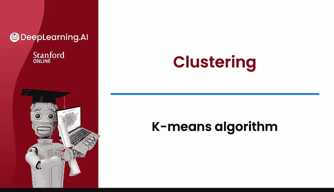
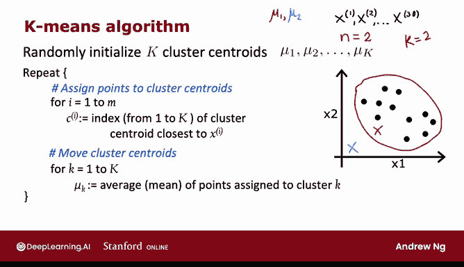
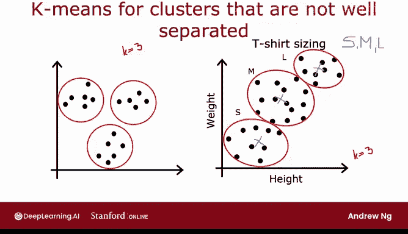

# 吴恩达《机器学习》｜machine-learning（中英字幕-deepseek翻译） - P109：04_01_03_K均值算法.zh_en - GPT中英字幕课程资源 - BV1MN4y1S7DE

In the last video， you saw an illustration of the Canens algorithm running Now let's write out the Kayens algorithm in detail so that you'd be able to implement it for yourself。

 Here's the Kayens algorithm。The first step is to randomly initialize K cluster centros mu1 mu2 through mu K。

In the example that we had this corresponded to when we randomly chose a location for the red Cross and for the blue Cross corresponding to the two cluster cents。

In our example， k was equal to2， so if the red cross was cluster centroid 1 and the blue cross was cluster centroid 2。

 these are just two indices to denote the first and the second cluster。

Then the red cross would be the location of mu 1， and the blue cross would be the location of mu 2。

 And just be clear mu 1。And mu2 are vectors which have the same dimension as your training examples。

 x1 through say x30 in our example， so all of these are lists of two numbers or there are two dimensional vectors。

Or whatever dimension the training data had。So if we had n equals two features for each of the training examples。

 then mu 1 and2 will also be two dimensional vectors， meaning vectors with two numbers in them。

 having randomly initialized the K clustercentroids。

 kians will then repeatedly carry out the two steps that you saw in the last video。

The first step is to assign points to clustercentroids， meaning color each of the points。

 either red or blue， corresponding to assigning them to clustercentroids1 or two。When K is equal to2。

Rined out in math， that means that we're going to for I equals1 through M for all M training examples。

 we're going to set C to be equal to the index which can be anything from 1 to K of the clustercentroid closest to the training example X I mathematicalmaticly you can write result as computing the distance between X I and new K and in math。

 the distance between two points is often written like this， it is also called the L2 norm。

And what you want to find is the value of k that minimizes this。

Because that corresponds to the clusterentroid mu K that is closest to。The training example， X I。

And then the value of k that minimizes this is what gets set to C。When you implement this algorithm。

 you find that it's actually a little bit more convenient to minimize the squared distance。

Because the clustercentroid with the smallest square distance should be the same as the clustercentroid with the smallest distance。

And when you look at this weekss。Optional labs and practice labs。

 you see how to implement this in code for yourself。As a concrete example。

This point up here is closer to the red or to clusterentroid1， so if this was training example x1。

 we would set C1 to be equal to1， whereas this point over here， if this was the 12 training example。

 this is closer to the second clustercentroid to blue1， and so we will set。This。

 the corresponding cluster assignment variable to two because it's closer to cluster Sroid2。

 so that's the first step of the K means algorithm assign points to cluster centroids the second step is to move the cluster centralroids and what that means is for lowercase K equals1 to capital K the number of clusters we're going to set the cluster centroid location。

To be updated to be the average or the mean of the points assigned to that cluster K concretely what that means is we'll look at all of these red points。

 say， and look at their position on the horizontal axis。

 look at the value of the first feature x1 and average that out。

And compute the average value on the vertical axis as well， and after computing those two averages。

 you find that the mean is here， which is why。Mux1。

 that is the location that the red cluster Androidroid gets updated as follows。Similarly。

 we will look at all of the points that were colored blue， that is with C equals 2。

And computes the average of。The value on the horizontal axis， the average of their feature x1。

 compute the average of the feature x2， and those two averages give you the new location of the blue cluster Androidroid。

 which therefore moves over here。Just to write those out in nav。If the first cluster had a to it。

Training examples， one， five， six， and 10。Just as an example。

Then what that means is you would compute。The average this way。Notice that x1， x5。

 x6 and x10 are training examples。Fortune examples。

 so we divide by4 and this gives you the new location of me1。

The new cluster centroid for cluster one， to be clear。

 each of these x values are vectors with two numbers in them。

Or n numbers in them if you have n features and so mu will also have two numbers in it or n numbers in it if you have n features instead of two。

Now， there is one corner case to this algorithm， which is。

What happens if a cluster has zero training examples assigned to it in that case。

 the second step muK would be trying to compute the average of zero points and that's not well defined。

If that ever happens， the most common thing to do is to just eliminate that cluster so you end up with k minus1 clusters。

 or if you really really need K clusters， an alternative would be to just randomly reinitialize that cluster centroid and hope that it gets assigned at least some points next time round。

 but it's actually more common when running K means to just eliminate the cluster if no points are assigned to it。

Even though I've mainly been describing cameians for clusters that are well separated。

 so clusters that may look like this where if you ask it to find three clusters。

 hopefully it will find these three distinct clusters。

 it turns out that cameians is also frequently applied to datas where the clusters are not that well separated for example。

 if you are a designer and manufacturer of cool t-shirts， and you want to decide how do I size。

My small， medium and large t-shirs， how small should a small be。

 how large should a large be and what should a medium sized T-shirt really be and so one thing you might do is collect data of people likely to buy your t-hirts based on their heights and weights。

And you find that the height and weight of people tend to vary continuously on the spectrum without very clear clusters。

Nonetheless， if you were to run Caie and Swift。Say the plus the ss。

 you might find that Kas would group these points into one cluster there。

These points into second cluster and these points into third cluster。

And so if you're trying to decide exactly how to size your small， medium and large T shirts。

 you might then。Choose the dimensions of your small t-shirt to try to make it fit these individuals well。

 the medium sized t-shirt to try to fit these individuals well。

 and the large t-shirt to try to fit these individuals well， with potentially the cluster centroids。

 giving you a sense of what is the most representative height and weight that you would want your three t-shirt sizes to fit。

So this is an example of Kmes working just fine and giving a useful result。

 even if the data does not lie in well separated groups or clusters。

 so that was the K meanss clustering algorithm， assign clustercentize randomly and then repeatedly assign points to clustercentries and move the clustercentries。

But when is this algorithm really doing and do we think this algorithm will converge or might they just keep on running forever and never converge to gain deeper intuition about the K means algorithm and also see why we might hope this algorithm does converge let's go on to the next video where you see that Ka means is actually trying to optimize a specific cost function let's take a look at that in the next video。

