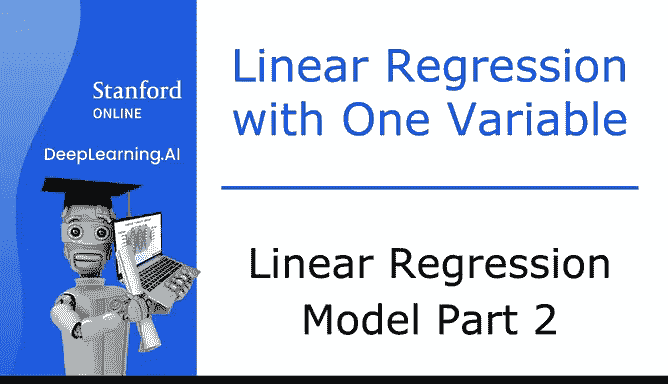
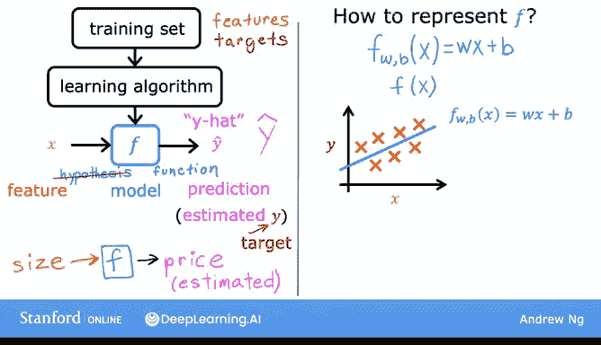
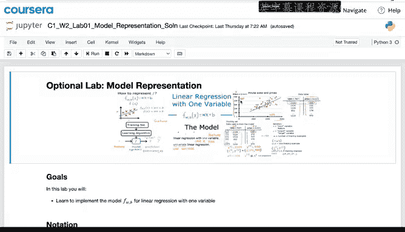
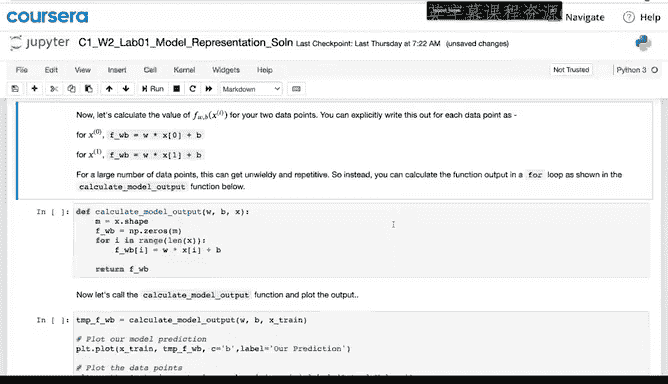
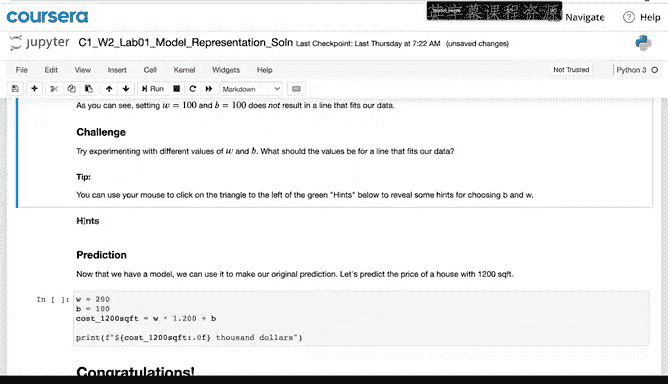
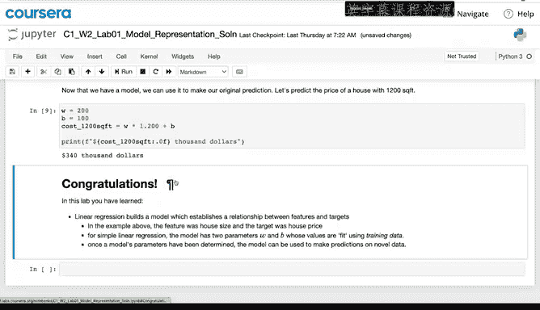

# 吴恩达《机器学习》｜machine-learning（中英字幕-deepseek翻译） - P10：10_01_02_线性回归模型第二部分.zh_en - GPT中英字幕课程资源 - BV1MN4y1S7DE

Let's look in this video at the process of how supervised learning works。

Suviss learning algorithm will input the data set and then what exactly does it do and what does it output。

 let's find out in this video。Recall that a training set in supervised learning includes both the input features。

 such as the size of the housese and also the output targets， such as the price of the house。

 The output targets are the right answers that the model will learn from。To train the model。

 you feed the training set， both the input features and the output targets to your learning algorithm。

Then your supervised learning algorithm will produce some function。

We'll write this function as lowercase F where F stands for function His this function used to be called a hypothesis。

 but I'm just going to call it a function F in this class。And the job of F is to take a new input X。

And output an estimate or prediction， which I'm going to call why hat and is written like the variable Y with this little hat symbol on top。

In machine learning， the convention is that Y hat is the estimate or the prediction for why。

The function F is called the model。X is called the input or the input feature。

 and the output of the model is to prediction Y hat。

The model's prediction is the estimated value of y。When the symbol is just a letter Y。

 then that refers to the target， which is the actual true value in the training set。 In contrast。

 Y hat is an estimate， it may or may not be the actual true value。Well。

 if you're helping your client to sell theirhu， well the true price of thehu is unknown until they sell it。

 so your model F， given the size， outputs the price which is the estimated that is the prediction of what the true price will be。

Now， when we design a learning algorithm。A key question is。

 how are we going to represent the function F， or in other words。

 what is the math formula we're going to use to compute F？For now。

 let's stick with F being a straight line， so your function can be written as F Subscript w comma B of x equals。

 I'm going to use W times x plus B。I'll define W and B soon。

 but for now just know that W and B are numbers and the values chosen for W and B will determine the prediction Y hat based on the input feature X。

 so this FwB of x means F is a function that takes x's input。

 and depending on the values of W and B F will output some value of a prediction Y hat。

As an alternative to writing this FW comma B of X， I'll sometimes just write F of x without explicitly including W and B in the sub it' just a simple notation。

 but means exactly the same thing as FWB of X。Let's plot a trading set on a graph where the input feature X is on the horizontal axis and the output target Y is on the vertical axis。

 Remember， the a learns from this data and generates。A best fit line， like maybe this one here。

This straight line is the linear function， FwB of x equals W times x plus B。

Or more simply we can drop W and B and just write F of x equals W X plus B。

 Here's what this function is doing is making predictions for the value of y using a straight line function of x。

 so you may ask， why are we choosing a linear function where linear function is just a fancy term for a straight line instead of some nonlinear function like a curve for a parabola？

Well， sometimes you want to fit more complex nonlinear functions as well， like a curve like this。

 but since this linear function is relatively simple and easy to work with。

 let's use a line as a foundation that will eventually help you to get to more complex models that are nonlinear。

This particular model as a name is called linear regression。

 more specifically this is linear regression with one variable where the phrase one variable means that there's a single input variable or feature X。

 namely the size of the holes。Another name for a linear model with one input variable is univariate linear regression。

 where uni means one in Latin and wherevari means variable。

 so univariate is just a fancy way of saying one variable。

In a later video you also see a variation of regression where you want to make a prediction based not just on the size of ahuse。

 but on a bunch of other things that you may know about thehu such as number of bedrooms and other features and by the way。

 when you're done with this video there is another optional lab you don't need to write any code just review it。

 run the code and see what it does that will show you how to define in Python a straight line function and the lab will let you choose the values of W&B to try to fit the training data。

You don't have to do the lab if you don't want to， but I hope you play of it when you're done watching this video So that's linear regression in order for you to make this work。

 one of the most important things you have to do is construct a cost function The idea of a cost function is one of the most universal and important ideas in machine learning and it used in both linear regression and in training many of the most advanced AI models in the world So let's go on to the next video and take a look at how you can construct a cost function。

