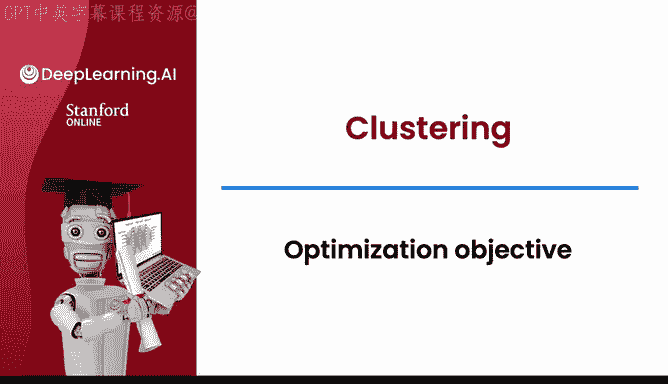
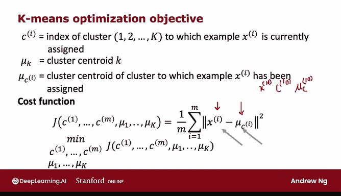
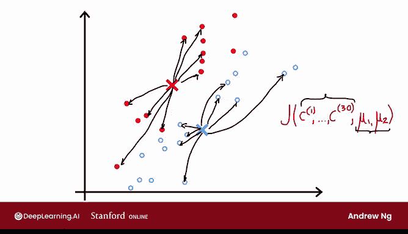
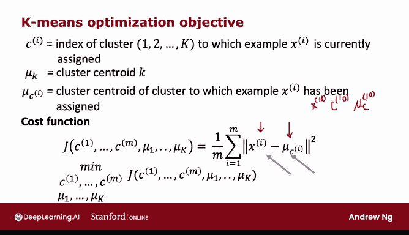
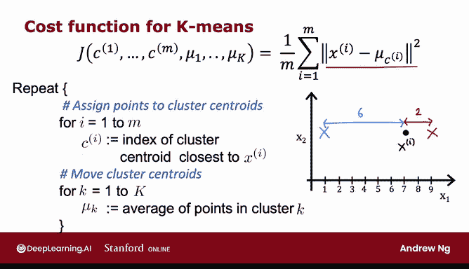
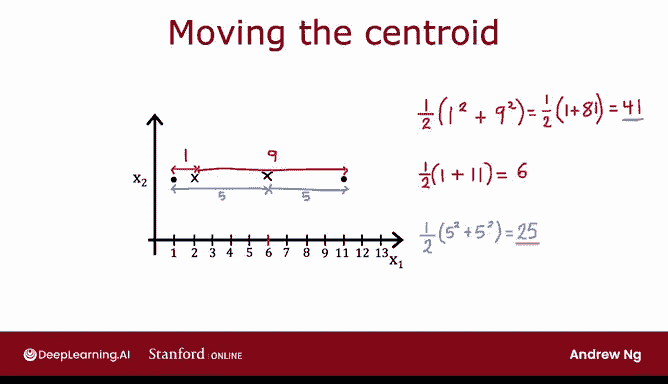

# 吴恩达《机器学习》｜machine-learning（中英字幕-deepseek翻译） - P110：05_01_04_优化目标.zh_en - GPT中英字幕课程资源 - BV1MN4y1S7DE

In the earlier causess， causess one and two of the specialization。

 you saw a lot of supervised learning algorithms as taking a training set， posing a cost function。

 and then using gradient in descent or some other algorithm to optimize that cost function。

It turns out that the key means algorithm that you saw in the loss video is also optimizing a specific cost function。

 although the optimization algorithm that the users optimize at is not gradient des send is actually the algorithm that you already saw in the loss video。

 let's take a look at what all this means。Let's take a look at what is the cost function for he means。

To get started as a reminder， this is a notation we've been using where C is the index of the cluster。

 so C is some number from1 through k。Of the index of the cluster to which training example Xi is currently assigned。

 and newk is the location of cluster Android H。Let me introduce one more piece of notation。

 which is when lowercase K equals。CI， so mu subscript C is the cluster centroid of the cluster to which example X has been assigned。

So for example， if I were to look at some training example， say。Training example10。

 And I were to ask。What's the location of the clustercentroid to which the 10th training example has been assigned。

 Well， I would then look up C 10 This will give me a number from one to K that tells me。

 was example 10 assigned to the red or the blue or some other clustercentroid。And then mu subscript。

 C 10 is the location of the clustercentroid to which X 10 has been assigned。

 So armed with this notation。Let me now write out the cost function that K means turns out to be minimizing the cost function。

J， which is a function of C1 through CM， these are all the assignments that points to clusterus Androidroids。

 as well as mu 1 through mu capsule K， these are the locations of all the clusterus androids is defined as this expression on the right。

It is the average， so one over a m of。Some from I equals1 to m of the squared distance between every training example Xi as I goes from 1 through M。

 it is the squared distance between X I and mu subscript C， so this quantity appear in other words。

 the cost function for can means is the average squared distance between every training example X I。

And the location of the cluster centroid to which the training example Xi has been assigned。

 So for this example up here， we've be measuring the distance between x 10 and mu subscript C 10。

 the cluster centroid to which x10 has been assigned and taking the square of that distance and that would be one of the terms over here that we're averaging over and it turns out that what the K means algorithm is doing is trying to find。

Assignments points to cluster Androids， as well as find locations of cluster Androids that minimizes the squared distance。

Visually， here's what you saw。Partway into the run of canyians in the earlier video and at this step the cost function if you wrote to compute it would be to look at every one of the blue points and measure these distances and compute the square and then also similarly look at every one of the red points and compute these distances。

And compute the square， and then the average of the squares of all of these differences for the red and the blue points is the value of the cost function J。

At this particular configuration。Of the parameterss。for cames。

And what it will do on every step is try to update the cluster assignments C1 through C30 in this example or update the positions of the cluster centrals mu1 and mu2 in order to keep on reducing this cost function J and by the way。

 this cost function J also has a name in the literature is called the distortion function。

I don't know that this is a great name， but if you hear someone talk about the key use algorithm and the distortion or the distortion cost function。

 that's just what this formula J is computing。Let's now take a deeper look at the algorithm and why the algorithm is trying to minimize this cost function J or why is's trying to minimize the distortion here on top。

 I've copied over the cost function from the previous slide。

It turns out that the first part of came means where you assign points to cluster the androids。

That turns out to be try to update C1 through CM to try to minimize the cost function J as much as possible while holding mu1 through mu Kfi。

And the second step in contrast， where you move the cluster Android。

 it turns out that that is trying to leave C1 through CM fixed。

 but to update mu1 through mu K to try to minimize the cost function or the distortion as much as possible let's take a look at why this is the case During the first step if you want to choose the values of C1 through C or save a particular value of C to try to minimize this。

Well， what would make Xi？Minus mu C。As small as possible。

 this is the distance or the square distance between a training example X I。

And the location of the cluster century to which it been assigned。

So if you want to minimize this distance or this square distance， what you should do is assign Xi。

To the closest closest Androidroid。So to take a simplified example。

 if you have two cluster centroids， say clusterus centroids 1 and two。

 and just a single training example， XI。If you were to assign it to cluster Android 1。

 this square distance here would be this large distance well squared。

And if you were to assign it to close to Central2， then this square distance would be the square of this much smaller distance。

So if you want to minimize this term， you would take Xi and assign it to the closer cluster Android。

 which is exactly what the algorithm is doing up here。

So that's why the step where you assign points to clustercentoids is choosing the values for CI to try to minimize J。

Without changing me1 through mu K for now but just choosing the values of C1 through CM to try to make these terms as long as possible。

How about the second step of E cameian's algorithm， that is to move to cluster androids。

It turns out that。Choosing mu K to be average at the mean of the points assigned is the choice of these terms mu that would minimize this expression。

To take a simplified example。Say you have a cluster with just two points assigned to it。

 shown as follows and。So with the cluster central right here。

 the average of the squared distances would be a distance of one here。

 squared plus this distance here， which is9。Squared and then you take the average of these two numbers。

 and so that turns out to be one half of one plus 81。Wwhichch turns out to be 41。

 but if you were to take the average of these two points so1 plus 11 over2 that's equal to6 and if you were to move the cluster cent over here to the middle。

 then the average of these two squared distances turns out to be a distance of five and five here。

 so you end up with one half of five squared plus5 squared。

 which is equal to 25 and this is a much smaller average square distance than 41 and in fact you can play around with the location of this cluster centroid and maybe convince yourself that taking this mean location。

 this average location in the middle of these two training examples。

 that is really the value that minimizes the square distance。

So the fact that the K means algorithm is optimizing a cost function J means that it is guaranteed to converge。

 that is on every single iteration， the distortion cost function should go down or stay the same。

 but if it ever fails to go down or stay the same in the worst case， if it ever goes up。

 that means there's a bug in the code it should never go up because every single step of K means is setting the value CI and mu K to try to reduce the cost function。

Also， if the cost function ever stops going down， that also gives you one way to test if K means has converged。

 once there's a single duration where it stays the same that usually means K means has converged and you should just stop running the Arab even further。

Or in some rare cases， you will run ks for a long time and the cost function or the distortion is just going down very。

 very slowly， and that's a bit like gradient in descent where maybe running even longer might help a bit。

 but if the rate at which the cost function is going down has become very， very slow。

 you might also just say this is good enough， I'm just going to say it's close enough the conversions and not spend even more compute cycles running the algorithm for even longer。

So these are some of the ways that computing the cost function is helpful。

 helps you figure out if the algorithm has converged。

It turns out that there's one other very useful way to take advantage of the cost function。

 which is to use multiple different random initialitiizations of the cluster Androidroids。

 it turns out if you do this you can often find much better clusters using ks let's take a look for the next video of how to do that。

