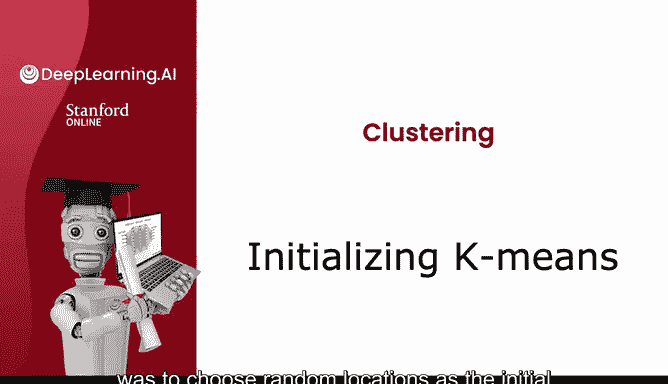
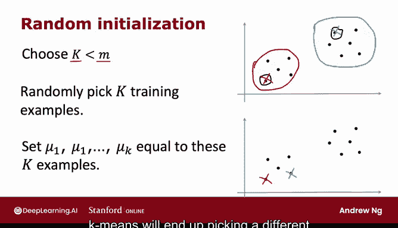
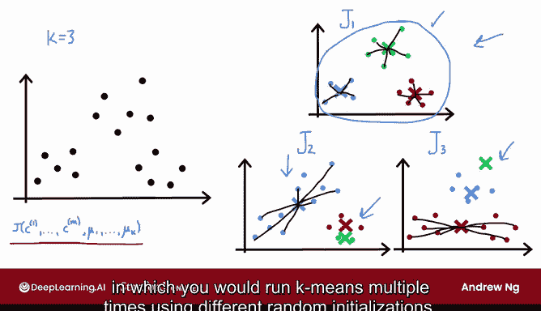
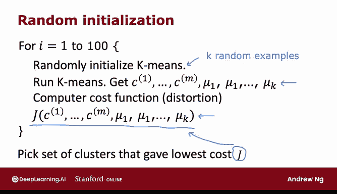

# 吴恩达《机器学习》｜machine-learning（中英字幕-deepseek翻译） - P111：06_01_05_K均值初始化.zh_en - GPT中英字幕课程资源 - BV1MN4y1S7DE

The very first step of the K means clustering algorithm was to choose random locations as the initial guesses for the clustercentroids mu1 through mu K。

 but how do you actually take that random guess Let's take a look at that in this video as was how you can take multiple attempts at the initial guesses with mu1 through mu K that will result in your finding a better set of clusters Let's take a look here again is the K means algorithm and in this video let's take a look at how you can implement this first step When running K means you should pretty much always choose the number of clustercentroids K to be lessened training examples M It doesn't really make sense to have K greater than M because then there won't even be enough training examples to have at least one training example for a cluster Androidroid So in our earlier example。

 we had K equals2。

And M equals 30。In order to choose the cluster cents。The most common way。Is to。

Randomly pick K training examples。So here is a training set where if I were to randomly pick two training examples。

 maybe I end up picking this one and this one。And then we would set mu1 through mu K equal to these k training examples。

 so I might initialize my red cluster centralroid here and initialize my blue cluster centroid over here in the example where K was equal to two and it turns out that if this was your random initialization and you were to run K means you probably end up with K means deciding that these are the two cluster in the dataset。

Note that this method of initializing the cluster centroids is a little bit different than what I had used in the illustration in the earlier videos。

 where I was initializing the cluster centros mu1 and mu2 to be just random points rather than sitting on top of specific training examples。

I've done that to make the illustrations clearer in the earlier videos。

 but what I'm showing in this slide is actually the much more commonly used way of initializing the cluster Androidroids。

Now。With this method， there is a chance that you will end up with。

An initialization of the clusterentroids where the red cross is here and maybe the blue cross is here。

 and depending on how you choose the random initial clusterentroids。

 Keys will end up picking a different set of cluster for your dataset set let's look at a slightly more complex example。

Where we're going to look at this data set and try to find three clusters。

 so k equals 3 in this data。If you were to run Canyians。

With one random initialization of the cluster entryroids。

 you may get this result up here and this looks like a pretty good choice。

 pretty good clustering of the data into three different clusters。

But with a different initialization， say you happen to initialize two of the cluster centralroids within this group of points and one within this group of points。

 after running K means， you might end up with this cluster ring。Which doesn't look as good。

And this turns out to be a local optimer。In which Ka means is trying to minimize the distortion cost function。

 that cost function J of C1 through CM and mu1 through muK that you saw in the last video but。

With this less fortunate choice of random initialization。

 it had just happened to get stuck in a local minima。

And here's another example of a local minimum where a different random initialization course came means to find this clustering of the data。

Into three clusters。Which again， doesn't seem as good as the one that you saw up here on top。

So if you want to give Kami's multiple shots at finding the best local optimo。

 if you want to try multiple random initializations。

 so give it a better chance of finding this good clustering up on top。

One other thing you could do with the Cans algorithm is to run it multiple times and then to try to find the best local  optima。

And it turns out that if you were to run K means three times a and end up with these three distinct clusterings。

 then one way to choose between these three solutions is to compute the cost function J for all three of these solutions or all three of these choices of clusters found by K means。

And then to pick one of these three， according to which one of them gives you the lowest value for the cost function J。

And in fact， if you look at this grouping of classes up here this。

Green Cross has relatively small square distances， or the green dots。

 The red cross has relatively small distance in the red dots， and similarly the blue cross。

 and so the cost function J would be relatively small。For this example on top。

 but here the blue Cross has larger distances to all the blue dots and here the red Cross has larger distances to all the red dots。

 which is why the cost function J for these examples down below would be larger。

 which is why if you pick from these three options。The one with the smallest distortion。

 the smallest cost function J， you end up selecting this choice of the the plus the cent choice。

So let me write this out more formally into an algorithm in which you would run K means multiple times using different random initializations。

Here's the algorithm。If you want to use 100 random initializations， the cameians。Then you would。

Run a00 times。Randomly initialize Kas using the method that you saw earlier in this video。

Pick K training examples and let the classiccentries initially be the locations of those K training examples。

Using that random initialization， run the cameians algorithm to convergence。

 and that will give you a choice of cluster assignments and cluster sroids。And then finally。

 you would compute the distortion， compute the cost function as follows。After doing this。

 say10 times。You would finally pick the set of clusters that gave the lowest cost。

And it turns out that if you do this， it'll often give you a much better set of clusters。

Move a much lower distortion function than if you were to run K means only a single time。

I plugged in the number up here as 100 when I'm using this method。

Doing this somewhere between say 50 to a thousand times would be pretty common where if you run this procedure a lot more than a thousand times。

 it tends to get computationally expensive and you tend to have diminishing returns when you run it a lot of times。

 whereas trying at least maybe 50 or 100 random initializations will often give you a much better result than if you only had one shot at picking a good random initialization。

But with this technique you are much more likely to end up with this good choice of clusters on top than these less superior local minima down at the bottom so that's it when I'm using the cameians average myself I will almost always use more than one random initialization because it just causes cameians to do a much better job minimizing the distortion cost function and finding a much better choice for the cluster centroids。

Before we wrap up our discussion of K means there's just one more video in which I hope to discuss with you the question of how do you choose the number of cluster Androids。

 how do you choose the value of K let's go on to the next video to take a look at that。

