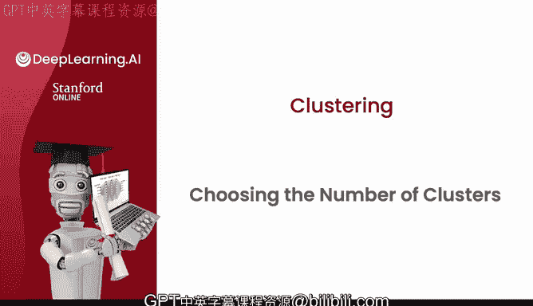
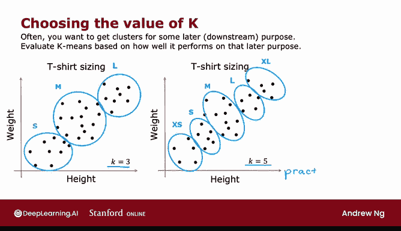

# 吴恩达《机器学习》｜machine-learning（中英字幕-deepseek翻译） - P112：07_01_06_选择聚类数量.zh_en - GPT中英字幕课程资源 - BV1MN4y1S7DE

The Kme algorithm requires as one of his inputs K， the number of classes you wanted to find。

 but how do you decide how many classes used do you want two classes or three classes or five classes or 10 classes。

 let's take a look。

For a lot of cluster vein problems， the right value of k is truly ambiguous if I were to show different people the same data set and ask how many cluster do you see？

There will definitely be people that will say， oh it looks like there are two distinct clusters and they will be right。

And there would also be others that will see， actually。Or distinct clusters。

And they would also be right。Because clustering is an unsupervised learning algorithm。

 you're not given the quote right answers in the form of specific labels to try to replicate。

 and so there are a lot of applications where the data itself。

Does not give a clear indicator for how many clusters there are in it。

 and I think it truly is ambiguous if this data has two or four， or maybe three clusters。If you take。

 say the red one here and the two blue ones here， say。

If you look at the academic literature on Canians， there are a few techniques to try to automatically choose the number of clusters to use for a certain application。

 I'll briefly mention one here that you may see others refer to。

 although I have to say I personally do not use this method myself。

But one way to try to choose the value of k is called the elbow method and what that does is。

You would run k means with a variety of values of k and plot the cost function of the distortion function J as a function of the number of clusters。

What you find is that when you have very few clusters， say one cluster。

 the distortion function of the cost function J will be high。

 and as you increase the number of clusters， it will go down， maybe as follows。

And if the curve looks like this， you say， well it looks like the cost function is decreasing rapidly until we get to three clusters。

 but the decreases more slowly after that， so let's choose k equals3 and this is called an elbow by the way。

 because think of it as analogous to that's your hand and that's your elbow over here。So。

Fting the cost function as a function of K， it could help you gain some insight。

I personally hardly ever use the elbow method myself to choose the right number of clusters。

Because I think for a lot of applications， the right number of classes is truly ambiguous。

 and you find that a lot of cost functions look like this。W just decreases smoothly。

And it doesn't have a clear elbow by which you could use to pick the value of K。By the way。

 one technique that does not work is to choose K so as to minimize the co function J。

Because doing so will cause you to almost always just choose the largest possible value of k because having more classes will pretty much always reduce the cost function J so choosing K to minimize the cost function J is not a good technique。

 so how do you choose the value of K in practice？Often you're running canians in order to get clusters to use for some later or some downstream purpose。

 that is you're going take the cluster and do something with those clusters so what I usually do and what I recommend you do is to evaluate cans based on how it performs for that later downstream purpose。

Let me illustrate the example of T shirt sizing。One thing you could do is run Canyians on this dataset to find three clusters in which case you may find clusters like that。

 and this would be how you size your small medium and large tshirts。

But how many t shirt sizes should there be what is ambiguous？

If you were to also run keys with five clusters， you might get。

Cluss that look like this and this would let you size thirs according to extra small， small， medium。

 large and extra large， and so both of these are completely valid and completely fine groupings of the data into clusters。

But whether you want to use three clusters or five clusters。

Can now be decided based on what makes sense for your t-shirt business。

 There a trade off between how well the t-shirts will fit。

 depending on whether you have three sizes or five sizes， but there will be extra costs as well。

 associated with manufacturing and shipping five types of t-shirts instead of three different types of t-shirts So what I would do in this case is to run K means with k equals 3 and K equals5。

 and then look at these two solutions to see based on the tradeoff between fit of t-shirt where more sizes results in better fit versus the extra costs of making more t-shirts where making fewer t-shirts is simpler and less expensive to try to decide what makes sense for the t-shirt business When you get to the programming exercise you also see there an application of K means to image compression This is actually one of the most。

Fun visual examples of k means。 And there you see that there will be a trade off between the quality of the compressed image。

 that is how good the image looks versus。How much you can compress the image to save the space and in that program exercise you see that you can use that trade off to maybe manually decide what's the best value of k based on how good you want the image to look versus how large you want to compress image size to be。

So that's it for the Kas clustering algorithm， congrats on learning your first unsupervised learning algorithm。

 you now know not just how to do supervised learning but also unsupervised learning and I hope you also have fun with their practice lab is actually one of the most fun exercises I know of the Kas。

And with that we're ready to move on to our second unsupervised learning algorithm which is anomaly detection how do you look at the data and find unusual or anomalous things in it this turns out to be another one of the most commercially important applications of unsupervised learning I've used this myself many times in many different applications let's go on the next video to talk about anomaly detection。

