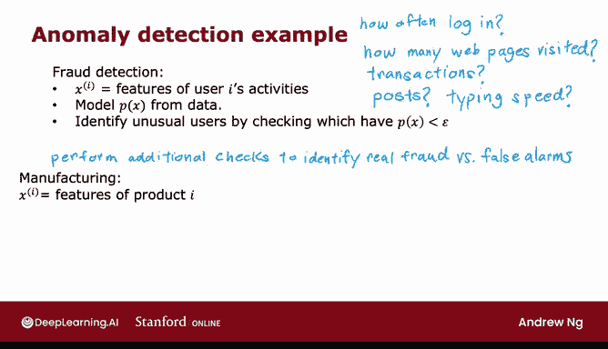

# 吴恩达《机器学习》｜machine-learning（中英字幕-deepseek翻译） - P113：08_01_01_发现异常事件.zh_en - GPT中英字幕课程资源 - BV1MN4y1S7DE

Let's look at our second unsupervised learning algorithm。

Anomomy detection algorithms look at an unlabeled dataset set of normal events and thereby learns to detect or to raise a red flag for if there is an unusual or an anomalous event。

Let's look at an example。Some of my friends were working on using anomaly detection to detect possible problems with aircraft engines that were being manufactured when a company makes an aircraft engine。

 you really want that aircraft engine to be reliable and function well because an aircraft engine failure has very negative consequences。

So some of my friends were using anomaly detection to check if an aircraft engine after it was manufactured。

 seemed anomalous or if there seemed to be anything wrong with it。Here's the idea。

After an aircraft engine rolls off the assembly line。

 you can compute a number of different features of the aircraft engine。

 so say feature X1 measures the heat generated by the engine。

 feature X2 measures the vibration intensity， and so on and so forth for additional features as well。

But to simplify this slide a bit， I'm going to use just two features X1 and X2 corresponding to the heat and the vibrations of the engine。

Now， it turns out that aircraft engine manufacturers don't make that many bad engines。

 And so the easier type of data to collect would be if you have manufactured M。

Aircraft engines to collect the features X1 and x2 about how these M engines behave。

 and probably most of them are just fine their normal engines rather than ones with a defect or floor in them。

And。The anomy detection problem is。After the learning algorithm has seen these M examples of how aircraft engines typically behave in terms of how much sheet they generated and how much they vibrate。

 if a brand new aircraft engine were to ro off the assembly line and if it had a new feature vector given by X test we like to know。

 does this engine look similar to ones that have been manufactured before， so is this probably okay。

 or is there something really weird about this engine which might cause this performance to be suspect。

 meaning that maybe we should inspected even more carefully before we。

Let the get ship tell them be installed in an airplane and then hopefully nothing will go wrong with it。

Here's how an anomaly detectionsection algorithm works let me plot the examples x1 through xM over here via these crosses where each cross。

 each data point in this plot corresponds to a specific engine with a specific amount of heat and a specific amount of vibrations。

If this new aircraft engine x test rolls off the assembly line and if you were to plot his values of x1 and x2。

 and if it were here，You'd say， okay， that looks probably okay。

 looks very similar to other aircraft engines。Maybe I don't need to worry about this one。

But if this new aircraft engine has a heat and vibration signature that is。

 say all the way down here， then this data point down here looks very different than the ones we saw up on top and so we will probably say。

 boyo， this looks like a anomaly， this doesn't look like the examples I've seen before。

 we'd better inspect this more carefully before we let this engine get installed on an airplane。

How can you have an algorithm address this problem？

The most common way to carry anomy detection is through a technique called density estimation。

And what that means is when you're given your training sets of these M examples。

The first thing you do is build a model。For the probability of X In other words。

 the learning algorithm will try to figure out what are the values of the features X1 and x2 that have high probability and what are the values that are less likely or have lower chance or lower probability of being seen in the data？

In this example that we have here。I think it is quite likely to see examples in that little ellipse in the middle。

 so that region in the middle would have high probability。

Maybe things in this ellipse have a little bit lower probability。

Things in this ellipse or this oval have even lower probability。

 and things outside have even lower probability。The details of how you decide from the trading set。

 what regions are higher versus lower probability is something we'll see in the next few videos。

And having learned a model for P of X。When you are given the new test example X test。

 what you will do is then compute the probability of X test。

 and if it is small or more precisely if it is less than some small number that I'm going to call epsilon。

 this is a Greek alphabet epsilon， which you should think of as a small number。

 which means that P of x is very small， or in other words。

 the specific value of x that you saw for a certain user was very unlikely。

 relative to other losers that you have seen。But if P of x test is less than some small threshold or some small number epsilon。

 we would raise a flag to say that this could be an anomaly， so for example。

 if X test was all the way down here，The probability of an example landing all the way out here is actually quite low。

 and so hopefully P of x test for this value of x test will be less than epsilon and so we would flag this as an anomaly。

Whereas in contrast， if P of x test is not less than epsilon。

 if P of x test is greater than equal to epsilon。Then we will say that it looks okay。

 this doesn't look like an anomaly and that corresponds to if you had an example。

In here assayA where our model P of X will say that examples near the middle here。

 they're actually quite high probability， its a very high chance that the new airplane engine will have features close to these inner ellipses and so P of X will be large for those examples and will say it's okay and it's not an anomaly。

Anomaly detection is used today in many applications， it is frequently used in fraud detection。

 where， for example， if you are running a website with many different features。

 if you compute XI to be the features of user eyes activities and examples of features might include。

 how often does this user log in and how many web pages do they visit how many transactions are they making or how many posts on the discussion forum are they making to what is their typing speed？

How many characters per second do they seem able to type？With data like this。

 you can then model P of x from data to model what is the typical behavior of a given user。

In the common workflow of fraud detection， you wouldn't automatically turn off an account just because it seemed anonymous。

 but instead you may ask the security team to take a closer look or put in some additional security checks such as ask the user to verify their identity with a cell phone number or ask them to pass a capture。

 to prove that they're human and so on。But algorithms like this are routinely used today to try to find unusual or maybe slightly suspicious activity so you can more carefully screen those accounts to make sure there isn't something fraudulent and this type of fraud detection is used both to find。

Fake accounts。 and this type of algorithm is also used frequently to try to identify financial fraud。

Such as。If there's a very unusual pattern of purchases。

 then that may be something well worth a security team taking a more careful look at。

Anomaomy detection is also frequently used in manufacturing。

 you saw an example on the previous slide with aircraft engine manufacturing。

But many manys in multiple continents in many， many factories were routinely use anomami detection to see if whether they just manufactured anything from an airplane engine to a printer circuit board to a smartphone to a motor to many。

 many things to see if you've just manufactured a unit that somehow behaves strangely。

Because that may indicate that there's something wrong with your airplane engine or printer circle bos or what have you that might cause you to want to take a more careful look before you ship that object to your customer。

Is also used to monitor computers in clusters and in data centers。

 where if XI are the features of a certain machine eye。

 such as if the features captured the memory usage， the number of disk axises per second。

 CPU load features can also be ratios， such as the ratio of CPU load to network traffic。

Then if ever a specific computer behaves very differently than other computers。

 it might be worth taking a look at that computer to see if something is wrong with it。

 such as if it has had a hardest failure or network heart failure or something's wrong with it。

 or if maybe it has been hacked into。Anomaly detection is one of those algorithms that is very widely used。

 even though you don't seem to hear people talk about it that much。

 I remember the first time I worked on the commercial application of anomaly detection was when I was helping a teleelco company put then place anomaly detection to see when any one of the cell towers was behaving in an unusual way because that probably meant there was something wrong with the cell tower and so they want to get a technician to take it look so hopefully that hope more people get good cell phone coverage and I've also used anomaly detection to find broadduent financial transactions and these days I often used it to help manufacturing companies find anomalous partss that they may have manufactured but should inspect more often So it is a very useful tool to have in your two chests and in the next few videos will talk about how you can build and get these algorithms to work for yourself。

In order to get anonymousomous detection algorithms to work， we'll need to use。

A Gaussian distribution to model the data P of X， So let's go on to the next video to talk about Gaussian distributions。

