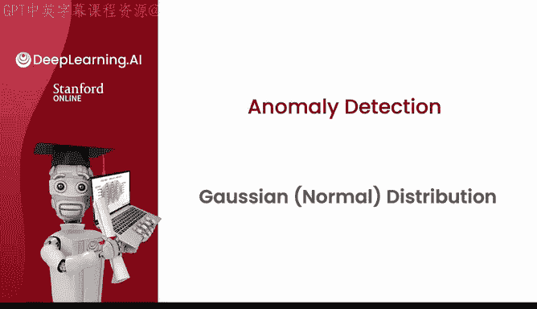
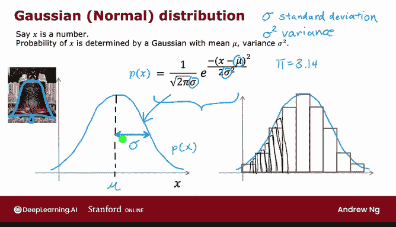
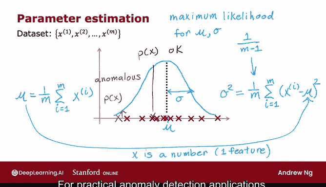

# 吴恩达《机器学习》｜machine-learning（中英字幕-deepseek翻译） - P114：09_01_02_高斯正态分布.zh_en - GPT中英字幕课程资源 - BV1MN4y1S7DE

In order to apply anomaly detection， we're going to need to use the Gaussian distribution。

 which is also called the normal distribution， so when you hear me say either Gaussian distribution or normal distribution。

 they mean exactly the same thing and if you've heard of the bellshaped distribution。

 that also refers to the same thing but if you haven't heard of the Belussian distribution that's fine too。

But let's take a look at what is the Gaussian or the normal distribution， say x is a number。

 and if x is a random number， sometimes called a random variable， but if x can take on random values。

 and if the probability of x is given by a Gaussian or normal distribution with mean parameter mu and with variance sigma squared。

What that means is that the probability of x looks like a curve that goes like this。

The center of the middle of the curve is given by the mean mu。

And the standard deviation or the width of this curve is given by that variance parameter sigma。

Technically sigma is called the standard deviation and the square sigma or sigma squared is called the variance of the distribution and this curve here shows what is P of x or the probability of x If you've heard of the bell shaped curve。

 this is that bell shaped curve because a lot of classic bells say in taus were kind of shaped like this with the bell clapper hanging down here and so the shape of this curve is vaguely reminisccent of。

The shape of the lo bells that。You will still find in some old buildings today。

Better looking than a hand drawn one。There's a picture of the Liber bell and indeed the Liber bell's shape on top is a vaguely bell shaped curve。

If you're wondering what this P of x really means。Here's one way to interpret it it means that if you were to get say 100 numbers drawn from this probability distribution and you were to plot a histogram of these1 hundred numbers drawn from distribution。

 you might get a histogram that looks like this and so it looks vaguely bell shaped。And。

What this curve on the left indicates is not if you have just 10 examples or10 or a million a billion。

 but if you had a practically infinite number of examples。

 and you were to draw a histogram of this practically infinite number of examples with a very。

 very fine histogram bin。Then you end up with。Essentially this bell shaped curve here on the left。

The formula for P of x is given by this expression。

 P of x equals1 over square root2 pi pi here is that 3。14159， it was about 22 over 7。

ratio of a circles diameter to a circumference times sigma times e to the negative x minus mu。

 the mean parameter squared divided by two sigma squared。And for any given value of mu and sigma。

 if you were to plot this function is a function of x。

 you get this type of bell shape curve that is centered at mu and with the width of this bell shape curve being determined by the parameter sigma。

Now let's look at a few examples of how changing mu and sigma will affect the Gausstian distribution。

First， let me set mu equals to0 and sigma equals 1。

 here's my plot of the Gaussian distribution with mean0 mu equals 0 and standard deviation sigma equals 1。

You notice that this distribution is centered at zero and that is the standard deviation sigma is equal to1 Now let's reduce the standard deviation sigma to 0。

5 if you plot the Gaussian distribution with me equals 0 and sigma equals 0。

5 it now looks like Lewis this notice that is' still center at 0 because mu is 0 but it's become a much thinner curve because sigma is now1 half。

And you might recall that sigma is a standard deviation is 0。5。

 whereas sigma squared is also called the variance， and so that's equal to 0。5 squared or 0。25。

You may have heard that probabilities always have to sum up to one。

 so that's why the area under the curve is always equal to one。

 which is why when the Gaussian distribution becomes skinnier， it has to become taller as well。

Let's look at another value of mu and sigma now I'm going to increase sigma to2 so the standard deviation is2 and the variance is4。

This now creates a much wider distribution because sigma here is now much larger and because it's now a wider distribution。

 it's become shorter as well because the area under the curve is still equal to one。And finally。

 let's try changing the mean parameter mu， and I'll leave sigma equals 0。5。In this case。

 the center of the distribution mu moves over here to the right。

 but the width of the distribution is the same as the one on top because the standard deviation is 0。

5 in both of these cases on the right。So this is how different choices of mu and sigma affect the Gaussian distribution when you're applying this to anomami detection。

 here's what you have to do you're given a data set of M examples。And here x is just a number。

 and here are parts of the training sets with 11 examples。

And what we have to do is try to estimate what are good choices for the mean parameter mu。

 as well as for the variance parameter Sigma squared。 And given a data set like this。

 it would seem that a Gaussian distribution。Maybe looking like that with a center here。

And the standard deviation kind of like that， just might be a pretty good fit to the data。

The way you would compute mu and Sigma squared mathematically is our estimate for mu will be just the average of all the training examples。

 So it's1 over M times。Some from I equals1 through M of the values of your training examples。

And the value we would use to estimate sigma squared will be the average of the squared difference between the examples and that mu that you just estimated here on the left。

It turns out that if you implement these two formulas in code with this value for mu and this value for Sigma squared。

 then you pretty much get the Gaussian distribution that I hand drew on top。

 and this will give you a choice of mu and Sigma for Gaussian distribution so that it kind of looked like the 11 training examples might have been drawn from this Gaussian distribution。

If you've taken an advanced statistics class， you may have heard that these formulas for mu and Sigma squared are technically called the maximum likelihood estimates for mu and Sigma。

 and some statistics classes will tell you to use the formula 1 over m minus1 instead of1 over M。

In practice， using1 over m or1 over M minus1 makes very low difference， I always use1 over M。

 but there are some other properties of dividing by m minus1 that some statisticians prefer。

But if you don't understand what they just said， don't worry about it。

 all you need to know is that if you set mu according to this formula and sigma squared。

 according to this formula， you get a pretty good estimate of mu and sigma and in particular you get a Gaussian distribution that will be a plausible probability distribution in terms of what's the probability distribution that the training examples had come from。

 you can probably guess what comes next if you were to get an example over here， then。

P of x is pretty high， whereas if you were to get an example way out here， then P of x is pretty low。

 which is why we would consider this example okay， not really anomalous。

 looks a lot like the other ones， whereas an example way out here to be pretty unusual compared to the examples we've seen and therefore more anomalous because P of x。

 which is the height of this curve， is much lower over here on the left compared to this point over here closer to the middle。

Now， we've done this only for when x is a number， as if you had only a single feature for your no detection problem。

For practical anomy detection applications， you usually have a lot of different features。

 so you've now seen how the Gaussian distribution works if x is a single number。

 this corresponds to if say you had just one feature for your anomy detection problem。

But for practical anomaly detection applications you will have many features。

 two or three or some even larger number n of features。

 let's take what you saw for a single Gaussian and use it to build a more sophisticated anomaly detection algorithm that can handle multiple features let's go do that in the next video。

