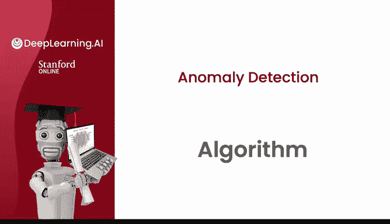
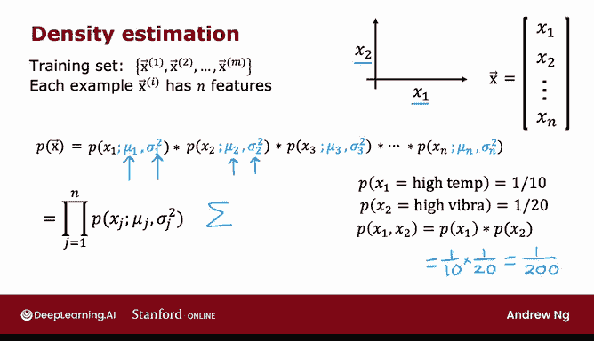
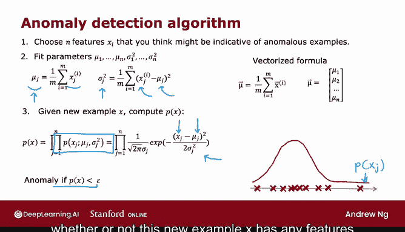
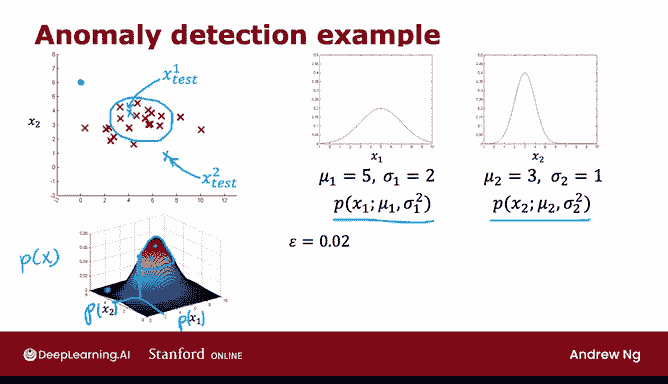

# 吴恩达《机器学习》｜machine-learning（中英字幕-deepseek翻译） - P115：10_01_03_异常检测算法.zh_en - GPT中英字幕课程资源 - BV1MN4y1S7DE

Now that you've seen how the Gaussian or the normal distribution works for a single number。

 we're ready to build ouromaomy detection algorithm， let's dive in。You have a training set。

 x1 through XM。Where here each example x has n features so each example x is a vector with n numbers in the case of the airplane engine example。

 we had two features corresponding to the heat and the vibrations and so each of these Xs would be a twodimensal vector and n would be equal to two。

 but for many practical applications n can be much larger and you might do this with dozens or even hundreds of features。

Given this training set， what we would like to do is to carry out density estimation and all that means is we will build a model。

Or estimate the probability for P of x what's the probability of any given feature vector？

And our model of a P of X is going to be as follows。X is a feature vector where values x1， x2。

 and so on down to x n， and I'm going to model P of x as the probability of x1 times the probability of x2 times the probability of x3 times the probability of x n for the n features。

In the feature vectors， if you've taken an advanced class in probably in statistics before。

 you may recognize that this equation corresponds to assuming that the features x1， x2。

 and so on up to XM are statistically independent。But it turns out this algorithm often works fine。

 even though the features are not actually statistically independent。

But if you don't understand what I just said， don't worry about it。

 understanding statistical independence is not needed to fully complete this class and also be able to very effectively use anomami detection algorithm。

Now， to fill in this equation a little bit more。We are saying that the probability of all the features of this vector features X is the product of P of x1 and P of x2 and so on up through P of x n。

And in order to model the probability of x1， say the heat feature in this example。

 we're going to have two parameters mu1 and sigma 1 or sigma squared 1。

And what that means is we're going to estimate。The mean of the feature x1 and also the variance of feature x1。

 and that will be mu 1 and sigma 1。To model P of x2 x2 is a totally different feature measuring the vibrations of the airplane engine。

 we're going to have two different parameters， which I'm going to write as mu2 sigma2 squared and it turns out this will correspond to the mean or the average of the vibration feature and the variance of the vibration feature and so on。

 if you have additional features。Mu3 signalig phi squares up through new N。And sigma n squared。

In case you're wondering why we multiply probabilities。

 maybe here's one example that could build intuition。Suppose for an aircraft engine。

 there's a  one10th chance that it is really， really hot， unusually hot。 and maybe there is a。

One in 20 chance that it vibrates really， really hard。Then what is the chance that it runs really。

 really hot and vibrates really， really hard。 We're saying that the chance of that is。

110 times 1 over 20， which is  one over 200， so it's really。

 really unlikely to get an engine that both runs really hard and vibrates really hard is the product of these two probabilities。

A somewhat more compact way to write this equation up here is to say that this is equal to the product from J equals 1 through n of p of xj what parameters mu J。

And sigma squared J。And this symbol here is a lot like the summation symbol。

 except that whereas the summation symbol corresponds to addition。

 this symbol here corresponds to multiplying these terms over here for J equals1 through n。

So let's put it all together to see how you can build an anomaly detection system。

The first step is to choose features X I that you think might be indicative of anonymous examples。

 having come up with the features you want to use。You would then fit the parameters mu 1 through mu N and sigma squared1 through sigma squared n。

For the end features in your dataset。As you might guess。

 the parameter mure J will be just the average of xj of the featured J。

Of all the examples in your training set and sigma squared J will be the average of the square difference between the J feature and the value mu J that you just computed。

And by the way， if you have a vectorized implementation， you can also compute mu as the average。

Of the training examples， as follows we here x and mu are both vectors。

 and so this would be the vectorized way of computing mu1 through mu n all at the same time。

And by estimating these parameters on your unlabeled training set。

 you've now computed all the parameters of your model。Finally， when you are given a new example。

 X test， or I'm just going to write the new example as x here。

 what you would do is compute P of x and see if it's large or small。So P of x。

 as you saw on the last slide， is the product from J equals1 through n of the probability of the individual features。

 So P of x J。What parameters is mu J and s squared J？And if you substitute in the formula。

For this probability， you end up with this expression。

 one over root 2 pi sigma J of e to this expression over here。And so Xj are the features。

 this is a J feature of your new example， mu J and Sigma J are numbers or parameters you had computed in the previous step。

And if you compute out this formula， you get some number for P ofx。

And the final step is to see if P of x is less than epsilon。And if it is。

 then you flag that it is an anomaly。One intuition behind what this algorithm is doing is that it would tend to flag an example as anomalous if one or more of the features are either very large or very small relative to what it has seen in the training set。

So for each of the features Xj， you're fitting a Gaussian distribution like this。

 and so if even one of the features of the new example was way out here or say。

Then P of xj would be very small and if just one of the terms in this product is very small。

 then this overall product， when you multiply together will tend to be very small and thus P of x will be small。

And what anomaly detection is doing in this algorithm is a systematic way of quantifying。

Whether or not this new example X has any features that are unusually large or unusually small。

Now let's take a look at what all this actually means on one example。

Here's a dataset set which features X1 and X2。And you notice that the features x1 take on a much larger range of values than the features X2。

 If you were to compute the mean of the features x1， you end up with5。

And it turns out that vericeity said if you compute Sigma 1， it will be equal to about2。

And if you were to compute mu2， the average of the features on x2， the average is 3。

 and similarly is variance or standard deviation is much smaller， which is why sigma 2 is equal to1。

So that corresponds to this Gaussian distribution for x1 and this Gaussian distribution for x2。

If you were to actually multiply P of x1 and P of x2。

 then you end up with this VD surface plot for p of x。

 where at any point the height of this is the product of P of x1 times P of x2 for the corresponding values of x1 and x2。

And dis signifies that values where P of x is higher are more likely， so values near the middle。

 kind of here are more likely， whereas values far out here， lay values out here。

 are much less likely I have a much lower chance。Now let me pick two test examples。

 the first one here， I'm going to write as X test1， and the second one down here as X test 2。

 and let's see which of these two examples the algorithm will flag as anomomaalous。

I'm going to pick the parameter epsilon to be equal to 0。02。And if you were to compute P of x test 1。

It turns out to be about 0。04， and this is much bigger than epsilon and so the am will say this looks okay。

 doesn't look like an anomaly。Whereas in contrast， if you were to compute P of x by this point down here。

 corresponding to x1 equals about8 and x2 equals about 0。5， kind of down here。Then P of x test2 is 0。

0021， so this is much smaller than epsilon and so the algorithm will flag this as a likely anomaly。

 so pretty much as you might hope it decides that X test 1 looks pretty normal。

 whereas X test2 which is much further away than anything you've see in the training set looks like it could be an anomaly。

So you've seen the process of how to build an anomaly detection system。

But how do you choose the parameter epsilon and how do you know if your anomaly detection system is working well in the next video。

 let's dive a little bit more deeply into the process of developing and evaluating the performance of an anomaly detection system let's go on to the next video。

