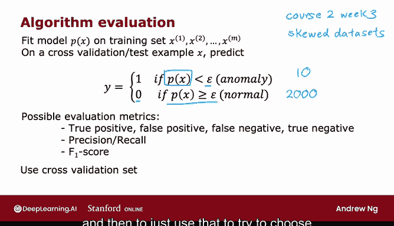

# 吴恩达《机器学习》｜machine-learning（中英字幕-deepseek翻译） - P116：11_01_04_开发与评估异常检测系统.zh_en - GPT中英字幕课程资源 - BV1MN4y1S7DE

I'd like to share with you some practical tips for developing an anomaly detection system One of the key ideas would be that if you can have a way to evaluate a system。

 even as it's being developed， you'd be able to make decisions and change a system and improve it much more quickly let's take a look at what that means when you're developing a learning algorithm。

 say choosing different features or trying different values of the parameters like epsilon。

 making decisions about whether or not to change a feature in a certain way or to increase or decrease epsilon or other parameters making those decisions is much easier if you have a way of evaluating the learning algorithm this is sometimes called real number evaluation meaning that if you can quickly change the algorithm in some way such as change a feature or change a parameter and have a way of computing a number that tells you if the algorithm got better or worse then it makes it much。

Easier to decide whether or not to stick with that change to the algorithm This is how it's often done in anomaly detection。

 which is even though we've mainly been talking about unlabeled data。

 I'm going to change that assumption a bit and assume that we have some label data including just a small number usually of previously observe anomalies。

 so maybe after making airplane engines for a few years。

 you've just seen a few airplane engines that were anomaallies and for examples that you know our anomaallies。

 I'm going to associate a label y equals one to indicate this anomomaalous。And for example。

 that we think are normal。I'm going to associate the label y equals0。

 and so the training set that the anomaly detection algorithm will learn from is still this unlabeled training set of x1 through Xm。

And I'm going to think of all of these examples as ones that were just assume are normal and not anomalous。

 So y is equal to 0。In practice， if a few anomalous examples were to slip into this training set。

 your algorithm will still usually do OK to evaluate your algorithm。

 to come of a way for you to have a row number evaluation。

It turns out to be very useful if you have a small number of anomalous examples。

So that you can create a cross validation set， which I'm going to denote XCV1。

 YCV1 through XCV MCCV and YCVMV， this is similar notation。

 as you had seen in the second course of the specialization and similarly have a test set of some number of examples。

Where。Both the cross validation and the test sets， hopefully include。A few anomalous examples。

In other words， the cross validation and test sets will have a few examples with y equals1。

 but also a lot of examples where y is equal to zero。And again， in practice。

 anomy detection algorithm will work okay If there are some examples， they're actually anomalous。

 but they were accidentally labeled with y equals 0。

 Let's illustrate this with the aircraft engine example。

 Let's say you have been manufacturing aircraft engines for years。

 And so you've collected data from 10000 goods or normal engines。But over the years。

 you had also collected data from 20 floorawed or anomalous engines。

Usually the number of anomalous engines that is y equals1 will be much smaller and。

It would not be atypical to apply this type of algorithm with anywhere from， say。

 2 to 50 known anomalies。We're going to take this data set and break it up into a training set。

 a cross validation set and a test set， here's one example。

 I'm going to put 6000 good engines into the training set。And again。

 if there are a couple anonymousomous engines that got slipped into this set is actually okay。

 I wouldn't worry too much about that。And then let's put 2。

000 good engines and 10 of the known anomalies into the cross validation set and a separate 2000 good and 10 anomalous engines into the test set。

What you can do then is train the algorithm on the training set。

Fit the Gaussian distributions to these 6000 examples。And then on the cross validation set。

 you can see how many of the anomalous engines it correctly flags。And so for example。

 you could use the cross validation set to tune the parameter epsilon and set it higher or lower。

Depending on。Whether the algorithm seems to be reliably detecting these 10 anomalies without taking too many of these 2000 good engines and flagging them as anomalies。

And after you have tuned to parameter Epsilon and maybe also added or subtracted or tuned to features Xj。

 you can then take the algorithm and evaluate it on your test set to see how many of these 10 anomalous engines it finds。

As was how many mistakes it makes by flagging the good engines as anomalous ones。Notice that。

 this is so。Primarily an unsupervised learning algorithm because the training set really has no labels or they all have labels that we're assuming to be y equals zero。

 and so we learn from the training set by fitting the Gaussian distributions as you saw in the previous video but it turns out if you're building a practical anomaly detection system。

 having a small number of anomalies to use to evaluate the algorithm in your crossvalidation in test sets is very helpful for tuning the algorithm。

 because the number of flawed engines is so small， there's one other alternative that I often see people use for anomaly detection。

 which is to not use a test set but to have just a training set and a crossvalidation set。

So in this example， you would still train on 6000 good engines but take the remainder of the data。

 the 4000 remaining good engines as well all the anomalies and put them in the crossvalidation set。

 and you would then tune the parameters epsilon and addla subtract featuress Xj to try to get it to do as well as possible as evaluated on the trustvalidation set。

If you have very， very few floored engines， so if you had only two flawed engines。

 then this really makes sense to put all of that in a crossvalidation set and you just don't have enough data to create a totally separate test set that is distinct from your crossvalidation set the downside of this alternative here is that after you've tuned your algorithm。

 you don't have a fair way to tell how well this will actually do on future examples because you don't have a test set but when your data set is small。

 especially when the number of anomalies you have your data set is small。

 this might be the best alternative you have。 And so I see this done quite often as well when you just don't have enough data to create a separate test set And if this is the case。

Just be aware that there's a higher risk that you would have overfit some of your decisions around Epsilon and choice of features and so on to the trust validation set。

 and so its performance on real data in the future may not be as good as you are expecting。Now。

 let's take a closer look at how to actually evaluate the algorithm on your trust validation sets or on the test set。

Here's what you do you would first fit the model P of x on the trading set。

 so this was the 6000 examples of good engines， then on any cross validation or tested example X。

 you would compute P of x。And you would predict y equals1 that is anomalous if P of x is less than epsilon and you predict y is0 if P of x is greater than or equal to epsilon。

 and so based on this， you can now look at how accurately this algorithm's predictions on the crossvalation or test set matches the labels。

 Y you have in the crossvalation or the test sets。In the third week of the second course。

 we had had a couple optional videos on how to handle highly skewed data distributions where the number of positive examples y equals1。

can be much smaller than the number of negative examples where y equals zero and this is the case as well for many anomaly detection in applications where the number of anomalies in your cross validation set is much smaller in our previous example we had maybe 10 positive examples。

And 2000 negative examples， because we had 10 anomalies and 2000 normal examples。

If you saw those optional videos， you may recall that we saw it could be useful to compute things like the true positive。

 false， positive， false， negative and true negative phrase or to compute precision recall or F1 score。

 and that these are alternative metrics to classification accuracy that could work better when your data distribution is very skewed。

So if you saw that video， you might consider applying those types of evaluation metrics as well to tell how well your learning algorithm is doing and finding that small handful of anomalies。

 a positive examples amids this much larger set of negative examples of normal plane engines if you didn't watch that video don't worry about it is okay the intuition I hope you get is to use the crossvalation set to just look at how many anomalies is finding and also how many normal engines it is incorrectly flagging as an anomaly and then to just use that to try to choose a good choice for the parameter epsilon so you find that the practical process of building an anomaly detection system is much easier if you actually have just a small number of labeled examples of known anomalies。

Now this does raise a question， if you have a few labeled examples should you still be using an unsupervised learning algorithm。

 why not take those labeled examples and use a supervised learning algorithm instead in the next video。

 let's take a look at a comparison between anomaly detection and supervised learning and when you might prefer one over the other let's go on to the next video。

