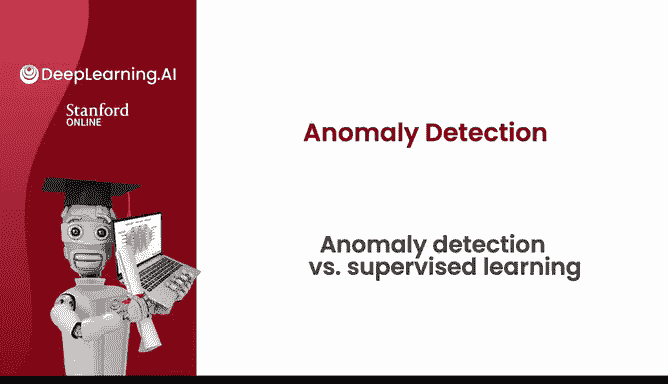
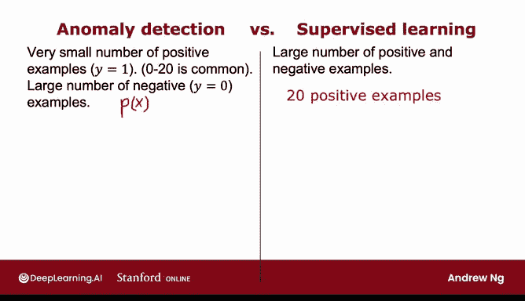
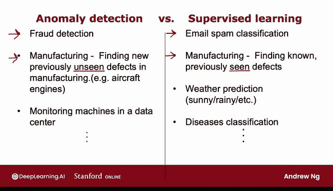

# 吴恩达《机器学习》｜machine-learning（中英字幕-deepseek翻译） - P117：12_01_05_异常检测与监督学习对比.zh_en - GPT中英字幕课程资源 - BV1MN4y1S7DE

When you have a few positive examples with y equals1 and a large number of negative examples。

 say y equals zero， When should you use anomaly detection and when should you use supervised learning。

 the decision is actually quite subtle in some applications so let me share with you some thoughts and some suggestions for how to pick between these two types of algorithms and anomaly detection algorithm will typically be the more appropriate choice when you have a very small number of positive examples。

Zero to 20 positive examples is not uncommon common。

And a relatively large number of negative examples with which to try to build a model for P of X。

 where you recall that the parameters for P of X are learned only from the negative examples and it much smaller so the positive examples is only used in your crossvalidation set and test set for parameter tuning and for evaluation in contrast。

 if you have a larger number of positive and negative examples。

 then supervised learning might be more applicable Now even if you have only 20 positive training examples。

 it might be okay to apply a supervised learning algorithm。

 but it turns out that the way anomami detection looks at the dataset versus the way supervised learning looks at the dataset are quite different。

Here's the main difference， which is that if you think there are many different types of anomalies or many different types of positive examples。

Then anomaly detection might be more appropriate。When there are many different ways for an aircraft engine to go wrong。

 and if tomorrow there may be a brand new way for an aircraft engine to have something wrong with it。

 then your 20， say positive examples may not cover all of the ways an aircraft engine could go wrong。

That makes it hard for any algorithm to learn from the small set deposit positive examples。

 what the anomalies， what the positive examples look like。

And future anomalies may look nothing like any of the anomomaalous examples we've seen so far。

If you believe this to be true for your problem， then I would gravitate to using an anomaly detection algorithm。

Because what anomaly detection does is it looks at the normal examples that is the y equals zero negative examples and just try to model what they look like and anything that deviates a lot from normal it flags as an anomaly。

 including if there's a brand new way for an aircraft engine to fail that had never been seen before in your dataset。

In contrast， supervised learning has a different way of looking at the problem。

When you apply supervised learning， ideally you would hope to have enough positive examples for the algorithm to get a sense of what the positive examples are like and with supervised learning。

 we tend to assume that a future positive examples unlikely likely to be similar to the ones in the training set。

 so let me illustrate this with one example， if you are using a system to find， say financial fraud。

There are many different ways unfortunately that some individuals are trying to commit financial fraud and unfortunately there are new types of financial fraud attempts every few months or every year。

 and what that means is that because they keep on popping up completely new and unique forms of financial fraud。

 anomaly detection is often used to just look for anything that's different than transactions we've seen in the past。

In contrast， if you look at the problem of email spam detection。Well。

 there are many different types of spam email， but even over many years。

 spam emails keep on trying to sell similar things or。

Get you to go to similar websites and so on spam email that you will get in the next few days is much more likely to be similar to spam emails that you have seen in the past。

So that's why supervised learning works well for spam because it's trying to detect more of the types of spam emails that you have probably seen in the past in your training set。

 whereas if you're trying to detect brand new types of fraud that have never been seen before。

 then anomaminly detection may be more applicable， let's go through a few more examples。

We have already seen fraud detection being one use case of anomaly detection。

 although supervised learning is used to define previously observed forms of fraud。

 and we've seen email spam classification typically being addressed using supervised learning。

You've also seen the example of manufacturing where you may want to find new previously unseen effects。

 such as if there are brand new ways for an aircraft engine to fail in the future that you still want to detect。

 even if you don't have any positive example like that in your training set。

It turns out that in manufacturing supervised learning is also used to find defects。

 the more of a fine known and previously seen defects。 For example， if you are a smartphone maker。

 you're making cell phones and you know that occasionally your machine for making the case of the smartphone will accidentally scratch the cover so stretches are a common defect on smartphones and so you can get enough training examples of stretch smartphones correspondinging to a label Y equals one and just train a system to decide if a new smartphone that you just manufactured as any scratches in it。

 And the difference is if you just see scratch smartphones over and over and you want to check if your phones are stretched。

 then supervised learning works well， whereas if you suspect that it' going to be brand new ways for something to go wrong in the future。

 then the no detection will work well。 Some other examples you heard me talk about。

Monioring machines in the data center， especially if the machines been hacked it can behave differently in a brand new way unlike any previous way it has behaved so that would feel more like an anomaly detection application In fact one theme is that many security related applications because hackers are often finding brand new ways to hack into systems。

 many security related applications will use anomaly detection whereas returning to supervised learning if you want to learn to predict the weather Well there's only a handful types of weather that you typically see is it sunny rainy music into snow and so because you see the same upper labels over and over。

 weather prediction would tend to be a supervised learning tasks or if you want to use the symptoms of the patient to see if the patient has a specific disease that you've seen before。

 then that would also tend to be a supervised learning application。

So I hope that gives you a framework for deciding when you have a small set of positive examples as well as maybe a large set of negative examples。

 whether to use anomaly detection or supervised learning anomaly detection tries to find brand new positive examples that may be unlike anything you've seen before。

 whereas supervised learning looks at your positive examples and tries to decide if a future examples is similar to the positive examples that you've already seen。

Now it turns out that when building an anomaly detection algorithm。

 the choice of features is very important and when building anomaly detection systems。

 I often spend a bit of time trying to tune the features I use for the system In the next video let me share some practical tips for how to tune the features you feed to anomaly detection algorithm。

