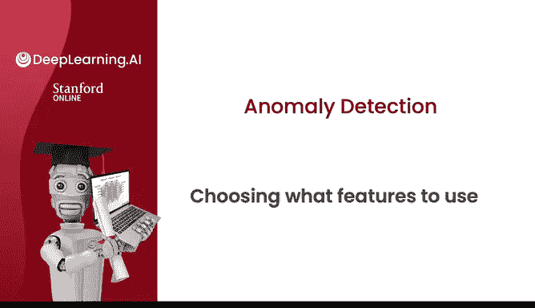
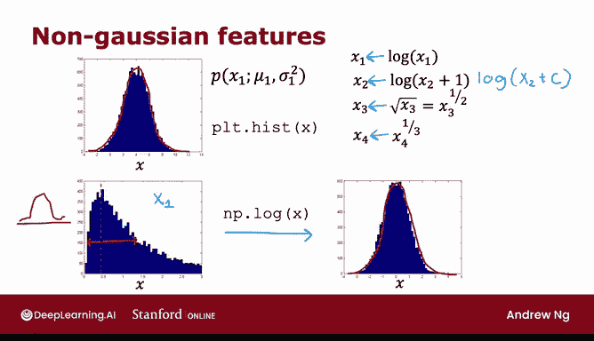
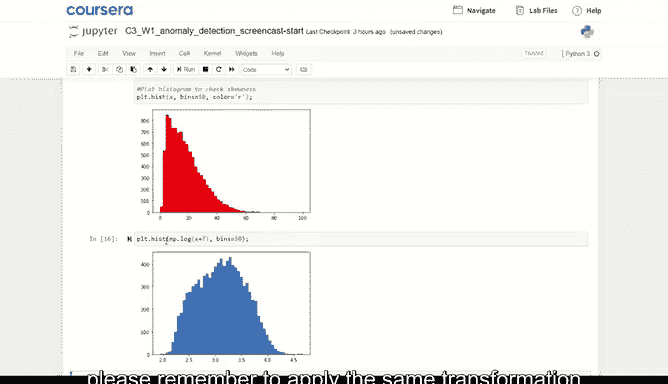
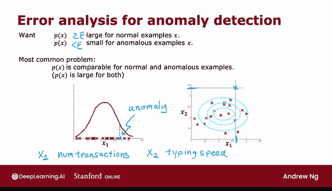
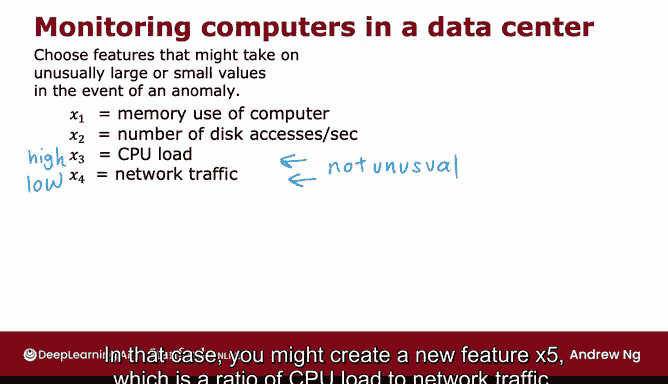
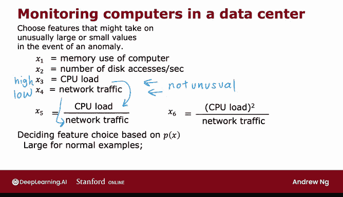

# 吴恩达《机器学习》｜machine-learning（中英字幕-deepseek翻译） - P118：13_01_06_选择使用哪些特征.zh_en - GPT中英字幕课程资源 - BV1MN4y1S7DE

When building an anomainated detection algorithm， I found that choosing a good choice of features turns out to be really important。

In supervised learning， if you don't have the features quite right。

 or if you have a few extra features that are not relevant to the problem。

 that often turns out to be okay because the algorithm has the supervised signal that is enough labels Y for the algorithm to figure out what features like no or how to rescale a feature and to take the best advantage of the features you do give it。

But for anomaly detection， which runs or learns just from unlabeled data is harder for the algorithm to figure out what features to ignore So Ive found that carefully choosing the features is even more important for anomaly detection than for supervised learning approaches Let's take a look in this video as some practical tips for how to tune the features for anomaly detection to try to get you the best possible performance。

 One step that can help your anomaly detection algorithm is to try to make sure the features you give it are more or less Gaussian。

And if your features are not Gaussian， sometimes you can change it to make it a little bit more Gaussian。

 let me show you what I mean。If you have a feature， X。I will often plot a histogram of the feature。

 which you can do using the Python command PLT dot his， you see this in the practice lab as well。

In order to look at the histogram of the data。This distribution here looks pretty Gaussian。

 so this would be a good candidate feature if you think this is a feature that hopes distinguish between anomalies and normal examples。

But quite often， when you plot a histogram of your features。

 you may find that the feature has a distribution like this distance not at all look like that symmetric bell shaped curve when that is the case。

I would consider if you can take。This feature X and transform it in order to make it more Gaussian。

 for example， maybe if you were to compute the log of x and plot a histogram of log of x。

 it'll look like this and this looks much more Gaussian， and so if this feature was feature x1。

 then instead of using the original feature x1， which looks like this on the left。

 you might instead replace that feature with log of x1 to get this distribution over here。

 because when x1 is made more Gaussian， when anomaly detection models P of x1。

Using a Gaussian distribution like that is more likely to be a good fit to the data。

 other than the log function， other things you might do is given a different feature X2。

 you may replace it with x2 log of x2 plus1 this would be a different way of transforming x2。

And more generally， log of x2 plus C would be one example of a formula you can use to change x2 to try to make it more Gaussian。

 or for a different feature you might try taking a square root or the square root have executed cube this x3 to the power of1 half and you may change that exponation in term。

 so for a different feature X4， you might use x4 to the power of one third for example。

So when I'm building an anomaly detection system， I'll sometimes take a look at my features and if I see any of the highly non-gaussian by plotting a histogram。

 I might choose transformations like these or others in order to try to make it more Gaussian。

 it turns out a larger value of C will end up transforming this distribution less。But in practice。

 I just try a bunch of different values of C and then try to tick a look to pick one that looks better in terms of making the distribution more Gaussian。

Now， let me illustrate how I actually do this and I you put a notebook。

So this is what the process of exploring different transformations of the features might look like。

When you have a feature of X， you can plot a histogram of it as follows。

 it actually looks like there's a pretty coarse histogram。

Let me increase the number of bins in my histogram to 50， so bins equals 50。

There that's what histogram bins Oh and by the way， if you want to change the color。

 you can also do so as follows。And if you want to try a different transformation， you can try。

 for example， to plot x square root of x so x of power 0。5 again。50 histogram bins。

 in which case it might look like this。And this actually looks somewhat more Gaussian。

But not perfectly， and let's try different parameter， so let me try。To the power of 0。25。

Maybe I just a little bit too far。So the 0。4， that looks pretty Gaussian。

 so one thing you could do is replace x with x in the power of 0。4。And so you would。

Set x to be equal to x to the power of 0。4 and just here use the value of x in your training process instead。

 or let me show you another transformation here I'm going to try taking the log of x so。Log of X。

ILet's pot it with 50 bins。我可以 use the non log function。As follows and oops。

 it turns out you get an error because it turns out that x in this example has some values that are equal to 0 and while longer0 is negative infinity is not defined。

 So common trick is to add just a very tiny number there。So x plus 。001 becomes non negative。

And so you get a histogram that looks like this。But if you want the distribution to look more Gaussian。

 you can also play around with this parameter。To try to see if there's a value of that term。

Cause user data to look more symmetric and maybe look more Gaussian as follows。

And just as I'm doing right now in real time， you can see that you can very quickly change these parameters and plot the histogram in order to try to take a look and try to get something a bit more Gaussian than was the original data。

X that。You saw in this histogram up above。If you read the machine learning literature there are some ways to automatically measure how close these distribution are to Gaussians。

 but I found that in practice it doesn't make a big difference if you just try a few values and pick something that looks right to you that will work well for our practical purposes。

So by trying things out in a Jupyter notebook， you can try to pick a transformation that makes your data more Gaussian and just as a reminder。

 whatever transformation you applied to the training set。

 please remember to apply the same transformation to your crossvalidation and test set data as well。

Other than making sure that your data is approximately Gaussian。

 after you've trained your anomaly detection algorithm。

 if it doesn't work that well on your cross validation set。

You can also carry out an error analysis process for anoma detection in other words。

 you can try to look at where the algorithm is not yet doing well。

 where it's making errors and then use that to try to come up with improvements。So as a reminder。

What we want is for P of x to be large for normal examples x。

 so greater than or equal to epsilon and P of x to be small or less than epsilon for the anomalous examples X when you've learned the model P of x from your unlabeled data。

 the most common problem that you may run into is that P of x comparable and value say is large for both normal and for anomalous examples as a concrete example if this is your data set you might fit that Gaussian to it。

And if you have an example in your trust validation set or test set that is over here。

 that is anomalous， then this has a pretty high probability and in fact it looks quite similar to the other examples in your training set。

And so even though this is an anomaly。P of x is actually pretty large and so the algorithm will fail to flag this particular example as an anomaly in that case what I would normally do is try to look at that example。

 and try to figure out what is it that made me think is an anomaly。

 even if this feature X1 took on value similar to other training examples。

And if I can identify some new feature， say x 2。That helps distinguish this example from the normal examples。

 then adding that feature can help improve the performance of the algorithm。

 here's a picture showing what I mean if I can come up with a new feature x2 say I'm trying to detect fraudulent behavior and if x1 is。

The number of transactions they make。Maybe this user looks like they're making so many transactions as everyone else。

 but if I discover that this user has some insanely fast typing speed。

And if I were to add a new feature X2， that is the typing speed of this user。

And if it turns out that when a plot this data using the old feature x1 and this new feature x2 causes x2 to stand out over here。

 then it becomes much easier for the anomaly detection algorithm to recognize that x2 is an anomalous user。

Because when you have this new feature X2。The learning algorithm may fit a Gaussian distribution that assigns high probability to points in this region a bit lower in this region and a bit lower in this region。

And so this example， because of the very anomalous value of x2。

 becomes easier to detect as an anomaly。So just to summarize。

 the development process I'll often go through is。To train a model and then to see what anomalies in the cross validation set。

 the algorithm is failing to detect。And then to look at those examples to see if that can inspire the creation of new features that would allow the algorithm to spot that。

That example takes on unusually large or unusually small values on the new features so that it can now successfully flag those examples as anomalies just as one more example。

 let's say you're building an anomaly detection system。

To monitor computers in a data center， to try to figure out if a computer may be behaving strangely and deserves a closer look。

 maybe because of a hardware failure or because it's been hacked into or something。

So what you like to do is to choose features that might take on unusually large or small values in the event of an anomaly。

You might start off with features like X1 is the memory use， x2's number of disk excesses per second。

 then the CPU load and the volume of network traffic。And if you。trainin the文。

You may find that it detects some anomalies， but fails to detect some other anomalies。In that case。

 it's not unusual to create new features by combining old features。 So for example。

 if you find that there's a computer that is behaving very strangely。

But neither is CPU load to nor network traffic is that unusual。

 but what is unusual is it has a really high CPU load while having a very low network traffic volume。

If you're running a data center that streams videos。

 then computers may have high CPU load and high network traffic or low CPU load and no network traffic。

 but what's unusual about this one machine is that very high CPU load despite a very low traffic volume in that case you might create a new feature X5 which is a ratio of CPU load to network traffic and this new feature with hope the anomaly detection algorithm flagged future examples like the specific machine you may be seeing as anomalous or you can also consider other features like the square of the CPU load divided by。

The network traffic volume， and you can play around with different choices of these features in order to try to get it so that P of X is still large for the normal examples。

 but they become small in the anomalies in your cross validationation set。

So that's it， thanks to sticking with me to the end of this week。

 I hope you enjoy hearing about both clustering algorithms and anomaly detection algorithms and that you also enjoy playing with these ideas in the practice labs。

Next week we'll go on to talk about recommended systems when you go to a website and it recommends products or movies or other things to you。

 how does that algorithm actually work This is one of the most commercially important algorithms in machine learning that gets talked about surprisingly little but next week we'll take a look at how these algorithms work so that you understand next time you go to a website and recommend something to you maybe how that came about as was you' be able to build other algorithms like that for yourself as well So have fun with the labs and I look forward to seeing you next week。

