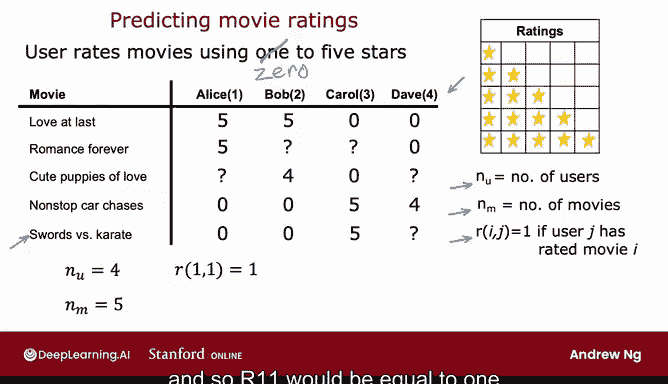

# 吴恩达《机器学习》｜machine-learning（中英字幕-deepseek翻译） - P119：14_02_01_推荐系统构建.zh_en - GPT中英字幕课程资源 - BV1MN4y1S7DE

Welcome to this second to last week of the Ma learning specialization。

 and I'm really happy that together we're almost all the way to the finish line。

What we'll do this week is discuss recommend systems This is one of the topics that has received quite a bit of attention in academia。

 but the commercial impact and the actual number of practical use cases of recommended systems seems to me to be even vastly greater than the amount of attention it has received in academia。

Every time you go to an online shopping website like Amazon or a movie streaming sites like Netflix or go to one of the apps or sites that do food delivery。

 many of these sites will recommend things to you that they think you may want to buy or movies they think you may want to watch or restaurants that they think you may want to try out and for many companies a large fraction of sales is driven by their recommended systems so today for many companies the economics or the value driven by recommended systems is very large and so what we're do in this week is take a look at how they work so with that let's dive in and take a look at what is a recommended system I'm going to use as a running example the application of predicting movie ratings。

So say you run a live movie streaming website and your users have rated movies using one to five stars and so in a typical recommended system。

 you have a set of users here， we have four users， Alice Bob Car andif。

 which I've numbered users one through four， as well as a set of movies。

 Love Alas romance forever cute Puppies of Love， and then nonstop car chases and Small dresss karate。

And what the users have done is rated these movies one to five stars， or in fact， to make some of。

These examples a little bit easier I'm much going to let them rate the movies from zero to five stars So say Alice has rated love atla five stars。

 romance forever five stars， maybe she has not yet watched cute puppies of love so you don't have a rating for that and I'm going to denote that via question mark and she thinks non sub car chases and souls with karate deserve zero stars Bob。

Race at5 stars has not watched that， so you don't have a rating， race at four stars，00， Carol。

 on the other hand。Things that deserve zero stars has not watched that zero stars and she loves non cons and swords v karate and Dave rates the movies as follows。

And the typical recommended system。You will have some number of users。

As well as some number of items， in this case， the items are movies that you want to recommend to the users。

And even though I'm using movies in this example， the same logic or the same framework works for recommending anything from products of website myself to restaurants to even which media articles or social media articles to show to a user that may be more interesting for them the notation I'm going to use is I'm going to use NU to dennotote the number of users so in this example NU is equal to four because you have four users。

And an M to denote the number of movies or really the number of items， so in this example。

 N M is equal to5 because we have five movies。I'm going to set RIJ to be equal to one if user J has rated movie I。

 so for example， user1， Dallas is Alice has rated movie1 but has not rated movie3 and so R11 will be equal to1 because she has rated movie1 but R。

31 would be equal to0 because she has not rated movie number3。

 Then finally I'm going to use Y Ij to denote the rating given by user J to movie I。

 so for example this rating here would be that。Movie 3 was rated by user 2 to be equal to4。

Notice that not every user ratess every movie and it's important for the system to know which users have rated which movies that's why we're going to define RIJ to be equal to one if userJ has rated movieI and or be equal to zero if user J has not rated movieI so with this framework for recommended systems。

 one possible way to approach the problem is to look at the movies that users have not rated and to try to predict how users would rate those movies because then we can try to recommend to users thinks that they are more likely to rate as five stars。

And in the next video we'll start to develop an algorithm for doing exactly that。

 but making one very special assumption， which is we're going to assume temporarily that we have access to features or extra information about the movies such as which movies are romance movies。

 which movies are actually movies and using that will start to develop an algorithm。

 but later this week we'll actually come back and ask what if we don't have these features。

 how can you still get the algorithm to work then？But let's go on to the next video to start building up this algorithm。

