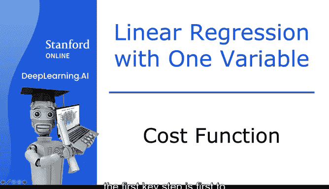
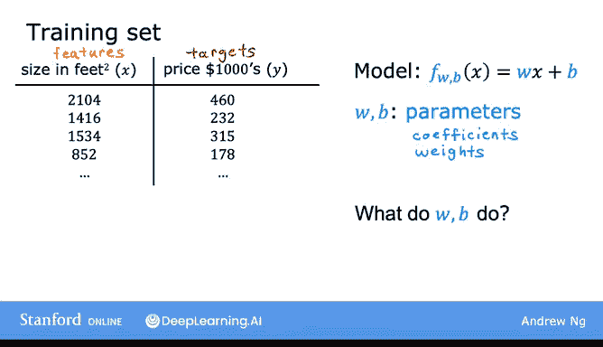
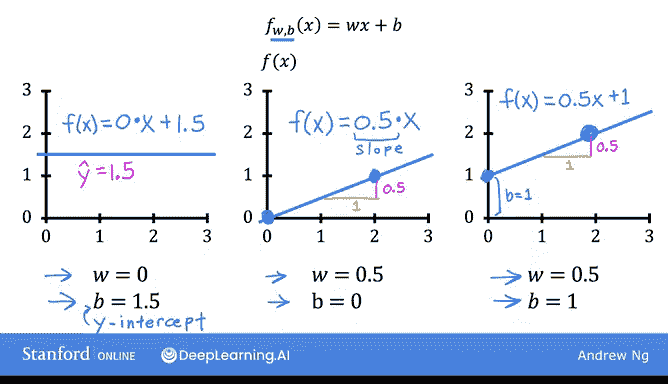
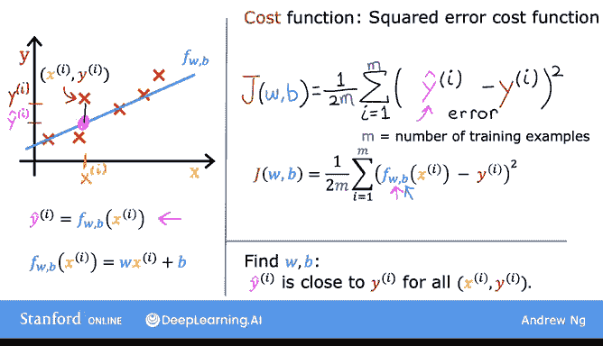

# 吴恩达《机器学习》｜machine-learning（中英字幕-deepseek翻译） - P11：11_01_03_成本函数公式.zh_en - GPT中英字幕课程资源 - BV1MN4y1S7DE

In order to implement linear regression， the first key step is for us to define something called a cost function。

 this is something we'll build in this video and the cost function will tell us how well the model is doing so that we can try to get it to do better Let's look what this means recall that you have a training set that contains input features X and output targets Y。

And the model you're going to use to fit this training set is this linear function Fwp of x equals w times x plus B。

To introduce a little bit more terminology， the W and B are called the parameters of the model。

In machine learning， parameters of a model are the variables you can adjust during training in order to improve the model。

Sometimes you also hear the parameters W and B referred to as coefficients or as weights。

Now let's take a look at what these parameters W and B do。

Depending on the values you've chosen for W and B， you get a different function， F of x。

 which generates a different line on the graph， and remember that we can write F of x as a shorthand for FwB of x。

We're going to take a look at some plots of F of X on a chart。

 Maybe you're already familiar with drawing lines on charts， but even if this is a review for you。

 I hope this will help you build intuition on how W and B the parameters determine F。

When w is equal to0 and b is equal to 1。5， then F looks like this horizontal line。In this case。

 the function F of x is 0 times x plus 1。5， so F is always a constant value， it always predicts 1。

5 for the estimated value of y so y hat is always equal to B and here B is also called the y intercept because that's where it crosses the vertical axis or the y xs on the graph。

As a second example。If w is 0。5 and p is equal to 0， then F of x is 0。5 times x When x is 0。

 the prediction is also 0， and when x is 2， then the prediction is 0。5 times 2， which is 1。

So you get a line that looks like this and notice is that the slope is 0。5 divided by one。

So the value of W gives you the slope of the line， which is 0。5。And finally， if w equals 0。

5 and b equals 1。Then F of x is 0。5 times x plus1。And when x is0， then f of x equals b， which is 1。

 so the line intersects the vertical x is at B， the y intercept。Also， when x is 2， then f of x is 2。

 so the line looks like this Again， the slope is 0。5 divided by1。

 so the value of w gives you the slope， which is 0。5。

Recall that you have a training set like the one shown here with linear regression。

 what you want to do is to choose values for the parameters W and B so that the straight line you get from the function F somehow fits the data well。

 like maybe this line shown here。And when I say that the line fits the data visually。

 you can think of this to mean that the line defined by F is roughly passing through or somewhat close to the trading examples as compared to other possible lines。

 the not as close to these points。And just to remind you of some notation。

 a training example like this point here。Is defined by x superstr I， Y superstr I。

Where why is the target？For a given input， X I。The function F also makes a predicted value for y。

 and the value that it predicts for y is Y hat I shown here for our choice of a model。

 F of X I is w times X plus B stated differently the prediction Y hat I is F of wb of X I。

Where for the model we're using。F。Of X I is equal to W X plus B。So now the question is。

How do you find values for W and B so that the prediction Y hat I is close to the true target， Y I。

 for many or maybe all training examples， X， I， Y I？To answer that question。

 let's first take a look at how to measure how well a line fits the training data。To do that。

 we're going to construct our cost function。 The cost function takes the prediction Y hat and compares it。

To the target y by taking y hat minus y。This difference is called the error。

We're measuring how far off the prediction is from the target。 Next。

 let's compute the square of this era。Also， we're going to want to compute to this term for different training examples。

 I in the training set， so when measuring the error， for example。

 I will compute this squared error term。Finally， we want to measure the error across the entire training set in particular。

 let's sum up the square errors like this while sum from I equals 12，3 all the way up to M。

And remember that M is the number of training examples， which is 47 for this dataset。

 notice that we have more training examples， M is larger and your cost function will calculate a bigger number since it's summing over more examples。

 so to build a cost function that doesn't automatically get bigger as the training set size gets larger。

By condenion， we will compute the average squared error instead of the total squared error。

 and we do that by dividing by M like this。Okay， we're nearly there。Just one last thing。

By convention， the cost function that machine learning people use actually devised by2 times m。

 the extra division by 2 is just meant to make some of our later calculations a little bit neatta。

 but the cost function still works whether you include this division by two or not。

 so this expression right here is the cost function and we're going to write J of WB to refer to the cost function。

This is also called the squared error Co function and it's called this because you're taking the square of these error terms。

In machine learning， different people will use different cost functions for different applications。

 but the spread error cost function is by far the most commonly used one for linear regression。

 and for that matter for all regression problems， where it seems to give good results for many applications。

So just as a reminder。The prediction Y hat is equal to the output of the model F at x。

So we can rewrite the cost function J of WB as 1 over 2 m times the sum from I equals1 to M of F of x I minus Y I。

 the quantity squared。Eventually we're going to want to find values of W and B that make the cost function small。

But before going there let's first gave more intuition about what J of WB is really computing at this point。

 you might be thinking we've done a whole lot of nav to define the cost function but what exactly is it doing let's go on to the next video where it will step through one example of what the cost function is really computing that I hope will help you build intuition about what it means if J of WB is large versus if the cost J is small let's go on to the next video。

