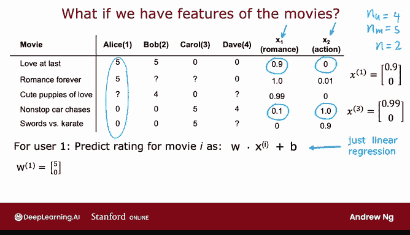
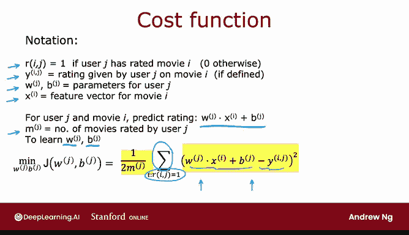
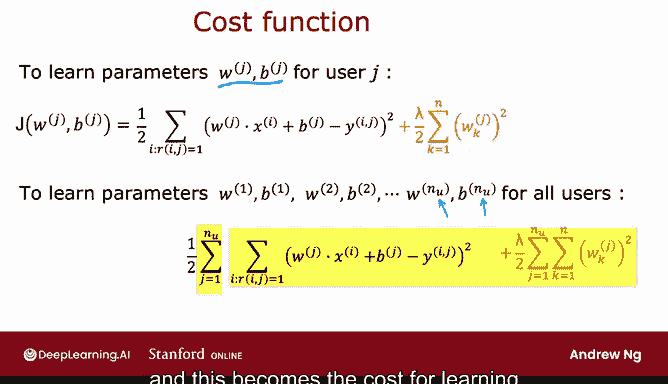

# 吴恩达《机器学习》｜machine-learning（中英字幕-deepseek翻译） - P120：15_02_02_使用物品特征.zh_en - GPT中英字幕课程资源 - BV1MN4y1S7DE

So let's take a look at how we can develop a recommended system if we had features of each item or features of each movie。

 so here's the same data set that we had previously with the four users having rated some but not all of the five movies。

What if we additionally have features of the movies so here I've added two features X1 and X2 that tell us how much each of these is a romance movie and how much each of these is an action movie so for example。

 love is a very romantic movie so this feature takes on 0。

9 but you it's not all action movie so this feature takes on zero。

But it turns out nontop car chases has just a little bit of romance in it， so it's 0。

1 but it has a ton of action so that feature takes on the value of 1。

0 so you recall that I had used the notation and U to denote the number of users。

 which is for andN to denote the number of movies which is five I'm going to also introduce n to denote the number of features we have here and so n is equal to 2 because we have two features X1 and x2 for each movie with these features we have。

 for example， that the features for movie1 that is the movie love at S would be 0。

90 and the features for the third movie cute puppies of love would be。0。99 and zero。And。

Let's start by taking a look at how we might make predictions for Alice's movie ratings。

 so for user one， that is Alice， let's say we predict the rating for movie I as W。

Dot x of feature I plus B。So this is just a lot like linear regression， for example。

 if we end up choosing the parameter w1 equal50 and say B1 is equal to zero。

Then the prediction for movie3， where the features are。0。99 and0， which I just copied from here。

 first feature 0。99 second feature0， our prediction would be。W dot x3。Plus B equals 0。

99 times 5 plus 0 times0， which turns out to be equal to 4。95。And this rating seems pretty plausible。

 it looks like Alice has given high ratings to love at last in romance forever to two highly romantic movies。

 but given low ratings to the action movies， nonstopcas and Sos versus karate so if we look at cute puppies of love。

 while predicting that she might rate that 4。95 seems quite plausible。

And so these parameters W and B for Alice。Seems like a reasonable model for predicting her movie ratings。

Just to add a little bit the notation， because we have not just one user。

 but multiple for users or really N equals four users。

 I'm going to add a superscript one here to denote that this is the parametered W1 for user one and add a superscript one there as well and similarly here。

And here as well， so that we would actually have different parameters。

For each of the four users in a data set。And more generally， in this model， we can for user J。

 not just user one now， we can predict user J's rating for movie I as WJ do product X I plus BJ。

 So here the parameters WJ and BJ are the parameters used to predict user Js rating for movie I。

 which is a function of XI， which is a features of movie I and this is a lot like linear regression。

 except that we're fitting a different linear regression model for each of the four users in the dataset。

 So let's take a look at how we can。Forulate the cost function for this algorithm。As a reminder。

 a notation is that RIJ is equal to 1 if user J has rated movie I or0 otherwise。

 and YIJ is a rating given by user J or Mo I。And on the previous slide。

 we defined W J BJ as a parameters for user J and X I as the feature vector for movie I。

 So the model we have is for user J and movie I predict the rating to be W J dot product X I plus。

BJ I'm going to introduce just one new piece of notation。

 which is I'm going to use MJ to denote the number of movies rated by user J。

 so if a user has rated four movies， then MJ would be equal to4 and every user has rated three movies。

 then MJ would be equal to three So what we like to do is to learn the parameters。WJ and BJ。

 given the data that we have， that is given the ratings a user has given of asset movies。

So the algorithm we're going to use is very similar to linear regression。

 so let's write out the cost function for learning the parameters WJ and BJ for a given user J。

 and let's just focus on one user on user J for now。I'm going to use the mean squared error criteria。

 so the cost will be the prediction， which is WJ dot X I plus。BJ minus the actual rating。

That the user had given， so minus Y I J。Squared and we'll try to choose parameters W and B to minimize the squared error between the predicted rating and the actual rating that was observed。

But the user hasn't rated all the movies， so if we're going to sum over this。

 we're going to sum over only over the values of I where RIJ is equal to one。

So we're going to sum only over the movie's eye that user J has actually rated。

So that's what this notess， some of all values of I where RIj is equal to  one。

 meaning that user J has rated that movie I。And then finally， we can take the usual normalization。

 one over two Mj。And this is very much like the cost function we have for linear regression with M or really MJ trading examples。

 where you're summing over the MJ movies for which you have a rating taking a squared error and then normalizing by this one over two MJ and this is going to be a cost function J of。

WJ。BJ。And if we minimize this。As a function of WJ and BJ。

 then you should come up with a pretty good choice of parameters WJ and BJ for making predictions for user J's ratings let me add just one more term to this cost function which is the regularization term to prevent overfitting and so here's our usual regularization parameter Lada divided by two mJ and then times the sum of you know the squared values。

Of the parameters W， and so n is the number of features X and that's the same as the number of numbers in WJ if you were to minimize this cost function J as a function of W and B。

 you should get a pretty good set of parameters for predicting user J's ratings for other movies。

Now before moving on， it turns out that for recommended systems。

 it would be convenient to actually eliminate this division by MJ term MJ is just a constant into this expression and so even if you take it out。

 you should end up with the same value of W andB Now let me take this cost function。

Down here to the bottom and copy it to the next slide。

So we have that to then the parameters WJPj for user J。

 we would minimize this cost function as a function of WJ and BJ。

But instead of focusing on a single user， let's look at how we learn the parameters for all of the users。

To learn the parameters W1 B1， W2 B2 through WN U BN U。

 we would take this cost function on top and sum it over all the NU users so we would have some。

From J equals1 to N U of。The same。Cost function that we had written up above。

And this becomes the cause。

For learning all the parameters， for all of the users。

 and if we use gradient In descent or any other optimization algorithm to minimize this as a function of W1b1 all the way through WNU BNU。

 then you have a pretty good set of parameters for predicting movie ratings for all the users。

And you may notice that this algorithm is a lot like linear regression where that plays a role。

Similar to the output F of x of linear regression， only now we're training a different linear regression model for each of the N subscript users。

So that's how you can learn parameters and predict movie ratings if you had access to these features X1 and X2 that tell you how much is each of the movies。

 is a romance movie and how much is each of the movies an action a movie。

But where these features come from and whether you don't have access to such features that give you enough detail about the movies with which to make these predictions in the next video we'll look at the modification of this algorithm that'll let you make predictions。

 let you make recommendations even if you don't have in advance features that describe the items of the movies in sufficient detail to run the algorithm that we just saw let's go on and take a look at that in the next video。

😊。