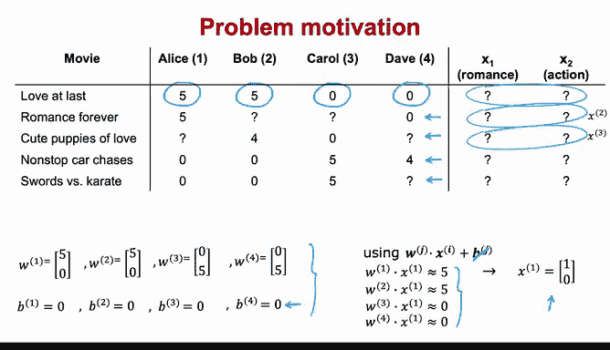
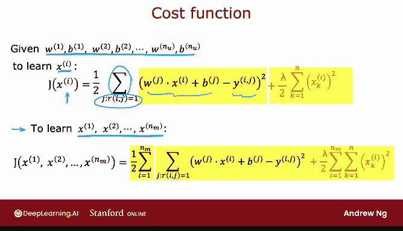
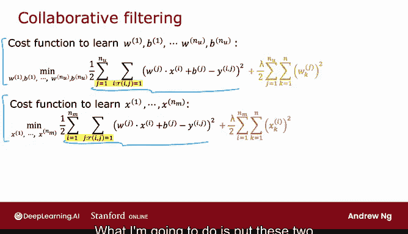
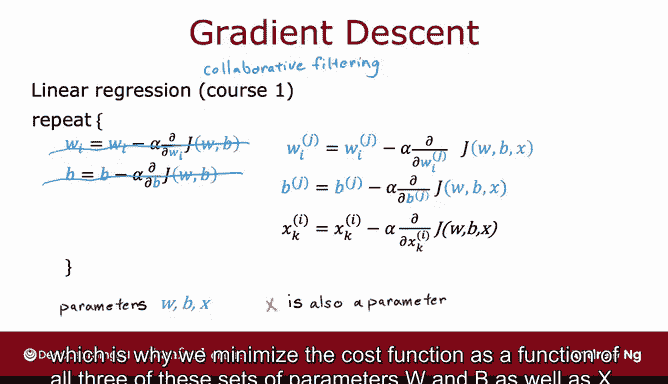
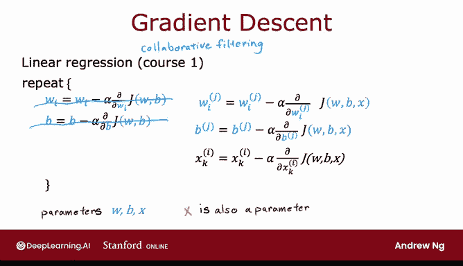

# 吴恩达《机器学习》｜machine-learning（中英字幕-deepseek翻译） - P121：16_02_03_协同过滤算法.zh_en - GPT中英字幕课程资源 - BV1MN4y1S7DE

In the last video you saw how if you have features for each movie such as features X1 and x2 that tell you how much is this a romance movie and how much is this an action movie。

 then you could use basically linear regression to learn to predict movie ratings but what if you don't have those features X1 and x2 let's take a look at how you can learn or come up with those features X1 and x2 from the data so here's the data that we had before。

But what if instead of having these numbers for x1 and x2。

 we didn't know in advance what the values of the features x1 and x2 are。

 so I'm going to replace them with question marks over here Now just for the purposes of illustration。

 let's say we had somehow already learned parameters for the four users so let's say that we learned parameters W1 equals 5 and0 and B1 equals0 for user 1 W2 is also50。

B 20。W3 is0，5。B3 is0 and and for user of4 W4 is also05 and b4 the zero zero We'll worry later about how we might have come over these parameters W and B。

 but let's say we have them already。And as a reminder to predict user J's rating on Mo I。

 we're going to use WJ dot product， the features of X I plus。B震。So to simplify this example。

 all the values of B are actually equal to zero， so just to reduce little over the writing。

 I'm going to ignore B for the rest of this example。

 let's take a look at how we can try to guess what might be reasonable features for Mo1。

If these are the parameters you have on the left， then given that Alice rated movie 15。

 we should have that w1 dot x1 should be about equal to 5。

And w2 tat x2 should also be probably equal to 5。Because Bob rated at five。

W3 dot x1 should be close to 0 and W4 dot x1 should be close to0 as well。

 So the question is given these values for w that we have up here，What？

Choice for X1 would cause these values。To be right。Well。

 one possible choice would be if the features for that first movie were1 zero， in which case？

W1 dot x1 would equal to 5， w2。 x1 would equal to5。

 and similarly W3 or W4 dot product with this feature vector x1 would be equal to zero。

So what we have is that if you have the parameters for all four users here and if you have four ratings in this example that you want to try to match。

 you can take a reasonable guess at what is the feature vector x1 for movie1 that would make good predictions for these four ratings up on top。

And similarly， if you have these parameter vectors， you can also try to come up with。

A feature vector， X2 for the second movie， a feature vector， X3 for the third movie。

 and so on to try to make the algorithm's predictions on these additional movies。

Close to what was actually the ratings given by the users。

 Let's come up with a cost function for actually learning the values of。X1 and X2 and by the way。

 notice that this works only because we have parameters for four users that's what allows us to try to guess appropriate features X1。

 This is why in a typical linear regression application if you had just a single user you don't actually have enough information to figure out what would be the features X1 and X2。

 which is why in the linear regression context that you saw on，Course one。

 you can't come up with features X1 and X2 from scratch。

 but in collaborative filtering it is because you have ratings from multiple users of the same item with the same movie。

 that's what makes it possible to try to guess what applasible values for these features。

So given W1p1， W2P2， and so on through WU， BNU for the Ns you users。

 if you want to learn the features XI for a specific movie I， here's a cost function we could use。

Which is that？I'm going to。Want to minimize squared error as usual。

 so if the predicted rating by user J on Mo I is given by this。

Let's take the squared difference from the actual movie rating YIJ。And as before。

 let's sum over all that uses J。But this will be some overall values of J where RIj is equal to1。

And I'll add a one half there as usual， and so if I defined this as a cost function。For X I。

Then if we minimize this as a function of X I， you'd be choosing the features X I for movie I so that for all the users J that had rated movie I。

 we would try to minimize the squared difference between what your choice of features X I results in in terms of the predicted movie rating。

 minus the actual movie rating that the user had given it。

 then finally if we want to add a regular term， wed add the usual plus lambda over2 k equals1 through n where n as usual as the number of features of X I K squared lastly。

To learn all the features， X1 through X and M， because with N M movies。

 we can take this cost function on top and sum it over all the movies。

 So some from I equals one through the number of movies。 and then just take this term。😊，From above。

 And this becomes a cost function for learning。The features for all of the movies in the dataset and so if you have parameters。

 W and B or all the users， then minimizing this course function as a function of X1 through X andM using great incent or cellular algorithm。

 this will actually allow you to take a pretty good guess at learning good features for the movies and this is pretty remarkable for most machine learning applications。

 the features had to be externally given， but in this algorithm。

 we can actually learn the features for a given movie。

 but in what we've done so far in this video we assume you had those parameters W andB for the different users where do you get those parameters from。

Well， let's put together the algorithm from the Los video for Learn W&B and what we just talked about in this video for Learning X。

 and that will give us our collaborative filtering algorithm。

Here's the cost function for learning the features， this is what we had derived on the last slide。

Now it turns out that if we put these two together this term here is exactly the same as this term here。

 notice that sum over a J of all values of I that RIJ equals1 is the same as summing over all values of I with all J where RIJ is equal to 1。

 this summation is just summing over all user movie pairs where there is a rating。

 and so what I'm going to do is put these two cost functions together。

And have。This。Where I'm just writing out the summation more explicitly as summing over all pairs I and J。

 where we do have a rating。Of the usual squared cost function。

 and then let me take the regular term from learning the parameters W and B and put that here and take the regular term from learning the features X and put them here。

 and this ends up being our overall cost function for learning W B and X。

And it turns out that if you minimize this cost function as a function of W and B as well as x。

 then this algorithm actually works。Here's what I mean if we had three users and two movies。

And if you have ratings for these four movies， but not those two over here it does。

 is it sums over all the users and for user one， it has the term the cost function for this for user  two is terms the cost function for these but user3 has the term the cost function for this。

 So we're summing over。Users first and then having one term for each movie where there is a rating。

 but an alternative way to carry a disseation is to first look at。Movie1。

 that's what this summation here does。 and then to include all the users that rated movie1。

And then look at Mo2。And have a term for all the users that had rated movie2。

 and you see that in both cases we' just summing over these four hairs where the user had rated the corresponding movie。

So that's why dis sumation on top and disamation here。

 there are two ways of summing over all of the pairs where the user had rated the movie。

So how do you minimize this cause function as a function of WPN X。

 One thing you could do is to use gradient descent。In course1。

 when we learned about linear regression， this is the gradient in descent algorithm you had seen where we had a cost function J。

 which is a function of the parameters W and B and we' apply gradient in descent as follows with collaborative filtering。

 the cost function isn't a function of just W and B is now a function of W B and X and I'm using W and B here to denote the parameters for all of the users and X here just informally to denote the features for all of the movies。

 but if you're able to take partial derivatives with respect to the different parameters you can then continue to update the parameters as follows。

But now we need to optimize this with respect to X as well。

 So we also will want to update each of these parameters X using gradient descent as follows。

 and it turns out that if you。Do this。Then you will actually find pretty good values of W and B as well as x。

 and in disform of the problem， the parameters are W and B and x is also a parameter。

And then finally， to learn the values of x， we also will update x as。

X minus the partial derivative of respect to x of the cost。

W B X I'm using the notation here a little bit informally and not keeping very careful track of the superss and subs。

 but the key takeaway I hope you have from this is that the parameters of this model are W and B and X now is also a parameter。

Which is why we minimize the cost function as a function of all three of these sets of parameters W and B as well as x So the algorithm we just arrived is called collaborative filtering and the name collaborative filtering refers to the sense that because multiple users have rated the same movie kind of collaboratively。

 given you a sense of what this movie may be like that allows you to guess what are appropriate features for that movie。

 and this in turn allows you to predict all other users that haven't yet rated that same movie may decide to rate it in the future so this collaborative filtering is this gatheringing of data from multiple users。

 you this collaboration between users to help you predict ratings for even other users in the future。

So far， our problem formulation has used movie ratings from one to five stars or from zero to five stars。

A very common use case of recommended systems is when you have binary labels such as do the user favorite or like or interact with an item in the next video let's take a look at the generalization of the model you've seen so far to binary labels let's go see that in the next video。

