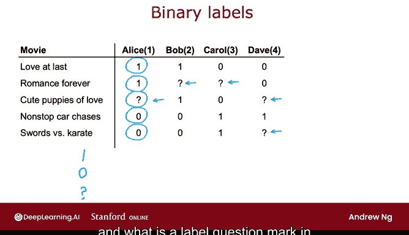
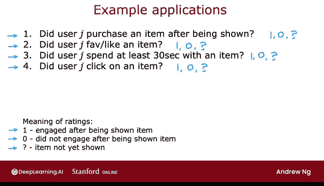
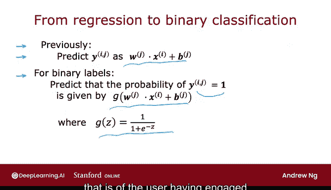
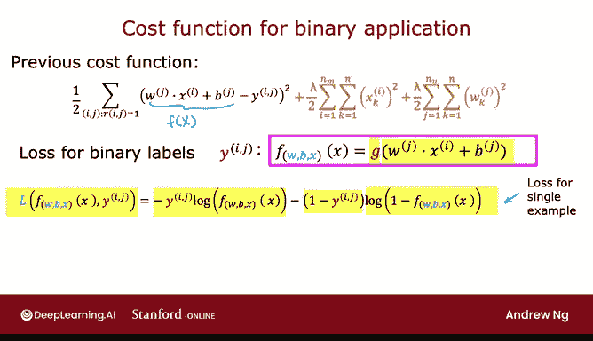

# 吴恩达《机器学习》｜machine-learning（中英字幕-deepseek翻译） - P122：17_02_04_二元标签（收藏、喜欢与点击）.zh_en - GPT中英字幕课程资源 - BV1MN4y1S7DE

Many important applications of recommended systems or collaborative filtering algorithms involve binary labels where instead of a user giving you a one to five star or zero to five star rating。

 they just somehow give you a sense of they liked this item or they did not like this item Let's take a look at how they generalize the algorithm you've seen to this setting the process were used to generalize the algorithm will be very much reminiscent to how we had gone from linear regression to logistic regression to predicting numbers to predicting a binary label back in coursese1 a take a look here's an example of a collaborative filtering data set with binary labels but one denotes that the user liked or engaged with a particular movie so label one could mean that Alice watched the movie love at last all the way to the end and watched romance forever all the way to the end but after playing a few minutes。

Of nonstop car chases decided to stop the video and move on。

Or it could mean that she explicitly hit like or favorite on an app to indicate that she liked these movies。

 but after checking out non-sub cloud traces and Sos versus karate did not hit like and the question mark usually means the user has not yet seen the item and so they weren't in the position to decide whether or not to hit like or favorite on that particular item so the question is how can we take the collaborative filtering algorithm that you saw in the last video and get it to work on this dataset and by predicting how likely Alice Bob Car and Dave are to like the items that they have not yet rated。

 we can then decide how much we should recommend these items to them there are many ways of defining what is the label one and what is the label zero and what is the label question mark in collaborative filtering with binary relabels let's take a look at a few examples in an online shopping website。

The label could denote whether or not user J chose to purchase an item after they were exposed to it after they were shown the item。

 so one would denote that they purchased it0 would denote that they did not purchase it and the question mark would denote that they were not even shown were not even exposed to the item or in a social media setting。

 the labels one or0 could denote that the user favorite or like an item after they were shown it and question mark would be if they've not yet been shown the item or many sites instead of asking for explicit user rating would use the user behavior to try to guess if the user like the item so for example。

You can measure if a user spent at least 30 seconds of an item and if they did。

 then assign that a label one because the user found the item engaging or if a user was shown an item but did not spend at least 30 seconds with it。

 then assign that a label zero， or if the user was not shown the item yet then assigned it a question mark。

Another way to generate a rating。Implicitly as a function of the user behavior will be to see that the user clicking an item this is often done in online advertising where if the user has been shown in ad。

 if they clicked on it assigned the label one if they did not click assign a label0 and the question mark will refer to if the user has not even been shown that ad in the first place so often these binary labels will have a rough meaning as follows a label of one means that the user engaged after being shown an item and engage could mean that they clicked or spend 30 seconds or explicitly favorite or liked to purchase the item。

 a0 will reflect the user not engaging after being shown the item and the question mark will reflect the item not yet having been shown to the user so given these binary labels let's look at how we can generalize our algorithm which is a lot like linear regression from the previous couple videos to predicting these。

Bineary outputsPrevious， we were predicting label Y I J as WJ dot product X I plus B。

 So this was a lot like a linear regression model， for binary labels。

We're going to predict that the probability of Y Ij being equal to 1 is given by not wj。xii+ B。

But its sent by G of this formula。Where now G of Z。Is1 over one plus e to the negative z。

 So this is the logistic function just like we saw in logistic regression and what we would do is take what was a lot like a linear regression model and turn it into something that will be a lot like a logistic regression model where we'll now predict the probability of Y Ij being one that is of the user having engaged with or like the item using this model in order to build this algorithm we'll also have to modify the cost function from the square error cost function to。

A cost function that is more appropriate for binary labels， for a logistic regression like model。

 So previously， this was the cost function that we had where this term。

Play their role similar to F of x， the prediction of the algorithm。

 when you now have binary labels Y I J， when the labels are1 or0 or question mark。

Then the prediction F of x becomes instead of。Wj。xi plus BJ。

It becomes G of this where G is the logistic function and similar to when we had derived logistic regression。

 we had written out the following loss function for a single example， which was at the loss。

 if the algorithm predicts F of x， and the true label was y the loss was this。

 it was negative y log F minus1 minus y log1 minus F。

This is also sometimes called the binary cross entropy cost function。

 but this is the standard cost function that we had used for logistic regression。

 as well as for the binary classification problems when we're training neural networks。

And so to adapt this to the collaborative filtering setting。Let me write out the cost function。

 which is now a function of all the parameters W and B。

As well as all the parametersus X， which are the features of the individual rubs or items。

Of we now need to sum over all the pairs。IJ， where R IJ is equal to 1 notice this is just similar to the summation up on top。

And now instead of this squared error cause function。

 we're going to use that loss function as a function of F of x comma。Why I J。

Where F of x here that's my abbreviation， my shorthand for G of wj。

xii plus Vj and if you plug this into here then this gives you the cost function they can use for collaborative filtering on binary labels so that's it that's how you can take the linear regression like collaborative filtering algorithm and generalize it to work with binary labels and this actually very significantly opens up the set of applications you can address with this algorithm。

Now even though you've seen the key structure and cost function of the algorithm。

 there are also some implementational tips that will make your algorithm work much better。

 let's go on to the next video to take a look at some details of how you would implement this and some little modifications that will make the algorithm run much faster。

 let's go on to the next video。