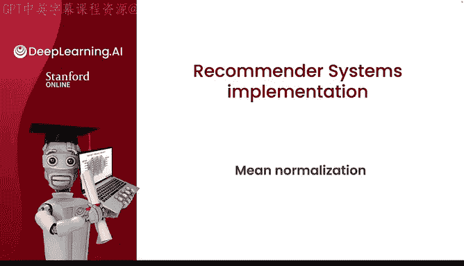
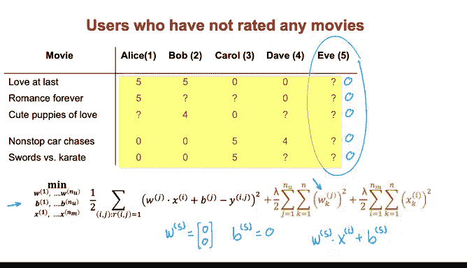
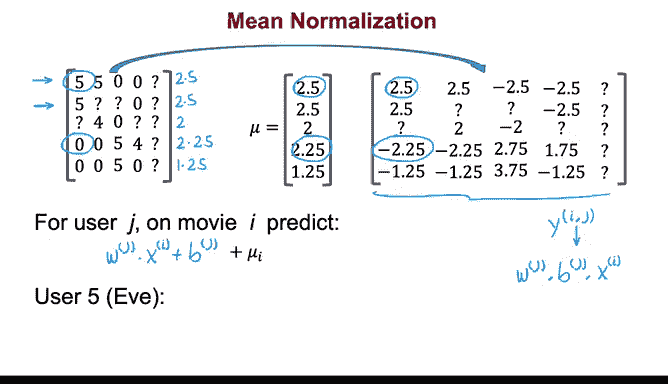

# 吴恩达《机器学习》｜machine-learning（中英字幕-deepseek翻译） - P123：18_02_01_均值归一化.zh_en - GPT中英字幕课程资源 - BV1MN4y1S7DE

Back in the first course， you had seen how for linear regression。

 feature normalization can help the algorithm run faster in the case of building a recommended system with numbers Y。

 such as movie ratings from one to five or zero to five stars。

 It turns out your algorithm will run more efficiently and also perform a bit better。

 if you first carry out mean normalization， that is if you normalize the movie ratings to have a consistent average value Let's take a look at what that means。

 So here's the data that would've been using and down below is the cost function you were use to learn the parameters for the model。

 in order to explain mean normalization， I'm actually going to add a fifth user。

Eve， who has not yet rated any movies and you see in a little bit that adding me normalization will help the algorithm make better predictions on the user Eve In fact if you were to train the collaborative filtering algorithm on this data。

 then because we are trying to make the parameters W small because of this regularization term。

 if you were to run the algorithm on this data set。

 you actually end up with the parameters W for the fifth user for the user Eve to be equal to00 as well as quite likely B5 equal0 because Eve hasn't rated any movies yet。

 the parameters W and B don't affect this first term in the cost function because none of Eve's moviess rating play a role in this square error cost function。

And so minimizing this means making the parameters W as small as possible。

 We didn't really regularize B， but if you initialize B to0 as a default。

 you end up with B5 equals0 as well。 But if these。Other parameters for user5 that is for Eve。

 then what the Am will end up doing is predict that all of Eve's movies ratings would be W5 dot X for movie I plus B5 and this is equal to0 if w and B above equal to0 and so this Am would predict that if you have a new user that has not yet rated anything。

 we think they'll rate all movies of zero stars and that's not particularly hopeful。

So in this video we'll see that mean normalization will help this algorithm come up with better predictions of the movie ratings for a new user that has not yet rated any movies in order to describe mean normalization let me take all of the values here。

 including all the question Mo Eve and put them in a twodimensional matrix like this。

 just to write out all the ratings including the question mark in a more succinct or the more compact way to carry out mean normalization what we're going to do is take all of these ratings and for each movie compute the average rating that was given so movie 1 at 25 and2 zeros and so the average rating is 2。

5， movie 2 and the 5 and0 so that average result to 2。5 movie 3，4 and0 average result to 2。

 movie4 average result to 2。2。

5 rating and movie5， not that popular as an average 1。25 rating。

So I'm going to take all of these five numbers and gather them into a vector which I'm going to call mu because this is the vector of the average ratings that each of the movies had averaging over just the users that did rate that particular movie instead of using these original 0 to 5 star ratings over here I'm going to take this and subtract from every rating the mean rating that it was given So for example。

 this movie rating was5， I'm going to subtract 2。5 giving me 2。5 over here。

 This movie had a 0 star rating'm going to subtract 2。25。Giving me a negative 2。

25 rating and so on for all of the now five users， including the new user Eve as well as for all five movies。

 then these new values on the right become your new values of Y IJ we're going to pretend that user one had given a 2。

5 rating to movie1 and a negative。2。25 rating into Mo 4 and using this you can then learn WJ。

 VJ and X I same as before for user J on Mo I， you would predict wj。 X plus Ej。

But because we had subtracted off new I for movie I during this me normalmalization step in order to predict not a negative star rating which isn't possible if a user rates from0 to5 stars。

 we have to add back this new I which is just the value we had subtracted out so as a concrete example。

 if we look at what happens with user5 with the new user Eve。

 because she had not yet rated any movies， the a might learn parameters W5 equals0 and say B5 equals0 and so if we look at the predicted rating for movie1 we would predict that Eve were rated W5。

 x1。

Plus b5， but this is zero and then plus mu1。Which is equal to 2。

5 so this seems more reasonable to think Eve is likely to rate this movie 2。

5 rather than think Eve will rate all movies zero cells just because she hasn't rated any movies yet and in fact。

 the effect of this algorithm is it will cause。The initial guesses for the new user Eve to be just equal to the mean of whatever other users have rated these five movies。

 and that seems more reasonable to take the average rating of the movies rather than to guess that all the ratings by Eve will be zero。

 It turns out that by normalizing the mean of the different movies ratings to be0。

 the optimization algorithm for the recommended system will also run just a little bit faster。

 but it does make the algorithm behave much better for users that have rated no movies or very small numbers of movies and the predictions will become more reasonable In this example。

 what we did was normalize each of the rows of this matrix to have zero mean and we saw this helps when there's a new user that hasn't rated a lot of the movies yet。

There's one other alternative that you could use， which is to instead normalize the columns of this matrix to have zero mean。

 and that would be a reasonable thing to do too， but I think in this application normalizing the rows so that you can give reasonable ratings for a new user seems more important than normalizing the columns。

Normalizing the columns would hope if there was a brand new movie that no one has rated yet。

 but if there's a brand new movie that no one has rated yet。

 you probably shouldn't show that movie to too many users initially because you don't know that much about that movie so normalizing columns the hope with the case of a movie with no ratings seems less important to me the normalizing the rules to hope with the case of a new user that's hardly rated than the movies yet and when you're building your own recommended system in this week's practice lab normalizing just the role should work fine So that's me normalization it makes the algorithm run a little bit faster but even more important it makes the algorithm give much better much more reasonable predictions when there are users that rated very few movies or even no movies at all。

This implementational detail of me normalization will make your recommended system work much better。

Next， let's go into the next video to talk about how you can implement this for yourself intensively。

