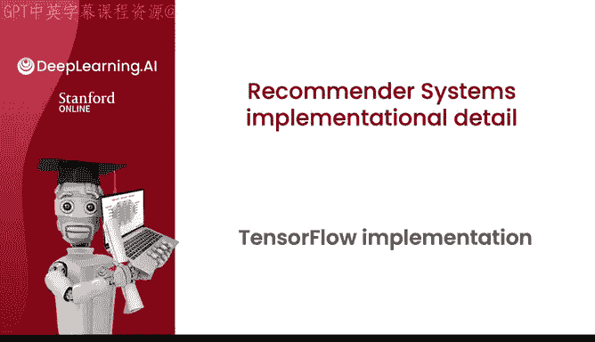
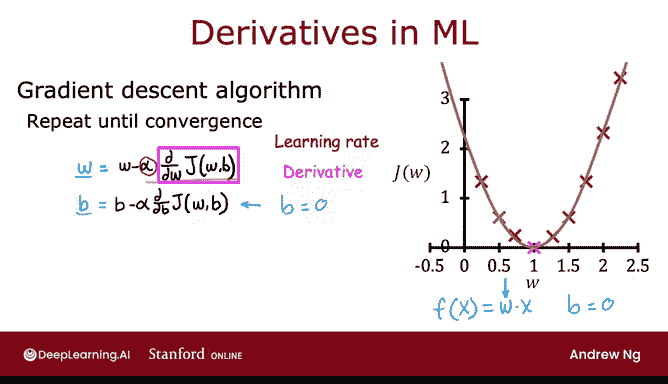
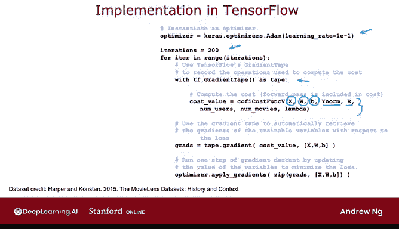

# 吴恩达《机器学习》｜machine-learning（中英字幕-deepseek翻译） - P124：19_02_02_协同过滤的TensorFlow实现.zh_en - GPT中英字幕课程资源 - BV1MN4y1S7DE

In this video， we'll take a look at how you can use Tensifflow to implement the collaborative filtering algorithm。

You might be used to thinking of TensorFlow as a tool for building neural networks and it is it a great tool for building neural networks。

 and it turns out that TensorFlow can also be very helpful for building other types of learning algorithms as well。

 like the collaborative filtering algorithm。One of the reasons I like using Tensorflow for tos like these is that。

For many applications in order to implement gradient intos。

 you need to find the derivatives of the cost function， but Tensorflow can。

Auttoomaally figure out for you what are the derivatives of a cost function all you have to do is implement the cost function and without needing to know any calculus without needing to take derivatives yourself。

 you can get tensorflow with just a few lines of code to compute that derivative term that could then be used to optimize to cost function let's take a look at how all this works you might remember this diagram here on the right from course1 this is exactly the diagram that we had looked at when we talked about optimizing W when we were working through our first linear regression example and at that time we had set B equals to zero and so the model was just predicting F of x equals w dox and we wanted to find the value of W that minimizes the cost function J。

So the way we were doing that was via a gradient descent update， which looked like this。

Where W gets repeatedly updated as w minus the learning rate alpha times the derivative term If you were updating B as well。

 this is the expression you will use， but if you set b equals to0 you just for gold this second update and you keep on performing this gradient descent update until convergence Sometimes computing this derivative or partial derivative term can be difficult and it turns out that Tensorflow can help with that Let's see how I'm going to use a very simple cost function J equals Wx minus1 squared so Wx is a simplified FW of x。

And y is equal to one。 And so this would be the cost function。If we had F of x equals Wx。

Y equals one for the？One training example that we have。

And if we were not optimizing this with respect to B So the gradient indescent algorithm would repeat until convergence this update over here。

 it turns out that if you implement the cost function J over here。

 Tensorflow can automatically compute for you， this derivative term and thereby get gradient indesscent to work。

 I'll give you a high level overview of what this code does。

W equals tf dot variable3 takes the parameter to w and initializes it to the value of3。

 telling Tensorflow that w is a variable is how we tell it that W is a parameter that we want to optimize。

 I'm going to set x equals1 y equals1 and the learning rate alpha to be equal to 0。

01 and let's run gradient descent for 30 iterations。

 So in this code we'll do for either range iterations。 So for 30 iterations。

 and this is a syntax we get tensorflow to automatically compute divus for you Tensorflow has a feature called a gradient tape。

And if you write this with TF I gradient tape as tape F。

 this is compute F of x S w times x and compute J as。F of x minus y squared。

 then by telling Tensorflow how to compute the co J and by doing it with a gradient tape syntax as follows。

 Tensorflow will automatically record the sequence of steps。

 the sequence of operations needed to compute the cause J。

And this is needed to enable automatic differentiation Next Tensorflow will have saved the sequence of operations in tape。

 in the gradient tape。And with this。Syntax Tensorflow will automatically compute this derivative term。

 which I'm going to call DJDW and Tensorflowlow knows you want to take the derivative with respect to W that w is the parameter you want to optimize because you had told it so up here and because we're also specifying it down here。

 So now that you compute derivative finally you can carry out this update by taking w and subtracting from it the learning rate alpha times that derivative term that we just got from up above。

 Tensorflow variables tier variables requires special handling。

 which is why instead of setting w to be w minus alpha times the derivative in a usual way。

 we use this assign add function。 But when you get to the practice lab don't worry about it we'll give you all the syntax you need in order to implement a collaborative filtering algorithm correctly So notice that with the gradient。

Fature of TensorF， the main work you need to do is to tell it how to compute the cost function J and the rest of this syntax causes Tensorflow to automatically figure out for you what is that derivative。

And with this Tensorflow we'll start with finding the slope of this at three shown by this dash line。

 take a gradient step and update W。And compute the derivative again and update W over and over until eventually it gets to the optimal value of w。

 which is at W equals1 So this procedure allows you to implement gradient descent without ever having to figure out yourself how to compute this derivative term this is a very powerful feature of Tensorflowlow called AutoDF and some other machine learning packages like Pythtor also support AutoDF Sometimes you hear people call this autograd。

 the technically correct term is autoDF and autograd is actually the name of a specific software package for doing automatic differentiation for taking derivatives automatically but sometimes if you hear someone refer to autograd they're just referring to this same concept of automatically taking derivatives so let's take this and look at how you can implement the collaborative filtering algorithm using autoDF。

And in fact， once you can compute derivatives automatically。

 you're not limited to just gradient in descent， you can also use a more powerful optimization algorithm like the Adamom optimization algorithm。

In order to implement the collaborative of filtering our Tensorflow， this is the syntax you can use。

 Let's start with specifying that the optimizer is carries optimizes Adamom with。

Learning rate specified here and then for say 200 iterations。

 here's the syntax as before with Tf gradient tape S tape。

 you need to provide code to compute the value of the cost function J。

So recall that in collaborative filtering， the cost function J takes this input parametersus X W and B as well as the ratings me normalizedize。

 so that's why I'm writing Y norm Rj specifying which values have a rating number of users or N U and a notation number of movies or Nm and annotation just now as well as the regular parameter lamb and if you can implement this cost function J。

 then this syntax will cause tensorflow to figure out the derivative for you then this syntax will cause tensorflow to record the sequence of operation is used to compute the cost and then by asking it to give you gras equals tape thought gradient this will give you the derivative of the cost function with respect to X W and B。

And finally， with the optimizer that we had specified up on top as the atom optimizeomr。

 you can use the optimizer with the gradients that we just computed and the zip function in Python is just a function that rearranges the numbers into an appropriate ordering for the applied gradients function if you are using gradient descent for colral filtering。

 recall that the cost function J would be a function of W B as was x and if you applied gradient descent。

 you take the partial derivative respect W and then update W as follows and you'd also take the partial derivative of this respect B and update B as follows and similarly update the features x as follows and you repeat until convergence。

But as I mentioned earlier， with Tensorflow and autoDF。

 you're not limited to just straight in descent， you can also use a more powerful optimization algorithm like the addom optimizeizer。

The dataset you use in the practice labb is a real data set comprising actual movies rated by actual people。

This is the movie lens dataset and is due to Harper and Cons and I hope you enjoy running toarro room on a real data set of movies and ratings and see for yourself the results that Dearro room can get So that's it that's how you can implement the collaborative filtering A intensive film。

If you're wondering why did we have to do it this way。

 why couldn't we use a dense layer and then model compile and model fit The reason we couldn't use that old recipe is the collaborative filtering algorithm and cost function it doesn't neatly fit into the dense layer or the other standard neural network layer types of Tensorflow that's why we had to implement this other way where we would implement the cost function ourselves cells but then use Tensorflows tools for automatic differentiation also called AutoDF and use Tensorflows implementation of the atom optimization algorithm to let it do a lot of the work for us of optimizing the cost function。

If the model you have is a sequence of dense neural network layers or other types of layers supported by TensorFlow。

 then the old implementation recipe of model Comp model fit works， but even when it isn't。

 these tools in TensorFlow give you a very effective way to implement other learning algorithms as well。

And so I hope you enjoy playing more with the collaborative filtering exercise in this week's practice lab and if it looks like there's La code and lot of synt。

 don't worry about it， make sure you have what you need to complete that exercise successfully and in the next video I'd like to also move on to discuss more of the nuances of collaborative filtering and specifically the question of how do you find related items given one movie what other movies similar to this one let's go on to the next video。

