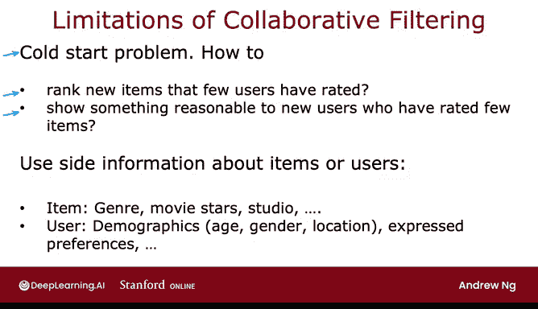

# 吴恩达《机器学习》｜machine-learning（中英字幕-deepseek翻译） - P125：20_02_03_查找相关物品.zh_en - GPT中英字幕课程资源 - BV1MN4y1S7DE

If you go to an online shopping website and are looking at a specific item say maybe a specific book the website may show you things like here are some other books similar to this one or if you're browsing a specific movie it may say here are some other movie similar to this one how do the websites do that so that when you look at one item gives you other similar related items to consider it turns out the collaborative filtering algorithm that we've been talking about。

 gives you a nice way to find related items let's take a look as part of the collaborative filtering with discuss you learn features XI for every item I for every movie eye or other type of item that you're recommending to users whereas early this week I had used a hypothetical example of the features representing how much a movie is a romance movie versus an action movie in practice when you use this algorithm to learn the features XI automatically？

Looking at the individual features like x1 x2， x3， you find them to be quite hard to interpret。

 it's quite hard to look at learn features and say oh X1 this is an action movie and x2 is is a foreign film and so on but nonetheless these learned features collectively x1 and x2 or X1 x2 x3 have the many features and you have。

Collectively， these features do convey something about what that movie is like。

 and it turns out that given features XI of item I， if you want to find other items。

 say other movies related to movieI， then what you can do is try to find the item K with features XK。

That is similar to X I and in particular， given a feature vector Xk。

 the way we determine whether or not is similar to the feature X I is as follows is the sum from L equals1 through n with n features of XkL minus X I L squared。

 this turns out to be the square distance between Xk and X I。

And in mathF this square distance between these two vectors。

 Xk and X I is sometimes written as follows as well。

 And if you find not just the one movie with the smallest distance between XK and XI， but find。

 say the five or 10 items with the most similar feature vectors。

 then you end up finding five or 10 related items to the item XI。

 So if you're building a website and want to help users find related products to a specific product they're looking at。

 this would be a nice way to do so。Because the features X I give a sense of what item I is about other items Xk with similar features will turn out to be similar to item I it turns out later this week。

 this idea of finding related items will be a small building block that we' used to get to an even more powerful recommend system as well before wrapping up this section I want to mention a few limitations of collaborativelateral filtering。

In collaborative filtering you have a set of items and a set of users and the users have rated some subset of items。

 one of its weaknesses is that it's not very good at the Colstar problem， for example。

 if there's a new item in your catalog， say someone's just published a new movie and hardly anyone has rated that movie yet。

How do you rank the new item if very few users have rated it before。

 similarly for new users that have rated only a few items。

 how can we make sure we show them something reasonable we did't see in an earlier video how me normalmalization can help with this and it does help a lot。

But perhaps there are even better ways to show users that've rated very few items。

Things that are likely to interest them This is called the code start problem because when you have a new item that few users have rated or when you have a new user that's rated very few items。

 the results of colagra filtering for that item for that user may not be very accurate a second limitation of collaborativeagra filtering is it doesn't give you a natural way to use side information or additional information about items or users For example。

 for the given movie in your catalog， you might know what is the genre of the movie。

 who are the movie stars， what is the studio， what is the budget and so on and you may have a lot of features about a given movie。

Or for a single user， you may know something about their demographics， such as their age。

 gender location， they express preferences， such as if they tell you they like certain movie genres。

 but not other movie genres。Or it turns out if you know the user's IP address that can tell you a lot about the user's location and knowing the user's location might also help you guess what might the user be interested in or if you know whether the user is accessing your site on mobile or on a desktop or if you know what web browser they're using it turns out all of these are little cues you can get that can be surprisingly correlated with the preferences of a user it turns out by the way that is known that users that use the Chrome versus Firefox versus a safari versus the Microsoft edge browser they actually behave in very different ways。

 so even knowing the user web browser can give you a hint when you have connected an updated data of what dis user might like So even though collaborative filtering where you have multiple users give you ratings of multiple items is a very powerful set of algorithms。

 it also has some limitations。In the next video let's go on to develop content based filtering algorithms which can address a lot of these limitations content based filtering algorithms are a state art technique used in many commercial applications today let's go take a look at how they work。

