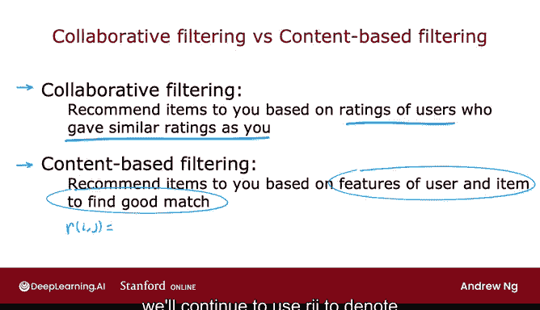
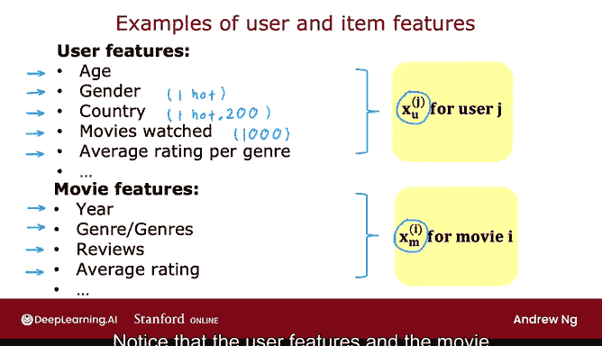
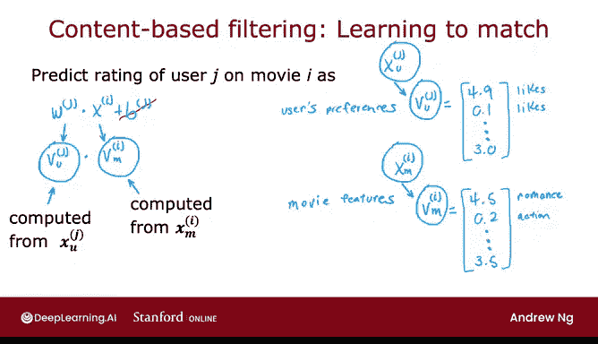

# 吴恩达《机器学习》｜machine-learning（中英字幕-deepseek翻译） - P126：21_02_01_协同过滤与基于内容的过滤对比.zh_en - GPT中英字幕课程资源 - BV1MN4y1S7DE

In this video we'll start to develop a second type of recommended system called a contentbased filtering algorithm To get started。

 let's compare and contrast the collaborative filtering approach that we've be looking at so far with this new content-based filtering approach Let's take a look with collaborative filtering the general approach is that we would recommend items to you based on ratings of users who gave similar ratings as you So we have some number of users give some ratings for some items and the algorithm figures out how to use that to recommend new items to you In contrast content-based filtering takes a different approach to deciding what to recommend to you a contentbased filtering algorithm will recommend items to you based on the features of users and features of the items to find a good match In other words。

 it requires having some。

Of each user， as well as some features of each item。

 and it uses those features to try to decide which items and users might be a good match for each other With a content based filtering algorithm。

 you still have data where users have rated some items。 So with content based filtering。

 willll continue to use R Ij。

To denote whether or not user J has rated item I， and we continue to use YIJ to denote the rating that user J is given item I if it' defined。

But the key to contentbased filtering is that willll be able to make good use of features of the user and of the items to find better matches than potentially a pure collaborative filtering approach might be able to Let's take a look at how this works in the case of movie recommendations here are some examples of features you may know the age of the user or you may have the gender of the user so this could be a oneho feature similar to what you saw when we were talking about decision trees where you could have a one-hot feature with fee values based on whether the user's self-identified gender is male or female or unknown or。

And you may know the country of the user。 So if there are about 200 countries in the world。

 then there would be a one hot feature with about 200 possible values。

 you can also look at past behaviors of the user to construct this feature vector。 For example。

 if you look at the top thousand movies in your catalog you might construct a thousand features that tells you of the thousand most popular movies in the world which of these past the user watch。

 And in fact， you can also take ratings the user might have already given in order to construct new features。

 So it turns out that if you have a set of movies and if you know what genre each movie is in。

 then the average rating per genre that the user has given。 So if all the。

Rmance movies that the users rated， What was the average rating of all the action movies that the users rated What was the average rating and so on for all the other genres。

 this too can be a powerful feature to describe the user one is interesting thing about this feature is that it actually depends on the ratings that the user had given。

 but there's nothing wrong with that constructing a feature vector that depends on the user's ratings is a completely fine way to develop a feature vector to describe that user So features like these you can then come up with a feature vector x sububscript U use stands for user superscript J for user J Similarlyly you can also come up with a set of features for each movie or for each item such as what was the year of the movie what's the genre or genres of the movie of known if there are critical。

Vis of the movie， you can construct one or multiple features to capture something about what the critics are saying about the movie。

 or once again， you can actually take user ratings in the movie to construct a feature of。

 say the average rating of this movie。This feature again depends on the ratings that users have given。

 but again there's nothing wrong with that， you can construct a feature for a given movie。

That depends on the ratings the movie had received， such as the average rating of the movie。

 Or if you wish you can also have average rating per country or average rating per user demographic and so on to construct other types of features of the movies as well and so with this for each movie you can then construct the feature vector which I'm going to denote X subscript M M stands for movie and superstr I for movie I given features like this the task is。

To try to figure out whether a given movie I is going to be good match for user J notice that the user features and movie features can be。

Very different in size for example， maybe the user features could be 1500 numbers and the movie features could be just 50 numbers and that's okay too in content based filtering we're going to develop an algorithm that learns to match users and movies previously we were predicting the rating of user J on movie I as WJ thought product with X I+ BJ。

In order to develop content based filtering。I'm going to get rid of VJ。

 it turns out this won't hurt the performance of the content based filtering at all。

 instead of writing WJ for a user J and X I for a movie I。

 I'm instead going to just replace this notation with VJ U this V here stands for a vector。

 it will be a list of numbers computed for user J and the U Sub here stands for user。

And instead of XI， I'm going to compute a separate vector Subscript M that stands for movie and for movie I is what the supersscript stands for。

 so VJU is a vector is a list of numbers computed from the features of user J and VIM is a list of numbers compute from the features like the ones you saw in the previous slide of movieI and if we're able to come up with an appropriate choice of these vectors VJU and VIM then hopefully the dot product between these two vectors will be a good prediction of the rating that user J gives movie VI just to illustrate what a learning algorithm could come up with。

If V U that is a user vector， turns out to capture the user's preferences。Says 4。90。1 and so on。

 list of numbers like that and the first number captures how much do they like romance movies and then the second number captures how much do they like action movies and so on and at VM。

 the movie vector is 4。5， 0。2 and so on and so forth。

With these numbers capturing how much this is a romance movie， how much this is an action movie。

 and so on， then the dot product， which multiplies these listen numbers element wise and then takes a sum。

 hopefully will give a sense of how much this particular user。We like this particular movie。

So the challenge is given features of a user， say XJU。

 how can we compute this vector VJU that represents succinctly or compactly the user's preferences。

 and similarly given features of a movie how can we compute V I am notice that whereas XU and XM could be different in size one could be a very long list of numbers one could be much shorterness V here have to be the same size because if you want to take a dot product between VU and VM then both of them have to have the same dimensions such as maybe both of these are say 32 numbers so to summarize in collaborative filtering。

 we had number of users give ratings of different items in contrast in contentbased filtering we have features of users and features of items。

to find a way to find good matches between the users and the items and the way we're going to do so is to compute these vectors。

 VU for the users and VM for the items for the movies。

 and then take dot process between them to try to find good matches。How do we compute VU and VM。

 let's take a look at that in the next video。