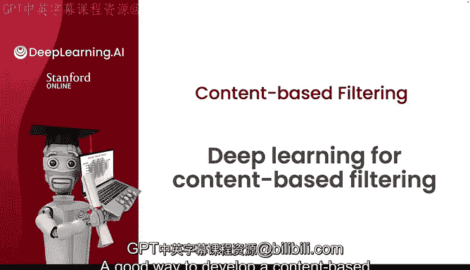
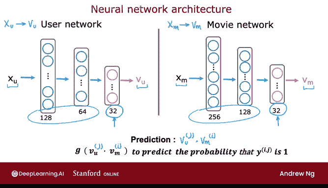
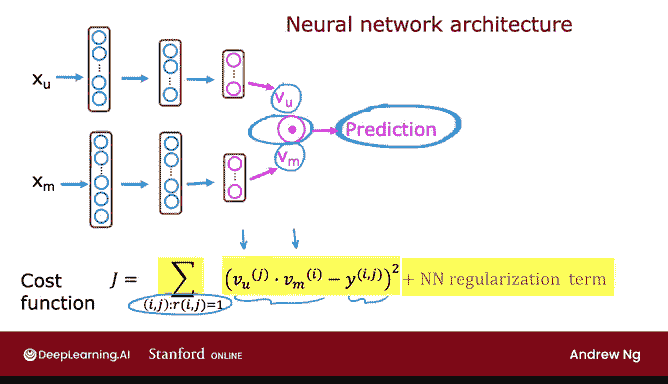
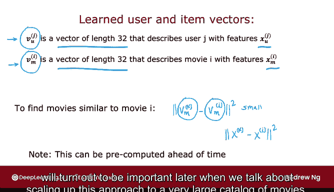

# 吴恩达《机器学习》｜machine-learning（中英字幕-deepseek翻译） - P127：22_02_02_基于内容过滤的深度学习.zh_en - GPT中英字幕课程资源 - BV1MN4y1S7DE

A good way to develop a content-based filtering algorithm is to use deep learning The approach you see in this video is the way that many important commercial sayard content based filtering our are built today let's take a look recall that in our approach given a feature vector describing a user such as the age and gender and country and so on。

 we have to compute a vector VU and similarly given a vector describing a movie such as this your release。

 the style in the movie and so on， we have to compute a vector VM。

In order to do the former， we're going to use a neural network and the first neural network will be what we'll call the user network。

Here's an example of user network， it takes as input the list of features of the user XU， so the age。

 the gender， the country of the user， and so on。And then using a few layers。

 say dense neural network layers， it will output this vector VU that describes the user。

Notice that in this neural network， the output layer has 32 units。

 and so VU is actually a list of 32 numbers， unlike most of the neural networks that werere using earlier。

 the final layer is not a layer with one unit， theres a layer with 32 units。

 Similarlyly to compute VM。For a movie， we can have a movie network as follows that takes us input features of the movie and through a few layers of a neural network and the outputting VM。

 that vector that describes the movie finally will predict。The rating of this user on that movie as。

VU do product with VM notice that the user network and movie network can hypothetically have different numbers of hidden layers and different numbers of units per hidden layer only the output layer needs to have the same size or the same dimension。

In the description you've seen so far， we were predicting the one to5 or0 to5 star movie rating if we had binary labels if y was to the user like or favorite an item then you can also modify this algorithm to output instead of VU。

VM you can apply the sigmoid function to that and use this to predict the probability that Y Ij this one and to flesh out this notation。

 we can also add superscripts I and J here if we want to emphasize that distance the prediction by user J on movie I So I've drawn here the user network and movie network as two separate neural networks。

 but it turns out that we can actually draw them together in a single diagram as if it was a single neural network。

This is what it looks like。On the upper portion of this diagram， we have the user network。

 which inputs XU and ends up computing VU on the lower portion of this diagram。

 we have what was the movie network that inputs XM and ends up computing VM。

And these two vectors are then dot producted together。 This dot here represents thatt product。

 and this gives us our prediction。Now this model has a lot of parameters each of these layers of a neural network has a usual set of parameters of the neural network so how do you train all the parameters of both the user network and the movie network What we're going to do is constructive cost function J。

 which is going to be very similar to the cost function that you saw in collaborative filtering。

 which is assuming that you do have some data of some users having rated some movies。

We're going to sum over all pairs I andJ of where you have labels where IIj equals one of the difference between the prediction。

 so that that would be VUJ dot product with VMI minus Y IJ squared and the way we would train this model is depending on the parameters of the neural network。

 you end up with different vectors here for the users and for the movies。

And so what we like to do is train the parameters of the neural network so that you end up with vectors for the users and for the movies that results in small squared error in the predictions you get out here and so to be clear。

 there's no separate training procedure for the user and movie networks， this expression down here。

 this is the cost function used to train all the parameters of the user and the movie networks We're going to judge the two networks according to how well VU and VM predict Yj and with this cost function。

 we're going to use gradient descent or some other optimization algorithm to tune the parameters of the neural network to cause the cost function J to be as small as possible and if you want to regularize this model。

 we can also add the usual neural network regularization term to encourage the neural networks to keep the value。

Use of their parameters small。 It turns out after you've trained as small， though。

 you can also use this to find similar items。 This is akin to what we have seen with collaborative filtering features helping you find similar items as well。

 Let's take a look。

So V UJ is a vector of length 32 that destroys a user J that has features X UJ and similarly VIM is a vector of length 32 that destroys a movie with these features over here so given a specific movie。

 what if you want to find other movies similar to it？Well， this vector V IM describes the movie I。

 so if you want to find other movies similar to it。

 you can then look for other movies K so that the distance between the vector describing driving movie K and the vector describing movie I that that distance or square distance is small and this expression plays a role similar to what we had previously with collaborative filtering where we talked about finding a movie with features XK that was similar to the features X I and thus with this approach。

 you can also find。Items similar to a given item。One final note。

 this can be precomputed ahead of time and by that I mean you can run a compute server overnight to go through the list of all your movies and for every movie。

 find a similar movies to it so that tomorrow if a user comes to the website and the browsing a specific movie you can already have precomped to 10 or 20 more similar movies to show to the user at that time the fact that you can precompute ahead of time was's similar to given movie will turn out to be important later when we talk about scaling up this approach to a very large catalog of movies so that's how you can use deep learning to build a content-based filtering algorithm。

You might remember when we were talking about decision trees and the pros and cons of decision trees versus neural networks。

 I mentioned that one of the benefits of neural networks is that it's easier to take multiple neural networks and put them together to make them work in concert to build a larger system and what you just saw was actually an example of that where we could take a user network and movie network and put them together and then take the inner product of the output and this ability to put two neural networks together is how we've managed to come up with a more complex architecture that turns out to be quite powerful。

One note， if you're implementing these algorithms in practice。

 I find that developers often end up spending a lot the time carefully designing the features needed to feed into these content based filtering algorithm so if you end up building one of these systems commercially。

 it may be worth spending some time。Engineering good features for this application as well。

And in terms of these applications， one limitation of the algorithm。

 as we've described it is it can be computationally。

 very expensive to run if you have a large catalog of a lot of different movies that you may want to recommend。

So in the next video， let's take a look at some of the practical issues and how you can modify this algorithm to make a scale to working on even very large item catalogs let's go see that in the next video。

😊。