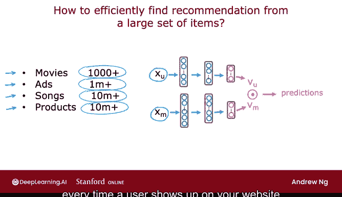
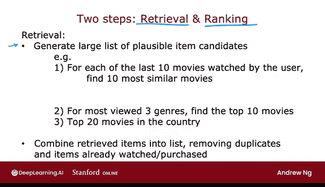
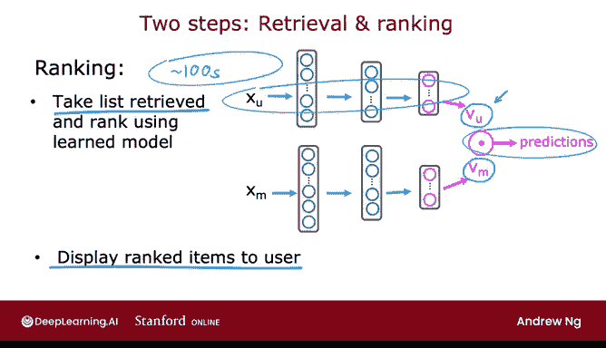
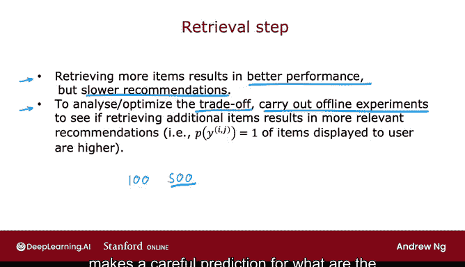

# 吴恩达《机器学习》｜machine-learning（中英字幕-deepseek翻译） - P128：23_02_03_从大型目录中推荐.zh_en - GPT中英字幕课程资源 - BV1MN4y1S7DE

Today's recommended systems will sometimes need to pick a handful of items to recommend from a catalog of thousands or millions or tens of millions or even more items How do you do this efficiently computationally let's take a look heres in neural network we've using to make predictions about how a user might rate an item today a large movie streaming site may have thousands of movies or a system that is trying to decide what ad to show may have a catalog of millions of ads to choose from or a music streaming site may have tens of millions of songs to choose from and large online shopping sites can have millions or even tens of millions of products to choose from。

When a user shows up on your website， they has some feature XU。

 but if you need to take thousands or millions of items to feed through this neural network in order to compute the inner product to figure out which products you should recommend。

 then having to run neural network inference， thousands or millions of times every time a user shows up on your website becomes computationally infeasible。

Many large scale recommended systems are implemented as two steps。

 which are called the retrieval and ranking steps。The idea is during the retrieval step we generate。

A large list of plausible item candidates that tries to cover a lot of possible things you might recommend to the user and it's okay during the retrieval step。

 if you include a lot of items that the user is not likely to like，And then during the ranking step。

 we'll fine tune and pick the best items to recommend to the user， so here's the example。

During the retrieval step， we might do something like for each of the last 10 movies that the user has watched。

 find the 10 most similar movies。

So this means for example， if a user has watched the movieI with vector VIM。

 you can find the movies hey with vector VKM that is similar to that and as you saw in the last video finding the similar movies to given movies can be precomputed so having precomped。

 the most similar movies to give a movie you can just pull up the results using a lookup table this would give you an initial set of maybe somewhat plausible movies to recommend to a user that just showed up on your website。

 Additionally you might decide to add to it for whatever are the most view3 genres of the user。

 say there's a user that's watched a lot of romance movies and a lot of comedy movies and a lot of historical dramas。

Then we would add to the list of plausible item candidates。

 the top 10 movies in each of these three genres。And then maybe we would also add to this list to top 20 movies in the country of the user。

So this retrieval step can be done very quickly and you may end up with a list of a hundred or maybe hundreds of plausible movies to recommend to the user and hopefully this list will recommend some good options but is also okay if it includes some options that the user won't like at all the goal of the retrieval step is to ensure broad coverage to have enough movies to at least have many good ones in there。

Finally， we would then take all the items we retrieve during the retrieval step and combine them into a list。

 removing duplicates and removing items that the user has already watched or that the user has already purchased and that you may not want to recommend to them again。

The second step of this is then the ranking step。During the ranking step。

 you would take the list retrieved during the retrieval step， So this may be just hundreds of。

Possible movies and rank them using the learned model and what that means is you will feed the user feature vector and the movie feature vector into this neural network and for each of the user movie pairs compute the predicted rating and based on this you now have all of the say0 plus movies。

 the ones that the user is most likely to give a high rating to and then you can just display the rank list of items to the user depending on what you think the user will give the highest rating to one additional optimization is that if you have computed VM for all the movies in advance then all you need to do is to do inference on this part of the neural network a single time to compute VU and then take that VU that just compute it for the user on your website right now and take the inner product between VU and。

VM for the movies that you have retrieved during the retrieval step。

 so this computation can be done relatively quickly if the retrieval step just brings up， say。

 hundreds of movies。One of the decisions you need to make for this algorithm is how many items do you want to retrieve during the retrieval step to feed into the more accurate ranking step？

During the retrieval step， retrieving more items will tend to result in better performance。

 but the algorithm will end up being slower to analyze or to optimize the tradeoff between how many items to retrieve do you retrieve 100 or 500 or 1 thousand00 items？

I would recommend carrying out offline experiments to see how much retrieving additional items results in more relevant recommendations and in particular。

 if the estimated probability that Y IJ is equal to1。

 according to your neural network model or if the estimated rating of Y being high of the retrieve items。

 according to your model's prediction ends up being much higher， if only you were to retrieve。

 say 500 items instead of only 100 items， then that would argue for maybe retrieving more items。

 even if it slows down the algorithm a bit， but with the separate retrieval step and the ranking step。

 this allows many recommended systems today to give both fast as was accurate results because retrieval step。

Tries to prune out a lot of items that are just not worth doing the more detailed inference and inner product on。

 and then a ranking step makes a more careful prediction for what are the items that the user is actually likely to enjoy。

So that's it， this is how you would make your recommended system work efficiently even on very large catalogs of movies or products or what have you。

Now it turns out that as commercially important as our recommended systems。

 there are some significant ethical issues associated with them as well and unfortunately there have been recommended systems that have created harm so as you build your own recommended system。

 I hope you take an ethical approach and use it to serve your users and society as large as well as yourself and the company that you might be working for let's take a look at the ethical issues associated with recommended systems in the next video。

