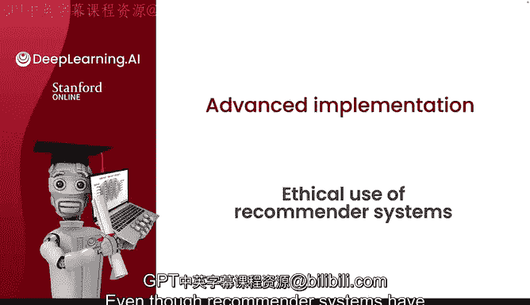
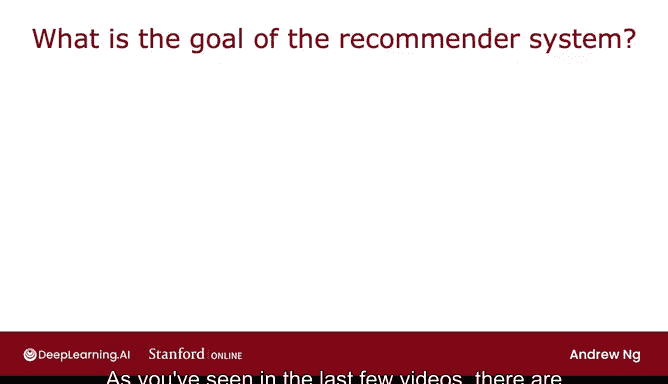
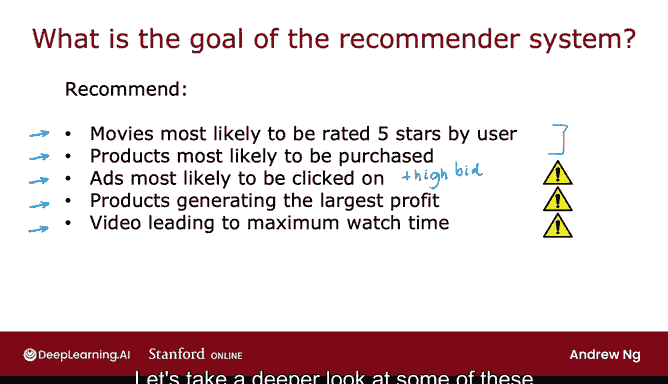
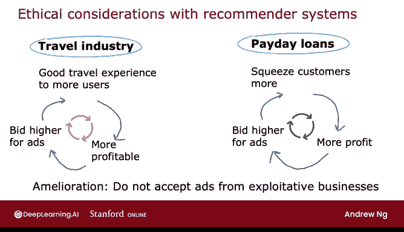
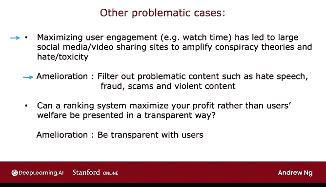

# 吴恩达《机器学习》｜machine-learning（中英字幕-deepseek翻译） - P129：24_02_04_推荐系统的伦理使用.zh_en - GPT中英字幕课程资源 - BV1MN4y1S7DE

Even though recommended systems have been very profitable for some businesses。

 there have been some use cases that have left people and society at large worse off However you use recommended systems or for that matter other learning algorithms I hope you only do things that make society at large and people better off Let's take a look at some of the problematic use cases of recommended systems as was amels to reduce harm or to increase the amount of good that they can do As you've seen in the last few videos。

 there are many ways of configuring a recommended system when we saw binary labels the label Y could be does a user engage or do they click or do they explicitly like an item。

So when designing a recommended system choices in setting the go of the recommended system and a lot of choices in deciding what to recommend to users。

 For example， you can decide to recommend to users movies most likely to be rated five stars by that user So that seems fine it seems like a fine way to show users movies that they will like or maybe you can recommend to the user products that they are most likely to purchase and that seems like a very reasonable user of a recommended system as well versions of recommended systems can also be used to decide what as to show to a user and one thing you could do is to recommend or really to show to the user as the most likely to be clicked on actually what many companies will do is try to show as likely to clicked on and where the advertiser。

I put in a high bid because for many ad models， the revenue that the company collects depends on whether the ad was clicked on and what the advertiser had bid per click。

And so while this is a profit maximizing strategy， there are also some possible negative implications of this type of advertising。

 I'll give a specific example on the next slide。One other thing that many companies do is try to recommend products that generate the largest profit If you go to a website and search for a product today。

 there are many websites that are not showing you the most relevant product or the product that you are most likely to purchase。

 but is instead trying to show you the products that will generate the largest profit for the company。

And so if a certain product is more profitable for them because they can buy it more cheaply and sell it at a higher price。

 that gets ranked higher in the recommendations。Now many companies view a pressure to maximize profit。

 so this doesn't seem like an unreasonable thing to do。

 but on the flip side from the user perspective， when a website recommends to your product sometimes it feels like could be nice that the website was transparent with you about the criteria by which it is deciding what to show you。

 is it trying to maximize their profits or trying to show you things that are most useful to you on video websites or social media websites a recommended system can also be modified to try to show you the content that leads to the maximum watch time。

So specifically， websites that earn ad revenue tend to have an incentive to keep you on the website for a long time。

 and so try to maximize the time you spend on the site is one way for the site to try to get more of your times so they can show you more ads。

And recommended systems today are used to try to maximize user engagement or to maximize the amount of time that someone spends on a site a specific app。

So whereas the first two of these seem quite innocuous， the third， fourth and fifth。

 they may be just fine， they may not cause any harm at all。

 or they could also be problematic use cases or recommended systems。

Let's take a deeper look at some of these potentially problematic use cases。

Let me start with the advertising example， it turns out that the advertising industry can sometimes be an amplifier of some of the most harmful businesses。

 it can also be an amplifier of some of the best and the most fruitful businesses。

Let me illustrate with a good example and a bad example take the travel industry I think in the travel industry the way to succeed is to try to give good travel experiences to users to really try to serve users now it turns out that if there's a really good travel company they can sell your trip to fantastic destinations and make sure you and your friends and family have a lot of fun then a good travel business I think will often end up being more profitable and if the business is more profitable it can then bid higher for ads it can afford to pay more to get users and because it can afford to bid higher for ads and online advertising site will show is ads more often and drive more users to this good company and this is a virtualuous cycle where the more users you serve well。

 the more profitable the business and the more you can bid more for ads and the more traffic you get and so。

And this virtuous circle will maybe even tend to help the good travel companies do even better。

 so this is a good example。Let's look at the problematic example The payday loan industry tends to charge extremely high interest rates often to low incomecome individuals and one of the ways to do well in the payday loan business is to be really efficient as squeezing customers for every single dollar you can get out of them。

 So if there's a payday loan company that is very good at exploiting customers。

 really squeezing customers for every single dollar then that company will be more profitable and thus they can bid higher ads and because they can bid higher ads they will get more traffic sent to them and this allows them to squeeze even more customers and exploit even more people for profit。

 and this in turn also creates a positive feedback loop。

 also a positive feedback loop that can cause the most exploitative。

 the most harmful payday loan companies to get sent more traffic。

And this seems like the opposite effect than what we think would be good for society。

I don't know that there's an easy solution to this and these are very difficult problems that recommended systems face One amelioration might be to refuse to accept ads from exploitative businesses Of course that's easy to say but how do you define what is an exploitative business and what is not is a very difficult question but as we build recommended systems for advertising all other things。

 I think these are questions that each one of us working on these technologies and ask ourselves so that we can hopefully invite open discussion and debate get multiple opinions from multiple people and try to come up with design choices that allows our systems to try to do much more good than potential harm Let's look at some of other examples its been widely reported in news that maximizing user engagement such as the amount of time that someone watches videos on the website or the。

the time someone spends on social media this has led to large social media and video sharing sites to amplify conspiracy theories or hate and toxicity because conspiracy theories and certain types of hate toxic content is highly engaging and causes people to spend a lot the time on it even if the effect of amplifying conspiracy theories are amplify hate and toxicity turns out to be harmful to individuals and to society at large One amunration for this partial and imperfect is to try to filter out problematic content such as hate speech fraud scams maybe certain types of val content。

 but again， the definitions of what exactly we should filter out is surprisingly tricky to develop。

And this is a set of problems that I think companies and individuals and even governments have to continue to wrestle with。

Just one last example when a user goes to many apps or websites。

 I think users think the Apple website are trying to recommend to the user things that they will like and I think many users don't realize that many apps and websites are trying to maximize their profit rather than necessarily the users enjoyments of the media items that being recommended。

 I would encourage you and other companies， if at all possible to be transparent with users about the criteria by which you are deciding what to recommend to them。

 I know this isn't always easy but ultimately I hope that being more transparent with users about what we're showing them and why will increase trust and also calls our systems to do more good for society So recommend systems are very powerful technology。

 a very profitable， a very lucrative technology and they're also some problematic use cases。

You are building one of these systems using recommended technology or really any other machine learning or other technology。

 I hope you think through not just the benefits you can create。

 but also the possible harm and invite diverse perspectives and discuss and debate and please only build things and do things that you really believe believe society better off。

I hope that collectively， all of us in AI can only do work that makes people that rough。

Thanks for listening and we have just one more video to go in recommended systems in which we take a look at some practical tips for how to implement a content based filtering our room in TensorF so let's go on to that last video on recommended systems。

