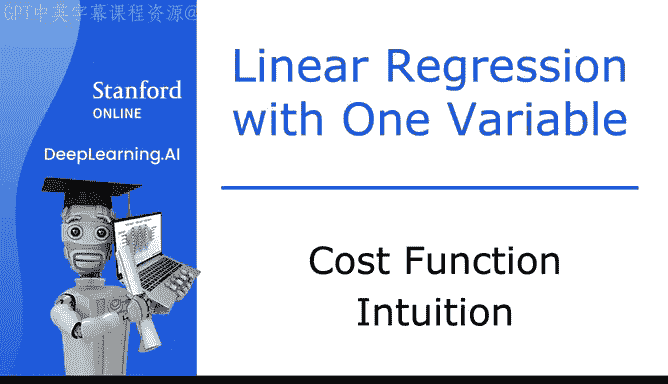
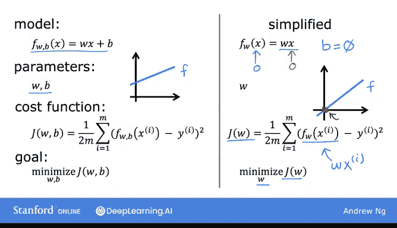
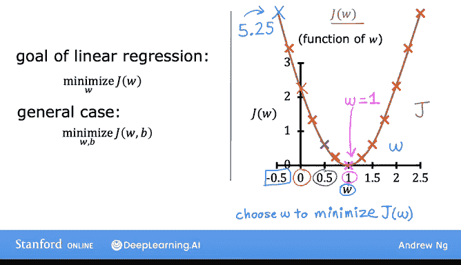

# 吴恩达《机器学习》｜machine-learning（中英字幕-deepseek翻译） - P12：12_01_04_成本函数直观理解.zh_en - GPT中英字幕课程资源 - BV1MN4y1S7DE

We've seen the mathematical definition of the cost function now let's build some intuition about what the cost function is really doing。

In this video we'll walk through one example to see how the cost function can be used to find the best parameters for your model I know this video is a little bit longer than the others。

 but bear of me I think it will be worth it to rehab。

 here's what we've seen about the cost function so far。

You want to fit the straight line to the training data， so you have this model。

 FwB of x is w times x plus B。And here the model's parameters are W and B。Now。

 depending on the values chosen for these parameters， you get different straight lines like this。

And you want to find values for W and B so that the straight line fits the training data well。

To measure how well a choice of W andB fits the training data， you have a cost function J。

 and what the cost function J does is it measures the difference between the model's predictions and the actual true values for y。

What you see later is that linear regression will try to find values for W and B that make J of W B as small as possible In math。

 we write it like this。 We want to minimize J as a function of。WNB。

So now in order for us to better visualize the cost function J。

 let's work of a simplified version of the linear regression model。

We're going to use the model FW of x is w times x。 You can think of this as taking the original model on the left and getting rid of the parameter B or setting the parameter b equal to0。

 so it just goes away from the equation。So F is now just w times x。

So you now have just one parameter w and your cost function J looks similar to what it was before。

 taking the difference and squaring it， except that now F is equal to w times X and J is now a function of just W。

And the go becomes a little bit different as well because you have just one parameter W， not W and B。

 so with this simplified model， the go is to find a value for W that minimizes J of W。

To see this visually， what this means is that if b is set to0。

 then F defines a line that looks like this， and you see that the line passes through the origin here because when x is0。

 well， f of x is 02。Now， using this Simified model。

 let's see how the cost function changes as you choose different values for the parameter W。

In particular， let's look at graphs of the model F of x。And the cost function J。

I'm going to plot these side by side and you'll be able to see how the two are related。First。

 notice that for F Sub W， when the parameter w is fixed， that is always a constant value。

 then FW is only a function of x。Which means that the estimated value of y depends on the value of the input x。

In contrast， look to the right。The cost function J is a function of W。

 where W controls the slope of the line defined by FW。

 so the cost defined by J depends on a parameter， in this case， the parameter W。

So let's go ahead and plot these functions， FW of x and J of W side by side so you can see how they are related。

We'll start to the model that is the function FW of X on the left。Here。

 the input feature X is on the horizontal axis， and the output value Y is on the vertical axis。

 Here's a plot of three points representing the training set at positions1，1，2，2 and 3，3。

Let's make a value for w， say w is1， so for this choice of W。

 the function FW looks like this straight lined with a slope of1。Now。

 what you can do next is calculate the cost J when W equals1。

So you may recall that the cost function is defined as follows is the squared error cost function。

 so if you substitute Fw of X with w timesxii the cost function looks like this where this expression is now w times Xi minus Yi so for this value of w。

 it turns out that the error term inside the cost function for this w times X minus yi is equal to0 for each of the three data points because for this data when x is1 then y is1 when w is also one。

 then f of x equals1 so F of x equals y for this first training example and the difference is0。

Pluging this into the cost function J you get0 squared， Similarlyly when x is 2， then y is 2。

 and f of x is also 2， so again f of x equals y for the second training example in the cost function。

 the squared error for the second example is also0 squared。Finally， when x is 3。

 then y is 3 and F of 3 is also3。In the cost function。

 the third squared error term is also zero squared。So for all three examples in this training set。

 F of X I equals Y I for each training example I， so F of X I minus Yi is0。

So follow this particular data set。When w is 1， then the cost J is equal to zero。Now。

 what you can do on the right is plot the co function J and notice that because the cos function is a function of the parameter W。

 the horizontal axis is now labeled W and not X。And the vertical axis is now J and not Y。

So you have j of1 equals to0， in other words， when w equals1， j of w is zero。

 so let me go ahead and plot that。Now let's look at how F and J change for different values of W W can take on a range of values right。

 so W can take on negative values， W can be zero and it can take on positive values z。

So what if w is equal to 0。5 instead of one， what will these drops look like then？

Let's go ahead and plot that， so let's set w to be equal to 0。5， and in this case。

 the function F of x now looks like this。Is a line with a slope equal to 0。5。

And less also computes the cost J when W is 0。5。Red that the cost function is measuring the squared error or difference between the estimated value that is y hat I。

 which is F of X I， and the true value that is Y I。For each example， I。So visually。

 you can see that the error or difference is equal to the height of this vertical line here when x is equal to 1。

 because this normal line is a gap between the actual value of y and the value that the function f predicted。

 which is a bit further down here。So for this first example。When x is1， F of x is 0。5。

So the squared error on the first example is 0。5 minus1 squared。Remember。

 the cost function will sum over all the training examples in the training set。

 so let's go on to the second training example。When x is2， the model is predicting F of x is1。

And the actual value of y is2。So the error for the second example is equal to the height of this little line segment here。

And the squared arrow is the square of the length of this line segment。So you get1 minus2 squared。

Let's do the third example。Repeating this process， the error here。

 also shown by this line segment is 1。5 minus3 squared。Next， we sum up all of these terms。

 which turns out to be equal to 3。5。Then we multiply this term by 1 over 2 m。

 where M is the number of training examples。Since there are three training examples， M equals3。

So this is equal to one over two times3。Where this M here is three If we work on the math。

 this turns out to be 3。5 divided by 6， so the cost J is about 0。58。

 Let's go ahead and plot that over there on the right okay。Now let's try one more value for W。

How about if w equals0， what do the grounds for F and J look like when W is equal to0？

It turns out that if w is equal to zero， then f of x is just this horizontal line that is exactly on the x axis。

And so the error for each example is a line that goes from each point down to the horizontal line that represents F of x equals0。

So the cost J， when w equals0 is1 over 2 m times the quantity1 squared plus2 squared plus v squared。

And that's equal to one over 6 times 14， which is about 2。33。

 So let's plot this point where w 0 and J of0 is 2。33 over here。

And you can keep doing this for other values of W Since w can be any number。

 it can also be a negative value， so if w is negative 0。5。

 then the line F is a downward sloping line like this， it turns out that when w is negative 0。5。

 then you end up with an even higher cost around 5。25， which is this point up here。

And you can continue computing the cost function for different values of W and so on and plot these。

 right？So it turns out that by computing a range of values。

 you can slowly trace out what the cost function J looks like， and that's what J is。To recap。

 each value of parameter w corresponds to a different straight line fit。

 F of x on the graph to the left。And for the given training set。

 that choice for a value of W corresponds to a single point。

 a single point on the graph on the right， because for each value of W。

 you can calculate a cost J of W。For example， when w equals1。

 this corresponds to this straight line fit through the data。

And it also corresponds to this point on the graph of J。Where w equals 1 and the cost J of1 equals0。

 whereas when w equals 0。5， this gives you this line， which has a smaller slope。

And this line in combination with the training set。

 corresponds to this point on the cost function graph at W equals 0。5。So for each value of W。

 you wind up with a different line and this corresponding costs J of W。

And you can use these points to trace all this plot on the right。Given this。

 how can you choose the value of W that results in the function F fitting the data well？Well。

 as you can imagine， choosing a v of w that causes J of w to be as small as possible seems like a good bet。

J is the cost function that measures how big the squared errors are。

 so choosing w that minimizes these squared errors makes them as small as possible would give us a good model。

In this example， if you were to choose the value of W。

 that results in the smallest possible value of J of w， you end up picking W equals 1。

And as you can see， that's actually a pretty good choice。

 This results in the line that fits the training data very well。So that's how in linear regression。

 you use the cost function to find the value of W that minimizes J。Or in the more general case。

 when we had parameters W and B rather than just W， you find the values of W and B that minimize。

Jy。So to summarize， you saw plots of both F and J and work through how the two are related。

As you vary W or vary W and B， you end up with different straight lines。

 and when that straight line passes close the data， the cost J is small。

So the goal of linear regression is to find a parameters W or W and B that results in the smallest possible value for the cost function J。

Now in this video， we work through our example with a simplified problem using only W in the next video。

 let's visualize what the cost function looks like for the full version of linear regression using both W and B and you see some cool 3D thoughts。

 Let's go to the next video。