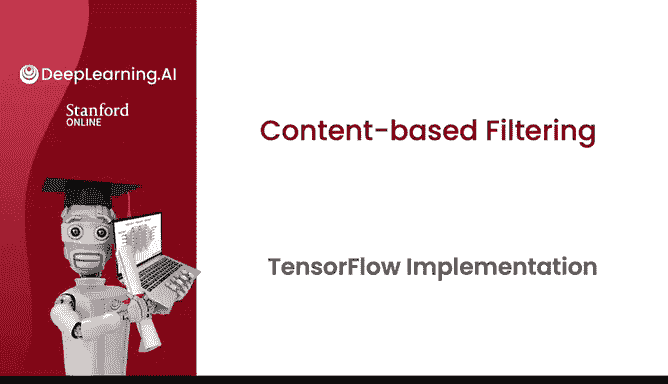
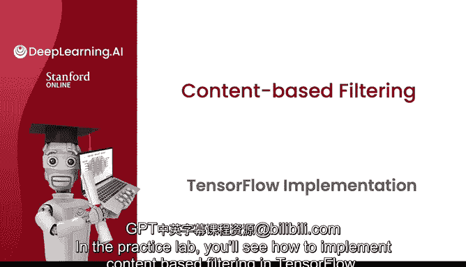
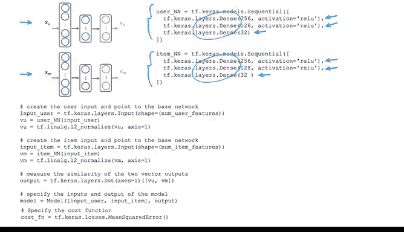

# 吴恩达《机器学习》｜machine-learning（中英字幕-deepseek翻译） - P130：25_02_05_基于内容过滤的TensorFlow实现.zh_en - GPT中英字幕课程资源 - BV1MN4y1S7DE

In the practice lab you'll see how to implement contentbased filtering in TensorFlow What I'd like to do in this video is just set through with a few of the key concepts in the code that you get to play with let's take a look recall that our code has started with a user network as well as a movie network and the way you can implement this in TensorFlow is very similar to how we have previously implemented a neural network with a set of dense layers we're going to use a sequential model we then in this example have two dense layers with the number of hidden units specified here and the final layer has 32 units in outputs 32 numbers。

Then for the movie network， I'm going to call it the item network because the movies are the items here。

 this is what the color looks like Once again we have couple dense hidden layers。

foollowed by this layer which outputs 32 numbers and for the hidden layers we use our default choice of activation function。

 which is the relu activation function Next we need to tell Tensorflow carriess how to feed the user features or the item features that is the movie features to the two neural networks this is the syntax for doing so that extracts out the input features for the user an inths it to the user Nn that we had to find up here to compute VU the vector for the user and then one additional step that turns out to make thisarrow work a bit better is at this line here which normalizes the vector VU to have length1 so this normalizes the length also called the L2 norm but basically the length of the vector V to be equal to1 and then we do the same thing for。

The item network for the movie network this extract out the item features and feeds it to the item neural network that we define up there and this computes the movie vector VM。

 and then finally this step also normalizes that vector to have length1。

After having computed VU and VM， we then have to take the dot product between these two vectors and this is a syntax for' doing so。

Kris has a special layer type。 notice we had here， T F， Caris layers dense here， and this is T F。

 Cars。Layers dot， it turns out that there's a special kous layer that just takes a dot product between two numbers。

 and so we're going to use that to take the dot product between the vectors VU and VM and this gives the output of the neural network this gives the final prediction。

Finally， to tell carriers what are the inputs and outputs of the model。

 this line tells it that the overall model is a model with inputs being the user features and the movie or the item features and the output to this output that we is defined up above。

And the cost function that we use to train this model is going to be the mean squared error cost function So these are the key code snippets for implementing contentbased filtering as a neural network and you see the rest of the code in the practice lab but hopefully you be able to play with that and see how all these code snippets fit together into a working tensorflow implementation of a contentbased filtering algorithm it turns out that there's one other step that I didn't talk about previously but if you do this which is normalize the length of the vector VU that makes the algorithm work a bit better and so Tensorflows has this L2 normalize function that normalizes the vector it is also called normalizing the L2 norm of the vector hences the name with the function and so that's it Thanks for sticking with me through all this material on recommend systems is an exciting thing。

And I hope you enjoy playing with these ideas and code in their practice labs so this week。

And so that takes us to the loss of these videos on recommended systems and to the end of the next to final week for this specialization。

 I look forward to seeing you next week as well we'll talk about the exciting technology of reinforcer learning hope you have fun with the quizzes and with the practice labs and I look forward to seeing you next week。

