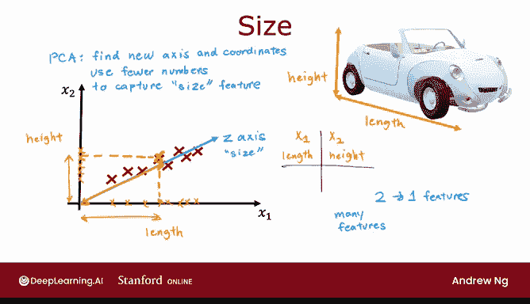
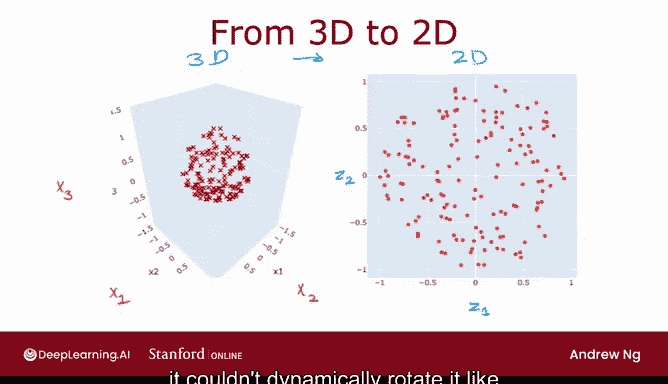
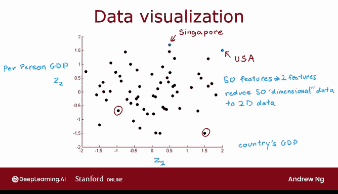

# 吴恩达《机器学习》｜machine-learning（中英字幕-deepseek翻译） - P131：26_02_01_减少特征数量（可选）.zh_en - GPT中英字幕课程资源 - BV1MN4y1S7DE

I hope you enjoyed the videos on how you can build your own recommend system before we wrap up this week in this and a few other optional videos。

 I'd like to share with you an unsupervised learning algorithm called Priip components analysislysis。

This is an algorithm that is commonly used for visualization specifically if you have a dataset with a lot of features。

 say 10 features or 50 features or even thousands of features。

 well you can't plot 100 dimensional data so PCA or principal components analysis is an algorithm that lets you take data with a lot of features。

501000 even more and reduce the number of features to two features。

 maybe three features so that you can plot it and visualize it is commonly used by data scientists to visualize their data to figure out what might be going on。

 let's take a look at how PCA principal components analysis works。To describe PCA。

 I'm going to use as a running example。If you have data from a collection of passenger cars and passenger cars can have a lot of features。

 you may know the length of the car or the width of the car， maybe the diameter of the wheel。

 or maybe the height of the car。And many other features of cars。

 And if you want to reduce the number of features so you can visualize it。

 how can you use PCA to do so So for the first example。

 let's say you're given the data set with two features。

 the feature X1 is the length of the car like so。And the second feature x2 is the width of the car。

 which is measured like so。It turns out that in most countries。

 because of constraints about the width of the road that cars drive on， width of the car。

 which has got a fit within the width of the road of single lane tends not to vary that much for example。

 in the United States， most cars are less caught about 1。8 meters wide， that just under 6 feet。

So if you were to have a collection of cars and a data set of the length and widths of the cars。

You would find that the data might look like this， where x1 varies quite a bit because some calls are really long。

And X2 varies relatively little。So if you want to reduce the number of features。

 well one thing you could do is let's just take X1 because x2 varies relatively little from car to car So it turns out that PCA is an algorithm that when applied to this data will more or less automatically decide to just take X1。

 but it can do much more than that。Let's look at a second example where here x1 is again the length of the car。

 and let's say that in this data set x2 is the diameter of the wheel。

The diameter of the wheel does vary a little bit， so you were to plot the data it might look like this。

But。😔，Again， if you were to want to simplify this data set to just one feature。

You might decide let's just take x1 and forget x2 and PC when applied to this dataset will again。

 more or less cause you to just take the feature X1 in both the examples we saw only one of the two features seemed to have a meaningful degree of variation。

 here's a more complex example say the feature x1 is the length of the car so that varies quite a bit and the feature x2 here is the height of the car which also varies quite a bit。

 some cars are much taller than other cars If you were to plot the data you might get a data that looks like this where some cars are bigger and they tend to be longer and taller and some cars are a little bit smaller。

 they tend to be not as long and not as tall。 So if you wanted to reduce the number of features。

What should you pick， you don't want to pick just x1 the length and ignore x2 the height。

 and you also don't want to pick just x2 the height and ignore x1 the length。

 So it seems as if both x1 and x2 have useful information。In this graph。

 x1 and x2 are the two axes of this plot What if instead of being limited to taking either the x1 axis or the x2 axis。

 what if we had a third axis and I'm going to call this new axis， the z axis。

 and to be clear this is not sticking all of this diagram， this is a combination of x1 the X2。

 this is not a z axis that's sticking out in the third dimension。

 this z axis lies fat within this plot。But whether we had the z axis。

 which corresponds to something about the size of the car。

 So give a car like this one over here is coordinate it。

 meaning the value on the X axis tells us the length of the car and the coordinate is just。

You know what is this distance similarly is coordinate meaning what is this distance on the x2 axis tells us what is the height of the car if we're not going to use the z axis instead as a one feature to capture what we know about this car。

 then is' coordinate on the z axis， meaning this distance that tells us roughly what is the size of the car。

 So well formalize this in the next few videos， but the idea of PCA is defined one or more new axes such as z so that when you measure your data's coordinates on the new axes。

 you end up still with very useful information about the car。

 but maybe now instead of needing two numbers corresponding to the coordinates on X1 and x2 aes。

 the length and height。You now need few numbers in this case。

 only one number instead of two to capture roughly the size of the car In the example withve use so far。

 we were trying to reduce the data from two numbers X1 and x2 down to one number the coordinate on the Z axises In practice。

 PC is usually used to reduce。A very large number of features， say 10， 20， 50。

 even thousands of features。

Down to maybe two or three features。So that you can visualize the data in a two dimensional or in a three dimensional plot。

 But for this video， because I could only draw on a two dimensional screen。

 I'm going to use mainly two or three dimensional dataset sets as my examples。

Let's look at one more example in this visualization we have a threedimensal dataset and notice that I can rotate the dataset here so you can see it in 3D。

 but notice if I rotate the data like this well most of this data even though it in 3D it actually lives on a very thin surface。

 it's almost as if all the data lies on a pancake on a two- dimensionsal pancake。

 even though the pancake lives in this three dimensionmensal space So a PC what you can do is instead of having three features x1 x2 x3 reduce it to two numbers which we're going to call Z1 and Z2。

And when you do that， you can then visualize the data on this Z1 Z2 axes and this becomes a convenient way to visualize this data if you had to say printed on a piece of paper I couldn't dynamically rotate it like you are seeing me do on the screen here's one more example。

 if you have data about the development status of many different countries， you might have。

 for example， data about different countries GDP and that speaker X1。

In addition， let's say we also have the per capita GDP and also a measure of their human development index。

 the human development index was developed to measure the overall progress of how well people in a country might be doing based on things like the lifespan and education and so on。

 or you might separately have a feature。Corresponding to the life expectancy in different countries and so on and so forth。

If for each country you have 50 features， how can you visualize this data because you can't plot 50 dimensional data on a two dimensional computer monitor？

What PC lets you do is take these 50 features， x1， x2， x3， x4， and so on。

 and compress it down to two features， which I'm going to call Z1 and Z2 and you can then plot these different countries values of Z1 and Z2 and you might find for example。

 that Z1 losely corresponds to how big is the country and what is this total GDP because larger countries tend to have a higher GDP because large countries of many people tend to have a larger economy。

And perhaps you find that。Z2 corresponds roughly to the per person。

GDP or the amount of economic activity per person and so for example， the United States。

 which is a relatively large country and has relatively high per person economic activity may be some up here to the up and right of this plot and a country like Singapore where I live many years as well。

 is a smaller country but has relatively high per person economic activity。

 so take on a lower value on the Z1 axis but still a relatively high value on the Z2 axis whereas a country like this would be maybe a smaller country with lower per person economic activity。

 whereas a country like this maybe be a large country with lower per person economic activity and a figure like this lets you take a large number of features。

 50 features， sometimes we also say that's 50 dimensional data it just means with have 50 features and reduce that。

To two features。 or sometimes we say it's two dimensional data because you can then plot it on this two dimensional plot like you're seeing here。

Whenever I get a new data， one of the things I often want to do is to visualize the data。

 since that helps me understand what the data looks like。

 what do the countries look like or what do the cars seem like in this data or whatever data you may be examining。

And you find also that visualizing a data will sometimes help you figure out something funny is going on in these data。

 something unexpected is happening。So PCA is a powerful algorithm for taking data with a lot of features。

 with a lot of dimensions or high dimensional data。

 and reducing it to two or three features to two or three dimensional data so you can plot it and visualize it and better understand what's in your data。

So that's what the PC algorithm can do for you in the next video let's start to take a look at how exactly the PCA algorithm works。

