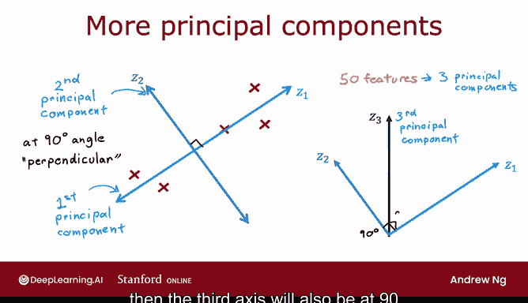
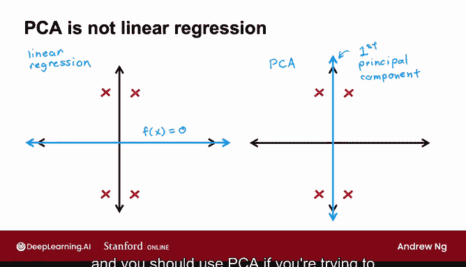
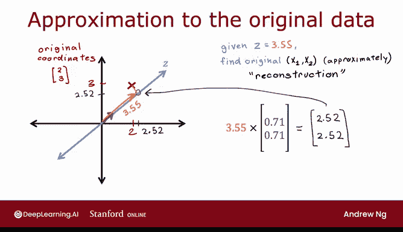

# 吴恩达《机器学习》｜machine-learning（中英字幕-deepseek翻译） - P132：27_02_02_PCA算法（可选）.zh_en - GPT中英字幕课程资源 - BV1MN4y1S7DE

So how does PCA work if you have a dataset with two features X1 and x2。

 so initially your data is plotted or represented using aes。

 X1 and X2 but you want to replace these two features with just one feature How can you choose a new axis let's call the Z axis that is somehow a good way a good feature for capturing of representing the data Let's take a look at how PCA does this。

Here's the data sets with five training examples。Remember。

 this is an unsupervised learning algorithm。 so we just have x1 and x2。 There is no Y。

 there's no label Y。An example here like this may have coordinates x1 equals 10。And x2 equals 8。

So if we don't want to use the X1 x2 axes， how can we pick some different aes with which to capture what's in the data or with which to represent the data。

 One note on preprocesing before applying the next few steps of PCA。

 the features should be first normalized to have zero mean。 I've already done that here。

And if the features x 1 and x 2 take on very different scales。 For example。

 if you remember a housing example， if x1 was the size of a house in square feet and X 2 was the number of bedrooms。

 then X 1 could be。1 thousand or a couple thousand whereas x2 is a small number。

 if the features take on very different scales， then you will first perform feature scaling before applying to next steps of PCA。

But so assuming the features have been normalized to have zero mean。

 so subtract the mean from each feature and then maybe apply feature scaling as well。

 so the ranges are not too far apart what does PCA do next So examine what PCA does let me remove the x1 and x2 axes so that were just left with the five training examples and this dot here represents the origin。

You know the position of zero on this plot still， what we have to do now with PCA is pick one axiss instead of the two aes that we had previously with which to capture what's important about these five examples If we were to choose this axiss to be on z axis this is actually the same as the x1 axis just for this example。

Then what we're saying is that for this example， we're going to just capture this value。

 disc coordinate on the Z axis， and for the second example。

 we're going to capture this value and for this will capture this value and so on for all five examples。

So another way of saying this is that we're going to take each of these examples and project it down to point on the Z axis and the where project refers to that you're taking this example and bring it to the Z axis using this line segment that' at a 90 degree angle to the Z axis and this little box here is used to denote that this line segment is at 90 degrees to the Z axis and the term project just means you're taking a point and finding this corresponding point on the Z axis。

 using this line segment is at 90 degrees。So picking this direction as a Z axis is not a bad choice。

 but there's some even better choices。 This choice isn't too bad because when you project your examples onto the Z axis。

 you still capture quite a lot of the spread of the data， you know these。5 points here。

 they're pretty spread apart。 So it's still capturing a lot of the variation or a lot of the variance in the original data set。

 And by that I mean these five points are quite spread apart and so the variance or variation among these five points。

 the projections of the data onto the Z axis is decently large and what that means is were still capturing quite a lot of the information in the original five examples。

Let's look at some of the possible choices for the axis Z。 here's another choice。

 and this is actually not a great choice。 but if I were to choose this as my Z axis。

 then if I take those same five examples，And project them down to the Z axiss。

 I end up with these five points and you notice that compared it to the previous choice。

 these five points are quite squish together the amount they are different from each other or the variances or the variation is much less and what this means is with this choice of Z。

 you're capturing much less of the information in the originalal data set because you've partially squish all five examples together let's look at one last choice which is if I choose this。

To be the Z axis， this is actually a better choice than the previous two that we saw。

 because if we take the datas projections onto the Z axis。

 we find that these thoughts over here they're actually quite far apart。

 And so we're capturing a lot of the variation， a lot of the information in the original data。

 even though we're now using just one coordinates or one number to represent or the capture each of the training examples instead of two numbers or two coordinates X1 and x2 in the PC algorithm。

 this axis is called the principal。Component， it is the axis that when you project the data onto it。

 you end up with the largest possible amount of variance。

And so if you were to reduce the data to one axis or the one feature。

 this principal component is actually a good choice and this is what PCA will do if you want to reduce the data to one number to one dimension or the one feature then we choose this principal component let me show you a visualization of how different choices of the axes affect the projection。

Here we have 10 training examples and as we slide the slider here and you can play with this in one of the optional labs yourself。

 let you slide the slider here， the angle of the z axis changes and what you're seeing on the left is each of the examples projected via that short line segment at 9 degrees to the z axis and here on the right is that projection of the data。

 meaning the value of these10 examples z coordinate and you notice that when I set the axis about here。

 the points are quite squished together and so this preserves less of the information of the original data。

 whereas if I set the z axis say to this then these points very much more and so this is capturing much more of the information in the original dataset set and so thats。

Why the principal component corresponds to setting the z axis to about here。

 and this is the choice that PCA would make if you ask it to reduce the data to one number to one dimension。

So machine learning library like Psyit Learn， which you hear more about in the next video。

 could help you automatically find the principal component。

 but let's dig a little bit deeper into how that works Here are my X1 and X2 aes and here is one training example with coordinates two on the X1 xs and three on the X2 axises。

And let's say that PCA has found this for the Z axises。One I'm drawing here。

 this little arrow is a length  one vector pointing in the direction of this Z axis that PCA will choose or that we have chosen。

It turns out this length one vector is the vector 0。710。71 round it off a bit is actually 0。

707 and in a bunch of other digits。So given this example with coordinates23 on the x1 x2 axes。

 how do we project this example onto the z axises It turns out the formula for doing so is to take a dot product between the vector23 and this vector 0。

710。71 and if you do that 23 dot product with 0。710。71 turns out to be 2 times 0。71 plus 3 times 0。

71 which is equal to 3。55 and what that means is the distance from the origin of this point over here is 3。

55 which means that if we were to represent or to use one number to try to capture this example that one number is 3。

55。So far we have talked about how to use PCA to reduce data down to one dimension or down to one number。

 and we do so by finding the principal components also called sometimes the first principal components。

And so in this example we had found this as the first axis。

 it turns out that if you were to pick a second axis。

 the second axis will always be at 90 degrees to the first axis。

 and if you were to choose even the third axis， then the third axis will be at 90 degrees to the first and the second axis。

By the way， in mathematics 90 degrees is sometimes called perpendicular。

 the term perpendicular just means at 90 degrees， so mathematicians will sometimes say the second axis Z2 is at 90 degrees or as perpendicular to the first axis Z1 and if you choose additional axes。

 they're also at 90 degrees or perpendicular to Z1 and Z2 and any other axes that PC will choose and so if you had 50 features and wanted to find three principal components then if that's the first axis。

 the second axis will be at 90 degrees to it， then the third axis will also be at 90 degrees to the first in the second axisxes。

Now， one question I'm often asked is。How is PCA different from linear regression？

It turns out PC is not linear regression， it's a totally different algorithm， let me explain why。😊。

With linear regression， which is a supervised learning algorithm， you have data X and Y。

 so here's the data set where the horizontal axis is the feature X and the vertical axis here is the label Y。

And with linear regression， you're trying to fit a straight line。

So that the predicted value is as close as possible to the ground truth label Y。So in other words。

 you're trying to minimize the length of these little line segments。

 which are in the vertical direction， theyre just align with the Y axiss。 In contrast in PC。

 there is no ground truth label Y so you just have unlabeled data x1 and x2 and furthermore you're not trying to fit the line to use x1 to predict x2 Instead the algorithm treats x1 and x2 equally and we're trying to find this x as z。

That it turns out we end up making these little line segments small。

 And when you project the data onto Z。 And so in linear regression。There is one number Y。

 which is given very special treatment。And we're always trying to measure distance between。

The fitted line and Y， which is why these distances are measured just in the direction of the Y axises。

Whereas in PCA you can have a lot of features， x1， x2， maybe all the way up to x50。

 if you have 50 features and all 50 features are treated equally and we're just trying to find an axis Z so that when the data is projected onto the x Z using these line segments。

That you still retain as much of the variance of the original data as possible。

I know that when I plot these things in two dimensions with just two features。

 which is all I can draw on a flat computer monitor。

 thesearrows look like maybe they're a little bit similar but when you have more than two features。

 which is most of the case， the difference between linear regression and PCA and what thearrows do is very large so thesearrows are used for totally different purposes and give you very different answers where linear regression is used to predict a target output Y and PCA is trying to take a lot of features and treat them all equally and reduce the number of axes needed to represent the data well。

And it turns out that maximizing the spread of these projections will correspond to minimizing the distances of these line segments。

 the distances that the points have to move to be projected down to Z。

To illustrate the difference between linear regression and PCA in another way。

 if you have a dataset that looks like this， linear regression。

 all you can do is fit a line that looks like that， whereas if your data looks like this。

 PCA will choose this to be the principal component， and so you should use linear regression。

 if you're trying to predict the value of Y and you should use PCA if you're trying to reduce the number of features in your dataset。

 say to visualize it。

Finally， before we wrap up this video， there's one more thing you could do with PCA。

Which is recall this example which was at coordinateons 23 We found that if you project it to the z axis。

 you end up with 3。55 One thing you could do is if you have an example where z equals 3。

55 given just this one number z3。55。Can we try to figure out what was the original example。

 It turns out that there's a step in PCA called reconstructioncon。

 which is to try to go from this one number z equals d。55 back to the original 2 numbers x1 and x2。

And it turns out you don't have enough information to get back X1 and x2 exactly。

 but you can try to approximate it， and in particular， the formula is you would take this number 3。

55， which is z and multiply it by that length 1 vector that we had just now， which was 0。710。71。

And this ends up to be 2。52， 2。52， which is this point over here。

So we can approximate the original training example。

 which was at coordinateiness 23 with this new point here， which is at 2。522。

52 and the difference between the original point and the projector point is this little line segment here and in this case its not a bad approximation 2。

522。52 you it's not that far from 23 so with just one number we could get a reasonable approximation to the coordinateiness of the original training example and this is called the reconstruction step of PCA。

To summarize， the PCA algorithm looks at your original data and choose one or more new axes。

 Z or maybe Z1 and Z2 to represent your data， and by taking your original data and projecting it onto your new axis or axes。

 this gives you a smaller set of numbers that you can plot with which to visualize your data。

You've seen the math， let's now take a look at how you can implement this in code in the next video we'll look at how you can use PC yourself using the Psy Learn library。

 Let's go on to the next video。