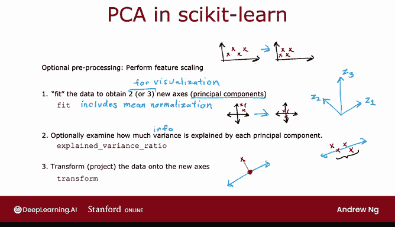
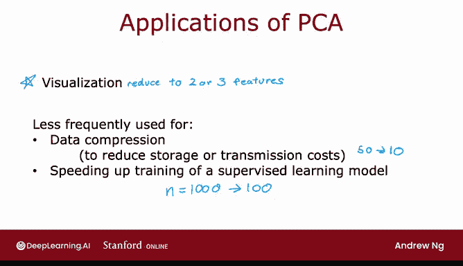

# 吴恩达《机器学习》｜machine-learning（中英字幕-deepseek翻译） - P133：28_02_03_代码实现PCA（可选）.zh_en - GPT中英字幕课程资源 - BV1MN4y1S7DE

In this video， we'll take a look at how you can use the Cy Learn library to implement PCA。

These are the main steps。First， if your features take on very different ranges of values。

 you can perform preprocessing to scale the features to take on comparable ranges of values。

So if you were looking at the features of different countries。

 those features take on very different ranges of values。GDP could be in trillions of dollars。

 whereas other features are less than 100。 so feature scaling in applications like that would be important to help PC find a good choice of axes for you。

 The next step then is to run the PC algorithm to quote fit the data to obtain two or three new axes Z1 Z2。

 maybe Z3。 And here I'm assuming you want2 or three axes。

If you want to visualize the data in 2D or 3D， if you have an application where you want more than two or three axes。

 the PCA implementation can also give you more than two or three axes。

 it's just that it then be harder to visualize。And in cycle learn。

 you will use the fit function or the fit method in order to do this。

 The fit function in PCA automatically carries out mean normalization。

 It subtracts out the mean of each feature。 And so you don't need to separately perform mean normalization。

And so after running the fit function， you would get the new axes Z1， Z2， maybe Z3。

 and in PCA we also call these the principal components where Z1 is the first principle component。

 Z2， the second principal component and Z3， the third principal component。After that。

 I would recommend taking a look at how much each of these new axes or each of these new principal components explains the variance in your data。

 I'll show a concrete example of what this means on the next slide， but this lets you get a sense of。

Whether or not projecting the data onto these axes help you to retain most of the variability or most of the information in the original dataset。

And this is done using the explained variance ratio function and finally， you can transform。

 meaning just project the data onto the new axes onto the new principal components。

 which you would do with the transform method and then for each training example you would just have two or three numbers even then plot those two or three numbers to visualize your data in detail。

 this is what PC encode looks like here's the data set X with six examples So x equals nu array the6 examples over here。

 and to run PC to reduce this data from two numbers， x1 x2 to just one number Z。

You would run PCA and ask it to fit one principal components。 So n components here is equal to one。

And fit PCA to X。PCA1 here is my notation for PCA with a single principal component with a single axis。

And it turns out if you were to print out PC1 explain variance ratio， this is 0。

992 and this tells you that in this example when you choose one axis， this captures 99。

2% of the variability or the information in the original dataset Finally if you want to take each of these training examples and project it to a single number you would then call this and this will output this array with six numbers corresponding to your six training examples。

 so for example， the first training example 11。Projected to the Z axis gives you this number，1。383。

 so on。 And so if you were to visualize this data using just one dimension。

 this would be the number used to represent the first example。

 And the second example is projected to be this number and so on。

 And I hope you take a look at the optional lab where you see that these six examples have been projected down onto this axis onto this line。

 which is now why all six examples now lie on。This line that looks like this。

And the first training example， which was11， has been maped to this example。

Which has a distance of 1。38 from the origin。 So that's why this is 1。38。Just one more quick example。

 This data is two dimensional data， and we reduced it to one dimensions。

 What if you were to compute two principle components So start with two dimensions and then also end up with two dimensions。

 This isn't that useful for visualization， but it might help us understand better how PC and how the code for PC works So here's the same code except that I've changed in components to two So Im ask the algorithm to find two principal components。

And if you do that， the PC2 explain ratio becomes 0。9920。0008， and what that means is that Z1。

 the first principle component still continues to explain 99。2% of the variance and Z2。

 the second principal component or the second axis explains 0。8% of the variance。

And these two numbers together add up to one because well this data is two dimensionmenal。

 so the two axes Z1 and Z2 together they explain 100% of the variance in the data。

 and if you were to transform or project the data onto the Z1 and z2 axes。

 this is what you get when now the first training example is map to these two numbers corresponding to this projection onto Z1 and Z2。

 and the second example， which was this projected onto Z1 and Z2 becomes these two numbers。

 if you were to reconstruct the original data， roughly this is Z1 and this is Z2。

 then the first training example which was at 11。Has a distance of 1。

38 on the Z1 axis hence this number and a distance here of 0。

29 hence this distance on the Z2 axiss and the reconstruction actually looks exactly the same as the original data because if you reduce or not really reduce two dimensionmenal data to two dimensionmenal data there is no approximation and you can get back the original data set with the projections onto Z1 and Z2 So this is what the code to run PC looks like。

 I hope you take a look at the optional lab where you can play with this more yourself and also try varying the parameters and look at a specific example to deepen your intuition about how PC works before wrapping up。

 I'd like to share a little bit of advice for applying PC PC is frequently used for visualization where you reduce data to two or three numbers so you can。

Ploot like you saw in an earlier video with the data on different countries so it can visualize different countries。

There are some other applications of PCA that you may occasionally hear about that used to be more popular maybe 1015。

20 years ago， but much less so now another possible use of PCA is data compression for example。

 if you have a database of lots of different cars and you have 50 features per car but it's just taking up too much space on your database or maybe transmitting 50 numbers over the internet you know just takes too long then one thing you could do is reduce these 50 features to a smaller number of features and it could be 10 features with 10 axes or 10 principal components you can't visualize 10dial data that easily but this is one fifth of the storage space or maybe one fifthth of the network transmission costs needed。

And so many years ago I saw a PCA used for this application more often。

 but today with modern storage being able to store pretty large data sets and modern networking。

 able to transmit faster and more data than ever before。

 I see this use much less often as an application of PCA One other application of PCA that again used to be more common maybe 10 years ago。

 20 years ago， but much less so now is using it to speed up training of a supervised learning model where the idea is if you had 1 thousand features。

And having 1 thousand0 features made the supervised learning algorithm run you slowly。

 Maybe you can reduce it to 100 features using PC。 and then your dataset is basically smaller in your supervised learning algorithm may run faster。

 This used to make a difference in the running time of some of the older generations of learning algorithms。

 such as if you've heard of a support vector machine， This will speed up a support vector machine。

 But it turns out with modern machine learning algorithms， algorithms like deep learning。

 This doesn't actually help that much。 and is。Much more common to just take the high dimensionional data set and feed it into say your neural network rather than run PCA because PC has some computational costs as well So you may hear about this in some of the other research papers but I don't really see this done much anymore but the most common thing that I use PC for today is visualization and I find it very useful to reduce the dimensional data to visualize it。

So thanks for sticking with me through the end of the optional videos for this week。

 I hope you enjoyed learning about PCA and that you find it useful when you get a new data for reducing the dimension of your dataset to two or three dimensions so you can visualize it and hopefully gain new insight into your dataset sets it's helped me many times understand my own datasets and I hope that you find it equally useful as well。

Thanks for watching these videos and I look forward to seeing you next week。

