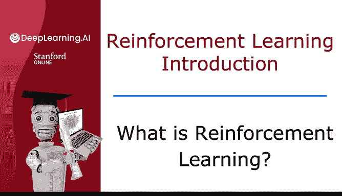
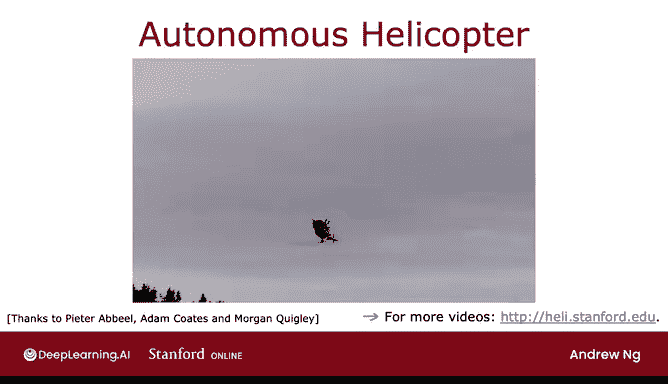
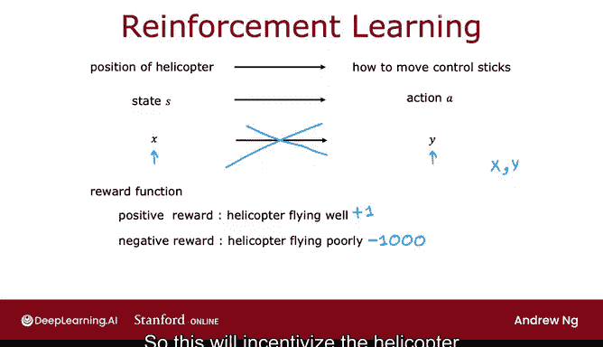
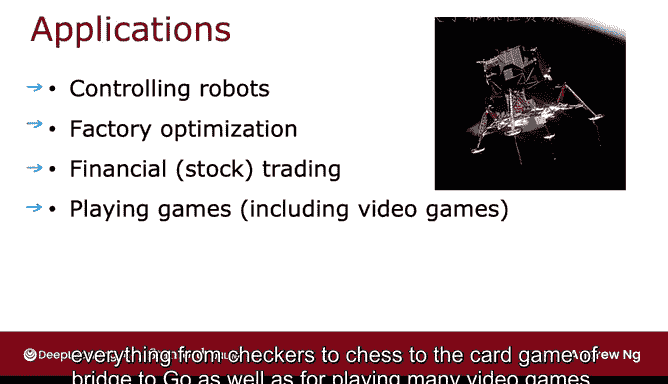

# 吴恩达《机器学习》｜machine-learning（中英字幕-deepseek翻译） - P134：29_03_01_什么是强化学习.zh_en - GPT中英字幕课程资源 - BV1MN4y1S7DE

Welcome to this final week of the machineine learning specialization。

 it's a little bit bittersweet for me that we're approaching the end of the specialization。

 but I am looking forward to this week sharing with you some exciting ideas about reinforcement learning。

😊。

In machine learning reinforcement learning is one of those ideas that while not very widely applied in commercial applications yet today is one of the pillars of machine learning and has lots of exciting research backing it up and improving it every single day so let's start by taking a look at what is reinforcement learning let's start with an example she has a picture of an autonomous helicopter。

 this is actually the Stanford autonomous helicopter weighs 32 pounds and is actually sitting in my office right now。

Like many other autonomous helicopters is instrumented with an onball computer， GPS。

 aceeroerometers and gyroscopes and magnetic compass so it knows where it is at all times quite accurately and if I went to give you the keys to the helicopter and ask you to write a program to fly it how would you do so radio control helicopters are control with joytick like these and so the task is 10 times per second you're given the position and orientation and speed and so on of the helicopter and you have to decide how to move these two control six in order to keep the helicopter balance in the air by the way。

 I phone radio control helicopters as well as quadro drones myself and radio control helicopters are actually quite a bit harder to fly quite a bit harder to keep balance in the air So how would you write a program to do this automatically let me show you a fun video of something we got the Stanford Autonomous helicopter to do Here's a video of it flying under the control。

Re reinforcement learning algorithm。 And let me play the video。

🎼I was actually the cameraman that day and this is a helicopter flying on the computer control and if I zoom out the video you see the trees planted this sky so using reinforcement learning。

 we actually got this helicopter to learn to fly upside down we tell it to fly upside down and so reinforcement learning has been used to get helicopters to fly a wide range of stunt or we call them aerobatic maneuvers By the way。

 if you're interested in seeing other videos you can also check them out at this URL So how do you get a helicopter to fly itself using reinforcement learning The task is given the position of the helicopter to decide how to move the control sticks in reinforcement learning。

 we call the position and orientation and speed and so on of the helicopter the state S and so the task is to find a function that maps from the state of the helicopter to an action A。

Meaning how far to push the two control six in order to keep the helicopter balance in the air and flying and without crashing one way you could attempt this problem is to use supervised learning it turns out this is not a great approach for autonomous helicopter flying but you could say well if we could get a bunch of observations of states and maybe have an expert human pilot tell us what's the best action Y to take you could then train a neural network using supervised learning to directly learn a mapping from the states S which I'm calling X here to an action a which I'm calling the label Y here but it turns out that when the helicopter is。

Moving through the air is actually very ambiguous。 What is the exact one right action to take do you tilt the bit to the left or a lot more to the left or increase the helicopter stress a little bit or a lot is actually very difficult to get a data set of X and the ideal action Y So that's why for a lot of task of controlling a robot like a helicopter and other robots。

 The supervised learning approach doesn't work well and when instead use reinforcement learning Now a key input to a reinforcement learning is something called the reward or the reward function which tells the helicopter when it's doing well and when it's doing poorly So the way I like to think of a reward function is it's a bit like training a dog when I was growing up my family had a dog and it was my job to training the dog or the puppy to behave So how do you get a puppy to behave well well you can't demonstrate。

that much to the puppy is that you let us do a thing and whenever it does something good， you go。

 oh good dog and whenever it did something bad， you go bad dog and then hopefully it learns by itself how to do more of the good dog and fear of the bad dog things。

So training of the reinforcement learning algorithm is like that when the helicopter is flying well。

 you go oh good helicopter and if it does something bad like trash you go bad helicopter and then it's a reinforcement learning algorithms job to figure out how to get more of the good helicopter and fear of the bad helicopter outcomes one way to think of why reinforcement learning is so powerful is you have to tell it what to do rather than how to do it and specifying the reward function rather than the optimal action gives you a lot more flexibility in how you design the system concretely flying the helicopter。

 whenever it is flying well， you may give it a reward of plus one every second that is flying well and maybe。

Whenever a flying poorly you may give it a negative reward or if it ever crashes。

 you may give it a very large negative reward like negative 1000 and so this would incentivize the helicopter to spend a lot more time flying well and hopefully to never crash but the here's another fun video I was using the good dog bad dog analogy or reinforcement learning for many years and then one day I actually managed to get my hands on a robotic dog and could actually use this reinforcement learning good dog bad dog methodology to train a robot dog to get over obstacles So this is a video of a robot dog that using reinforcement learning which rewards it moving toward the left of the screen has learned how to place speak carefully or climb over a variety of obstacles and if you think about what it takes to program a dog like this。

I have no idea I really don't know how to tell it what's the best way to place its legs to get over a given obstacle all of these things were figured out automatically by the robot just by giving it rewards that incentivizes it。

 making progress toward the goal on the left of the screen。Today。

 reinforcement learning has been successfully applied to a variety of applications ranging from controlling robots。

 and in fact， later this week， in the practice lab。

 you implement for yourself a reinforcement learning algorithm to land a lunar lander in simulation。

It's also been used for factory optimization how do you rearrange things in the factory to maximize throughput and efficiency as well as financial stock trading For example。

 one of my friends was working on efficient stock execution so if you've decided to sell a million shares over the next several days well you may not want to dump a million shares on the stock market suddenly because that will move prices against you so what's the best way to sequence out your trades over time so that you can sell the shares you want to sell and hopefully get the best possible price for them Finally they've also been many applications of reinforcement learning to playing games everything from checkers to ches to the card game of bridge to go as well as for playing many video games。

So that's reinforcement learning， even though reinforcement learning is not used nearly as much as supervised learning。

 it is still used in a few applications today。And the key idea is rather than you needing to tell the algorithm what it's the right output Y for every single input。

 all you have to do instead is specify a reward function that tells it when it's doing well and when it's doing poorly and it's a job of the algorithm to automatically figure out how to choose good actions With that。

 let's now go to the next video where we'll formalize the reinforce learning problem and also start to develop algorithms for automatically picking good actions。

