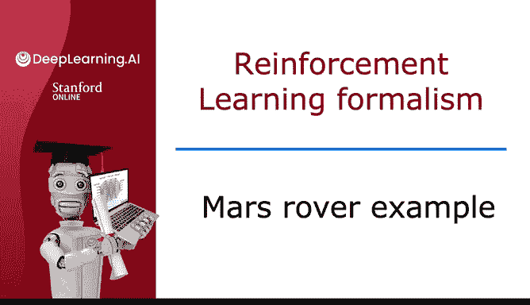
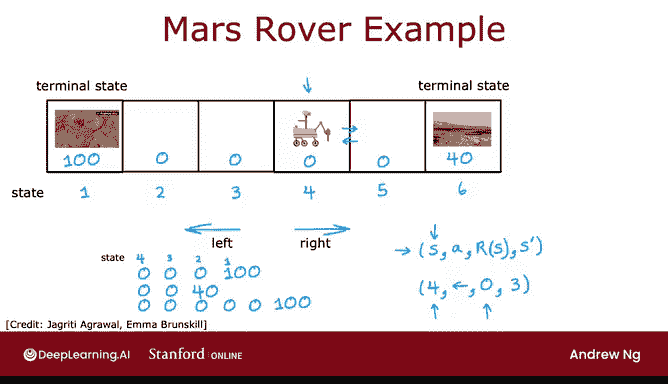

# 吴恩达《机器学习》｜machine-learning（中英字幕-deepseek翻译） - P135：30_03_02_火星探测器示例.zh_en - GPT中英字幕课程资源 - BV1MN4y1S7DE

To flesh out the reinforcement learning formalism， instead of looking at something as complicated as a helicopter or a robot dog。

 we're going to use a simplified example that's loosely inspired by the Mars Rover。

 this is adapted from an example due to Stanford professorssor Emma Brunskill and one of my collaborators Jack Riti Argrawell who had actually written code that is actually controlling the Mars Rover right now and also helped me talk through and helped develop this example。

 a's take look。

Well develop reinforcement learning using a simplified example inspired by the Mars Rover in this application the rover can be in any of six positions。

 as shown by the six boxes here and the rover might start off。

 say in disposition position in the four bots shown here。

 the position of the Mars Rover is called the state in reinforcement learning。

And I'm going to call these six states state1， state two， state3， state4， state 5 and state6。

 and so the rover is starting off in state 4 Now the rover was sent to Mars to try to carry out different science missions it can go to different places to use is sensors such as a drill or radar or spectrometer to analyze the rock at different places on the planet or go to different places to take interesting pictures for scientists on Earth to look at in this example。

 state1 here on the left has a very interesting surface that scientists would love for the robot to sample and state6 also has a pretty interesting surface that scientists would quite like the rover to sample but not as interesting as state1。

 so we would more like to carry out the science mission at state1 than at state6。

 but state1 is further away。The way we will reflect state one being potentially more valuable is through the reward function。

So the reward at state one is 100。And the reward at state 6 is 40。

 and the rewards at all of the other states in between。

 I'm going to write it as a reward of zero because there's not as much interesting science to be done at these states2。

3，4， and 5。On each step， the rover gets to choose one of two actions。

 it can either go to the left or it can go to the right。

So the question is what should the Rover do in reinforcement learning we pay a lot of attention to the rewards because that's how we know if the robot powder is doing well or poorly。

Let's look at some examples of what might happen。If the robot were to go left。

 starting from stage four。Then initially starting from state four it will receive a rewarder zero and after going left it gets a state three where it receives again rewarder zero。

 then it gets to state two receives a rewarder zero and finally gets a state one where it receives a reward of 100 for this application I'm going to assume that when it gets either state one or state six that the day ends and so in reinforcement learning。

 we sometimes call this a terminal state and what that means is that after it gets to one of these terminal states it gets a reward at that state but then nothing more happens after that maybe the robots run out of field or run out of time for the day。

 which is why it only gets to either enjoy the 100 or the 40 reward， but then that's it for the day。

And it doesn't get to earn additional rewards after that。Now instead of going left。

 the robot could also choose to go to the right， in which case from state four。

 it would first have a reward of zero， and then itll move right and get to state 5。

 have another reward of zero， and then it will get to this other terminal state on the right。

 state 6 and get a reward of 40。But going left one， going right are't the only options。

 One thing the robot could do is it could start from state 4 and decide to move to the right。

 So it goes from state 4 to5。It's a reward of zero and state four， reward of zero and state five。

 and then maybe it changes its mind and it decides to start going to the left。As follows。

 in which case， it would get a reward of zero state 4， as state3， as state two。

 and then the reward of 100 when it gets to state one。In this sequence of actions and states。

 the robot is wasting a bit of time， so this maybe isn't such a great way to take actions but it is one choice that the algorithm could pick。

 but hopefully it won't pick this one。So to summarize， at every time step。

 the robot is in some state， which I'm to call S。And it gets to choose an action。

 and it also enjoys some rewards R of S that it gets from that state。And as a result of its action。

 it gets to some new state as prime， so as a concrete example， when the robot was in state4。

And it took the action， go left it enjoyed well， maybe didn't enjoy the reward of zero associated with that state four and it wound up in a new state3 when you learn about specific reinforcement learning algorithms。

 you see that these four things， the state action the reward and the next state。

 which is what happens， basically every time you take an action that this will be a core elements of what reinforcement learning algorithms will look at when deciding how to take actions and just for clarity。

 the reward here， R ofs， this is a reward associated with the state。

 so this reward of zero is associated with the state four rather than with the state three。

So that's the formalism of how a reinforcement learning application works in the next video let's take a look at how we specify exactly what we want the reinforcement learning algorithm to do in particular we'll talk about an important idea in reinforcement learning called the returnturn let's go on to the next video to see what that means。

😊。