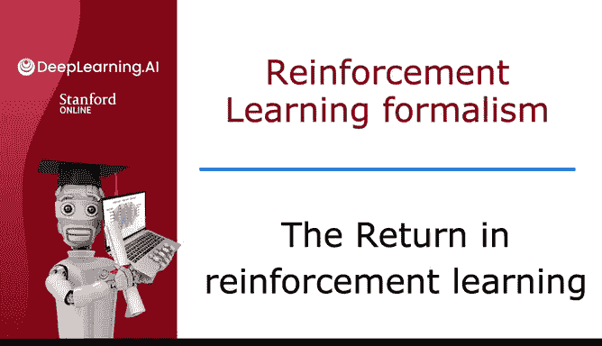
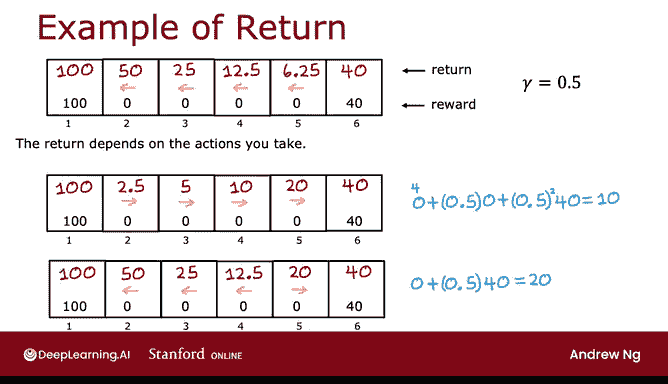

# 吴恩达《机器学习》｜machine-learning（中英字幕-deepseek翻译） - P136：31_03_03_强化学习中的回报.zh_en - GPT中英字幕课程资源 - BV1MN4y1S7DE

You saw in the last video what are the states of a reinforcement learning application。

 as well how depending on the actions you take， you go through different states and also get to enjoy different rewards。

But how do you know if a political set of rewards is better or worse than a different set of rewards。

 the return in reinforcement learning， which we'll define in this video。

 allows us to capture that as we go through this one analogy that you might find helpful is。

If you imagine you have a $5 bill at your feet， you can reach down and pick up or half an hour across town。

 you can walk half an hour and pick up a $10 bill， which one would you rather go after？

$10 is much better than $5 but if you need to walk for half an hour to go and get that $10 bill。

 then maybe it'd be more convenient to just pick up the $5 bill instead so the concept of a return captures that rewards you can get quicker are maybe more attractive than rewards that take you a long time to get to Let's take a look at exactly how that works。

Here's a last rover example if starting from state4 you go to the left we saw that the rewards you get would be zero on the first step from state 40 from state30 from state2 and then 100 at state 1 the terminal state and so the return is defined as the sum of these rewards but weighted by one additional factor which is called the discount factor so the discount factor is a number a little bit less than one so let me pick 0。

9 is the discount factor and'm going to wait the reward on the first step which just 0 the reward on the second step is a discount factor 0。

9 times that reward and then plus the discount factor squared times that reward and then plus the discount factor cubed times that reward and if you calculate this turns out to be 0。

729 times 100。Wwhich is 72。9 the more general formula for the return is that if your robot goes through some sequence of states and gets to reward R1 on the first step and R2 on the second step and R3 on the third step。

And so on， then the return is R1 plus the discount factor gamma， the Greek alphabet gamma。

Which offset to 0。9 is this example， the gamma times r2 plus gamma squared times r3 plus gamma cube times r4 and so on until you get to the terminal state。

What the discount factor gamma does is it has the effect of making the reinforcement learning algorithm a little bit impatient because the return gives full credit to the first reward is 100% is 1 times R1 but then it gives a little bit less credit to the reward you get at a second step is multiplied by 0。

9 and even less credit to the reward you get at the next time step R3 and so on and so getting rewards sooner results in a higher value for the total return in many reinforcement learning algorithms a common choice for the discount factor will be a number pretty close to one like 0。

9 or 0。99 or even 0。999 but for illustrative purposes in the running example I'm going to use I'm actually going to use a discount factor of 0。

5 So this very heavily down weights or very heavily we say。Discounts rewards in the future。

 because with every additional passing time step you get only half as much credit as rewards that you would have gotten one step earlier and so if gamma were equal to 0。

5， the return under the example above would have been 0 plus 0。5。Times  zero。

 replacing this equation on top plus 0。5 squared0 plus 0。5 cubed times 100。

That's the last reward because state ones a terminal state and this turns out to be a return of 12。

5 In financial applications， the discount factor also has a very natural interpretation as the interest rate or the time value of money So if you can have a dollar today that may be worth of a little bit more then if you could only get a dollar in the future because if a dollar today。

 you can put in the bank earns some interest and end up with a little bit more money a year from now So for financial applications often that discount factor represents how much less is a dollar in the future worth compared to a dollar today let's look at some concrete examples of returns the return you get depends on the rewards and the rewards depends on the actions you take and so the return depends on the actions you take let's use our usual example and say for this example on。

to always go to the left。And so we already saw previously that if the robot were to start off in state 4。

 the return is 12。5 as we worked out on the previous slide。

 it turns out that if it were to start off in state 3。

 the return would be 25 because it gets to the 100 reward one step sooner and so it's discounted less if it were to start off in state2。

 the return would be 50 and if it were to just start off in state 1。

 well it gets the reward of 100 right away， so it's not discounted at all and so the return if it were to start off in state1 would be 100 and then the return in these two states are 6。

25， it turns out if you start off in state 6 which is terminal state you just get the reward and thus the return of 40。

 Now if you were to take a different set of actions， the return would actually be different。

For example， if we were to always go to the right， if those were our actions。

 then if you were to start in state four， get a reward of zero， then you get to stay5。

 get a reward of 0 and you get to stay6 and get a reward of 40 in this case the return would be0 plus 0。

5 the discount factor times 0 plus 0。5 squared times 40 and that turns out to be equal to 0。

5 squared is one quarter so one quarter of 40 is 10 and so the return from this state from state 4 is 10 if you were to take actions always go to the right。

And through similar reasoning， the return from this state is 20， the return from this state is 5。

 the return from this state is 2。5， and then the return at the terminal stage is 140 By the way。

 if these numbers don't fully make sense， feel free to pause the video and doubleche the math and see if you can convince yourself that these are the appropriate values for the return for if you start from different states and if you were to always go to the right。

And so we see that if we were to always go to the right。

 the return you expect to get is lower from most states。

So maybe always going to the right isn't as good an idea as always going to the left。

But it turns out that we don't have to always go to the left or always go to the right we could also decide if you're in state two go left。

 if you're in state three go left， if you're in state four go left but if you're in state five then you're so close to this reward let's go right so this will be a different way of choosing actions to take based on what state you're in and it turns out that。

The return you get from the different states will be 100。50， 25， 12。5。

20 and 40 just to illustrate one case， if you were to start off in state5 here you would go to the right and so the rewards you get would be zero first in state5 and then 40 and so the return is 0。

 the first reward plus the discount factor is 0。5 times 40 which is 20。

 which is why the return from this state is 20， if you take actions shown here。

So to summarize the return in reinforcement learning is some of the rewards that the system gets。

 but weighted by the discount factor where rewards in the far future are weighted by the discount factor raised to a higher power。

Now， this actually has an interesting effect when you have systems with negative rewards in the example we went through。

 all the rewards were zero or positive， but if there are any rewards that are negative。

 then the discount factor actually incentivizes the system to push out the negative rewards as far into the future as possible。

Taking a financial example， if you had to pay someone $10， maybe that's a negative reward of 10。

 but if you could postpone payment by a few years， then you're actually better off because $10 a few years from now because of the interest rate is actually worth less than $10 that you had to pay today so for systems with negative rewards。

 it causes the algorithm to try to push out the negative rewards as far into the future as possible and for financial applications and for other applications that actually turns out do the right thing for the system to do You now know what is the return in reinforcement learning。

 let's go into the next video to formalize the go of reinforcement learning algorithm。

