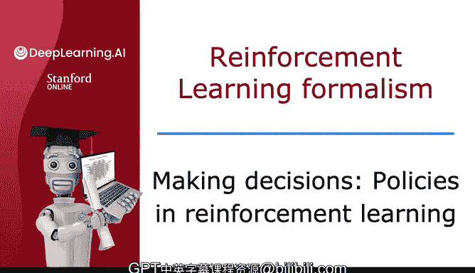
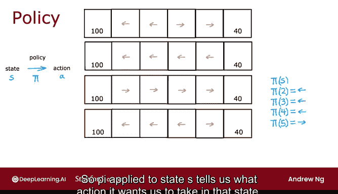
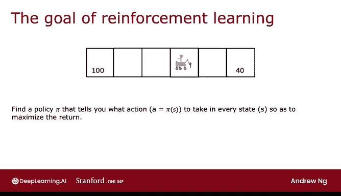

# 吴恩达《机器学习》｜machine-learning（中英字幕-deepseek翻译） - P137：32_03_04_强化学习中的决策策略.zh_en - GPT中英字幕课程资源 - BV1MN4y1S7DE

Let's formalize how a reinforcement learning algorithm picks actions in this video you learn about what is a policy in a reinforcement learning algorithm let's take a look as we've seen there are many different ways that you can take actions in a reinforcement learning problem for example。

 we could decide to always go for the nearer reward so you go left if this leftmost reward is nearer or go right if this rightmost reward is nearer。

Another way we could choose actions is to always go for the larger award。

Or we could always go for smaller or what doesn't seem like a good idea， but it is another option。

 or you could choose to go left。Unless you're just one step away from the Leer reward， in which case。

 you go for that one。In reinforcement learning， our goal is to come up with a function which is called a policy pi。

 whose job it is to take us input any state S and map it to some action A that it wants us to take so for example。

 for this policy here at the bottom this policy would say that if you're in state two。

 then it maps us to the left action， if you're in state3， the policy says go left。

If you're in state four， also go left and if you're in state five。Go right and so。

Pi applied to state S tells us what action it wants us to take in that state。

And so the goal of reinforcement learning is to find a policy。

 pi or pi of S that tells you what action to take in every state so as to maximize the return。

By the way， I don't know if policy is the。Most descriptive term of what pi is。

 but it's one of those terms that's become standard in reinforcement learning。

 maybe calling pi a controller rather than a policy would be more natural terminology。

 but policy is what everyone in reinforcement learning now calls this。

In the last video we've gone through quite a few concepts in reinforcement learning from states to actions to rewards to returns to policies。

 let's do a quick review of them in the next video and then we'll go on to start developing algorithms for finding good policies let's go on to the next video。

