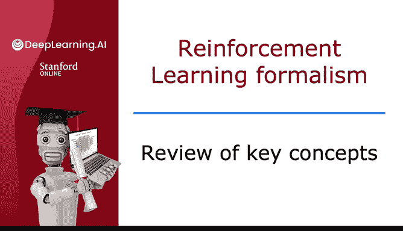
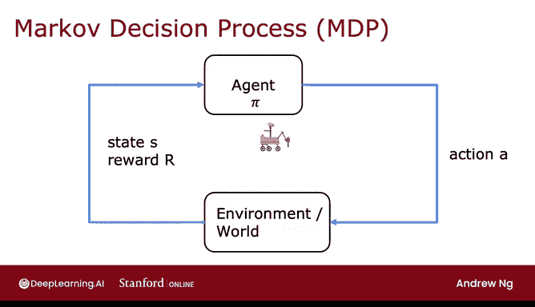

# 吴恩达《机器学习》｜machine-learning（中英字幕-deepseek翻译） - P138：33_03_05_关键概念回顾.zh_en - GPT中英字幕课程资源 - BV1MN4y1S7DE

With've developed a reinforcement learning formalism using the six state mass Rover example。

 let's do a quick review of the key concepts and also see how this set of concepts can be used for other applications as well。

Some of the concepts we've discussed are states of a reinforcement learning problem。

 the set of actions。The rewards， a discount factor。

 then how rewards and the discount factor are together used to compute the return。And then finally。

 a policy whose job it is to help you pick actions so as to maximize the return for the mass row。

 for example， we had six states that we numbered one to6 and the actions were to go left or to go right the rewards were 100 for the leftmost state 40 for the rightmost state and  zero in between and I was using a discount factor of 0。

5 the return was given by this formula and we could have different policies pie that pick actions depending on what state you're in this same formulaism a state actions rewards and so on can be used for many other applications as well。

Take the problem of flying an autonomous helicopter to set of states would be the set of possible positions and orientations and speeds and so on of the helicopter。

 the possible actions would be the set of possible ways to move the control sink of a helicopter and the rewards may be a plus one if it's flying well and the negative 1000。

 if it doesn't be really bad or crashes， so a reward function that tells you how well the helicopter is flying。

The discount factor， a number slightly less than1， maybe say 0。

99 and then based on the rewards and the discount factor。

 you compute the return using the same formula and the job of reinforcement learning algorithm would be to find some policy pi of S so that given as input the position of the helicopter S it tells you what action to take that is tells you how to move the control sticks here's one more example。

 here's a gameplay one， say you want to use reinforcement learning to learn to play chess the state of this problem would be the position of all the pieces on the board。

 by the way， if you play chess and know the rules well。

 I know that there's a little bit more information than just the position of the pieces as important for chess well simplify a little bit for this video the actions are the possible legal moves in the game and then a common choice of reward would be if you give your system。

Award of plus one if it wins a game。Minus one， if it loses a game and a reward of zero。

 if it ties a game for chess， usually a discount factor very close to one would be used， so maybe 0。

99 or even 0。995 or 0。999。And the return uses the same formula as the other applications and once again。

 the goal is given a board position to pick a good action using a policy pie This formalism of a reinforcement learning application actually has a name is called a Markoff decision process and I know that sounds like a big technical complicated term。

 but if you ever hear this term Markoff decision process or MDP for short。

 that's just the formalism that we've been talking about in the last few videos the term markov in the MDP or Markov decision process refers to that the future only depends on the current state and not on anything that might have occurred prior to your getting to the current state In other words。

 in a Markoff decision process， the future depends only on where you are now not on how you got here One other way to think of the Markov。

processces formalism is that we have a robot or some other agent。

That we wish to control and what we get to do is choose actions A， and based on those actions。

 something will happen in the world。or in the environment。

 such as opposition in a world changes or we get to sample a piece of rock and execute a science mission。

 the way we choose the actions A is with a policy pie and based on what happens in the world。

 we then get to see or we observe back， what state we're in as well as what reward are that we get。

And so you sometimes see different authors use a diagram like this to represent the Markov decision process or the MDP formalism。

 but this is just another way of illustrating the set of concepts that you learned about in the last of your videos。

 so you now know how a reinforcement learning problem works。

In the next video we'll start to develop an algorithm for picking good actions a first step two of that will be to define and then eventually learn to compute the state action value function This turns out to be one of the key quantities for when we want to develop a learning algorithm let's go on to the next video to see what is this state action value function。

