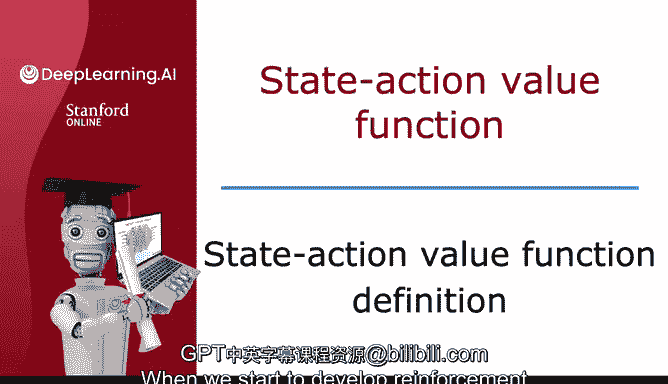
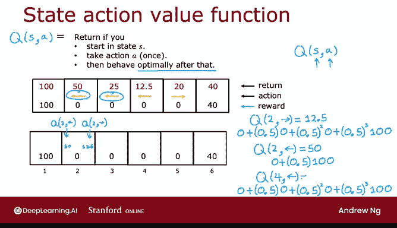
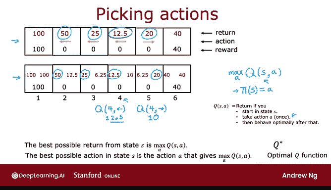

# 吴恩达《机器学习》｜machine-learning（中英字幕-deepseek翻译） - P139：34_03_01_状态-动作价值函数定义.zh_en - GPT中英字幕课程资源 - BV1MN4y1S7DE

When we start to develop reinforcement learningarrows later this week。

 you see that there's a key quantity that reinforcement learning arrows will try to compute and that's called the state action value function let's take a look at what this function is。

The state action value function is a function typically denoted by the letter uppercase Q and iss a function of a state you might be in as well as the action you might choose to take in that state and Q of SA will give a number that equals the return if you start in that state S and take the action A just once and after taking action A once you then behave optimally after that so after that you take whatever actions will result in the highest possible return now you might be thinking there's something a little bit strange about this definition because how do we know what is the optimal behavior and if we knew what's the optimal behavior if we already knew what the best action to take in every state why do we still need to compute Q of SA because we already have the optimal policy So I do want to acknowledge that there's something？

Strange about this definition there's almost something a little bit circular about this definition。

 but rest assured when we look at specific reinforcement learning algorithms later we'll resolve this slightly circular definition and we' come up with a way to compute the Q function even before we've come up with the optimal policy but you see that in the later video so don't worry about dysnel Let's look at an example we saw previously that this is a pretty good policy。

Go left from states23 and4 and go right from state5 It turns out that this is actually the optimal policy for the Mas Rover application when the discount factor gamma is 0。

5 so Q of SA will be equal to the total return if you start from state S take the action A and then behave optimally after that meaning take actions according to this policy shown over here let's figure out what Q of SA is for a few different states let's look at sayq of state2 and what if we take the action to go right。

Well， if you're in state two and you go right， then you end up at state three。And then after that。

 if you behave optimally， you're going to go left from state three and then go left from state two and eventually you get the reward of a 100。

In this case， the rewards you get would be zero from state2， zero when you get to state3。

 zero when you get back to state2， and then 100， when you finally get to the terminal state 1 and so the return will be 0 plus 0。

5 times that plus 0。5 squared times that plus 0。5 cube times 100 and this turns out to be 12。

5 and so  Q of state2 of going right as equal to 12。5。

Note that this passes no judgment on whether going right is a good idea or not。

 it's actually not that good an idea from state two to go right。

 but it just faithfully rep out the return if you take action A and then behave optimally off theward。

Here's another example， if you're in state two and you were to go left。

Then the sequence of rewards you get will be  zero when you're in state2， followed by 100。

 and so the return is 0 plus 0。5 times 100 and that's equal to 50 in order to write down the values of QSa in this diagram I'm going to write 12。

5 here on the right to denote that this is Q of state 2 going to the right and then going to write a little 50 here on the left to denote that this is Q of state2 and going to the left。

Just to take one more example， what if we're in state4 and we decide to go left Well。

 if you're in state4 and you go left you get rewards zero and then you take action left here。

 so zero gain， take action left here， zero and then 100， so Q of4 left， results in rewards zero。

Because the first action is left， and then because we follow the optimal policy afterward。

You get it was 00100 and so the return is 0 plus 。5 times that plus 0。5 squared times that plus 0。

5 cube times that， which is therefore equal to 12。5 so Q4 left is 12。

5 and we'm going to write this here as 12。5。

And it turns out if you were to carry out this exercise for all of the other states and all of the other actions。

 you end up with this being the cu of SA for different states and different actions。And then finally。

 at the terminal state， well it doesn't matter what you do。

 you just get that terminal reward 100 or 40， so I just write down those terminal rewards over here。

So this is Q of SA for every state， state 1 through six， and for the two actions。

 action left and action right。Because the state action value function is。

almost always denoted by the letter Q， this is also often called the Q function。

 so the terms Q function and state action value function are used interchangeably and it tells you what are your returns or really what is the value how good is it to take action A in state S and then behave optimally after that？

Now it turns out that once you can compute the Q function this would give you a way to pick actions as well here's the policy and return and here are the values Q of SA from the previous slide。

 you notice one interesting thing when you look at the different states。

 which is that if you take state2 taking the action left results in a Q value or state action value of 50。

 which is actually the best possible return you can get from that state in state3 Q of SA for the action left。

Also gives you that higher return in state four， the action left。Gives you the return you want。

And in state 5 is actually the action going to the right that gives you that higher return of 20。

 so it turns out that the best possible return from any state S is the largest value of Q of S maximizing over a。

 just to make sure this is clear， what I'm saying is that in say state 4， there is Q of state 4 left。

 which is 12。5。And Q of state 4 right， which turns out to be 10 and the larger of these two values。

 which is 12。5 is the best possible return from that state 4 In other words。

 the highest return you can hope to get from state 4 is 12。

5 and it' actually the larger of these two numbers 12。5 and 10 and moreover。

 if you want your Mars rover to enjoy a return of 12。5 rather than say 10。

 then the action you should take is the action a that gives you the larger value of Q of S So the best possible action in state S is the action A that actually maximizes Q of S So this might give you a hint for why computing Q of S is an important part of the reinforcement learning algorithm that will bill later。

Namely， if you have a way of computing Q of SA for every state and for every action。

 then when you're in some state S， all you have to do is look at the different actions a and pick the action A that maximizes Q of SA and so pi of S can just pick the action A that gives the largest value of Q of SA and that will turn out to be a good action。

 in fact it will turn out to be the optimal action another intuition about why this makes sense is Q of SA is return if you suddenly state S and take the action A and then behave optimally off of that。

So in order to earn the biggest possible return， what you really want is to take the action A that results in the biggest total return。

That's why if only we have a way of computing Q of SA for every state。

 taking the action A that maximizes the return under these circumstances seems like it's the best action to take in that state。

 although this isn't something you need to know for this course。

 I want to mention also that if you look online or look at the reinforcement learning literature。

 sometimes you also see this Q function written as Q star instead of Q and this Q function is sometimes also called the optimal Q function these terms just refer to the Q function exactly as we've defined it。

 So if you look at the reinforcement learning literature and read about Q star or the optimal Q function that just means the state action value function that we've been talking about but for the purposes of this course。

 you don't need to worry about this So to summarize if you can compute Q of SA for every state and every action then that gives us a good way to compute。

Optal policy pi of this。

So that's the state action value function or the Q function we'll talk later about how to come up with an algorithm to compute them despite the slightly circular aspect of the definition of the Q function。

 but first let's take a look in the next video at some specific examples of what these values QSA actually look like。

